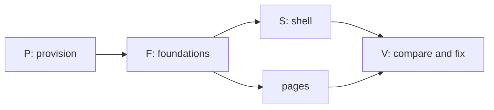

# Prompt: build the Syrius desktop redesign from the mockups

Open a session in this folder, the root of the Syrius repository, and tell
it: `Follow PROMPT-redesign-build.md`. Every path below is relative to this
folder.

This file is the instructions and the record of progress. The coordinator and
its subagents write their progress into the Progress section at the end, so a
session that starts later, or after the context was cleared, reads this file
and carries on from it.

---

## The task

Make the Syrius desktop wallet in this tree look and move the way
`mockups/redesign/` shows: every one of its 47 screens, in both themes, with
the same layout, the same effects and the same transitions. Where a screen
shows a feature the wallet cannot do yet, draw it as the mockup does but do
not let it run: put a seam in the code where the feature will be filled in
later.

You coordinate. Subagents do the microtasks below, up to four at once, each
on one small task with a fresh context. You provision, build, run, commit,
compare and dispatch.

## Assume you have never built Syrius

Nothing about this machine or this tree is taken from memory, an earlier
session, or a file that says it is done. Every tool, version, path and claim
is checked on disk before it is used.

- This file's Progress section is how the work resumes, but it is a record,
  not proof: a row marked `done` names its commit, and the commit is found in
  `git log` before anything is built on it.
- `HANDOFF.md`, when present (it is local, not in git), and its "Redesign
  build (Task 41)" table describe an earlier pass at the same work. Rows marked `done` there are claims. Reuse the code
  they point at where it exists and matches the mockup; otherwise fix it.
- The branch is `redesign`. Look at `git status` and `git log` before the
  first change, and commit nothing you did not read.

## Read first

1. `docs/design/RULES.md`: the owner's interface rules. They bind: motion
   always runs (never follow the OS reduced-motion setting), interface text
   is as short as it can be, no em dashes in it, balances with no trailing
   zeros, diagrams in docs are Mermaid.
2. `AGENTS.md`: the BLoC feature layout, generated files, the pinned and
   patched packages.
3. `mockups/redesign/README.md`: the plan. Its Motion, Shaders, Dollar values
   and "The original animations" tables are the specification for effects.
   "Not drawn" lists screens that follow a drawn pattern; build those to the
   pattern.
4. `mockups/redesign/src/*.html`: each `<section class="scr" id="…">` is one
   screen, with notes under it saying what is at rest, what is one click
   away, what moves, what was dropped. `src/00-head.html` holds the CSS: the
   colours, type, radii and gaps of both themes.
5. `mockups/redesign/shots/NN-<id>-<theme>.png`: each screen at 1280 by 780,
   dark and light. These pictures are what "done" is measured against.
6. `docs/flutter-dev-practices.md` and `docs/research/modern-flutter-stack.md`
   for how motion and shaders are built here; `harness/README.md` for driving
   the wallet; `tools/devnet/lab/README.md` for the chain it sends on.

Some files here (`docs/research/`, `HANDOFF.md`) cite paths in other
repositories or on another machine as their sources. You do not need them,
and you do not go looking for them.

## Hard rules

- **Stay in this folder.** Read and write nothing outside it, except the
  tools you install, what `tools/devnet/lab/lab.sh` fetches into its own
  `.build/`, and Docker's own state. If something seems to need a file from
  elsewhere, stop and ask.
- **Never touch the real wallet.** Real wallets live in `%AppData%\znn`. Run
  the wallet only through `harness/h start`, which moves APPDATA, LOCALAPPDATA,
  TEMP, HOME and USERPROFILE into a profile under `.harness/`, or with those
  variables redirected by hand for `flutter run`. Syrius allows one window per
  desktop: check no `syrius.exe` is running before you start one, and stop
  only what you started.
- **No new dependency.** The packages the mockup's effects need are in
  `pubspec.yaml` already (`animations`, `flutter_animate`, `flutter_shaders`,
  `lottie`). If a task cannot be done without one, it stops and says so.
- `flutter pub get` rewrites `analysis_options.yaml` and `pubspec.lock`;
  restore them before each commit unless the change was meant.
- Elevation (an installer's UAC prompt, enabling Developer Mode) is the
  owner's to grant: list what needs it and ask once, together.
- Keep the tree compiling at every commit. Commit on `redesign` only, new
  commits, never amends, never a push unless the owner asks.
- Writing, in code and docs: say what a thing is and why it is that way, name
  the failure that motivated a constraint, leave out encouragement. Comments
  explain the decision, not the syntax. Reports back are short.

## Seams: a feature that is drawn but not built

Missing means the logic behind the control does not exist in this tree: a
service, a chain call, a file format, a platform API. It does not mean "the
widget is not drawn yet"; drawing is the task.

Task F03 builds the seam kit before any page task starts. Every page task
uses it the same way:

- `lib/seams/seam.dart`: `enum Seam` with one value per missing feature, and
  `SeamGate(seam:, child:)`. The child is drawn exactly as the mockup draws
  it, then held disabled: no tap, no keyboard activation, the cursor stays
  basic, a tooltip of two words ("Not yet"). Its Go to entry and its shortcut
  refuse the same way.
- A missing service is an interface plus an `Unbuilt…` implementation that
  throws `SeamNotBuilt(Seam.x)`. Nothing calls the network or the chain for
  it, and no fake result is shown as real.
- Each seam is listed in `lib/seams/SEAMS.md`: the value, the screens it
  gates, the file to fill in, and the brief in `docs/research/` that describes
  it. A test fails when an enum value has no row there.
- Candidates from the mockup, to be confirmed against the tree by each task:
  Zap send and receive, the wallet picker at unlock, operator modes, the
  GitHub update notice, Windows Hello, WalletConnect approvals in the bell,
  the Sporks group, the Ledger flow. Anything the tree already does is wired,
  not seamed.

## End state

The work is done when all of these hold:

1. On a clean checkout, `docs/environment.md` lists every tool with its
   version and how it was installed, and following it gives a working debug
   and release build of the wallet on Windows.
2. `flutter analyze` reports no error or warning, and `flutter test` passes.
3. For each of the 47 screen ids and each theme, a harness script drives the
   wallet into that state at a 1280 by 780 client area and takes a shot.
   `mockups/redesign/compare/index.html` shows each shot beside its mockup
   shot with a diff, and every pair is marked `match` in the Screens table of
   the Progress section.
   A pair matches when the layout, components, colours, type, spacing, icons
   and animation frames shown agree. Allowed differences: the example figures,
   names and addresses, live data, and font hinting.
4. Every row of the mockup's Motion table and Shaders table plays in the
   running build as specified, checked by eye in the built wallet and, where a
   test can hold it, by a widget test on its duration and curve.
   `harness/h stalls` during a page change, a disclosure and the launch shows
   no frame over 16 ms that the old build did not also have.
5. Every seam is in `SEAMS.md`, and none of them can be set off from the
   interface.

## Order



P runs one task at a time: it installs and builds, and builds collide. F
starts when P is done; S and the page groups start when F03 (seams) and F01
(tokens) are committed, and each page group also needs the shared parts it
names. V runs as pages land, not only at the end.

## How the coordinator works

1. **Start from the Progress section.** Read it whole. A row left at `run`
   by a session that ended is checked against the disk (its files, `git
   status`) and set back to `todo` with a note of what was found.
2. Dispatch up to four `general-purpose` agents, each on one row whose
   dependencies are `done` and whose write paths no running row shares.
   Give each the brief template below, filled in. The agent marks its own
   row as it goes (see "Keeping the Progress section").
3. When a row reports: read the diff, run `flutter analyze --no-pub` on its
   files and its tests, add any strings it reported, commit it, set the row
   to `done` with the commit's short hash, and dispatch the next.
4. After every four rows: full `flutter test`, `harness/h build`, run the
   screen scripts of the screens those rows touched, rebuild the compare
   page, and look at it. Mark each pair looked at in the Screens table. Each
   mismatch becomes a new row (`X01`, `X02`, …) appended to the Rows table,
   naming the screen, the difference and the write paths.
5. Rewrite the "Now" lines of the Progress section after each of steps 3 and
   4, and before anything that can end the session (a long build, a
   restart).
6. Never build or run the harness while an agent is writing.
7. A row that fails twice is split, not retried as it was.

### Keeping the Progress section

Several agents write to this file at once, so every write is small and
exact:

- Only the Edit tool, replacing one whole line that is yours: your row in the
  Rows table, or, for the coordinator, the "Now" lines, the Screens table and
  new `X` rows. Never Write this file, never reformat it, never touch another
  agent's line. If the edit is refused because the file changed, read it
  again and redo the one edit.
- Times are UTC from `date -u +%Y-%m-%dT%H:%MZ`, never an estimate.
- A note is one short line: what is true now, not the history. No `|`, no
  em dashes.
- States: `todo`, `run` (an agent has it), `review` (the agent finished; the
  coordinator has not committed it), `done` (committed, hash in the note),
  `blocked` (the note says on what). In the Screens table: `todo`, `match`,
  or the `X` row that holds the difference.

### Brief template

```
Row <ID>: <what>.
Mockup: mockups/redesign/src/<file>.html, sections <ids>;
shots mockups/redesign/shots/<NN>-<id>-dark.png and -light.png.
Spec rows: <Motion / Shaders / Dollar values rows that apply>.
Write only: <paths>, and your row's line in PROMPT-redesign-build.md.
Read anything in this repository.

Progress: follow "Keeping the Progress section" in PROMPT-redesign-build.md.
Set your row to run when you start, update its note after each step that
lands (drawn, wired, tests passing), and set it to review with a one-line
summary as the last thing before your report. If you stop on a problem,
set it to blocked and say on what.

First check what exists at those paths and whether it already matches the
mockup; change only what does not. Draw what the mockup draws. If the logic
behind a control does not exist in the tree, gate it with SeamGate and add
its row to lib/seams/SEAMS.md; do not build the missing service.

Do not: run flutter build, flutter run, flutter pub get or harness/h; write
to git; add a dependency; kill a process you did not start; bulk-replace
with a script. Use Edit and Write for Dart and ARB files.

Follow docs/design/RULES.md. Read nothing outside this repository.
Colours, gaps and radii from AppTokens.of(context), never literals.
Directional padding. Amounts and addresses in Ltr; balances through
AmountText (no trailing zeros). Motion always runs; nothing on money moves
except ValueFlash. Interface text as short as it can be, no em dashes.
Comments say why. New strings: append to lib/l10n/app_en.arb only, then
flutter gen-l10n (re-read the file if the edit is refused; another agent may
have appended).

Write harness/screens/<id>.txt for each screen you own: the harness lines
that bring the wallet from unlocked Home to that state. Do not run it.

Done when: flutter analyze --no-pub <your files> is clean, and
flutter test --no-pub --timeout 60s <your test dir> passes.
Report in at most 25 lines: files written, tests, seams added, strings
added, what does not yet match the shot and why, what you found. Then stop.
```

## Microtasks

`Needs` names rows that must be committed first. Paths are relative to the
repository; `features/` is `lib/rearchitecture/features/`, `tabs/` is
`lib/widgets/tab_children_widgets/`, `modular/` is
`lib/widgets/modular_widgets/`, `utils/widgets/` is
`lib/rearchitecture/utils/widgets/`.

### P: provision (one at a time; the coordinator or one agent)

| Row | What | Writes | Needs |
| --- | --- | --- | --- |
| P01 | Inventory, read only: Windows version, Git with Git Bash, Visual Studio or Build Tools with the "Desktop development with C++" workload (MSVC, CMake, a Windows SDK), Flutter and Dart, Python 3 with Pillow, Node (the lab's scripts), Chrome or Edge, Docker Desktop, Developer Mode (Flutter's Windows plugins need symlinks). Record what is present, with versions, and what is missing | `docs/environment.md` | |
| P02 | Choose the Flutter version: the newest stable that satisfies `pubspec.yaml`'s Dart constraint and resolves `pubspec.lock`; note where it differs from `FLUTTER_VERSION` in `.github/workflows/` and why | `docs/environment.md` | P01 |
| P03 | Install what P01 found missing (winget where it can; Flutter as a git checkout of the chosen tag). One list of elevation prompts to the owner first | `docs/environment.md` | P02 |
| P04 | `flutter config --enable-windows-desktop`; `flutter doctor -v` clean for Windows desktop. Record any warning left and why it does not matter | `docs/environment.md` | P03 |
| P05 | Dependencies and generated code: `flutter pub get` (then restore the two files it rewrites), `dart run build_runner build --delete-conflicting-outputs` if any `*.g.dart` is stale, `flutter gen-l10n`. Check the `libznn` blobs in `lib/embedded_node/blobs/` load on Windows | generated files only | P04 |
| P06 | Baseline: `flutter analyze`, `flutter test`, `flutter build windows --release` and `--debug`. Record times, test count and every existing warning, so later rows are judged against it | `docs/environment.md` | P05 |
| P07 | Debug loop: `flutter run -d windows` with the profile variables redirected, hot reload and hot restart, DevTools attached, a breakpoint hit. Write the exact recipe | `docs/environment.md` | P06 |
| P08 | Harness: `harness/h build`, `start --fresh`, onboarding, `tour` with no error widget and no SEVERE log | `docs/environment.md` | P06 |
| P09 | Lab devnet: `tools/devnet/lab/lab.sh up` (chain 321; it fetches go-zenon at a pinned commit and builds the image), `status` says producing, the devnet mnemonic from its README imported into the harness profile, `harness/h chain 321`, index 1 selected, one send confirmed | `docs/environment.md` | P08 |
| P10 | Mockup pipeline: `python art.py` and `python build.py shots` in `mockups/redesign/` reproduce `shots/` (diff a few); proves Chrome and Python | none | P04 |

### F: foundations (four at once)

| Row | What | Writes | Needs |
| --- | --- | --- | --- |
| F01 | Tokens: every CSS variable in `src/00-head.html`, both themes (colours, type scale, radii, gaps, shadows, glass), mapped one to one into `AppTokens` and the two `ThemeData`s; a table in the file's doc comment of mockup name to token | `lib/utils/app_theme.dart`, `lib/utils/app_colors.dart`, `test/theme/` | P |
| F02 | Fonts: the families and weights the mockup inlines, bundled and declared. The coordinator edits `pubspec.yaml` from the agent's report | `assets/fonts/`, report for `pubspec.yaml` | P |
| F03 | Seam kit, as specified above, with its test | `lib/seams/`, `test/seams/` | P |
| F04 | Harness additions: `theme dark\|light`, `window` sized by client area in logical pixels at 1280 by 780, and `screens <id>\|all` that runs `harness/screens/<id>.txt` in both themes and saves `.harness/shots/<NN>-<id>-<theme>.png` | `harness/bin/`, `harness/app/`, `harness/README.md` | P08 |
| F05 | Compare page: `tool/redesign_compare.py` pairs `.harness/shots/` with `mockups/redesign/shots/`, writes `mockups/redesign/compare/index.html` (side by side, a diff image, a per-pair score, the screen's notes) | `tool/redesign_compare.py`, `mockups/redesign/compare/` | P10 |
| F06 | Seed data: `harness/seed/` scripts of harness lines that give the lab the states the shots need, done through the wallet itself (a stake, a fuse, a token owned, a swap, a project, a second funded address). Index 1 already owns pillar `dev1` and three fuses. States the lab cannot reach (a sentinel, a fuse old enough to cancel) get a fixture injected through `harness/app/` only, never linked into an ordinary build | `harness/seed/`, `harness/app/fixtures/` | P09 |
| F07 | `Segment` (one sliding thumb, 360 ms `(.65,0,.35,1)`, arrow keys) and `Disclosure` (240 ms slide 8 px, chevron 220 ms, state kept by key) | `utils/widgets/segment.dart`, `disclosure.dart`, their tests | F01 |
| F08 | `PageStrip` (headline figures, 48 px lead slot, main action) and `EmptyNote` (no-data mark at 44 px with "None yet", 16 px on one-line cards) | `utils/widgets/page/`, `test/page_strip/` | F01 |
| F09 | `RowDetail` (a row that opens its details under itself) and the list entrance (40 ms stagger, once) | `utils/widgets/row_detail.dart`, `test/row_detail/` | F01 |
| F10 | Motion kit: `RiseSwitcher` with fade through (320 ms, rise 6 px), `ValueFlash` (one 1.2 s flash; a new row rises 6 px over 320 ms), `Skeleton` sweep (1.4 s, in step across the page) | `utils/widgets/motion/`, `test/motion/` | F01 |
| F11 | Frost: blurred backdrop for dialogs, Go to, the bell panel, menus, the lock and ready cards; one `BackdropGroup` where several share it; dialogs rise 6 px | `lib/widgets/reusable_widgets/modals/`, `test/frost/` | F01 |
| F12 | Primary pill: its look per theme and the 600 ms sheen on hover and once when the action lands | `lib/widgets/reusable_widgets/buttons/`, `test/sheen/` | F01 |
| F13 | Shaders: hero field (Home, lock, Welcome), plasma glow, meter flow; each in a `RepaintBoundary`, one ticker, stopped when its page is hidden or the window loses focus | `lib/rearchitecture/utils/shaders/`, `shaders/`, `test/shaders/` | F01 |
| F14 | Lottie rules in `AppLottie`: play once when the surface appears, hold the last frame, replay on hover; the three loops; nothing below 40 px; `_small` files at 48 px | `lib/widgets/reusable_widgets/app_lottie.dart`, `test/app_lottie/` | F01 |
| F15 | `LaunchFilm`: animated WebP a frame at a time (window file and well file), start frame, hold, replay, skip; the assets from `tool/lottie_reencode.py` if absent | `lib/widgets/reusable_widgets/launch_film.dart`, `assets/images/launch*.webp`, `tool/`, `test/launch_film/` | F01 |
| F16 | Dollar values: price feed (CoinGecko `zenon-2` and `quasar`, once a minute while listened to, last answer kept), `DollarText` (dim, mono, 13 px; four decimals under a dollar; `≈` on sums), the setting key, on | `lib/services/price_feed.dart`, `utils/widgets/dollar_text.dart`, `test/price_feed/` | F01 |
| F17 | Hidden balances: one notifier, `HiddenAmount` dots, the eye on the original Lottie (frames 0 to 30, 200 to 232) | `lib/utils/notifiers/balance_visibility.dart`, `utils/widgets/eye_toggle.dart`, `test/hidden_balances/` | F14 |
| F18 | Toast: rises 300 ms, bar drains over 5 s, hover pauses, self-dismissing | `lib/utils/toast_utils.dart`, its widget, `test/toast/` | F01 |

### S: shell (`10-home.html` shows it on every screen)

| Row | What | Screens | Writes | Needs |
| --- | --- | --- | --- | --- |
| S01 | Rail: 56 px icons, tooltips with shortcuts, chevron to 200 px (200 ms spring, labels fade 150 ms after), state kept across restarts; Home, Transfer, Staking, Nodes, Plasma, Tokens, Swap, Accelerator, then bell, Settings, Lock | all | `lib/widgets/shell/rail.dart`, `test/shell/rail/` | F01, F03 |
| S02 | Status strip: sync, node, chain, peers; sync dot pulse 2.4 s, amber when behind; in-flight block chip; plasma generating with the bolt, elapsed and typical time; update line slot (seam) | all | `lib/widgets/shell/status_strip.dart`, `lib/widgets/shell/strip/`, `test/shell/strip_test.dart` | F03, F14 |
| S03 | Bell panel: dot for unseen, slides 24 px over 240 ms with frost, what needs the user first, runs folded ("Block published × 6") | `home-bell` | `lib/widgets/shell/bell_panel.dart`, `tabs/notifications_tab_child.dart` | F11 |
| S04 | Go to (Ctrl K): pages, actions, addresses, contacts; seamed actions refuse | `home-goto` | `utils/widgets/go_to_palette.dart` | F03, F11 |
| S05 | Shortcuts: Ctrl 1 to 8, Ctrl L, R, H, comma, Esc; page change by fade through | all | `lib/widgets/shell/shortcuts.dart`, `lib/widgets/shell/shell.dart` | S01, F10 |

### Home (`10-home.html`)

| Row | What | Screens | Writes | Needs |
| --- | --- | --- | --- | --- |
| H01 | Hero: balances with dollar values, the eye, Send / Receive / Zap pills, hero field behind; no refresh icons | `home-rest` | `features/home/view/` hero files | F13, F16, F17, F12 |
| H02 | Side cards: To collect on one line with Collect all, Tokens closed (opens in place), Pending only while a block is in flight | `home-rest`, `home-open` | `features/home/view/` side files, `features/pending_transactions/` | F07, F08 |
| H03 | Activity list: rows say what moved, Message on a zap row (seam if Zap is), hidden state hides amounts | `home-rest`, `home-hidden` | `features/latest_transactions/` | F09, F17 |
| H04 | "A zap arrived": 28 sparks over 900 ms, once per hash (gate on the Zap seam if receive is missing) | `home-zap` | `features/home/view/zap_sparks.dart` | F03 |

### Transfer (`20-transfer.html`)

| Row | What | Screens | Writes | Needs |
| --- | --- | --- | --- | --- |
| T01 | One 640 px card, `Segment` Send / Receive / Zap; To receive below only with rows; Receive blocked while a receive runs | all transfer | `features/transfer/`, `tabs/transfer_tab_child.dart` | F07 |
| T02 | Send: recent chips, book icon, dollar line, look-alike and first-time warning, node-behind note | `send-rest`, `send-warn` | `features/send/` | T01, F16 |
| T03 | Receive: address, Show QR, request an amount | `receive`, `receive-qr` | `features/receive/` | T01 |
| T04 | Confirm dialog in the transfer shape (`docs/design/RULES.md` section 8), the block followed to its momentum | `send-confirm` | send dialog files | F11, T02 |
| T05 | Zap tab as drawn; behind its seam if the Zap service is missing | `zap-form` | `features/zap/` | T01, F03 |

### Staking and Nodes (`30-earn.html`)

| Row | What | Screens | Writes | Needs |
| --- | --- | --- | --- | --- |
| E01 | Staking: strip (staked, to collect, week, Stake), list with unlock countdown, New stake as a disclosure, empty state, reward chart behind a button | `staking`, `staking-new`, `staking-empty` | `features/staking/`, `stakes/`, `create_stake/`, `stake_collect/`, `staking_rewards_history/`, `tabs/staking_tab_child.dart` | F07, F08, F09 |
| E02 | Nodes page: `Segment` Pillars / Sentinels, delegation strip; one rail entry replacing the two tabs | `pillars` | new `tabs/nodes_tab_child.dart`, `features/delegation/`, `delegation_stats/` | F07, F08, S01 |
| E03 | Pillars list: five columns, sort chip, search, APR, row detail | `pillars` | `features/pillars/`, `active_pillars/` | E02, F09 |
| E04 | Your pillar panel: pillar Lottie once at 132 px, then 48 px in the strip; revoke asks twice | `pillar-mine` | `features/pillars_by_owner/`, `pillar_parts/` | E02, F14 |
| E05 | Sentinels tab: list, your sentinel leading the strip at 48 px | `sentinels` | `features/sentinels/`, `sentinels_by_owner/`, `active_sentinels/` | E02, F14 |
| E06 | Steppers on a shared axis (300 ms), every step kept mounted | `spawn` | `lib/widgets/reusable_widgets/custom_material_stepper.dart`, step switcher | F01 |
| E07 | Success step: the object full size ("Pillar registered"; the same shape for sentinel and token) | `pillar-done` | stepper success widgets | E06, F14 |

### Plasma and Tokens (`40-plasma-tokens.html`)

| Row | What | Screens | Writes | Needs |
| --- | --- | --- | --- | --- |
| K01 | Plasma: glow in its well, available and fused strip, fused list with checkboxes and "Cancel 2 fuses" | `plasma` | `features/plasma_stats/`, `fused_plasma/`, `cancel_plasma/`, `tabs/plasma_tab_child.dart` | F13, F08, F09 |
| K02 | Fuse form and Other addresses as disclosures | `plasma-fuse` | `features/fuse_plasma/` | K01, F07 |
| K03 | Tokens: one list, Held / Favorites / All, search, balance column, the coin leading the strip | `tokens` | `features/tokens/`, `all_tokens/`, `token_balance/`, `token_favorite/`, `search_token/`, `tabs/tokens_tab_child.dart` | F07, F08, F14 |
| K04 | Token row detail: Mint, Burn, Transfer ownership, Flags in the row | `token-mine` | `features/mint_token/`, `burn_token/`, `transfer_token/` | K03, F09 |
| K05 | Create token stepper | `token-new` | `features/create_token_stepper/`, `create_token/` | E06 |

### Swap and Accelerator (`50-swap-az.html`)

| Row | What | Screens | Writes | Needs |
| --- | --- | --- | --- | --- |
| W01 | Swap: strip, one list (active, completed, to reclaim), row detail with deposit ID | `swap-list` | `modular/p2p_swap_widgets/` list files, `tabs/p2p_swap_tab_child.dart` | F08, F09 |
| W02 | Start and Join dialogs in the transfer shape, dollar line | `swap-start` | `modular/p2p_swap_widgets/modals/` | F11, F16 |
| W03 | Accelerator: fund strip, Voting / Active / Mine / All, vote bar in the row | `az` | `modular/accelerator_widgets/` list files, `tabs/accelerator_tab_child.dart` | F07, F08 |
| W04 | Project page by container transform (300 ms), phases, vote column | `az-project` | `lib/screens/project_details_screen.dart`, project detail files | W03 |

### Settings (`60-settings.html`)

| Row | What | Screens | Writes | Needs |
| --- | --- | --- | --- | --- |
| G01 | Frame: seven sections (Node, Security, Display, Wallet, Apps, Addresses, About), groups closed, no second rail, every Confirm gone | all settings | `tabs/settings_tab_child.dart`, `modular/settings_widgets/settings_parts.dart` | F07 |
| G02 | Node section, Sporks group closed (seam if not wired) | `set-node` | node management and peers files | G01 |
| G03 | Security: applies when chosen, wrong-password limit on at 3, Windows Hello row (seam) | `set-security` | security file | G01, F03 |
| G04 | Display: theme, dollar switch, explorer, rail labels, hide balances | `set-display` | display and general files | G01, F16 |
| G05 | Wallet: modes (seam), wallets on this computer (seam), delete cache keeps labels | `set-wallet` | wallet options and backup files | G01, F03 |
| G06 | Apps: connected sites as one list and one switch | `set-apps` | `modular/wallet_connect_widgets/`, new `apps.dart` | G01 |
| G07 | Addresses: labels and contacts | `set-addresses` | addresses file | G01 |
| G08 | About with the update line (seam), Licences group | `set-about`, `set-licences` | about card, new `licences.dart` | G01, F03 |
| G09 | The unlabelled field under the last licence; 321 raises the Originals card (six tiles that play on hover, three small, replay launch). Nothing stored | `set-originals` | `licences.dart` field, new `originals_card.dart` | G08, F14, F15 |

### Entry (`70-entry.html`)

| Row | What | Screens | Writes | Needs |
| --- | --- | --- | --- | --- |
| N01 | Launch: full window on black, click or key skips to the last frame | `launch` | `lib/screens/splash_screen.dart` | F15 |
| N02 | Lock card: the well playing `LaunchFilm`, wallet name, password, tries left; wrong password shakes the field 4 px twice over 200 ms and replays frames 14 to 56 in the well; Ctrl L replays the same | `lock-screen`, `lock-wrong` | `tabs/lock_tab_child.dart` | F15, F13, F11 |
| N03 | Launch settles into the lock card: one container transform on the stage's rect, 400 ms emphasized decelerate; the lock card under the stage from the first frame | `launch-settle` | `splash_screen.dart`, `lock_tab_child.dart` | N01, N02 |
| N04 | Wallet picker at unlock, drawn; behind its seam if listing wallets is missing | `lock-pick` | lock card picker file | N02, F03 |
| N05 | Welcome: the globe turning on the left half, three rows with the list entrance | `welcome` | `lib/screens/onboarding/access_wallet_screen.dart`, onboarding scaffold | F14, F09 |
| N06 | Import (any file accepted) and the seed quiz of three words, four choices each | `import`, `seed-quiz` | `lib/screens/onboarding/` import and confirm-seed files | N05 |
| N07 | Wallet ready: the map full window behind a frosted card | `wallet-ready` | `lib/screens/onboarding/wallet_success_screen.dart` | F11, F14 |

### V: compare and fix (the coordinator, as pages land)

| Row | What |
| --- | --- |
| V01 | Seed the lab (F06), `harness/h build`, `harness/h screens all`, `python tool/redesign_compare.py`. Mark each pair `match` or open an `X` row for it |
| V02 | Motion pass in the running build: each Motion and Shaders row seen, `harness/h stalls` across a page change, a disclosure and the launch, compared with P06's baseline |
| V03 | Seam pass: every value in `SEAMS.md` tried from its control, its shortcut and Go to; none runs |
| V04 | The minimum window (1200 by 600) and Arabic layout looked at once; defects become `X` rows, not part of the match |
| V05 | A fresh agent, given only the compare page, `mockups/redesign/README.md` (its "Settled by the owner" table above all) and `docs/design/RULES.md`, reviews every pair against the section 9 checklist and the owner's answers; its findings become `X` rows |
| V06 | End state checked item by item and written into the Progress section with the date |

## Progress

Written by the coordinator and its agents as the work goes; see "Keeping
the Progress section" for how. Local foundation preparation has begun on
macOS; Windows provision and acceptance remain pending. See
`docs/environment.md` for the source pin, tool selection and evidence limits.

### Now

- Updated: 2026-10-23T22:19Z
- Running: Prepare the anonymous 5f9faeb37c82 follow-up for the existing edgepillar/redesign Draft PR; the full serial suite has a positive terminal result and its evidence task closed SUCCESS
- Next: Publish the qualified source and dispatch the independent Windows baseline, ordinary entry, devnet and Fast lanes; then repair X141, prepare owned chain-321 admission in X142 and apply the owner-selected RULES.md colours in X143; all 94 visual matches, owned lab checkpoints, motion, frame-time and seam acceptance remain pending
- Last batch check: Formatting and strict analysis of 23 Dart files pass with zero diagnostics; six entry/provider cases, 90 Python cases, workflow semantics, 350 focused cases, root analysis with zero errors, zero warnings and 1314 infos, the diff check and the full serial suite with 4051 passes and one existing skip all pass; the original command exited 0 with complete rehashed output and the evidence task closed SUCCESS; earlier failed attempts remain preserved
- Publication evidence: Initial rows identify e13abb387577; X125-X130 identify ddf740e14206 and X131 identifies 8ea04bc8caea; all 34 native-entry qualification inputs match 5f9faeb37c820e8817b075f0bf9a2850b8fb41f5; local evidence is carried by source equality, not a fresh execution at a publication commit; see docs/environment.md
- CI: New follow-up dispatch is pending; at d225317cce49, fork Fast Validation 40018735731 passed 4015 tests with one existing skip and devnet 40018730800 passed the earlier identity boundary before failing because SendTransactionBloc was absent from the first registration host; at e67d0fab4c54 all six native desktop builds and isolated Windows presentation passed; target workflows remain action_required and native wallet capture acceptance remains pending

### Rows

| Row | State | Updated (UTC) | Note |
| --- | --- | --- | --- |
| P01 | blocked | 2026-10-23T15:55Z | The macOS inventory is recorded; the native Windows host inventory remains unavailable |
| P02 | done | 2026-10-23T15:54Z | e13abb387577 pins workflows to Flutter 3.47.7; passes on the retained Dart 3.13.5 toolchain with unchanged application dependency versions; Windows provisioning remains separate |
| P03 | blocked | 2026-10-21T23:02Z | Isolated Flutter installed; Windows tools require a Windows host |
| P04 | blocked | 2026-10-21T22:36Z | Windows desktop tools unavailable on the current macOS host |
| P05 | blocked | 2026-10-21T23:02Z | Locked restoration and localization passed; Windows native load unverified |
| P06 | blocked | 2026-10-23T20:09Z | e67d0fab4c54 passes hosted Fast Validation with 3997 tests and one existing skip, all six desktop Debug/Release builds and the isolated Windows presentation job; Windows Dart baseline, doctor and explicit embedded-library qualification remain pending |
| P07 | blocked | 2026-10-22T12:31Z | The specified Windows debug loop needs a Windows host; no breakpoint, reload or DevTools execution claimed |
| P08 | blocked | 2026-10-22T12:31Z | Native harness execution awaits desktop provisioning; source adapters pass but no running-wallet tour is claimed |
| P09 | blocked | 2026-10-22T12:31Z | Depends on the native harness; no isolated chain send or confirmation has executed |
| P10 | done | 2026-10-22T11:00Z | e13abb387577 adds portable fresh output and isolated browser selection; 13 synthetic checks, 12 exact art scripts and 94 reference renders pass; inspected samples differ in platform text rendering; actual wallet capture remains separate |
| F01 | done | 2026-10-21T23:26Z | e13abb387577 maps both themes and all CSS variables; selected checks pass; native acceptance pending |
| F02 | done | 2026-10-22T00:32Z | e13abb387577 bundles the derived 600 face, coverage fallback and licenses; deterministic output and metadata verified; native rendering pending |
| F03 | done | 2026-10-21T23:27Z | e13abb387577 adds the seam kit and throwing boundaries; input, focus, semantics and registry tests pass; page wiring pending |
| F04 | done | 2026-10-22T06:06Z | e13abb387577 adds guarded themes, measured client sizing and complete 1x captures; adapter and input tests pass; remaining page scripts and native P08 pending |
| F05 | done | 2026-10-21T23:27Z | e13abb387577 adds comparison reports; 12 synthetic tests pass; all 94 actual shots missing; no matches claimed |
| F06 | blocked | 2026-10-23T15:54Z | e13abb387577 qualifies six guarded UI recipes, exact preparation selectors, original outcome holds, bounded capture receipts and independent read-only presentations; verified checkpoints, full Swap terms, P08/P09, original native owner restoration and actual captures remain pending |
| F07 | done | 2026-10-22T05:11Z | e13abb387577 blocks closing disclosure input and semantics; existing thumb, keyboard and reveal clocks retained; local tests pass; native acceptance pending |
| F08 | done | 2026-10-22T05:11Z | e13abb387577 aligns strip spacing and empty type while retaining exact figures and original marks; both-theme, keyboard and update tests pass; native acceptance pending |
| F09 | done | 2026-10-22T00:32Z | e13abb387577 adds keyed, once-per-view list entrances with 40 ms staggering; RowDetail retained; lifecycle and input tests pass; page wiring pending |
| F10 | done | 2026-10-22T00:32Z | e13abb387577 aligns fade-through and flash timing, preserving motion and focus barriers; 168 foundation tests pass; running-build motion pending |
| F11 | done | 2026-10-22T05:11Z | e13abb387577 adds clipped glass and independent overlapping filters with preserved dialog clocks; local tests pass; remaining callers and native acceptance pending |
| F12 | done | 2026-10-21T23:27Z | e13abb387577 adds both-theme plasma pills; disabled geometry, input and sheen tests pass; native visual acceptance pending |
| F13 | done | 2026-10-22T05:11Z | e13abb387577 stops hidden, blurred and unfocused clocks without resume jumps; single-ticker meter keeps 500 ms easing; local tests pass; generation callers and native shader acceptance pending |
| F14 | done | 2026-10-22T05:11Z | e13abb387577 adds once-and-hold playback, hover replay, three allowed loops and actual-size rules; playback and existing image tests pass; native acceptance pending |
| F15 | done | 2026-10-22T05:11Z | e13abb387577 fixes queued takeover and reused-controller skip; existing asset, decoder and master-frame tests pass; native memory and frame-time checks pending |
| F16 | done | 2026-10-22T05:11Z | e13abb387577 retains the existing exact dollar formatter, listener-bound feed and default-on key; existing feed and formatting tests pass; Display wiring pending |
| F17 | done | 2026-10-22T05:11Z | e13abb387577 retains shared visibility, hidden width and semantics, persistence and original eye ranges; existing tests pass; remaining page wiring pending |
| F18 | done | 2026-10-22T05:11Z | e13abb387577 adds 300 ms toast rise, five-second drain, remaining-time pause and owned overlay cleanup; timing, flags, replacement and teardown tests pass; notification wiring pending |
| S01 | done | 2026-10-22T06:06Z | e13abb387577 adds eight pages, original SVGs, rich shortcut hints and preserved two-stage motion; local tests pass; native acceptance pending |
| S02 | done | 2026-10-22T07:34Z | e13abb387577 adds pulse, exact scoped flight tracking, measured plasma, peers and update seam; wires session status; local checks pass; native acceptance pending |
| S03 | done | 2026-10-22T10:03Z | e13abb387577 adds scoped history and explicit connection decisions; wires the panel and toast; local checks pass; native acceptance pending |
| S04 | done | 2026-10-22T10:03Z | e13abb387577 adds grouped exact targets, IME and seam guards; wires existing flows; 27 cases and the full suite pass; native acceptance pending |
| S05 | done | 2026-10-22T12:31Z | e13abb387577 wire platform chords; binds locked replay and removes outgoing private pages immediately; local checks pass; native acceptance pending |
| H01 | done | 2026-10-22T10:03Z | e13abb387577 adds exact balances, shared dollars and privacy, responsive columns and distinct Transfer entries; 26 cases and full suite pass; native acceptance pending |
| H02 | done | 2026-10-22T11:00Z | e13abb387577 wires exact rewards, closed Tokens and published-only Pending through the retained session owner; widget and full suites pass; native acceptance pending |
| H03 | done | 2026-10-22T12:31Z | e13abb387577 adds exact scoped Activity, trusted ABI labels, hidden amounts and guarded Message previews; ownership, widget and full suites pass; actual captures pending |
| H04 | done | 2026-10-22T17:44Z | e13abb387577 adds 28 sparks over exactly 900 ms with 21 passing cases; qualified receive and durable claims remain seamed; strict and full checks pass; native acceptance pending |
| T01 | done | 2026-10-22T07:34Z | e13abb387577 adds retained 640px modes and guarded inbound rows; 14 widget cases and full suite pass; inner forms continue in T02-T05; native acceptance pending |
| T02 | done | 2026-10-22T14:33Z | e13abb387577 adds exact Send fields, recipient checks, known-lag guards and confirmation; strict and full checks pass; native acceptance pending |
| T03 | done | 2026-10-22T14:33Z | e13abb387577 retains exact optional requests and synchronously revokes stale QR exports; strict and full checks pass; native export and acceptance pending |
| T04 | done | 2026-10-22T14:33Z | e13abb387577 bind exact confirmation to captured context and the original result; deferred lifecycle and full checks pass; native acceptance pending |
| T05 | done | 2026-10-22T14:33Z | e13abb387577 adds retained Zap fields and exact byte counts behind existing service seams; strict and full checks pass; native acceptance pending |
| E01 | done | 2026-10-22T06:06Z | e13abb387577 adds stake columns, persistent entrances and guarded compact form; 14 widget cases and existing BLoC suites pass; three guarded scripts authored; native acceptance pending |
| E02 | done | 2026-10-22T07:34Z | e13abb387577 adds retained Nodes tabs and shared action holds with chart-only history; lifecycle and full suites pass; list and owner refinements continue in E03-E05 |
| E03 | done | 2026-10-22T17:44Z | e13abb387577 adds five exact columns, loaded search and sorting, pagination and reported counts; unavailable APR remains seamed; strict and full checks pass; native acceptance pending |
| E04 | done | 2026-10-22T17:44Z | e13abb387577 binds owner facts and original art to fresh authority; update, QSR and twice-confirmed revoke retain exact context and deadlines; strict and full checks pass; native acceptance pending |
| E05 | done | 2026-10-22T17:44Z | e13abb387577 adds the active list, exact-owner strip and retained inactive ownership with guarded Spawn and revoke; strict and full checks pass; native acceptance pending |
| E06 | done | 2026-10-22T12:31Z | e13abb387577 retains all bodies and listeners with 300 ms shared-axis input gates; rapid Back, completion and real keyboard traversal pass with the full suite; native acceptance pending |
| E07 | done | 2026-10-22T21:26Z | e13abb387577 binds receipt state and original art to exact positive confirmation; immutable original results, owner guards, retained steps and full checks pass; native acceptance pending |
| K01 | done | 2026-10-22T21:26Z | e13abb387577 adds complete owner reads and exact serial cancellations with shared Fuse admission, retained original outcomes and uncertainty holds; full checks pass; native acceptance pending |
| K02 | done | 2026-10-23T00:27Z | e13abb387577 adds compact Fuse and Other addresses with retained drafts, original outcome holds and confirmed Another; full local checks pass, native acceptance pending |
| K03 | done | 2026-10-22T21:26Z | e13abb387577 adds one scoped non-native token ledger, exact balances, committed favorites and shell-retained filters; full checks pass; native acceptance pending |
| K04 | done | 2026-10-23T00:27Z | e13abb387577 adds inline token actions with sender-owned journals and original terminal delivery; full local checks pass, native acceptance pending |
| K05 | done | 2026-10-23T00:27Z | e13abb387577 adds retained token creation steps, exact preflight and immutable publication; full local checks pass, native acceptance pending |
| W01 | done | 2026-10-23T15:54Z | e13abb387577 adds captured Swap catalogues, proof-gated receive and expiry facts, exact public deposit disclosure and original-Box deletion receipts; strict and full local checks pass; native comparison remains pending |
| W02 | done | 2026-10-23T15:54Z | e13abb387577 binds Start, Join, Recover and detail surfaces to captured sources and original outcomes, with explicit deposits and retained sender admission; full two-sided terms remain seamed; strict and full local checks pass; native acceptance pending |
| W03 | done | 2026-10-23T15:54Z | e13abb387577 adds captured Accelerator sources, actual fund values with independent unknown coins, wallet-wide Mine, four segments and 300 ms project transforms; quorum remains Unknown; strict and full local checks pass; native comparison pending |
| W04 | done | 2026-10-23T15:54Z | e13abb387577 adds project phases and vote aside, original-click action sources, shared sender admission, exact latest-phase budgets and original outcome rearm; strict and full local checks pass; native contract effects and comparison remain unqualified |
| G01 | done | 2026-10-22T06:06Z | e13abb387577 adds seven sections, Apps destination and protected page transitions; frame tests pass; child controls continue in G02-G09; native acceptance pending |
| G02 | done | 2026-10-23T00:27Z | e13abb387577 adds Node settings, owned transport transitions, verified rollback and gated Sporks; full local checks pass, native acceptance pending |
| G03 | done | 2026-10-23T15:54Z | e13abb387577 adds the Security stack, original policy lanes, owned sensitive routes and exact Sign field semantics; password migration remains seamed; strict and full local checks pass; native acceptance pending |
| G04 | done | 2026-10-22T07:34Z | e13abb387577 shares seven Display choices and source-chain explorer gates; settings and full suites pass; native acceptance pending |
| G05 | done | 2026-10-23T15:54Z | e13abb387577 adds full-width Wallet rows and closed Maintenance, with gated modes and catalogues, serialized original-Box preferences and captured maintenance holds; strict and full local checks pass; native cleanup and startup acceptance pending |
| G06 | done | 2026-10-23T15:54Z | e13abb387577 adds one persisted Web apps switch, combined actual connections and closed WalletConnect details, with original requester incarnations and captured client outcomes; strict and full local checks pass; native acceptance pending |
| G07 | done | 2026-10-23T15:54Z | e13abb387577 adds full-width address and contact tables, complete captured reads, original-Box edits and queued membership derivation; strict and full local checks pass, including attached actions and scaled RTL fixtures; native comparison pending |
| G08 | done | 2026-10-23T15:54Z | e13abb387577 adds full-width About, actual process metadata, original links and genuine licence groups; strict and full local checks pass; native metadata and comparison remain unqualified |
| G09 | done | 2026-10-23T15:54Z | e13abb387577 adds session-only Originals discovery, six large and three small original animations and movie-only replay; strict and full local checks pass; native comparison pending |
| N01 | done | 2026-10-22T21:26Z | e13abb387577 plays the original launch and runs existing startup once after completion or skip; finite source cases and full checks pass; native acceptance pending |
| N02 | done | 2026-10-22T12:31Z | e13abb387577 adds the owned glass card, launch well, replay and awaited attempt bookkeeping; isolated and full suites pass; SDK worker rollback, native authentication and captures remain unqualified |
| N03 | done | 2026-10-22T21:26Z | e13abb387577 reparents one genuine auth owner and original film into the measured well over 400 ms; boundary, resize and full checks pass; native acceptance pending |
| N04 | done | 2026-10-23T00:27Z | e13abb387577 draws the current wallet picker and gates the missing catalog; full local checks pass, native acceptance pending |
| N05 | done | 2026-10-23T15:54Z | e13abb387577 adds the original globe crop and three captured entry routes, preserving owned callbacks and Welcome motion; strict and full local checks pass; native comparison pending |
| N06 | done | 2026-10-23T15:54Z | e13abb387577 adds pure Import and the bounded three-word quiz with original decrypt, access release and shared-axis routes; strict and full local checks pass; native authentication and comparison remain unqualified |
| N07 | done | 2026-10-23T15:54Z | e13abb387577 adds the original map and Ready glass card, captured first address and once-only opening bound to original creation and local initialization; connection mismatch and uncertainty remain distinct from readiness; strict and full local checks pass; native acceptance pending |
| V01 | blocked | 2026-10-23T12:26Z | Compare tooling is prepared; native harness, producing owned lab, verified seed prerequisites and all 94 actual captures remain unavailable |
| V02 | blocked | 2026-10-23T12:26Z | Finite widget timing coverage is separate from the running-build motion, shader and frame-time pass; native execution and its baseline remain pending |
| V03 | blocked | 2026-10-23T12:26Z | Seam registry and injected control checks are prepared; trying every control, shortcut and Go to entry in a running native wallet remains pending |
| V04 | blocked | 2026-10-23T12:26Z | Scaled and RTL widget cases are separate from the complete native wallet at 1200 by 600 and its Arabic layout; native inspection remains pending |
| V05 | blocked | 2026-10-23T12:26Z | Independent pair review requires actual captures; all 94 pairs remain unreviewed and no match is claimed |
| V06 | blocked | 2026-10-23T20:20Z | Hosted e67d0fab4c54 passes 3997 tests with one existing skip, all six desktop builds and isolated Windows presentation; devnet setup failed and 8ea04bc8caea qualifies its fixture repair locally; full native harness and lab, all 94 matches, motion and frame-time, native seam and minimum-window acceptance remain pending |
| X01 | done | 2026-10-21T23:26Z | e13abb387577 restores loading-list sweep ink in lib/rearchitecture/utils/widgets/motion/skeleton.dart; all 19 existing Skeleton tests pass unchanged |
| X02 | done | 2026-10-21T23:57Z | e13abb387577 keeps the status-strip dot visible at narrow widths and fixes asynchronous visibility tests |
| X03 | done | 2026-10-21T23:57Z | e13abb387577 parses the bridge test's HTTP head before binary frames; compression refusal assertions retained |
| X04 | done | 2026-10-21T23:57Z | e13abb387577 aligns the Fuse Plasma integration step with its shared bloc API; no live-chain run |
| X05 | done | 2026-10-21T23:57Z | e13abb387577 restores locked vendored test tools and aligns workflow pins; local analysis has no errors or warnings; hosted CI not run |
| X06 | done | 2026-10-22T07:34Z | e13abb387577 resolves the split Transfer diagnostics; strict changed-file analysis, 14 targeted tests and full suite pass |
| X07 | done | 2026-10-22T10:03Z | e13abb387577 preserves original publication ownership, exact results and late history; session and failure cases pass with no real signing or chain run |
| X08 | done | 2026-10-22T11:00Z | e13abb387577 scopes publication and four consumers to opaque PoW ownership and explicit idle; revokes shell contexts; lifecycle and full suites pass |
| X09 | done | 2026-10-22T10:03Z | e13abb387577 keeps Bell test ownership inside widget time; blocked seen writes and stream closure are awaited; eight panel cases pass |
| X10 | done | 2026-10-22T10:03Z | e13abb387577 checks rendered spans and tooltip metadata with owned semantics cleanup; all 27 palette cases pass |
| X11 | done | 2026-10-22T10:03Z | e13abb387577 releases semantics and checks actual seam tooltip metadata; all 26 Home hero cases pass |
| X12 | done | 2026-10-22T10:03Z | e13abb387577 consumes locked Escape and exposes only the replay chord; keyboard variants pass; the N02 well remains pending |
| X13 | done | 2026-10-22T10:03Z | e13abb387577 attaches acquisition errors after observers and preserves exact failure identities; publication lifecycle cases pass |
| X14 | done | 2026-10-22T10:03Z | e13abb387577 declares explicit route semantics children and checks the first visible panel frame; isolated and full suites pass |
| X15 | done | 2026-10-22T10:03Z | e13abb387577 bridges real cancellation and fake widget queues outside motion samples; cleanup and restored-focus cases pass |
| X16 | done | 2026-10-22T10:03Z | e13abb387577 positions toasts at the shared top and end and beside an open panel; local checks pass; native acceptance pending |
| X17 | done | 2026-10-22T10:03Z | e13abb387577 refuses retained files before RPC when locked or uninitialized and rechecks lock before dispatch; lifecycle cases pass |
| X18 | done | 2026-10-22T10:03Z | e13abb387577 aligns devnet notification override parameters; strict and full analysis pass; original full unit inputs are unchanged; native chain integration unrun |
| X19 | done | 2026-10-22T11:00Z | e13abb387577 serializes shared admission and retains exact outcomes through close; keeps partial and uncertain collection attempts; 21 sender cases and full suite pass |
| X20 | done | 2026-10-22T11:00Z | e13abb387577 binds collection rearm to the exact post-confirmation snapshot and coalesces Home reads; equal fresh snapshots reach the view; lifecycle and full suites pass |
| X21 | done | 2026-10-22T11:00Z | e13abb387577 resolves final Home diagnostics and preserves the token precision fixture; strict analysis and full suite pass |
| X22 | done | 2026-10-22T11:00Z | e13abb387577 checks asynchronous display removal separately from the exact completed duration; lifecycle and full suites pass |
| X23 | done | 2026-10-22T12:31Z | e13abb387577 binds reads and caches to exact address, node and chain; stale completion, overlapping pagination, empty cache and close cases pass |
| X24 | done | 2026-10-22T12:31Z | e13abb387577 owns the already-broadcast SDK controller directly; replacement, repeated reconnect, independent readers and close all detach without a socket |
| X25 | done | 2026-10-22T12:31Z | Failed bounded focus retries and the diagnostic trace are preserved; e13abb387577 resolves handoff through the X27 source fix; all focused and full tests pass |
| X26 | done | 2026-10-22T12:31Z | e13abb387577 wraps the lock comment; strict changed-file analysis has no diagnostics and the full suite passes |
| X27 | done | 2026-10-22T12:31Z | e13abb387577 removes the inherited traversal latch and keeps one revoked handoff; 35 focused cases including Tab and Shift-Tab pass with the full suite |
| X28 | done | 2026-10-22T14:33Z | e13abb387577 removes the inherited traversal latch from Transfer and RiseSwitcher; returning form and hidden-arrival regressions pass with the full suite |
| X29 | done | 2026-10-22T14:33Z | e13abb387577 opens contacts and records only original accepted transfer recipients; storage and observer failures preserve outcomes; full checks pass |
| X30 | done | 2026-10-22T14:33Z | e13abb387577 preserve immutable confirmation fields and late original results; exact unchanged drafts alone clear; full checks pass |
| X31 | done | 2026-10-22T14:33Z | e13abb387577 repairs address-book ink, retained amount fields and exact acknowledgement checks after the split; strict and full checks pass |
| X32 | done | 2026-10-22T14:33Z | e13abb387577 revokes pending QR exports before rebuild and checks the complete 240 ms reveal; strict and full checks pass |
| X33 | done | 2026-10-22T14:33Z | e13abb387577 checks the effective seam cursor and retains the disabled pointer, key, focus, semantics and callback boundaries; full checks pass |
| X34 | done | 2026-10-22T14:33Z | e13abb387577 retains segment focus and targets pending-row privacy; resolves deferred confirmation through X36 and X37; full checks pass |
| X35 | done | 2026-10-22T14:33Z | e13abb387577 refuses revoked queued work and reentrant closing predicates; publication preparation rejects context round trips; focused and full checks pass |
| X36 | done | 2026-10-22T14:33Z | e13abb387577 constructs deferred replies on the widget clock and awaits actual dispatch and original-result boundaries; focused and full checks pass |
| X37 | done | 2026-10-22T14:33Z | e13abb387577 refuses callbacks from popping or disposed confirmations before Navigator access; repeated and post-disposal regressions pass with the full suite |
| X38 | done | 2026-10-22T17:44Z | e13abb387577 binds address-owned reads to exact current transport, node, chain and revision; unbound caches cannot authorize owned or empty states; full checks pass |
| X39 | done | 2026-10-22T17:44Z | e13abb387577 binds immutable owner actions to fresh proofs, original wallet context and shared admission through preparation; original outcomes survive disposal; full checks pass |
| X40 | done | 2026-10-22T17:44Z | e13abb387577 retains immutable rewards, original collection outcomes and uncertain holds; exact-hash confirmation and a fresh read alone rearm; full checks pass |
| X41 | done | 2026-10-22T17:44Z | e13abb387577 retains inactive Sentinel ownership and original art; Spawn and twice-confirmed revoke use exact reads and shared publication; full checks pass |
| X42 | done | 2026-10-22T17:44Z | e13abb387577 uses independent reported counts with genuine zero, unknown and stale-context handling; mono Segment and full checks pass |
| X43 | done | 2026-10-22T17:44Z | e13abb387577 repairs owned diagnostics without changing analyzer rules; strict changed-file and complete checks pass |
| X44 | done | 2026-10-22T17:44Z | e13abb387577 retains the source covered by the complete serial suite with 3960 successes and one existing skip; interrupted and incomplete executions retain UNKNOWN evidence |
| X45 | done | 2026-10-22T17:44Z | e13abb387577 releases owned semantics, records callbacks before assertions and removes only owned routes; focused and full checks pass |
| X46 | done | 2026-10-22T17:44Z | e13abb387577 supplies explicit synthetic SDK epoch facts while retaining original owner assertions; focused and full checks pass |
| X47 | done | 2026-10-22T17:44Z | e13abb387577 uses finite observed Sentinel futures, real route clocks and owned close queues while retaining exact outcomes; focused and full checks pass |
| X48 | done | 2026-10-22T17:44Z | e13abb387577 registers the missing Pillar APR service and disables its sort through SeamGate; strict, seam and full checks pass |
| X49 | done | 2026-10-22T17:44Z | e13abb387577 adds measured heading underlines, CSS count insets and scaled Panel alignment with pill defaults retained; 12 heading cases and full checks pass |
| X50 | done | 2026-10-22T17:44Z | e13abb387577 settles owned QSR fixture routes beyond the pinned interpolation endpoint without changing production guards; full checks pass |
| X51 | done | 2026-10-22T17:44Z | e13abb387577 completes covering-route teardown before removing the owner and preserves unrelated dialogs; focused and full checks pass |
| X52 | done | 2026-10-22T17:44Z | e13abb387577 drains asynchronous Sentinel fixture storage turns with finite widget clocks; exact-result and full checks pass |
| X53 | done | 2026-10-22T17:44Z | e13abb387577 releases counted Segment semantics before framework verification and retains actual-zero and unknown assertions; full checks pass |
| X54 | done | 2026-10-22T17:44Z | e13abb387577 finds the entering Spawn route before its measured transition and requires the visible original stepper afterwards; full checks pass |
| X55 | done | 2026-10-22T17:44Z | e13abb387577 qualification preserves both SCRATCH_SCAN_UNSTABLE failures; later full tests and full analysis complete under unchanged storage policy; no manager repair is claimed |
| X56 | done | 2026-10-22T17:44Z | e13abb387577 retains the Pillar revocation deadline through preparation; four exact-expiry refusals and original accepted-result retention pass with the full suite |
| X57 | done | 2026-10-22T17:44Z | e13abb387577 checks observed Spawn refusal outcomes after guarded widget pumping; exact error and absent-result assertions pass with the full suite |
| X58 | done | 2026-10-22T17:44Z | e13abb387577 removes new style diagnostics and completes the Home paint boundary at exactly 900 ms; strict and full checks pass |
| X59 | done | 2026-10-22T17:44Z | e13abb387577 waits for the measured theme transition before exact palette assertions and retains all 28-circle checks; all 21 effect cases and the full suite pass |
| X60 | done | 2026-10-22T17:44Z | e13abb387577 retains the source checked by full tests before root analysis; 3960 pass with one existing skip, no failures, no analysis errors or warnings and 1322 infos |
| X61 | done | 2026-10-22T17:44Z | e13abb387577 supplies exact owner and positive unit getters in both legacy reward fixtures; six focused cases and the full suite pass with original assertions intact |
| X62 | done | 2026-10-22T21:26Z | e13abb387577 retains persistent boxes during ordinary cache maintenance and preserves explicit reset; policy and full tests pass; X81 pairing retention remains a separate follow-up |
| X63 | done | 2026-10-22T21:26Z | e13abb387577 synchronously revokes Tokens, Plasma and registration paint on context revision; stale display and callback cases pass with the full suite |
| X64 | done | 2026-10-22T21:26Z | e13abb387577 freezes exact Fuse-link decimal units and owner before questions, shares sender admission and retains original results through owned closure; full checks pass |
| X65 | done | 2026-10-22T21:26Z | e13abb387577 repairs registry fixture cascades without changing exact-hash outcomes; strict changed-file analysis and all focused and full tests pass |
| X66 | done | 2026-10-22T21:26Z | e13abb387577 preserves the full-stage crop and adds the generated English skip instruction; finite inset, crop and completion cases pass with the full suite |
| X67 | done | 2026-10-22T21:26Z | e13abb387577 observes original Plasma cancellation and close outcomes within finite positive widget ticks; original errors and assertions pass with the full suite |
| X68 | done | 2026-10-22T21:26Z | e13abb387577 constructs registration blocs inside guarded builds, preserves identical original errors and closes owned instances; focused and full tests pass |
| X69 | done | 2026-10-22T21:26Z | e13abb387577 bounds logical Tokens reads and closes within their widget clocks; physical art loads and original paint assertions pass with the full suite |
| X70 | done | 2026-10-22T21:26Z | e13abb387577 keeps registration observations, stream closure and traversal assertions on their original widget clocks; focused and full tests pass |
| X71 | done | 2026-10-22T21:26Z | e13abb387577 fixes token actions at 32 px with local shrink targets; all 24 extent, containment, callback and semantics cases pass with the full suite |
| X72 | done | 2026-10-22T21:26Z | e13abb387577 owns Plasma fixtures and operations in finite real async guards; body and teardown failures remain independent and original assertions pass with the full suite |
| X73 | done | 2026-10-22T21:26Z | e13abb387577 captures original Plasma question visibility before preparation; leaving and returning cannot revive it; deferred and full tests pass |
| X74 | done | 2026-10-22T21:26Z | e13abb387577 uses one concrete Disposable in the Tokens fixture and verifies exactly one disposal; original selection, node, revision and callback assertions pass |
| X75 | done | 2026-10-22T21:26Z | The original bounded Tokens read-paint failure is resolved by e13abb387577 through X77; current catalog, exact account and original paint assertions pass with the full suite |
| X76 | done | 2026-10-23T00:27Z | e13abb387577 preserves internal text-field traversal and closed-detail input refusal; full local checks pass, native acceptance pending |
| X77 | done | 2026-10-22T21:26Z | e13abb387577 explicitly awaits both synthetic delayed replies before JSON decoding; original error observation, exact account facts and stale-callback assertions pass |
| X78 | done | 2026-10-23T15:54Z | e13abb387577 binds receive origins, exact shared-sender admission, non-secret original journals and scoped rows; strict and full local checks pass; native receive and durability remain unqualified |
| X79 | done | 2026-10-22T21:26Z | The parallel eye timing failure remains preserved; the unchanged isolated case passes at 35 ms and e13abb387577 passes a terminal full serial suite under the original 50 ms bound |
| X80 | done | 2026-10-22T21:26Z | e13abb387577 disposes owned capture images and uses fresh managed temporary output; all original timing bounds and sampled frames pass in the focused and full serial suites |
| X81 | done | 2026-10-23T00:27Z | e13abb387577 retains pairings during ordinary cache maintenance; no cleanup was executed; full local checks pass, native acceptance pending |
| X82 | done | 2026-10-23T00:27Z | e13abb387577 captures Tokens Send owner and asset and explicitly opens Send; full local checks pass, native acceptance pending |
| X83 | done | 2026-10-23T00:27Z | e13abb387577 retains registration requests across replacement with exact-confirmed rearm; full local checks pass, native acceptance pending |
| X84 | done | 2026-10-23T00:27Z | e13abb387577 retains owner, chain and token holds across reopened action views; full local checks pass, native acceptance pending |
| X85 | done | 2026-10-23T00:27Z | e13abb387577 retains Fuse drafts and sender-owned uncertainty across reopening; full local checks pass, native acceptance pending |
| X86 | done | 2026-10-23T00:27Z | e13abb387577 repairs the missing localization import and changed-source diagnostics; full local checks pass, native acceptance pending |
| X87 | done | 2026-10-23T00:27Z | e13abb387577 adds per-segment availability, keyboard skipping and Security policy boundaries; full local checks pass, native acceptance pending |
| X88 | done | 2026-10-23T00:27Z | e13abb387577 bounds same-handle wallet envelope probing and awaits the original file write; full local checks pass, native acceptance pending |
| X89 | done | 2026-10-23T00:27Z | e13abb387577 quarantines publication during exact-owned transport transitions; full local checks pass, native acceptance pending |
| X90 | blocked | 2026-10-23T00:27Z | Canceled embedded startup needs exact owned startup and positively verified shutdown; native lifecycle ownership is unavailable and the source conservatively retains quarantine |
| X91 | done | 2026-10-23T00:27Z | e13abb387577 repairs Node direction imports and diagnostics while preserving failed evidence; full local checks pass, native acceptance pending |
| X92 | done | 2026-10-23T00:27Z | e13abb387577 fences stale Fuse effects while releasing original busy state; full local checks pass, native acceptance pending |
| X93 | done | 2026-10-23T00:27Z | e13abb387577 requires the positively captured original chain for rollback; full local checks pass, native acceptance pending |
| X94 | done | 2026-10-23T00:27Z | e13abb387577 observes actual async queues, painted controls and engine submission; full local checks pass, native acceptance pending |
| X95 | done | 2026-10-23T00:27Z | e13abb387577 uses valid synthetic token names and captured block chains; full local checks pass, native acceptance pending |
| X96 | done | 2026-10-23T00:27Z | e13abb387577 checks attached semantics while retaining pointer, focus and clock assertions; full local checks pass, native acceptance pending |
| X97 | done | 2026-10-23T00:27Z | e13abb387577 sets the twelve-pixel Settings gap and bounds scaled Fuse actions; full local checks pass, native acceptance pending |
| X98 | done | 2026-10-23T00:27Z | e13abb387577 isolates terminal observer failures from original publication results; full local checks pass, native acceptance pending |
| X99 | done | 2026-10-23T00:27Z | e13abb387577 observes rendered receipt removal and rebuilt supply actions; full local checks pass, native acceptance pending |
| X100 | done | 2026-10-23T00:27Z | e13abb387577 observes actual Fuse reversal and attached merged semantics; full local checks pass, native acceptance pending |
| X101 | done | 2026-10-23T00:27Z | e13abb387577 retains the same preparation error in the Future and journal; full local checks pass, native acceptance pending |
| X102 | done | 2026-10-23T00:27Z | e13abb387577 separates four terminal deliveries from publication catches; twelve regressions pass; full local checks pass, native acceptance pending |
| X103 | done | 2026-10-23T00:27Z | e13abb387577 awaits the original popup completion within finite frames; full local checks pass, native acceptance pending |
| X104 | done | 2026-10-23T00:27Z | e13abb387577 releases semantics handles before framework verification; full local checks pass, native acceptance pending |
| X105 | done | 2026-10-23T15:54Z | e13abb387577 preserves the revision already invalidated by NodeChange.announce while clearing owned collections; committed transition receipts are retained; strict and full local checks pass |
| X106 | done | 2026-10-23T15:54Z | e13abb387577 captures maintenance and lock-attempt ownership, original Futures and errors, exact disposal and film boundaries, writer drains and uncertainty holds; strict and full local checks pass; fresh startup transfer and native cleanup remain refusing or unqualified |
| X107 | done | 2026-10-23T15:54Z | e13abb387577 captures connection feeds, same-origin scans and rendered-row receive guards, with no fallback node-chain reads or inactive probes; strict and full local checks pass |
| X108 | done | 2026-10-23T15:54Z | e13abb387577 captures original notification stores and operation Futures, serializes same-Box retention and exposes terminal pause and drain receipts; strict and full local checks pass; native persistence remains unqualified |
| X109 | done | 2026-10-23T15:54Z | The unchanged-source qualification for e13abb387577 completed in the existing approved store with retained original outputs and no historical adoption, cleanup, duplicate packages or new downloads |
| X110 | done | 2026-10-23T15:54Z | e13abb387577 adds original HTLC Box lanes, encrypted durable action holds, exact contiguous cursors and terminal handler drains, with private metadata omitted from captured history; strict and full local checks pass; fresh native owner and cancellation proof remain unavailable |
| X111 | done | 2026-10-23T15:54Z | e13abb387577 captures direct SDK senders, notification Boxes, original hashes and publication drains, binding creation and initialization to original files and connection receipts; strict and full local checks pass; fresh terminal-owner restart and native cancellation remain unqualified |
| X112 | done | 2026-10-23T15:54Z | e13abb387577 resolves observed diagnostics, pre-queue address capture, original-settlement WalletConnect input release, receive reentrancy and exact publication lanes; strict analysis and the complete local suite pass |
| X113 | done | 2026-10-23T15:54Z | e13abb387577 retains the once-only committed original service lifetime while startup and each wallet cycle keep strict authority; ordinary lock, exact owner loss, failed handoff and nested refusal regressions pass with the full local suite |
| X114 | done | 2026-10-23T15:54Z | e13abb387577 fixes Settings and Accelerator overflow, sensitive-route removal and the original copy symbol; bounded fixture cleanup preserves actual Futures, original assertions and timer limits; strict and full local checks pass |
| X115 | done | 2026-10-23T15:54Z | e13abb387577 permits only the once-only synchronous original question over reserved Splash; original route completion, positive disposal, film and arbitrary-cover guards remain; strict and full local checks pass |
| X116 | done | 2026-10-23T15:54Z | e13abb387577 retains nested observed revocation after original callbacks across initialization, settings, receive, Swap, Accelerator, store and maintenance guards; exact error identity and refused-effect regressions pass with the full local suite |
| X117 | done | 2026-10-23T15:54Z | e13abb387577 preserves worker-owned notifier disposal and stable script assertions; all 47 scripts retain final positive assertions; strict and full local checks pass; native preparation and actual captures remain pending |
| X118 | done | 2026-10-23T15:54Z | e13abb387577 isolates the actual Sign input semantics from the File disclosure, retaining exact spoken label, field role, attached-node and closed-state checks; strict and full local checks pass |
| X119 | done | 2026-10-23T15:54Z | e13abb387577 repairs consent-incarnation, approval-replacement, contact settlement, source-whitespace and exact creation-date cases without relaxing behavior; recent-recipient setup stays outside widget time under 60 seconds, and devnet overrides compile; strict and full local checks pass |
| X120 | done | 2026-10-23T15:54Z | e13abb387577 aligns four Settings headers with production preflight and qualifies actual-script and pending-entry refusals; bounded capture contracts retain original Futures, observed frame identity and positive restoration requirements; strict and full local checks pass; the native adapter remains unavailable |
| X121 | blocked | 2026-10-23T13:56Z | Production entry and full-shell covering capture lack positively owned preparation, renderer frame pins and restoration or fresh startup receipts. Push and pop, synthetic Ready state, visible Home and equal theme values cannot prove restoration; pending script guards remain |
| X122 | done | 2026-10-23T15:54Z | e13abb387577 adds six labelled inert standalone components before wallet startup, explicit isolated mode and process acknowledgement, attached-theme checks and denied wallet or shot commands; strict and full local checks pass; native execution and actual capture remain unqualified |
| X123 | done | 2026-10-23T15:54Z | e13abb387577 pins the original Element, preserves Welcome clocks behind pointer and keyboard barriers, checks only owned visible content and retains one delayed original close outcome; unseen remount, both themes, coverage, keyboard cleanup, retirement and late-error regressions pass |
| X124 | done | 2026-10-23T17:19Z | e13abb387577 targets dev in all three PR workflow filters; local YAML parsing and exact semantic comparison pass; push, tag and release conditions are preserved; hosted CI remains unrun |
| X125 | done | 2026-10-23T19:48Z | ddf740e14206 adds the manual desktop matrix and same-commit devnet reuse; local semantic checks preserve existing behavior; hosted e67d0fab4c54 passes all six desktop builds, while the devnet job fails its first setup scenario and retains its original failure |
| X126 | done | 2026-10-23T19:30Z | ddf740e14206 retains the original frame Future and late outcomes; deadline or failure holds readback and theme changes; thirteen frame regressions pass within the 160-case harness suite; native renderer and owner restoration proof remain separate |
| X127 | done | 2026-10-23T19:30Z | ddf740e14206 retains original route completion, State disposal and every asynchronous close; thirteen cleanup regressions pass, including actual Navigator teardown with a pending original close; native wallet restoration remains unqualified |
| X128 | done | 2026-10-23T19:30Z | ddf740e14206 retains typed success handlers and original error tearoffs; the full suite passes 3997 tests with one existing skip before one redundant import is removed; final strict analysis has zero diagnostics and root analysis has zero errors, zero warnings and 1322 infos after locked offline vendored tool restoration; failed receipts remain preserved |
| X129 | done | 2026-10-23T19:30Z | ddf740e14206 refuses seed begin, preparation and publication while original fixture cleanup is held; original callbacks, guards, attempts, check and exact finish hashes remain; eleven inert policy regressions pass within the 160-case harness suite |
| X130 | done | 2026-10-23T19:48Z | ddf740e14206 adds the CI-only Windows presentation controller and 32 passing finite cases; hosted e67d0fab4c54 passes Windows Debug/Release, controller tests, the separate harness build and presentation steps; full-wallet ownership, restoration and actual captures remain unqualified |
| X131 | done | 2026-10-23T22:19Z | 8ea04bc8caea binds the owned memory-wallet path, original socket URL and verified chain 69, restores prior identity and refuses foreign owners; eighteen new cases and 87 publication regressions pass; hosted d225317cce49 passes that identity boundary before the separate missing-provider failure addressed by X137 |
| X132 | review | 2026-10-23T22:19Z | 5f9faeb37c82 adds a default-off Windows baseline with bounded sanitized inventory, doctor, locked restoration, terminal Dart counts, generated correspondence and three separate DLL map/export probes; all 28 finite controller cases pass locally; Windows execution remains pending and mapping does not establish node startup or ABI compatibility |
| X133 | done | 2026-10-23T22:19Z | 5f9faeb37c82 adds harness-only early entry observation with no production owner retention, permanent late-opt-in refusal and original initialization, startup, Import and restoration receipts; all seven original-entry and startup lifecycle cases pass within the 350-case focus and 4051-pass full suite |
| X134 | review | 2026-10-23T22:19Z | 5f9faeb37c82 adds original Windows process, controller and child-window receipts with actual frame callbacks, retained method Futures and permanent ownership holds; all 21 mock-channel cases pass locally; new C++ compilation and native lifecycle execution remain pending |
| X135 | review | 2026-10-23T22:19Z | 5f9faeb37c82 retains an original renderer image through its PNG encoding and connects genuine Welcome and empty Import capture to original startup, window and restoration receipts; three renderer and three command cases pass locally; actual native captures and restoration remain pending |
| X136 | review | 2026-10-23T22:19Z | 5f9faeb37c82 adds the default-off Windows ordinary-entry lane, four bounded PNG captures, exact process and source binding, positive restoration and zero exit checks with five explicit artifacts; all 30 finite controller cases pass locally; native execution and visual comparison remain pending |
| X137 | done | 2026-10-23T22:19Z | 5f9faeb37c82 gives all three isolated registration steppers one owning sender provider and borrowed original balances; both offline ancestry, retention and exact-disposal cases pass; production admission and token ownership remain; fresh hosted devnet qualification is pending |
| X138 | done | 2026-10-23T22:19Z | 5f9faeb37c82 corrects strict analyzer findings without changing analyzer policy; formatting and strict analysis of 23 Dart files pass with zero diagnostics; root analysis has zero errors, zero warnings and 1314 infos |
| X139 | done | 2026-10-23T22:19Z | 5f9faeb37c82 observes original route ownership, navigation, disposal and provider close Futures through finite real-queue turns; the final six-case gate, 350-case focus and 4051-pass full suite succeed; earlier failed commands and their closed FAILURE outcomes remain preserved |
| X140 | done | 2026-10-23T22:19Z | 5f9faeb37c82 observes exactly one actual push from the original Welcome in both onboarding tests, then stages the first frame and awaits that same route before visible lookup; all six entry/provider cases pass with late-opt-in refusal and original cleanup assertions intact |
| X141 | todo | 2026-10-23T21:49Z | Repair harness/bin/harness.dart automation that still types numbered seed fields and looks for removed chain-setting labels; bind the actual single import_seed_field, word-count segment, Continue control, node_settings_client_chain and node_settings_chain_save; no wallet or lab execution is claimed |
| X142 | todo | 2026-10-23T21:49Z | Prepare bounded admission for the separate owned chain-321 lab with exact node, image, genesis, process and Docker resource identities and positive dual-endpoint production checks; preserve existing resources and checkpoints; chain-69 hosted evidence cannot satisfy this gate |
| X143 | todo | 2026-10-23T22:19Z | The owner selected docs/design/RULES.md brand colours, green #00D557 and blue #0061EB; align the shared palette and dependent surfaces in a separately qualified follow-up, preserve semantic roles and do not claim visual parity from the colour decision |

`X` rows from the batch checks are appended here, each naming its screen,
the difference and its write paths in the note.

### Screens

| # | Screen | Dark | Light |
| --- | --- | --- | --- |
| 01 | `home-rest` | todo | todo |
| 02 | `home-open` | todo | todo |
| 03 | `home-hidden` | todo | todo |
| 04 | `home-bell` | todo | todo |
| 05 | `home-goto` | todo | todo |
| 06 | `home-zap` | todo | todo |
| 07 | `send-rest` | todo | todo |
| 08 | `send-warn` | todo | todo |
| 09 | `receive` | todo | todo |
| 10 | `receive-qr` | todo | todo |
| 11 | `zap-form` | todo | todo |
| 12 | `send-confirm` | todo | todo |
| 13 | `staking` | todo | todo |
| 14 | `staking-new` | todo | todo |
| 15 | `staking-empty` | todo | todo |
| 16 | `pillars` | todo | todo |
| 17 | `pillar-mine` | todo | todo |
| 18 | `sentinels` | todo | todo |
| 19 | `spawn` | todo | todo |
| 20 | `pillar-done` | todo | todo |
| 21 | `plasma` | todo | todo |
| 22 | `plasma-fuse` | todo | todo |
| 23 | `tokens` | todo | todo |
| 24 | `token-mine` | todo | todo |
| 25 | `token-new` | todo | todo |
| 26 | `swap-list` | todo | todo |
| 27 | `swap-start` | todo | todo |
| 28 | `az` | todo | todo |
| 29 | `az-project` | todo | todo |
| 30 | `set-node` | todo | todo |
| 31 | `set-security` | todo | todo |
| 32 | `set-display` | todo | todo |
| 33 | `set-wallet` | todo | todo |
| 34 | `set-apps` | todo | todo |
| 35 | `set-addresses` | todo | todo |
| 36 | `set-about` | todo | todo |
| 37 | `set-licences` | todo | todo |
| 38 | `set-originals` | todo | todo |
| 39 | `launch` | todo | todo |
| 40 | `launch-settle` | todo | todo |
| 41 | `lock-screen` | todo | todo |
| 42 | `lock-wrong` | todo | todo |
| 43 | `lock-pick` | todo | todo |
| 44 | `welcome` | todo | todo |
| 45 | `import` | todo | todo |
| 46 | `seed-quiz` | todo | todo |
| 47 | `wallet-ready` | todo | todo |
