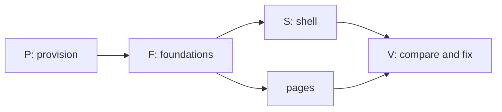

# Prompt: build the Syrius desktop redesign from the mockups

Open a session in this folder, the root of the Syrius repository, and tell
it: `Follow PROMPT-redesign-build.md`. Every path below is relative to this
folder.

This file is the instructions and the record of progress. The coordinator and
its subagents write their progress into the Progress section at the end, so a
session that starts later, or after the context was cleared, reads this file
and carries on from it.

---

## The task

Make the Syrius desktop wallet in this tree look and move the way
`mockups/redesign/` shows: every one of its 47 screens, in both themes, with
the same layout, the same effects and the same transitions. Where a screen
shows a feature the wallet cannot do yet, draw it as the mockup does but do
not let it run: put a seam in the code where the feature will be filled in
later.

You coordinate. Subagents do the microtasks below, up to four at once, each
on one small task with a fresh context. You provision, build, run, commit,
compare and dispatch.

## Assume you have never built Syrius

Nothing about this machine or this tree is taken from memory, an earlier
session, or a file that says it is done. Every tool, version, path and claim
is checked on disk before it is used.

- This file's Progress section is how the work resumes, but it is a record,
  not proof: a row marked `done` names its commit, and the commit is found in
  `git log` before anything is built on it.
- `HANDOFF.md`, when present (it is local, not in git), and its "Redesign
  build (Task 41)" table describe an earlier pass at the same work. Rows marked `done` there are claims. Reuse the code
  they point at where it exists and matches the mockup; otherwise fix it.
- The branch is `redesign`. Look at `git status` and `git log` before the
  first change, and commit nothing you did not read.

## Read first

1. `docs/design/RULES.md`: the owner's interface rules. They bind: motion
   always runs (never follow the OS reduced-motion setting), interface text
   is as short as it can be, no em dashes in it, balances with no trailing
   zeros, diagrams in docs are Mermaid.
2. `AGENTS.md`: the BLoC feature layout, generated files, the pinned and
   patched packages.
3. `mockups/redesign/README.md`: the plan. Its Motion, Shaders, Dollar values
   and "The original animations" tables are the specification for effects.
   "Not drawn" lists screens that follow a drawn pattern; build those to the
   pattern.
4. `mockups/redesign/src/*.html`: each `<section class="scr" id="…">` is one
   screen, with notes under it saying what is at rest, what is one click
   away, what moves, what was dropped. `src/00-head.html` holds the CSS: the
   colours, type, radii and gaps of both themes.
5. `mockups/redesign/shots/NN-<id>-<theme>.png`: each screen at 1280 by 780,
   dark and light. These pictures are what "done" is measured against.
6. `docs/flutter-dev-practices.md` and `docs/research/modern-flutter-stack.md`
   for how motion and shaders are built here; `harness/README.md` for driving
   the wallet; `tools/devnet/lab/README.md` for the chain it sends on.

Some files here (`docs/research/`, `HANDOFF.md`) cite paths in other
repositories or on another machine as their sources. You do not need them,
and you do not go looking for them.

## Hard rules

- **Stay in this folder.** Read and write nothing outside it, except the
  tools you install, what `tools/devnet/lab/lab.sh` fetches into its own
  `.build/`, and Docker's own state. If something seems to need a file from
  elsewhere, stop and ask.
- **Never touch the real wallet.** Real wallets live in `%AppData%\znn`. Run
  the wallet only through `harness/h start`, which moves APPDATA, LOCALAPPDATA,
  TEMP, HOME and USERPROFILE into a profile under `.harness/`, or with those
  variables redirected by hand for `flutter run`. Syrius allows one window per
  desktop: check no `syrius.exe` is running before you start one, and stop
  only what you started.
- **No new dependency.** The packages the mockup's effects need are in
  `pubspec.yaml` already (`animations`, `flutter_animate`, `flutter_shaders`,
  `lottie`). If a task cannot be done without one, it stops and says so.
- `flutter pub get` rewrites `analysis_options.yaml` and `pubspec.lock`;
  restore them before each commit unless the change was meant.
- Elevation (an installer's UAC prompt, enabling Developer Mode) is the
  owner's to grant: list what needs it and ask once, together.
- Keep the tree compiling at every commit. Commit on `redesign` only, new
  commits, never amends, never a push unless the owner asks.
- Writing, in code and docs: say what a thing is and why it is that way, name
  the failure that motivated a constraint, leave out encouragement. Comments
  explain the decision, not the syntax. Reports back are short.

## Seams: a feature that is drawn but not built

Missing means the logic behind the control does not exist in this tree: a
service, a chain call, a file format, a platform API. It does not mean "the
widget is not drawn yet"; drawing is the task.

Task F03 builds the seam kit before any page task starts. Every page task
uses it the same way:

- `lib/seams/seam.dart`: `enum Seam` with one value per missing feature, and
  `SeamGate(seam:, child:)`. The child is drawn exactly as the mockup draws
  it, then held disabled: no tap, no keyboard activation, the cursor stays
  basic, a tooltip of two words ("Not yet"). Its Go to entry and its shortcut
  refuse the same way.
- A missing service is an interface plus an `Unbuilt…` implementation that
  throws `SeamNotBuilt(Seam.x)`. Nothing calls the network or the chain for
  it, and no fake result is shown as real.
- Each seam is listed in `lib/seams/SEAMS.md`: the value, the screens it
  gates, the file to fill in, and the brief in `docs/research/` that describes
  it. A test fails when an enum value has no row there.
- Candidates from the mockup, to be confirmed against the tree by each task:
  Zap send and receive, the wallet picker at unlock, operator modes, the
  GitHub update notice, Windows Hello, WalletConnect approvals in the bell,
  the Sporks group, the Ledger flow. Anything the tree already does is wired,
  not seamed.

## End state

The work is done when all of these hold:

1. On a clean checkout, `docs/environment.md` lists every tool with its
   version and how it was installed, and following it gives a working debug
   and release build of the wallet on Windows.
2. `flutter analyze` reports no error or warning, and `flutter test` passes.
3. For each of the 47 screen ids and each theme, a harness script drives the
   wallet into that state at a 1280 by 780 client area and takes a shot.
   `mockups/redesign/compare/index.html` shows each shot beside its mockup
   shot with a diff, and every pair is marked `match` in the Screens table of
   the Progress section.
   A pair matches when the layout, components, colours, type, spacing, icons
   and animation frames shown agree. Allowed differences: the example figures,
   names and addresses, live data, and font hinting.
4. Every row of the mockup's Motion table and Shaders table plays in the
   running build as specified, checked by eye in the built wallet and, where a
   test can hold it, by a widget test on its duration and curve.
   `harness/h stalls` during a page change, a disclosure and the launch shows
   no frame over 16 ms that the old build did not also have.
5. Every seam is in `SEAMS.md`, and none of them can be set off from the
   interface.

## Order



P runs one task at a time: it installs and builds, and builds collide. F
starts when P is done; S and the page groups start when F03 (seams) and F01
(tokens) are committed, and each page group also needs the shared parts it
names. V runs as pages land, not only at the end.

## How the coordinator works

1. **Start from the Progress section.** Read it whole. A row left at `run`
   by a session that ended is checked against the disk (its files, `git
   status`) and set back to `todo` with a note of what was found.
2. Dispatch up to four `general-purpose` agents, each on one row whose
   dependencies are `done` and whose write paths no running row shares.
   Give each the brief template below, filled in. The agent marks its own
   row as it goes (see "Keeping the Progress section").
3. When a row reports: read the diff, run `flutter analyze --no-pub` on its
   files and its tests, add any strings it reported, commit it, set the row
   to `done` with the commit's short hash, and dispatch the next.
4. After every four rows: full `flutter test`, `harness/h build`, run the
   screen scripts of the screens those rows touched, rebuild the compare
   page, and look at it. Mark each pair looked at in the Screens table. Each
   mismatch becomes a new row (`X01`, `X02`, …) appended to the Rows table,
   naming the screen, the difference and the write paths.
5. Rewrite the "Now" lines of the Progress section after each of steps 3 and
   4, and before anything that can end the session (a long build, a
   restart).
6. Never build or run the harness while an agent is writing.
7. A row that fails twice is split, not retried as it was.

### Keeping the Progress section

Several agents write to this file at once, so every write is small and
exact:

- Only the Edit tool, replacing one whole line that is yours: your row in the
  Rows table, or, for the coordinator, the "Now" lines, the Screens table and
  new `X` rows. Never Write this file, never reformat it, never touch another
  agent's line. If the edit is refused because the file changed, read it
  again and redo the one edit.
- Times are UTC from `date -u +%Y-%m-%dT%H:%MZ`, never an estimate.
- A note is one short line: what is true now, not the history. No `|`, no
  em dashes.
- States: `todo`, `run` (an agent has it), `review` (the agent finished; the
  coordinator has not committed it), `done` (committed, hash in the note),
  `blocked` (the note says on what). In the Screens table: `todo`, `match`,
  or the `X` row that holds the difference.

### Brief template

```
Row <ID>: <what>.
Mockup: mockups/redesign/src/<file>.html, sections <ids>;
shots mockups/redesign/shots/<NN>-<id>-dark.png and -light.png.
Spec rows: <Motion / Shaders / Dollar values rows that apply>.
Write only: <paths>, and your row's line in PROMPT-redesign-build.md.
Read anything in this repository.

Progress: follow "Keeping the Progress section" in PROMPT-redesign-build.md.
Set your row to run when you start, update its note after each step that
lands (drawn, wired, tests passing), and set it to review with a one-line
summary as the last thing before your report. If you stop on a problem,
set it to blocked and say on what.

First check what exists at those paths and whether it already matches the
mockup; change only what does not. Draw what the mockup draws. If the logic
behind a control does not exist in the tree, gate it with SeamGate and add
its row to lib/seams/SEAMS.md; do not build the missing service.

Do not: run flutter build, flutter run, flutter pub get or harness/h; write
to git; add a dependency; kill a process you did not start; bulk-replace
with a script. Use Edit and Write for Dart and ARB files.

Follow docs/design/RULES.md. Read nothing outside this repository.
Colours, gaps and radii from AppTokens.of(context), never literals.
Directional padding. Amounts and addresses in Ltr; balances through
AmountText (no trailing zeros). Motion always runs; nothing on money moves
except ValueFlash. Interface text as short as it can be, no em dashes.
Comments say why. New strings: append to lib/l10n/app_en.arb only, then
flutter gen-l10n (re-read the file if the edit is refused; another agent may
have appended).

Write harness/screens/<id>.txt for each screen you own: the harness lines
that bring the wallet from unlocked Home to that state. Do not run it.

Done when: flutter analyze --no-pub <your files> is clean, and
flutter test --no-pub --timeout 60s <your test dir> passes.
Report in at most 25 lines: files written, tests, seams added, strings
added, what does not yet match the shot and why, what you found. Then stop.
```

## Microtasks

`Needs` names rows that must be committed first. Paths are relative to the
repository; `features/` is `lib/rearchitecture/features/`, `tabs/` is
`lib/widgets/tab_children_widgets/`, `modular/` is
`lib/widgets/modular_widgets/`, `utils/widgets/` is
`lib/rearchitecture/utils/widgets/`.

### P: provision (one at a time; the coordinator or one agent)

| Row | What | Writes | Needs |
| --- | --- | --- | --- |
| P01 | Inventory, read only: Windows version, Git with Git Bash, Visual Studio or Build Tools with the "Desktop development with C++" workload (MSVC, CMake, a Windows SDK), Flutter and Dart, Python 3 with Pillow, Node (the lab's scripts), Chrome or Edge, Docker Desktop, Developer Mode (Flutter's Windows plugins need symlinks). Record what is present, with versions, and what is missing | `docs/environment.md` | |
| P02 | Choose the Flutter version: the newest stable that satisfies `pubspec.yaml`'s Dart constraint and resolves `pubspec.lock`; note where it differs from `FLUTTER_VERSION` in `.github/workflows/` and why | `docs/environment.md` | P01 |
| P03 | Install what P01 found missing (winget where it can; Flutter as a git checkout of the chosen tag). One list of elevation prompts to the owner first | `docs/environment.md` | P02 |
| P04 | `flutter config --enable-windows-desktop`; `flutter doctor -v` clean for Windows desktop. Record any warning left and why it does not matter | `docs/environment.md` | P03 |
| P05 | Dependencies and generated code: `flutter pub get` (then restore the two files it rewrites), `dart run build_runner build --delete-conflicting-outputs` if any `*.g.dart` is stale, `flutter gen-l10n`. Check the `libznn` blobs in `lib/embedded_node/blobs/` load on Windows | generated files only | P04 |
| P06 | Baseline: `flutter analyze`, `flutter test`, `flutter build windows --release` and `--debug`. Record times, test count and every existing warning, so later rows are judged against it | `docs/environment.md` | P05 |
| P07 | Debug loop: `flutter run -d windows` with the profile variables redirected, hot reload and hot restart, DevTools attached, a breakpoint hit. Write the exact recipe | `docs/environment.md` | P06 |
| P08 | Harness: `harness/h build`, `start --fresh`, onboarding, `tour` with no error widget and no SEVERE log | `docs/environment.md` | P06 |
| P09 | Lab devnet: `tools/devnet/lab/lab.sh up` (chain 321; it fetches go-zenon at a pinned commit and builds the image), `status` says producing, the devnet mnemonic from its README imported into the harness profile, `harness/h chain 321`, index 1 selected, one send confirmed | `docs/environment.md` | P08 |
| P10 | Mockup pipeline: `python art.py` and `python build.py shots` in `mockups/redesign/` reproduce `shots/` (diff a few); proves Chrome and Python | none | P04 |

### F: foundations (four at once)

| Row | What | Writes | Needs |
| --- | --- | --- | --- |
| F01 | Tokens: every CSS variable in `src/00-head.html`, both themes (colours, type scale, radii, gaps, shadows, glass), mapped one to one into `AppTokens` and the two `ThemeData`s; a table in the file's doc comment of mockup name to token | `lib/utils/app_theme.dart`, `lib/utils/app_colors.dart`, `test/theme/` | P |
| F02 | Fonts: the families and weights the mockup inlines, bundled and declared. The coordinator edits `pubspec.yaml` from the agent's report | `assets/fonts/`, report for `pubspec.yaml` | P |
| F03 | Seam kit, as specified above, with its test | `lib/seams/`, `test/seams/` | P |
| F04 | Harness additions: `theme dark\|light`, `window` sized by client area in logical pixels at 1280 by 780, and `screens <id>\|all` that runs `harness/screens/<id>.txt` in both themes and saves `.harness/shots/<NN>-<id>-<theme>.png` | `harness/bin/`, `harness/app/`, `harness/README.md` | P08 |
| F05 | Compare page: `tool/redesign_compare.py` pairs `.harness/shots/` with `mockups/redesign/shots/`, writes `mockups/redesign/compare/index.html` (side by side, a diff image, a per-pair score, the screen's notes) | `tool/redesign_compare.py`, `mockups/redesign/compare/` | P10 |
| F06 | Seed data: `harness/seed/` scripts of harness lines that give the lab the states the shots need, done through the wallet itself (a stake, a fuse, a token owned, a swap, a project, a second funded address). Index 1 already owns pillar `dev1` and three fuses. States the lab cannot reach (a sentinel, a fuse old enough to cancel) get a fixture injected through `harness/app/` only, never linked into an ordinary build | `harness/seed/`, `harness/app/fixtures/` | P09 |
| F07 | `Segment` (one sliding thumb, 360 ms `(.65,0,.35,1)`, arrow keys) and `Disclosure` (240 ms slide 8 px, chevron 220 ms, state kept by key) | `utils/widgets/segment.dart`, `disclosure.dart`, their tests | F01 |
| F08 | `PageStrip` (headline figures, 48 px lead slot, main action) and `EmptyNote` (no-data mark at 44 px with "None yet", 16 px on one-line cards) | `utils/widgets/page/`, `test/page_strip/` | F01 |
| F09 | `RowDetail` (a row that opens its details under itself) and the list entrance (40 ms stagger, once) | `utils/widgets/row_detail.dart`, `test/row_detail/` | F01 |
| F10 | Motion kit: `RiseSwitcher` with fade through (320 ms, rise 6 px), `ValueFlash` (one 1.2 s flash; a new row rises 6 px over 320 ms), `Skeleton` sweep (1.4 s, in step across the page) | `utils/widgets/motion/`, `test/motion/` | F01 |
| F11 | Frost: blurred backdrop for dialogs, Go to, the bell panel, menus, the lock and ready cards; one `BackdropGroup` where several share it; dialogs rise 6 px | `lib/widgets/reusable_widgets/modals/`, `test/frost/` | F01 |
| F12 | Primary pill: its look per theme and the 600 ms sheen on hover and once when the action lands | `lib/widgets/reusable_widgets/buttons/`, `test/sheen/` | F01 |
| F13 | Shaders: hero field (Home, lock, Welcome), plasma glow, meter flow; each in a `RepaintBoundary`, one ticker, stopped when its page is hidden or the window loses focus | `lib/rearchitecture/utils/shaders/`, `shaders/`, `test/shaders/` | F01 |
| F14 | Lottie rules in `AppLottie`: play once when the surface appears, hold the last frame, replay on hover; the three loops; nothing below 40 px; `_small` files at 48 px | `lib/widgets/reusable_widgets/app_lottie.dart`, `test/app_lottie/` | F01 |
| F15 | `LaunchFilm`: animated WebP a frame at a time (window file and well file), start frame, hold, replay, skip; the assets from `tool/lottie_reencode.py` if absent | `lib/widgets/reusable_widgets/launch_film.dart`, `assets/images/launch*.webp`, `tool/`, `test/launch_film/` | F01 |
| F16 | Dollar values: price feed (CoinGecko `zenon-2` and `quasar`, once a minute while listened to, last answer kept), `DollarText` (dim, mono, 13 px; four decimals under a dollar; `≈` on sums), the setting key, on | `lib/services/price_feed.dart`, `utils/widgets/dollar_text.dart`, `test/price_feed/` | F01 |
| F17 | Hidden balances: one notifier, `HiddenAmount` dots, the eye on the original Lottie (frames 0 to 30, 200 to 232) | `lib/utils/notifiers/balance_visibility.dart`, `utils/widgets/eye_toggle.dart`, `test/hidden_balances/` | F14 |
| F18 | Toast: rises 300 ms, bar drains over 5 s, hover pauses, self-dismissing | `lib/utils/toast_utils.dart`, its widget, `test/toast/` | F01 |

### S: shell (`10-home.html` shows it on every screen)

| Row | What | Screens | Writes | Needs |
| --- | --- | --- | --- | --- |
| S01 | Rail: 56 px icons, tooltips with shortcuts, chevron to 200 px (200 ms spring, labels fade 150 ms after), state kept across restarts; Home, Transfer, Staking, Nodes, Plasma, Tokens, Swap, Accelerator, then bell, Settings, Lock | all | `lib/widgets/shell/rail.dart`, `test/shell/rail/` | F01, F03 |
| S02 | Status strip: sync, node, chain, peers; sync dot pulse 2.4 s, amber when behind; in-flight block chip; plasma generating with the bolt, elapsed and typical time; update line slot (seam) | all | `lib/widgets/shell/status_strip.dart`, `lib/widgets/shell/strip/`, `test/shell/strip_test.dart` | F03, F14 |
| S03 | Bell panel: dot for unseen, slides 24 px over 240 ms with frost, what needs the user first, runs folded ("Block published × 6") | `home-bell` | `lib/widgets/shell/bell_panel.dart`, `tabs/notifications_tab_child.dart` | F11 |
| S04 | Go to (Ctrl K): pages, actions, addresses, contacts; seamed actions refuse | `home-goto` | `utils/widgets/go_to_palette.dart` | F03, F11 |
| S05 | Shortcuts: Ctrl 1 to 8, Ctrl L, R, H, comma, Esc; page change by fade through | all | `lib/widgets/shell/shortcuts.dart`, `lib/widgets/shell/shell.dart` | S01, F10 |

### Home (`10-home.html`)

| Row | What | Screens | Writes | Needs |
| --- | --- | --- | --- | --- |
| H01 | Hero: balances with dollar values, the eye, Send / Receive / Zap pills, hero field behind; no refresh icons | `home-rest` | `features/home/view/` hero files | F13, F16, F17, F12 |
| H02 | Side cards: To collect on one line with Collect all, Tokens closed (opens in place), Pending only while a block is in flight | `home-rest`, `home-open` | `features/home/view/` side files, `features/pending_transactions/` | F07, F08 |
| H03 | Activity list: rows say what moved, Message on a zap row (seam if Zap is), hidden state hides amounts | `home-rest`, `home-hidden` | `features/latest_transactions/` | F09, F17 |
| H04 | "A zap arrived": 28 sparks over 900 ms, once per hash (gate on the Zap seam if receive is missing) | `home-zap` | `features/home/view/zap_sparks.dart` | F03 |

### Transfer (`20-transfer.html`)

| Row | What | Screens | Writes | Needs |
| --- | --- | --- | --- | --- |
| T01 | One 640 px card, `Segment` Send / Receive / Zap; To receive below only with rows; Receive blocked while a receive runs | all transfer | `features/transfer/`, `tabs/transfer_tab_child.dart` | F07 |
| T02 | Send: recent chips, book icon, dollar line, look-alike and first-time warning, node-behind note | `send-rest`, `send-warn` | `features/send/` | T01, F16 |
| T03 | Receive: address, Show QR, request an amount | `receive`, `receive-qr` | `features/receive/` | T01 |
| T04 | Confirm dialog in the transfer shape (`docs/design/RULES.md` section 8), the block followed to its momentum | `send-confirm` | send dialog files | F11, T02 |
| T05 | Zap tab as drawn; behind its seam if the Zap service is missing | `zap-form` | `features/zap/` | T01, F03 |

### Staking and Nodes (`30-earn.html`)

| Row | What | Screens | Writes | Needs |
| --- | --- | --- | --- | --- |
| E01 | Staking: strip (staked, to collect, week, Stake), list with unlock countdown, New stake as a disclosure, empty state, reward chart behind a button | `staking`, `staking-new`, `staking-empty` | `features/staking/`, `stakes/`, `create_stake/`, `stake_collect/`, `staking_rewards_history/`, `tabs/staking_tab_child.dart` | F07, F08, F09 |
| E02 | Nodes page: `Segment` Pillars / Sentinels, delegation strip; one rail entry replacing the two tabs | `pillars` | new `tabs/nodes_tab_child.dart`, `features/delegation/`, `delegation_stats/` | F07, F08, S01 |
| E03 | Pillars list: five columns, sort chip, search, APR, row detail | `pillars` | `features/pillars/`, `active_pillars/` | E02, F09 |
| E04 | Your pillar panel: pillar Lottie once at 132 px, then 48 px in the strip; revoke asks twice | `pillar-mine` | `features/pillars_by_owner/`, `pillar_parts/` | E02, F14 |
| E05 | Sentinels tab: list, your sentinel leading the strip at 48 px | `sentinels` | `features/sentinels/`, `sentinels_by_owner/`, `active_sentinels/` | E02, F14 |
| E06 | Steppers on a shared axis (300 ms), every step kept mounted | `spawn` | `lib/widgets/reusable_widgets/custom_material_stepper.dart`, step switcher | F01 |
| E07 | Success step: the object full size ("Pillar registered"; the same shape for sentinel and token) | `pillar-done` | stepper success widgets | E06, F14 |

### Plasma and Tokens (`40-plasma-tokens.html`)

| Row | What | Screens | Writes | Needs |
| --- | --- | --- | --- | --- |
| K01 | Plasma: glow in its well, available and fused strip, fused list with checkboxes and "Cancel 2 fuses" | `plasma` | `features/plasma_stats/`, `fused_plasma/`, `cancel_plasma/`, `tabs/plasma_tab_child.dart` | F13, F08, F09 |
| K02 | Fuse form and Other addresses as disclosures | `plasma-fuse` | `features/fuse_plasma/` | K01, F07 |
| K03 | Tokens: one list, Held / Favorites / All, search, balance column, the coin leading the strip | `tokens` | `features/tokens/`, `all_tokens/`, `token_balance/`, `token_favorite/`, `search_token/`, `tabs/tokens_tab_child.dart` | F07, F08, F14 |
| K04 | Token row detail: Mint, Burn, Transfer ownership, Flags in the row | `token-mine` | `features/mint_token/`, `burn_token/`, `transfer_token/` | K03, F09 |
| K05 | Create token stepper | `token-new` | `features/create_token_stepper/`, `create_token/` | E06 |

### Swap and Accelerator (`50-swap-az.html`)

| Row | What | Screens | Writes | Needs |
| --- | --- | --- | --- | --- |
| W01 | Swap: strip, one list (active, completed, to reclaim), row detail with deposit ID | `swap-list` | `modular/p2p_swap_widgets/` list files, `tabs/p2p_swap_tab_child.dart` | F08, F09 |
| W02 | Start and Join dialogs in the transfer shape, dollar line | `swap-start` | `modular/p2p_swap_widgets/modals/` | F11, F16 |
| W03 | Accelerator: fund strip, Voting / Active / Mine / All, vote bar in the row | `az` | `modular/accelerator_widgets/` list files, `tabs/accelerator_tab_child.dart` | F07, F08 |
| W04 | Project page by container transform (300 ms), phases, vote column | `az-project` | `lib/screens/project_details_screen.dart`, project detail files | W03 |

### Settings (`60-settings.html`)

| Row | What | Screens | Writes | Needs |
| --- | --- | --- | --- | --- |
| G01 | Frame: seven sections (Node, Security, Display, Wallet, Apps, Addresses, About), groups closed, no second rail, every Confirm gone | all settings | `tabs/settings_tab_child.dart`, `modular/settings_widgets/settings_parts.dart` | F07 |
| G02 | Node section, Sporks group closed (seam if not wired) | `set-node` | node management and peers files | G01 |
| G03 | Security: applies when chosen, wrong-password limit on at 3, Windows Hello row (seam) | `set-security` | security file | G01, F03 |
| G04 | Display: theme, dollar switch, explorer, rail labels, hide balances | `set-display` | display and general files | G01, F16 |
| G05 | Wallet: modes (seam), wallets on this computer (seam), delete cache keeps labels | `set-wallet` | wallet options and backup files | G01, F03 |
| G06 | Apps: connected sites as one list and one switch | `set-apps` | `modular/wallet_connect_widgets/`, new `apps.dart` | G01 |
| G07 | Addresses: labels and contacts | `set-addresses` | addresses file | G01 |
| G08 | About with the update line (seam), Licences group | `set-about`, `set-licences` | about card, new `licences.dart` | G01, F03 |
| G09 | The unlabelled field under the last licence; 321 raises the Originals card (six tiles that play on hover, three small, replay launch). Nothing stored | `set-originals` | `licences.dart` field, new `originals_card.dart` | G08, F14, F15 |

### Entry (`70-entry.html`)

| Row | What | Screens | Writes | Needs |
| --- | --- | --- | --- | --- |
| N01 | Launch: full window on black, click or key skips to the last frame | `launch` | `lib/screens/splash_screen.dart` | F15 |
| N02 | Lock card: the well playing `LaunchFilm`, wallet name, password, tries left; wrong password shakes the field 4 px twice over 200 ms and replays frames 14 to 56 in the well; Ctrl L replays the same | `lock-screen`, `lock-wrong` | `tabs/lock_tab_child.dart` | F15, F13, F11 |
| N03 | Launch settles into the lock card: one container transform on the stage's rect, 400 ms emphasized decelerate; the lock card under the stage from the first frame | `launch-settle` | `splash_screen.dart`, `lock_tab_child.dart` | N01, N02 |
| N04 | Wallet picker at unlock, drawn; behind its seam if listing wallets is missing | `lock-pick` | lock card picker file | N02, F03 |
| N05 | Welcome: the globe turning on the left half, three rows with the list entrance | `welcome` | `lib/screens/onboarding/access_wallet_screen.dart`, onboarding scaffold | F14, F09 |
| N06 | Import (any file accepted) and the seed quiz of three words, four choices each | `import`, `seed-quiz` | `lib/screens/onboarding/` import and confirm-seed files | N05 |
| N07 | Wallet ready: the map full window behind a frosted card | `wallet-ready` | `lib/screens/onboarding/wallet_success_screen.dart` | F11, F14 |

### V: compare and fix (the coordinator, as pages land)

| Row | What |
| --- | --- |
| V01 | Seed the lab (F06), `harness/h build`, `harness/h screens all`, `python tool/redesign_compare.py`. Mark each pair `match` or open an `X` row for it |
| V02 | Motion pass in the running build: each Motion and Shaders row seen, `harness/h stalls` across a page change, a disclosure and the launch, compared with P06's baseline |
| V03 | Seam pass: every value in `SEAMS.md` tried from its control, its shortcut and Go to; none runs |
| V04 | The minimum window (1200 by 600) and Arabic layout looked at once; defects become `X` rows, not part of the match |
| V05 | A fresh agent, given only the compare page, `mockups/redesign/README.md` (its "Settled by the owner" table above all) and `docs/design/RULES.md`, reviews every pair against the section 9 checklist and the owner's answers; its findings become `X` rows |
| V06 | End state checked item by item and written into the Progress section with the date |

## Progress

Written by the coordinator and its agents as the work goes; see "Keeping
the Progress section" for how. Local foundation preparation has begun on
macOS; Windows provision and acceptance remain pending. See
`docs/environment.md` for the source pin, tool selection and evidence limits.

### Now

- Updated: 2026-10-28T08:40Z
- Running: At 8bbc93b0c0a8, native 40650905349 passes 736 Python/287 Dart and clean selected analysis. Independent 40653076744 qualifies original index-1 one-ZNN UI send, all twelve destinations, complete quiescence and normal required actors/five nodes. The lab fails at copied child startup; its old label covers window show and restored-lock wait, so the precise cause is unknown. The candidate validates one silent window acknowledgement and records fixed typed child failures. All 222 memory controls pass; current 740/290 awaits hosted execution
- Main ledger: 71 of 80 main rows are marked done, or 88.75 percent, excluding X correction rows. P01 and P04-P08 are qualified for their written hosted Windows requirements. This is a row count rather than verified end-state acceptance or an estimate of remaining effort. Nine main rows and all 94 visual matches remain open
- Next: Require 740 Python cases, clean selected analysis and all 290 Dart cases before a fresh original native session. Observe copied window and lock phases without changing decoding, retrying failed sessions or granting seed authority from diagnostics. Review four source126 prepared entry images under the separately authorized small transfer. Qualify original animation phases, copied reopen/six effects, nineteen catalog preparations and all 94 matches
- Last batch check: The dash batch passes all five gates with thirteen existing presentation cases and one loader, including both themes' geometry, stable focus, real hover/fill and unchanged 1.5 px paint checks. All 69 pins, original exit zero, complete 251303-byte stdout, free lease, absent original group and CLOSED/SUCCESS are independently verified. The separate preflight batch retains 211 passing Python methods and CLEANED closure. Shared scratch remains 12 GiB with a 10 GiB floor; the 512 MiB task cap is not a measured peak and historical HOLD data is unchanged
- Publication evidence: Native da809e850607 run 40442587592 and independent a56f0b6c5ec6 inspection 40444377836 qualify actual onboarding, complete twelve-destination tour, twelve PNG checks and original app/entry closure. Their separate lab/wallet archive digests and the original lab-recorded wallet manifest digest agree. The ordinary application baseline and four entry captures at 88fcdb9b8773 keep their independent 639be8318e1b inspection binding. Earlier failed startup, moving-control and partial-tour runs, original reports, HOLD data and browser-preview refusal remain preserved. The twelve tour probes do not establish any of the 94 mockup matches
- CI: Source127 native 40650905349 passes all 736 Python/287 Dart and clean selected analysis. Independent 40653076744 preserves positive original UI/send/quiescence and failed copied startup; no positive copied binding is inferred. Source126 producer 40645871645 and independent 40649202887 retain 4565 non-chain passes/two existing skips, root analysis zero errors/warnings and 1295 infos, Debug/Release builds and four prepared Debug captures/restoration. Images remain unreviewed; all 94 matches remain open. Current source requires 740 Python/290 Dart, with four new Python and three Dart cases; 222 pure-memory controls actually ran and passed

### Rows

| Row | State | Updated (UTC) | Note |
| --- | --- | --- | --- |
| P01 | done | 2026-10-26T13:08Z | At 08fdf0ab62e8, run 40325850769 attempt one job 121584678066 succeeds with all nineteen inventory fields known and source unchanged. The native query exits zero normally in 2.656s with 932 complete bytes, every phase and one valid frame. Desktop workload 18.11.12315.225, MSVC 14.51.36231, SDK 10.0.26100.0, browser versions and enabled Developer Mode are observed. Pillow and Docker Desktop are recorded absent. The environment table records versions and runner-provided or Flutter-setup origins. This completes inventory; P03 installation and full wallet acceptance remain separate |
| P02 | done | 2026-10-23T15:54Z | e13abb387577 pins workflows to Flutter 3.47.7; passes on the retained Dart 3.13.5 toolchain with unchanged application dependency versions; Windows provisioning remains separate |
| P03 | blocked | 2026-10-26T13:08Z | Complete P01 inventory at 08fdf0ab62e8 records absent Pillow and Docker Desktop. Hosted Flutter setup, locked dependency restoration, native builds and actual debug/browser execution are qualified separately. Installation reconciliation and the documented native-Windows/Linux-Docker environment route remain pending; no missing tool is declared installed. A personal Windows host is not required for the hosted path |
| P04 | done | 2026-10-25T19:16Z | At unchanged application source 1d663dc58b9c, Windows run 40142185606 attempt one job 121016046890 enables desktop and passes Windows/Visual Studio doctor sections with original exit zero, complete output and no forced termination. Retained source/run/log and successful transport closure are rechecked without another build. This completes hosted Windows desktop setup; optional inventory failures, the personal machine and full wallet startup retain their separate scopes |
| P05 | done | 2026-10-25T20:43Z | At unchanged application source 1d663dc58b9c, Windows job 121016046890 verifies locked restoration, generated/localized correspondence and actual source/Debug/Release DLL loads with export lookup and identical pinned bytes. Every original stage exits zero, complete and unforced. This meets P05's dependency/generation/loading requirements. ABI invocation, full wallet startup and optional inventory remain separately unqualified; no test or build is repeated |
| P06 | done | 2026-10-26T18:22Z | At f024e78bf777, original run 40368833678 baseline job 121733764905 and read-only inspection 40376130619/job 121759565325 verify all twelve checks. Root analysis has zero errors/warnings and 1304 infos; 4377 non-chain test events pass with two skips. Debug/Release take 139.328/189.406s, with original zero complete unforced exits, unchanged generation/source and three matching DLL map/export probes. This qualifies that application source; old-build frame comparison remains V02 and full wallet runtime remains P08 |
| P07 | done | 2026-10-26T07:37Z | Source fc6515e8ffbc, tree 6157da75da60, run 40279392842 attempt one job 121429091241 passes all 24 native checks, 50 controller/ten frontend cases, six tour regressions and zero-diagnostic selected analysis. Original app/VM binding, breakpoint, reload/state preservation, restart/state reset and actual DevTools attachment pass. Browser, frontend, probe, app, tool and bootstrap exit zero normally with complete output. Exact SDK/compiler helpers have explicit forced termination receipts; the job is empty and no required actor is forced. This meets P07's debug-loop recipe; prior failed attempts remain failed |
| P08 | done | 2026-10-27T03:38Z | At da809e850607, native 40442587592/job 121986172753 and independent a56f0b6c5ec6 inspection 40444377836/job 121992021448 verify fresh build/start, original onboarding, chain-321 signing policy and all twelve tour destinations with zero error widgets/severe logs and twelve valid 1280x780 PNGs. Original app/entry exit zero normally with 1940 complete output bytes, no forced required actor, an empty owned job and unchanged source/inputs. Exact MSVC telemetry termination is labelled separately; all five lab nodes exit zero normally. Both original archives and the cross-recorded wallet digest match. This completes P08; index-1 send, fixtures, 94 visual matches and whole-runner lifecycle remain separate |
| P09 | review | 2026-10-27T17:51Z | At 103e37479ab4, 40550772652 positively qualifies the original native UI send: persisted index 1 sends exactly 1 ZNN to index 0 with original-request confirmation, all twelve tour checks and normal app/entry/five-node exits. All 218 Dart cases, 555 Python cases/three skips and clean selected analysis pass. Every source/input check passes; auxiliary telemetry termination is separate. This closes the native send portion, while the written Docker installation/lab.sh image-command route remains unqualified. Earlier UNKNOWN originals remain UNKNOWN; no checkpoint or seed state is inferred |
| P10 | done | 2026-10-22T11:00Z | e13abb387577 adds portable fresh output and isolated browser selection; 13 synthetic checks, 12 exact art scripts and 94 reference renders pass; inspected samples differ in platform text rendering; actual wallet capture remains separate |
| F01 | done | 2026-10-21T23:26Z | e13abb387577 maps both themes and all CSS variables; selected checks pass; native acceptance pending |
| F02 | done | 2026-10-22T00:32Z | e13abb387577 bundles the derived 600 face, coverage fallback and licenses; deterministic output and metadata verified; native rendering pending |
| F03 | done | 2026-10-21T23:27Z | e13abb387577 adds the seam kit and throwing boundaries; input, focus, semantics and registry tests pass; page wiring pending |
| F04 | done | 2026-10-22T06:06Z | e13abb387577 adds guarded themes, measured client sizing and complete 1x captures; adapter and input tests pass; remaining page scripts and native P08 pending |
| F05 | done | 2026-10-25T00:05Z | e13abb387577 adds comparison reports with twelve passing synthetic tests. A new private export uses the four 1d663dc58b9c native captures and existing references, with independently verified successful closure and all eleven earlier report files preserved. The 94-pair summary has four unreviewed and 90 missing captures, zero matches; browser rendering remains unverified |
| F06 | review | 2026-10-28T08:40Z | At 8bbc93b0c0a8, native 40650905349 and independent 40653076744 qualify original index-1 one-ZNN send, twelve tour checks, complete quiescence and normal required-actor/five-node exits after 736 Python/287 Dart and clean analysis. The lab fails at copied startup; window-versus-lock location is unknown. Source126 prepared Debug captures/restoration stay independently qualified. The candidate adds one silent target-client acknowledgement and finite typed child failure records; copied reopen/six effects, nineteen catalog preparations and fixture acceptance remain open |
| F07 | done | 2026-10-22T05:11Z | e13abb387577 blocks closing disclosure input and semantics; existing thumb, keyboard and reveal clocks retained; local tests pass; native acceptance pending |
| F08 | done | 2026-10-22T05:11Z | e13abb387577 aligns strip spacing and empty type while retaining exact figures and original marks; both-theme, keyboard and update tests pass; native acceptance pending |
| F09 | done | 2026-10-22T00:32Z | e13abb387577 adds keyed, once-per-view list entrances with 40 ms staggering; RowDetail retained; lifecycle and input tests pass; page wiring pending |
| F10 | done | 2026-10-22T00:32Z | e13abb387577 aligns fade-through and flash timing, preserving motion and focus barriers; 168 foundation tests pass; running-build motion pending |
| F11 | done | 2026-10-22T05:11Z | e13abb387577 adds clipped glass and independent overlapping filters with preserved dialog clocks; local tests pass; remaining callers and native acceptance pending |
| F12 | done | 2026-10-21T23:27Z | e13abb387577 adds both-theme plasma pills; disabled geometry, input and sheen tests pass; native visual acceptance pending |
| F13 | done | 2026-10-22T05:11Z | e13abb387577 stops hidden, blurred and unfocused clocks without resume jumps; single-ticker meter keeps 500 ms easing; local tests pass; generation callers and native shader acceptance pending |
| F14 | done | 2026-10-22T05:11Z | e13abb387577 adds once-and-hold playback, hover replay, three allowed loops and actual-size rules; playback and existing image tests pass; native acceptance pending |
| F15 | done | 2026-10-22T05:11Z | e13abb387577 fixes queued takeover and reused-controller skip; existing asset, decoder and master-frame tests pass; native memory and frame-time checks pending |
| F16 | done | 2026-10-22T05:11Z | e13abb387577 retains the existing exact dollar formatter, listener-bound feed and default-on key; existing feed and formatting tests pass; Display wiring pending |
| F17 | done | 2026-10-22T05:11Z | e13abb387577 retains shared visibility, hidden width and semantics, persistence and original eye ranges; existing tests pass; remaining page wiring pending |
| F18 | done | 2026-10-22T05:11Z | e13abb387577 adds 300 ms toast rise, five-second drain, remaining-time pause and owned overlay cleanup; timing, flags, replacement and teardown tests pass; notification wiring pending |
| S01 | done | 2026-10-22T06:06Z | e13abb387577 adds eight pages, original SVGs, rich shortcut hints and preserved two-stage motion; local tests pass; native acceptance pending |
| S02 | done | 2026-10-22T07:34Z | e13abb387577 adds pulse, exact scoped flight tracking, measured plasma, peers and update seam; wires session status; local checks pass; native acceptance pending |
| S03 | done | 2026-10-22T10:03Z | e13abb387577 adds scoped history and explicit connection decisions; wires the panel and toast; local checks pass; native acceptance pending |
| S04 | done | 2026-10-22T10:03Z | e13abb387577 adds grouped exact targets, IME and seam guards; wires existing flows; 27 cases and the full suite pass; native acceptance pending |
| S05 | done | 2026-10-22T12:31Z | e13abb387577 wire platform chords; binds locked replay and removes outgoing private pages immediately; local checks pass; native acceptance pending |
| H01 | done | 2026-10-22T10:03Z | e13abb387577 adds exact balances, shared dollars and privacy, responsive columns and distinct Transfer entries; 26 cases and full suite pass; native acceptance pending |
| H02 | done | 2026-10-22T11:00Z | e13abb387577 wires exact rewards, closed Tokens and published-only Pending through the retained session owner; widget and full suites pass; native acceptance pending |
| H03 | done | 2026-10-22T12:31Z | e13abb387577 adds exact scoped Activity, trusted ABI labels, hidden amounts and guarded Message previews; ownership, widget and full suites pass; actual captures pending |
| H04 | done | 2026-10-22T17:44Z | e13abb387577 adds 28 sparks over exactly 900 ms with 21 passing cases; qualified receive and durable claims remain seamed; strict and full checks pass; native acceptance pending |
| T01 | done | 2026-10-22T07:34Z | e13abb387577 adds retained 640px modes and guarded inbound rows; 14 widget cases and full suite pass; inner forms continue in T02-T05; native acceptance pending |
| T02 | done | 2026-10-22T14:33Z | e13abb387577 adds exact Send fields, recipient checks, known-lag guards and confirmation; strict and full checks pass; native acceptance pending |
| T03 | done | 2026-10-22T14:33Z | e13abb387577 retains exact optional requests and synchronously revokes stale QR exports; strict and full checks pass; native export and acceptance pending |
| T04 | done | 2026-10-22T14:33Z | e13abb387577 bind exact confirmation to captured context and the original result; deferred lifecycle and full checks pass; native acceptance pending |
| T05 | done | 2026-10-22T14:33Z | e13abb387577 adds retained Zap fields and exact byte counts behind existing service seams; strict and full checks pass; native acceptance pending |
| E01 | done | 2026-10-22T06:06Z | e13abb387577 adds stake columns, persistent entrances and guarded compact form; 14 widget cases and existing BLoC suites pass; three guarded scripts authored; native acceptance pending |
| E02 | done | 2026-10-22T07:34Z | e13abb387577 adds retained Nodes tabs and shared action holds with chart-only history; lifecycle and full suites pass; list and owner refinements continue in E03-E05 |
| E03 | done | 2026-10-22T17:44Z | e13abb387577 adds five exact columns, loaded search and sorting, pagination and reported counts; unavailable APR remains seamed; strict and full checks pass; native acceptance pending |
| E04 | done | 2026-10-22T17:44Z | e13abb387577 binds owner facts and original art to fresh authority; update, QSR and twice-confirmed revoke retain exact context and deadlines; strict and full checks pass; native acceptance pending |
| E05 | done | 2026-10-22T17:44Z | e13abb387577 adds the active list, exact-owner strip and retained inactive ownership with guarded Spawn and revoke; strict and full checks pass; native acceptance pending |
| E06 | done | 2026-10-22T12:31Z | e13abb387577 retains all bodies and listeners with 300 ms shared-axis input gates; rapid Back, completion and real keyboard traversal pass with the full suite; native acceptance pending |
| E07 | done | 2026-10-22T21:26Z | e13abb387577 binds receipt state and original art to exact positive confirmation; immutable original results, owner guards, retained steps and full checks pass; native acceptance pending |
| K01 | done | 2026-10-22T21:26Z | e13abb387577 adds complete owner reads and exact serial cancellations with shared Fuse admission, retained original outcomes and uncertainty holds; full checks pass; native acceptance pending |
| K02 | done | 2026-10-23T00:27Z | e13abb387577 adds compact Fuse and Other addresses with retained drafts, original outcome holds and confirmed Another; full local checks pass, native acceptance pending |
| K03 | done | 2026-10-22T21:26Z | e13abb387577 adds one scoped non-native token ledger, exact balances, committed favorites and shell-retained filters; full checks pass; native acceptance pending |
| K04 | done | 2026-10-23T00:27Z | e13abb387577 adds inline token actions with sender-owned journals and original terminal delivery; full local checks pass, native acceptance pending |
| K05 | done | 2026-10-23T00:27Z | e13abb387577 adds retained token creation steps, exact preflight and immutable publication; full local checks pass, native acceptance pending |
| W01 | done | 2026-10-23T15:54Z | e13abb387577 adds captured Swap catalogues, proof-gated receive and expiry facts, exact public deposit disclosure and original-Box deletion receipts; strict and full local checks pass; native comparison remains pending |
| W02 | done | 2026-10-23T15:54Z | e13abb387577 binds Start, Join, Recover and detail surfaces to captured sources and original outcomes, with explicit deposits and retained sender admission; full two-sided terms remain seamed; strict and full local checks pass; native acceptance pending |
| W03 | done | 2026-10-23T15:54Z | e13abb387577 adds captured Accelerator sources, actual fund values with independent unknown coins, wallet-wide Mine, four segments and 300 ms project transforms; quorum remains Unknown; strict and full local checks pass; native comparison pending |
| W04 | done | 2026-10-23T15:54Z | e13abb387577 adds project phases and vote aside, original-click action sources, shared sender admission, exact latest-phase budgets and original outcome rearm; strict and full local checks pass; native contract effects and comparison remain unqualified |
| G01 | done | 2026-10-22T06:06Z | e13abb387577 adds seven sections, Apps destination and protected page transitions; frame tests pass; child controls continue in G02-G09; native acceptance pending |
| G02 | done | 2026-10-23T00:27Z | e13abb387577 adds Node settings, owned transport transitions, verified rollback and gated Sporks; full local checks pass, native acceptance pending |
| G03 | done | 2026-10-23T15:54Z | e13abb387577 adds the Security stack, original policy lanes, owned sensitive routes and exact Sign field semantics; password migration remains seamed; strict and full local checks pass; native acceptance pending |
| G04 | done | 2026-10-22T07:34Z | e13abb387577 shares seven Display choices and source-chain explorer gates; settings and full suites pass; native acceptance pending |
| G05 | done | 2026-10-23T15:54Z | e13abb387577 adds full-width Wallet rows and closed Maintenance, with gated modes and catalogues, serialized original-Box preferences and captured maintenance holds; strict and full local checks pass; native cleanup and startup acceptance pending |
| G06 | done | 2026-10-23T15:54Z | e13abb387577 adds one persisted Web apps switch, combined actual connections and closed WalletConnect details, with original requester incarnations and captured client outcomes; strict and full local checks pass; native acceptance pending |
| G07 | done | 2026-10-23T15:54Z | e13abb387577 adds full-width address and contact tables, complete captured reads, original-Box edits and queued membership derivation; strict and full local checks pass, including attached actions and scaled RTL fixtures; native comparison pending |
| G08 | done | 2026-10-23T15:54Z | e13abb387577 adds full-width About, actual process metadata, original links and genuine licence groups; strict and full local checks pass; native metadata and comparison remain unqualified |
| G09 | done | 2026-10-23T15:54Z | e13abb387577 adds session-only Originals discovery, six large and three small original animations and movie-only replay; strict and full local checks pass; native comparison pending |
| N01 | done | 2026-10-22T21:26Z | e13abb387577 plays the original launch and runs existing startup once after completion or skip; finite source cases and full checks pass; native acceptance pending |
| N02 | done | 2026-10-22T12:31Z | e13abb387577 adds the owned glass card, launch well, replay and awaited attempt bookkeeping; isolated and full suites pass; SDK worker rollback, native authentication and captures remain unqualified |
| N03 | done | 2026-10-22T21:26Z | e13abb387577 reparents one genuine auth owner and original film into the measured well over 400 ms; boundary, resize and full checks pass; native acceptance pending |
| N04 | done | 2026-10-23T00:27Z | e13abb387577 draws the current wallet picker and gates the missing catalog; full local checks pass, native acceptance pending |
| N05 | done | 2026-10-23T15:54Z | e13abb387577 adds the original globe crop and three captured entry routes, preserving owned callbacks and Welcome motion; strict and full local checks pass; native comparison pending |
| N06 | done | 2026-10-23T15:54Z | e13abb387577 adds pure Import and the bounded three-word quiz with original decrypt, access release and shared-axis routes; strict and full local checks pass; native authentication and comparison remain unqualified |
| N07 | done | 2026-10-23T15:54Z | e13abb387577 adds the original map and Ready glass card, captured first address and once-only opening bound to original creation and local initialization; connection mismatch and uncertainty remain distinct from readiness; strict and full local checks pass; native acceptance pending |
| V01 | blocked | 2026-10-28T07:25Z | Four earlier Welcome/empty-Import pairs remain reviewed and unaccepted. At d17b474b1362, producer 40645871645 and independent 40649202887 add four genuine prepared Debug entry captures with original restoration. Those four fresh images are not visually reviewed or accepted. Nineteen scripts retain literal preparation refusals; ninety catalog outputs and all 94 matches remain open. Original images and source/run bindings are preserved |
| V02 | blocked | 2026-10-23T12:26Z | Finite widget timing coverage is separate from the running-build motion, shader and frame-time pass; native execution and its baseline remain pending |
| V03 | blocked | 2026-10-23T12:26Z | Seam registry and injected control checks are prepared; trying every control, shortcut and Go to entry in a running native wallet remains pending |
| V04 | blocked | 2026-10-23T12:26Z | Scaled and RTL widget cases are separate from the complete native wallet at 1200 by 600 and its Arabic layout; native inspection remains pending |
| V05 | blocked | 2026-10-25T00:05Z | Limited earlier inspection remains X176. Both current 1d663dc58b9c Import scans measure the reference 3/2 dash/gap runs; empty input/focus, text rasterization and globe phase still differ from the references. The new report has four unreviewed pairs. Complete fresh-agent review of all 94 pairs and browser-rendered report review remain pending; no visual match is claimed |
| V06 | blocked | 2026-10-28T07:25Z | At d17b474b1362, producer 40645871645 and independent 40649202887 qualify 4565 non-chain passes/two existing skips, root analysis zero errors/warnings and 1295 infos, Debug/Release builds and four prepared Debug entry captures with original exit/restoration and retained digests. Native 40644753061 separately fails the original Release startup skip. All 94 matches, copied reopen/six effects, literal Docker/lab route, native motion/frame time, seam routes, minimum-window/RTL and final audit remain open |
| X01 | done | 2026-10-21T23:26Z | e13abb387577 restores loading-list sweep ink in lib/rearchitecture/utils/widgets/motion/skeleton.dart; all 19 existing Skeleton tests pass unchanged |
| X02 | done | 2026-10-21T23:57Z | e13abb387577 keeps the status-strip dot visible at narrow widths and fixes asynchronous visibility tests |
| X03 | done | 2026-10-21T23:57Z | e13abb387577 parses the bridge test's HTTP head before binary frames; compression refusal assertions retained |
| X04 | done | 2026-10-21T23:57Z | e13abb387577 aligns the Fuse Plasma integration step with its shared bloc API; no live-chain run |
| X05 | done | 2026-10-21T23:57Z | e13abb387577 restores locked vendored test tools and aligns workflow pins; local analysis has no errors or warnings; hosted CI not run |
| X06 | done | 2026-10-22T07:34Z | e13abb387577 resolves the split Transfer diagnostics; strict changed-file analysis, 14 targeted tests and full suite pass |
| X07 | done | 2026-10-22T10:03Z | e13abb387577 preserves original publication ownership, exact results and late history; session and failure cases pass with no real signing or chain run |
| X08 | done | 2026-10-22T11:00Z | e13abb387577 scopes publication and four consumers to opaque PoW ownership and explicit idle; revokes shell contexts; lifecycle and full suites pass |
| X09 | done | 2026-10-22T10:03Z | e13abb387577 keeps Bell test ownership inside widget time; blocked seen writes and stream closure are awaited; eight panel cases pass |
| X10 | done | 2026-10-22T10:03Z | e13abb387577 checks rendered spans and tooltip metadata with owned semantics cleanup; all 27 palette cases pass |
| X11 | done | 2026-10-22T10:03Z | e13abb387577 releases semantics and checks actual seam tooltip metadata; all 26 Home hero cases pass |
| X12 | done | 2026-10-22T10:03Z | e13abb387577 consumes locked Escape and exposes only the replay chord; keyboard variants pass; the N02 well remains pending |
| X13 | done | 2026-10-22T10:03Z | e13abb387577 attaches acquisition errors after observers and preserves exact failure identities; publication lifecycle cases pass |
| X14 | done | 2026-10-22T10:03Z | e13abb387577 declares explicit route semantics children and checks the first visible panel frame; isolated and full suites pass |
| X15 | done | 2026-10-22T10:03Z | e13abb387577 bridges real cancellation and fake widget queues outside motion samples; cleanup and restored-focus cases pass |
| X16 | done | 2026-10-22T10:03Z | e13abb387577 positions toasts at the shared top and end and beside an open panel; local checks pass; native acceptance pending |
| X17 | done | 2026-10-22T10:03Z | e13abb387577 refuses retained files before RPC when locked or uninitialized and rechecks lock before dispatch; lifecycle cases pass |
| X18 | done | 2026-10-22T10:03Z | e13abb387577 aligns devnet notification override parameters; strict and full analysis pass; original full unit inputs are unchanged; native chain integration unrun |
| X19 | done | 2026-10-22T11:00Z | e13abb387577 serializes shared admission and retains exact outcomes through close; keeps partial and uncertain collection attempts; 21 sender cases and full suite pass |
| X20 | done | 2026-10-22T11:00Z | e13abb387577 binds collection rearm to the exact post-confirmation snapshot and coalesces Home reads; equal fresh snapshots reach the view; lifecycle and full suites pass |
| X21 | done | 2026-10-22T11:00Z | e13abb387577 resolves final Home diagnostics and preserves the token precision fixture; strict analysis and full suite pass |
| X22 | done | 2026-10-22T11:00Z | e13abb387577 checks asynchronous display removal separately from the exact completed duration; lifecycle and full suites pass |
| X23 | done | 2026-10-22T12:31Z | e13abb387577 binds reads and caches to exact address, node and chain; stale completion, overlapping pagination, empty cache and close cases pass |
| X24 | done | 2026-10-22T12:31Z | e13abb387577 owns the already-broadcast SDK controller directly; replacement, repeated reconnect, independent readers and close all detach without a socket |
| X25 | done | 2026-10-22T12:31Z | Failed bounded focus retries and the diagnostic trace are preserved; e13abb387577 resolves handoff through the X27 source fix; all focused and full tests pass |
| X26 | done | 2026-10-22T12:31Z | e13abb387577 wraps the lock comment; strict changed-file analysis has no diagnostics and the full suite passes |
| X27 | done | 2026-10-22T12:31Z | e13abb387577 removes the inherited traversal latch and keeps one revoked handoff; 35 focused cases including Tab and Shift-Tab pass with the full suite |
| X28 | done | 2026-10-22T14:33Z | e13abb387577 removes the inherited traversal latch from Transfer and RiseSwitcher; returning form and hidden-arrival regressions pass with the full suite |
| X29 | done | 2026-10-22T14:33Z | e13abb387577 opens contacts and records only original accepted transfer recipients; storage and observer failures preserve outcomes; full checks pass |
| X30 | done | 2026-10-22T14:33Z | e13abb387577 preserve immutable confirmation fields and late original results; exact unchanged drafts alone clear; full checks pass |
| X31 | done | 2026-10-22T14:33Z | e13abb387577 repairs address-book ink, retained amount fields and exact acknowledgement checks after the split; strict and full checks pass |
| X32 | done | 2026-10-22T14:33Z | e13abb387577 revokes pending QR exports before rebuild and checks the complete 240 ms reveal; strict and full checks pass |
| X33 | done | 2026-10-22T14:33Z | e13abb387577 checks the effective seam cursor and retains the disabled pointer, key, focus, semantics and callback boundaries; full checks pass |
| X34 | done | 2026-10-22T14:33Z | e13abb387577 retains segment focus and targets pending-row privacy; resolves deferred confirmation through X36 and X37; full checks pass |
| X35 | done | 2026-10-22T14:33Z | e13abb387577 refuses revoked queued work and reentrant closing predicates; publication preparation rejects context round trips; focused and full checks pass |
| X36 | done | 2026-10-22T14:33Z | e13abb387577 constructs deferred replies on the widget clock and awaits actual dispatch and original-result boundaries; focused and full checks pass |
| X37 | done | 2026-10-22T14:33Z | e13abb387577 refuses callbacks from popping or disposed confirmations before Navigator access; repeated and post-disposal regressions pass with the full suite |
| X38 | done | 2026-10-22T17:44Z | e13abb387577 binds address-owned reads to exact current transport, node, chain and revision; unbound caches cannot authorize owned or empty states; full checks pass |
| X39 | done | 2026-10-22T17:44Z | e13abb387577 binds immutable owner actions to fresh proofs, original wallet context and shared admission through preparation; original outcomes survive disposal; full checks pass |
| X40 | done | 2026-10-22T17:44Z | e13abb387577 retains immutable rewards, original collection outcomes and uncertain holds; exact-hash confirmation and a fresh read alone rearm; full checks pass |
| X41 | done | 2026-10-22T17:44Z | e13abb387577 retains inactive Sentinel ownership and original art; Spawn and twice-confirmed revoke use exact reads and shared publication; full checks pass |
| X42 | done | 2026-10-22T17:44Z | e13abb387577 uses independent reported counts with genuine zero, unknown and stale-context handling; mono Segment and full checks pass |
| X43 | done | 2026-10-22T17:44Z | e13abb387577 repairs owned diagnostics without changing analyzer rules; strict changed-file and complete checks pass |
| X44 | done | 2026-10-22T17:44Z | e13abb387577 retains the source covered by the complete serial suite with 3960 successes and one existing skip; interrupted and incomplete executions retain UNKNOWN evidence |
| X45 | done | 2026-10-22T17:44Z | e13abb387577 releases owned semantics, records callbacks before assertions and removes only owned routes; focused and full checks pass |
| X46 | done | 2026-10-22T17:44Z | e13abb387577 supplies explicit synthetic SDK epoch facts while retaining original owner assertions; focused and full checks pass |
| X47 | done | 2026-10-22T17:44Z | e13abb387577 uses finite observed Sentinel futures, real route clocks and owned close queues while retaining exact outcomes; focused and full checks pass |
| X48 | done | 2026-10-22T17:44Z | e13abb387577 registers the missing Pillar APR service and disables its sort through SeamGate; strict, seam and full checks pass |
| X49 | done | 2026-10-22T17:44Z | e13abb387577 adds measured heading underlines, CSS count insets and scaled Panel alignment with pill defaults retained; 12 heading cases and full checks pass |
| X50 | done | 2026-10-22T17:44Z | e13abb387577 settles owned QSR fixture routes beyond the pinned interpolation endpoint without changing production guards; full checks pass |
| X51 | done | 2026-10-22T17:44Z | e13abb387577 completes covering-route teardown before removing the owner and preserves unrelated dialogs; focused and full checks pass |
| X52 | done | 2026-10-22T17:44Z | e13abb387577 drains asynchronous Sentinel fixture storage turns with finite widget clocks; exact-result and full checks pass |
| X53 | done | 2026-10-22T17:44Z | e13abb387577 releases counted Segment semantics before framework verification and retains actual-zero and unknown assertions; full checks pass |
| X54 | done | 2026-10-22T17:44Z | e13abb387577 finds the entering Spawn route before its measured transition and requires the visible original stepper afterwards; full checks pass |
| X55 | done | 2026-10-22T17:44Z | e13abb387577 qualification preserves both SCRATCH_SCAN_UNSTABLE failures; later full tests and full analysis complete under unchanged storage policy; no manager repair is claimed |
| X56 | done | 2026-10-22T17:44Z | e13abb387577 retains the Pillar revocation deadline through preparation; four exact-expiry refusals and original accepted-result retention pass with the full suite |
| X57 | done | 2026-10-22T17:44Z | e13abb387577 checks observed Spawn refusal outcomes after guarded widget pumping; exact error and absent-result assertions pass with the full suite |
| X58 | done | 2026-10-22T17:44Z | e13abb387577 removes new style diagnostics and completes the Home paint boundary at exactly 900 ms; strict and full checks pass |
| X59 | done | 2026-10-22T17:44Z | e13abb387577 waits for the measured theme transition before exact palette assertions and retains all 28-circle checks; all 21 effect cases and the full suite pass |
| X60 | done | 2026-10-22T17:44Z | e13abb387577 retains the source checked by full tests before root analysis; 3960 pass with one existing skip, no failures, no analysis errors or warnings and 1322 infos |
| X61 | done | 2026-10-22T17:44Z | e13abb387577 supplies exact owner and positive unit getters in both legacy reward fixtures; six focused cases and the full suite pass with original assertions intact |
| X62 | done | 2026-10-22T21:26Z | e13abb387577 retains persistent boxes during ordinary cache maintenance and preserves explicit reset; policy and full tests pass; X81 pairing retention remains a separate follow-up |
| X63 | done | 2026-10-22T21:26Z | e13abb387577 synchronously revokes Tokens, Plasma and registration paint on context revision; stale display and callback cases pass with the full suite |
| X64 | done | 2026-10-22T21:26Z | e13abb387577 freezes exact Fuse-link decimal units and owner before questions, shares sender admission and retains original results through owned closure; full checks pass |
| X65 | done | 2026-10-22T21:26Z | e13abb387577 repairs registry fixture cascades without changing exact-hash outcomes; strict changed-file analysis and all focused and full tests pass |
| X66 | done | 2026-10-22T21:26Z | e13abb387577 preserves the full-stage crop and adds the generated English skip instruction; finite inset, crop and completion cases pass with the full suite |
| X67 | done | 2026-10-22T21:26Z | e13abb387577 observes original Plasma cancellation and close outcomes within finite positive widget ticks; original errors and assertions pass with the full suite |
| X68 | done | 2026-10-22T21:26Z | e13abb387577 constructs registration blocs inside guarded builds, preserves identical original errors and closes owned instances; focused and full tests pass |
| X69 | done | 2026-10-22T21:26Z | e13abb387577 bounds logical Tokens reads and closes within their widget clocks; physical art loads and original paint assertions pass with the full suite |
| X70 | done | 2026-10-22T21:26Z | e13abb387577 keeps registration observations, stream closure and traversal assertions on their original widget clocks; focused and full tests pass |
| X71 | done | 2026-10-22T21:26Z | e13abb387577 fixes token actions at 32 px with local shrink targets; all 24 extent, containment, callback and semantics cases pass with the full suite |
| X72 | done | 2026-10-22T21:26Z | e13abb387577 owns Plasma fixtures and operations in finite real async guards; body and teardown failures remain independent and original assertions pass with the full suite |
| X73 | done | 2026-10-22T21:26Z | e13abb387577 captures original Plasma question visibility before preparation; leaving and returning cannot revive it; deferred and full tests pass |
| X74 | done | 2026-10-22T21:26Z | e13abb387577 uses one concrete Disposable in the Tokens fixture and verifies exactly one disposal; original selection, node, revision and callback assertions pass |
| X75 | done | 2026-10-22T21:26Z | The original bounded Tokens read-paint failure is resolved by e13abb387577 through X77; current catalog, exact account and original paint assertions pass with the full suite |
| X76 | done | 2026-10-23T00:27Z | e13abb387577 preserves internal text-field traversal and closed-detail input refusal; full local checks pass, native acceptance pending |
| X77 | done | 2026-10-22T21:26Z | e13abb387577 explicitly awaits both synthetic delayed replies before JSON decoding; original error observation, exact account facts and stale-callback assertions pass |
| X78 | done | 2026-10-23T15:54Z | e13abb387577 binds receive origins, exact shared-sender admission, non-secret original journals and scoped rows; strict and full local checks pass; native receive and durability remain unqualified |
| X79 | done | 2026-10-22T21:26Z | The parallel eye timing failure remains preserved; the unchanged isolated case passes at 35 ms and e13abb387577 passes a terminal full serial suite under the original 50 ms bound |
| X80 | done | 2026-10-22T21:26Z | e13abb387577 disposes owned capture images and uses fresh managed temporary output; all original timing bounds and sampled frames pass in the focused and full serial suites |
| X81 | done | 2026-10-23T00:27Z | e13abb387577 retains pairings during ordinary cache maintenance; no cleanup was executed; full local checks pass, native acceptance pending |
| X82 | done | 2026-10-23T00:27Z | e13abb387577 captures Tokens Send owner and asset and explicitly opens Send; full local checks pass, native acceptance pending |
| X83 | done | 2026-10-23T00:27Z | e13abb387577 retains registration requests across replacement with exact-confirmed rearm; full local checks pass, native acceptance pending |
| X84 | done | 2026-10-23T00:27Z | e13abb387577 retains owner, chain and token holds across reopened action views; full local checks pass, native acceptance pending |
| X85 | done | 2026-10-23T00:27Z | e13abb387577 retains Fuse drafts and sender-owned uncertainty across reopening; full local checks pass, native acceptance pending |
| X86 | done | 2026-10-23T00:27Z | e13abb387577 repairs the missing localization import and changed-source diagnostics; full local checks pass, native acceptance pending |
| X87 | done | 2026-10-23T00:27Z | e13abb387577 adds per-segment availability, keyboard skipping and Security policy boundaries; full local checks pass, native acceptance pending |
| X88 | done | 2026-10-23T00:27Z | e13abb387577 bounds same-handle wallet envelope probing and awaits the original file write; full local checks pass, native acceptance pending |
| X89 | done | 2026-10-23T00:27Z | e13abb387577 quarantines publication during exact-owned transport transitions; full local checks pass, native acceptance pending |
| X90 | blocked | 2026-10-23T00:27Z | Canceled embedded startup needs exact owned startup and positively verified shutdown; native lifecycle ownership is unavailable and the source conservatively retains quarantine |
| X91 | done | 2026-10-23T00:27Z | e13abb387577 repairs Node direction imports and diagnostics while preserving failed evidence; full local checks pass, native acceptance pending |
| X92 | done | 2026-10-23T00:27Z | e13abb387577 fences stale Fuse effects while releasing original busy state; full local checks pass, native acceptance pending |
| X93 | done | 2026-10-23T00:27Z | e13abb387577 requires the positively captured original chain for rollback; full local checks pass, native acceptance pending |
| X94 | done | 2026-10-23T00:27Z | e13abb387577 observes actual async queues, painted controls and engine submission; full local checks pass, native acceptance pending |
| X95 | done | 2026-10-23T00:27Z | e13abb387577 uses valid synthetic token names and captured block chains; full local checks pass, native acceptance pending |
| X96 | done | 2026-10-23T00:27Z | e13abb387577 checks attached semantics while retaining pointer, focus and clock assertions; full local checks pass, native acceptance pending |
| X97 | done | 2026-10-23T00:27Z | e13abb387577 sets the twelve-pixel Settings gap and bounds scaled Fuse actions; full local checks pass, native acceptance pending |
| X98 | done | 2026-10-23T00:27Z | e13abb387577 isolates terminal observer failures from original publication results; full local checks pass, native acceptance pending |
| X99 | done | 2026-10-23T00:27Z | e13abb387577 observes rendered receipt removal and rebuilt supply actions; full local checks pass, native acceptance pending |
| X100 | done | 2026-10-23T00:27Z | e13abb387577 observes actual Fuse reversal and attached merged semantics; full local checks pass, native acceptance pending |
| X101 | done | 2026-10-23T00:27Z | e13abb387577 retains the same preparation error in the Future and journal; full local checks pass, native acceptance pending |
| X102 | done | 2026-10-23T00:27Z | e13abb387577 separates four terminal deliveries from publication catches; twelve regressions pass; full local checks pass, native acceptance pending |
| X103 | done | 2026-10-23T00:27Z | e13abb387577 awaits the original popup completion within finite frames; full local checks pass, native acceptance pending |
| X104 | done | 2026-10-23T00:27Z | e13abb387577 releases semantics handles before framework verification; full local checks pass, native acceptance pending |
| X105 | done | 2026-10-23T15:54Z | e13abb387577 preserves the revision already invalidated by NodeChange.announce while clearing owned collections; committed transition receipts are retained; strict and full local checks pass |
| X106 | done | 2026-10-23T15:54Z | e13abb387577 captures maintenance and lock-attempt ownership, original Futures and errors, exact disposal and film boundaries, writer drains and uncertainty holds; strict and full local checks pass; fresh startup transfer and native cleanup remain refusing or unqualified |
| X107 | done | 2026-10-23T15:54Z | e13abb387577 captures connection feeds, same-origin scans and rendered-row receive guards, with no fallback node-chain reads or inactive probes; strict and full local checks pass |
| X108 | done | 2026-10-23T15:54Z | e13abb387577 captures original notification stores and operation Futures, serializes same-Box retention and exposes terminal pause and drain receipts; strict and full local checks pass; native persistence remains unqualified |
| X109 | done | 2026-10-23T15:54Z | The unchanged-source qualification for e13abb387577 completed in the existing approved store with retained original outputs and no historical adoption, cleanup, duplicate packages or new downloads |
| X110 | done | 2026-10-23T15:54Z | e13abb387577 adds original HTLC Box lanes, encrypted durable action holds, exact contiguous cursors and terminal handler drains, with private metadata omitted from captured history; strict and full local checks pass; fresh native owner and cancellation proof remain unavailable |
| X111 | done | 2026-10-23T15:54Z | e13abb387577 captures direct SDK senders, notification Boxes, original hashes and publication drains, binding creation and initialization to original files and connection receipts; strict and full local checks pass; fresh terminal-owner restart and native cancellation remain unqualified |
| X112 | done | 2026-10-23T15:54Z | e13abb387577 resolves observed diagnostics, pre-queue address capture, original-settlement WalletConnect input release, receive reentrancy and exact publication lanes; strict analysis and the complete local suite pass |
| X113 | done | 2026-10-23T15:54Z | e13abb387577 retains the once-only committed original service lifetime while startup and each wallet cycle keep strict authority; ordinary lock, exact owner loss, failed handoff and nested refusal regressions pass with the full local suite |
| X114 | done | 2026-10-23T15:54Z | e13abb387577 fixes Settings and Accelerator overflow, sensitive-route removal and the original copy symbol; bounded fixture cleanup preserves actual Futures, original assertions and timer limits; strict and full local checks pass |
| X115 | done | 2026-10-23T15:54Z | e13abb387577 permits only the once-only synchronous original question over reserved Splash; original route completion, positive disposal, film and arbitrary-cover guards remain; strict and full local checks pass |
| X116 | done | 2026-10-23T15:54Z | e13abb387577 retains nested observed revocation after original callbacks across initialization, settings, receive, Swap, Accelerator, store and maintenance guards; exact error identity and refused-effect regressions pass with the full local suite |
| X117 | done | 2026-10-23T15:54Z | e13abb387577 preserves worker-owned notifier disposal and stable script assertions; all 47 scripts retain final positive assertions; strict and full local checks pass; native preparation and actual captures remain pending |
| X118 | done | 2026-10-23T15:54Z | e13abb387577 isolates the actual Sign input semantics from the File disclosure, retaining exact spoken label, field role, attached-node and closed-state checks; strict and full local checks pass |
| X119 | done | 2026-10-23T15:54Z | e13abb387577 repairs consent-incarnation, approval-replacement, contact settlement, source-whitespace and exact creation-date cases without relaxing behavior; recent-recipient setup stays outside widget time under 60 seconds, and devnet overrides compile; strict and full local checks pass |
| X120 | done | 2026-10-23T15:54Z | e13abb387577 aligns four Settings headers with production preflight and qualifies actual-script and pending-entry refusals; bounded capture contracts retain original Futures, observed frame identity and positive restoration requirements; strict and full local checks pass; the native adapter remains unavailable |
| X121 | blocked | 2026-10-23T13:56Z | Production entry and full-shell covering capture lack positively owned preparation, renderer frame pins and restoration or fresh startup receipts. Push and pop, synthetic Ready state, visible Home and equal theme values cannot prove restoration; pending script guards remain |
| X122 | done | 2026-10-23T15:54Z | e13abb387577 adds six labelled inert standalone components before wallet startup, explicit isolated mode and process acknowledgement, attached-theme checks and denied wallet or shot commands; strict and full local checks pass; native execution and actual capture remain unqualified |
| X123 | done | 2026-10-23T15:54Z | e13abb387577 pins the original Element, preserves Welcome clocks behind pointer and keyboard barriers, checks only owned visible content and retains one delayed original close outcome; unseen remount, both themes, coverage, keyboard cleanup, retirement and late-error regressions pass |
| X124 | done | 2026-10-23T17:19Z | e13abb387577 targets dev in all three PR workflow filters; local YAML parsing and exact semantic comparison pass; push, tag and release conditions are preserved; hosted CI remains unrun |
| X125 | done | 2026-10-23T19:48Z | ddf740e14206 adds the manual desktop matrix and same-commit devnet reuse; local semantic checks preserve existing behavior; hosted e67d0fab4c54 passes all six desktop builds, while the devnet job fails its first setup scenario and retains its original failure |
| X126 | done | 2026-10-23T19:30Z | ddf740e14206 retains the original frame Future and late outcomes; deadline or failure holds readback and theme changes; thirteen frame regressions pass within the 160-case harness suite; native renderer and owner restoration proof remain separate |
| X127 | done | 2026-10-23T19:30Z | ddf740e14206 retains original route completion, State disposal and every asynchronous close; thirteen cleanup regressions pass, including actual Navigator teardown with a pending original close; native wallet restoration remains unqualified |
| X128 | done | 2026-10-23T19:30Z | ddf740e14206 retains typed success handlers and original error tearoffs; the full suite passes 3997 tests with one existing skip before one redundant import is removed; final strict analysis has zero diagnostics and root analysis has zero errors, zero warnings and 1322 infos after locked offline vendored tool restoration; failed receipts remain preserved |
| X129 | done | 2026-10-23T19:30Z | ddf740e14206 refuses seed begin, preparation and publication while original fixture cleanup is held; original callbacks, guards, attempts, check and exact finish hashes remain; eleven inert policy regressions pass within the 160-case harness suite |
| X130 | done | 2026-10-23T19:48Z | ddf740e14206 adds the CI-only Windows presentation controller and 32 passing finite cases; hosted e67d0fab4c54 passes Windows Debug/Release, controller tests, the separate harness build and presentation steps; full-wallet ownership, restoration and actual captures remain unqualified |
| X131 | done | 2026-10-23T22:19Z | 8ea04bc8caea binds the owned memory-wallet path, original socket URL and verified chain 69, restores prior identity and refuses foreign owners; eighteen new cases and 87 publication regressions pass; hosted d225317cce49 passes that identity boundary before the separate missing-provider failure addressed by X137 |
| X132 | done | 2026-10-24T19:39Z | The bcc26fee2ca5 hosted Windows baseline passes all twelve controller checks and every job step, including locked restoration, analyses, generation correspondence, Debug/Release builds and three DLL map/export probes. Complete original output and closed retention are verified. These finite checks do not establish node startup or ABI compatibility; P05/P06 remain blocked |
| X133 | done | 2026-10-23T22:19Z | 5f9faeb37c82 adds harness-only early entry observation with no production owner retention, permanent late-opt-in refusal and original initialization, startup, Import and restoration receipts; all seven original-entry and startup lifecycle cases pass within the 350-case focus and 4051-pass full suite |
| X134 | review | 2026-10-25T00:05Z | The 1d663dc58b9c ordinary entry/caption contract verifies original process/window ownership, four actual captures and positive finite restoration, including maximize, caption restore, minimize and native restore. All eighteen original and four caption checks pass with independently verified retention closure. Full wallet/lab lifecycle ownership and restoration acceptance remain pending |
| X135 | done | 2026-10-24T19:39Z | At efeca119cf2f, four genuine 1280x780 Welcome/empty-Import PNGs, original renderer retention, startup/window/restoration receipts, original zero exit and complete output pass the eighteen-check native entry contract. Original log/archive transport and successful retention closure are independently verified; full-wallet restoration and visual matching remain separate |
| X136 | done | 2026-10-24T19:39Z | The default-off ordinary Windows entry lane passes all thirteen job steps at efeca119cf2f, with four bounded PNG captures, exact original source/process bindings, positive restoration, zero exit, complete output and no overflow/forced kill. All eighteen original and four caption checks plus archive/retention closure are independently verified. Visual comparison remains pending under V01/V05 |
| X137 | done | 2026-10-23T22:53Z | 5f9faeb37c82 gives all three isolated registration steppers one owning sender provider and borrowed original balances; both offline ancestry, retention and exact-disposal cases pass; production admission and token ownership remain; 8b019e3eb6d7 hosted devnet built Linux and then failed the pillar stepper scenario, whose retained failure is under diagnosis |
| X138 | done | 2026-10-23T22:19Z | 5f9faeb37c82 corrects strict analyzer findings without changing analyzer policy; formatting and strict analysis of 23 Dart files pass with zero diagnostics; root analysis has zero errors, zero warnings and 1314 infos |
| X139 | done | 2026-10-23T22:19Z | 5f9faeb37c82 observes original route ownership, navigation, disposal and provider close Futures through finite real-queue turns; the final six-case gate, 350-case focus and 4051-pass full suite succeed; earlier failed commands and their closed FAILURE outcomes remain preserved |
| X140 | done | 2026-10-23T22:19Z | 5f9faeb37c82 observes exactly one actual push from the original Welcome in both onboarding tests, then stages the first frame and awaits that same route before visible lookup; all six entry/provider cases pass with late-opt-in refusal and original cleanup assertions intact |
| X141 | review | 2026-10-24T01:30Z | be6a7612aa36 requires positive explicit-chain preflight, strict actionable-key cardinality, one genuine mismatch admission and one original Ready opening; all 34 recipe cases pass, with committed SDK and stored signing policy observed separately; actual native import, readiness and policy acceptance remain pending |
| X142 | review | 2026-10-24T01:30Z | be6a7612aa36 adds the injected bounded chain-321 supervisor with original fresh resource capabilities, trusted build/storage witnesses and independent HTTP/WS production observations; all 41 policy cases pass; saved reports cannot authorize ownership or seed, and actual managed adapters, wallet and checkpoint admission remain pending |
| X143 | review | 2026-10-24T01:30Z | be6a7612aa36 applies owner-selected docs/design/RULES.md colours, green #00D557 and blue #0061EB; original mockups and separately defined readable inks remain; the separate 12-input task closed SUCCESS with 37 passing theme cases, zero strict diagnostics and complete rehashed output; actual visual parity remains unqualified |
| X144 | done | 2026-10-24T19:39Z | The earlier SOURCE_CHANGED/SOURCE_REFUSED outcomes remain preserved with zero captures. Strict source guards now pass the complete bcc26fee2ca5 baseline and efeca119cf2f ordinary entry/caption contracts. LF checkout preparation remains in place. Later positive execution resolves current source admission without establishing the exact earlier hosted cause |
| X145 | done | 2026-10-24T01:23Z | be6a7612aa36 carries the successful 30-input local qualification: format11, strict zero diagnostics, Python183, Dart65 with no skips, root zero errors/warnings with 1314 infos, and diff; actual exit0 and complete rehashed output, genuine SUCCESS closure and positive owned cleanup; earlier failures and UNKNOWN attempts remain unchanged; no full-suite or native acceptance is inferred |
| X146 | done | 2026-10-24T19:39Z | At efeca119cf2f, all four native entry captures have the required 1280x780 dimensions and the eighteen-check entry plus four-check caption contracts pass. Complete original output, bounded PNG parsing and successful archive/retention closure are independently verified. Earlier 1184x749 diagnostics and failures remain preserved; no historical causality or visual parity is inferred |
| X147 | done | 2026-10-24T02:19Z | be6a7612aa36 passes all 30 baseline-controller cases; retained 423e9e02299f output verifies all 12 actual hosted baseline checks, Windows doctor, Debug/Release, analyses, 4115 tests with two skips, generated correspondence and source/Debug/Release DLL map/export checks; retention closed SUCCESS with owned cleanup; the later pub-cache post-step job failure is separate X156, and wallet/node startup remains unqualified |
| X148 | done | 2026-10-24T19:39Z | The original-deposit Sentinel BDD scenario passes at 193f3ad437eb and again within all six passing feature files at 27938b9bc546. Exact transaction confirmation, full contract amount, original information bloc and one read-only refresh remain intact. Complete original logs, terminal steps and successful retention closure are independently verified. Earlier timeouts remain preserved; owned chain-321 lab and real-wallet acceptance remain separate |
| X149 | review | 2026-10-24T01:30Z | be6a7612aa36 passes all 42 HTTP/WS socket-adapter cases, including three local AF_UNIX mechanics cases with no skips; original socket retention, finite operations and exact close are covered; live storage, source-build, Docker, wallet and checkpoint authorities remain absent and seed admission stays false |
| X150 | done | 2026-10-24T01:34Z | e2a2dd648e17 adds one finite Python controller and lab-policy step to PR Fast Validation; the real Ruby check confirms all five workflow documents, only this added step and preserved dev filter and Flutter/codegen semantics; actual exit0, complete rehashed output, genuine SUCCESS closure and owned cleanup; no new dependency or hosted execution is inferred |
| X151 | done | 2026-10-24T01:23Z | be6a7612aa36 corrects the ten infos and the test constructor super-parameter name without suppressions; all 11 Dart files now have zero strict diagnostics, all 31 confirmation cases pass, and original error identity, permanent refusal, authority checks and deadlines remain |
| X152 | done | 2026-10-24T01:23Z | be6a7612aa36 gives duplicate welcome_import controls distinct keyed parents, retaining global ambiguity without an invalid Flutter sibling tree; production selectors and original assertions remain unchanged; all 34 recipe cases pass without skips |
| X153 | done | 2026-10-24T03:26Z | e39e8ed4d99d captures original Sentinel authority before mounting and bounds account-info and deposited-QSR reads, retaining the same owner and original Futures; formatting, zero-diagnostic strict analysis, all 47 confirmation cases, root analysis with zero errors or warnings and 1314 infos, and diff pass; original exit 0, complete output, genuine SUCCESS and owned cleanup are verified; the first UNKNOWN attempt remains preserved and native acceptance remains pending |
| X154 | done | 2026-10-24T03:26Z | 40466630ead4 configures finite tracking before ordinary Windows harness startup while preserving early native ownership, exact measured client matching and restoration; all 11 cases and two hidden loading checks, zero-diagnostic strict analysis, root analysis with zero errors or warnings and 1314 infos, formatting and diff pass with complete output, genuine SUCCESS and owned cleanup; the first fixture failure remains preserved and native cause/capture acceptance remain pending |
| X155 | done | 2026-10-24T03:10Z | Local 584428b0e15a captures authority before Register, retains the original accepted sender and journals, freezes its exact hash and requires positive confirmation within one finite budget; all 38 cases and three hidden checks pass, four-file strict analysis has zero diagnostics, and root analysis has zero errors or warnings; complete rehashed output, genuine SUCCESS and owned cleanup are verified; both earlier FAILURE outcomes remain preserved, and hosted behavior remains pending |
| X156 | done | 2026-10-24T04:20Z | 8861f95eb1f3 retains SDK caching and separately keys pub dependencies from the two exact committed lockfiles; the real five-document semantic check passes with all 22 source pins intact, original exit0, complete output, genuine SUCCESS and owned cleanup; the first refused admission remains UNKNOWN with no task or command; at 87228af16567 hosted baseline job120767290096 passes all checks and both cache post-steps with complete retained output and verified SUCCESS closure; the earlier directory-walk cause remains unproven |
| X157 | done | 2026-10-24T03:10Z | Local 584428b0e15a fixes the BDD ignore explanation in integration_test/steps/the_blockchain_should_contain_pillar_testpillar_with_the_submitted_stepper_data.dart and the fixture cascade in test/integration_support/devnet_pillar_observation_test.dart; the scoped formatter preserves the other ten inputs, strict analysis has zero diagnostics, all 38 regressions pass, and root analysis has zero errors or warnings with 1313 infos; original exit 0, complete output, genuine SUCCESS and owned cleanup are verified |
| X158 | done | 2026-10-24T05:18Z | Published edecd9b3465f passes all 189 Python cases; ordinary Windows CI 40062851700 attempt 1 passes all 18 checks, four genuine captures, both restorations and original exit 0. Complete log, archive and images are independently rehashed with genuine SUCCESS and owned cleanup; visual findings are X163-X165, and the earlier rejected PNG's exact cause remains unproven |
| X159 | done | 2026-10-24T05:28Z | Local anonymous 8f22be145676 retains the original wallet, account and immutable message across signing and close, retaining settled results and original failures privately. All 34 offline regressions and one loading check pass, strict analysis has zero diagnostics, and root analysis has zero errors or warnings with 1301 infos. All five gates exit 0 with complete rehashed 259669-byte output; eleven raw inputs, genuine CLOSED/SUCCESS, free lease and absent original process group are independently verified. Analyzer state remains under storage HOLD without cleanup; the first test-only compilation failure is preserved, and live signing remains unqualified |
| X160 | done | 2026-10-24T04:52Z | Local anonymous f5b503afd264 prevents late original reads from restarting polling after disposal; all ten offline regressions and one loading check pass, strict analysis has zero diagnostics, root analysis has zero errors or warnings with 1309 infos, and format/diff pass. Original exit 0 and complete 250523-byte output are rehashed, all ten inputs match the raw commit, and genuine CLOSED/SUCCESS, free lease and absent original process group are independently verified. Isolated analyzer state remains under storage HOLD without cleanup; the first strict-analysis failure and UNKNOWN closure remain preserved |
| X161 | done | 2026-10-24T05:55Z | Local anonymous 71143c49b3e4 owns the missing selection provider, borrows the original balances and selects the actual Segment duration. All three offline ownership/render regressions and one loading check pass; strict analysis has zero diagnostics, and root analysis has zero errors or warnings with 1297 infos. All five gates exit 0 with complete rehashed 245134-byte output, eleven raw pins, genuine CLOSED/SUCCESS, free lease and absent original process group independently verified. Analyzer state remains under storage HOLD without cleanup; the first strict failure is preserved, original transaction assertions remain unchanged, and hosted devnet behavior remains unqualified |
| X162 | done | 2026-10-24T06:21Z | Local anonymous 555ed3d0ca46 routes approved WalletConnect text through the shared UTF-8 and exact-32-byte refusal policy, preserving original confirmation and signing. All 13 offline regressions and three loading checks pass; test analysis has zero diagnostics, the production file retains its exact 44 inherited infos, and root analysis has zero errors or warnings with 1297 infos. All six gates exit 0 with complete rehashed 259903-byte output, ten raw pins, genuine CLOSED/SUCCESS, free lease and absent original process group independently verified. The new 1GiB task preserves shared policy and the first UNKNOWN admission with no task or tests. Analyzer state remains under storage HOLD without cleanup; live signing and hosted behavior remain unqualified |
| X163 | done | 2026-10-24T09:56Z | Anonymous 579ce016618a qualifies EntryField and entry density within all 150 other UI cases plus sixteen hidden checks. Seven gates pass with zero strict diagnostics, complete rehashed output and a genuine CLOSED/SUCCESS outcome. All 55 raw inputs match the commit; analyzer scratch remains HOLD and native matching remains pending |
| X164 | done | 2026-10-24T09:56Z | 579ce016618a passes all 32 window cases and two loaders. The sibling caption Overlay retains original View, body Overlay bounds, input delivery, actions and Futures; the fixture verifies actual original focus, Tab/Shift+Tab and Enter/Space activation with timely semantics disposal. Native behavior remains unqualified |
| X165 | done | 2026-10-24T09:56Z | 579ce016618a qualifies ImportSurface within the passing 150-case UI gate, retaining callbacks, drop handling, private input ownership, drop stroke and selector insets. Strict analysis has zero diagnostics; complete output and closed source correspondence are verified, while screenshot matching remains pending |
| X166 | done | 2026-10-24T09:56Z | 579ce016618a qualifies shared PrimaryPill, Receive and Home density within the passing 150-case UI gate. Explicit overrides and tight Lock/Send constraints remain. Strict analysis has zero diagnostics and original completion is independently verified; native matching remains pending |
| X167 | done | 2026-10-24T09:56Z | 579ce016618a passes both scaled stake Cancel cases, including original provider identity, actual cell bounds and declined confirmation at scale. All seven gates pass with zero strict diagnostics and root zero errors or warnings. Earlier failures remain preserved and X168 now awaits separate qualification |
| X168 | done | 2026-10-24T10:30Z | Anonymous b2af047763a0 qualifies all 21 style paths and 41 raw inputs. All five original gates pass with 117 visible cases plus eleven hidden checks, zero strict diagnostics and root zero errors or warnings with 1296 infos. Original exit zero, complete rehashed 320340-byte output, genuine CLOSED/SUCCESS, free lease and absent original process group are independently verified. Analyzer scratch remains HOLD; the 512 MiB task cap is not a measured peak. Shared policy remains unchanged, the earlier 1 GiB UNKNOWN admission is preserved, and native matching remains pending |
| X169 | done | 2026-10-24T17:24Z | At efeca119cf2f, ordinary Windows entry job 120927304304 passes all thirteen steps, eighteen original checks and four caption checks: maximize, caption restore, minimize and native restore. Four PNGs, original exit zero, complete output, no overflow/forced kill, original transport and genuine CLOSED/SUCCESS/CLEANED retention are independently verified. The 560308-byte archive is pinned in docs/environment.md. Full-wallet and visual acceptance remain separate |
| X170 | done | 2026-10-24T10:57Z | Anonymous bff78c818167 qualifies all three fixture paths and 31 raw inputs, preserving original issuance slices and returning the untapped Issue control after finite four-step navigation. All five gates exit zero, including five regressions plus one loader, zero strict diagnostics and root zero errors or warnings with 1296 infos. Complete rehashed 249361-byte stdout, genuine CLOSED/SUCCESS, free lease and absent original process group are independently verified. Scratch remains HOLD; the earlier pre-application refusal is preserved, and hosted devnet execution remains unqualified |
| X171 | done | 2026-10-24T19:39Z | At 27938b9bc546, Fast 40122053184 passes all thirteen steps, 205 Python methods, root zero errors/warnings with 1295 infos, generation correspondence and 4355 terminal-reported tests with one existing skip; 4325 individual success lines are recorded separately. Devnet 40122141453 passes all six feature files. These and both earlier queued Fast logs have complete original output, exact source/job bindings and CLOSED/SUCCESS/CLEANED retention. Target approval and full acceptance remain separate |
| X172 | done | 2026-10-24T09:56Z | 579ce016618a retains every original keyboard assertion and disposes SemanticsHandle in a test-body finally. The isolated case and the fresh complete 32-case window gate both pass with zero errors or skips and verified CLOSED/SUCCESS outcomes. The original isolated FAILURE and five full negative attempts remain preserved |
| X173 | done | 2026-10-24T16:35Z | At 4c7213663d53, the actual Plasma fusion BDD scenario passes in devnet job 120913607514, retaining original sender, beneficiary, amount, subscription and on-chain assertions. All five preceding feature files pass separately before the later Send failure; the complete 367640-byte job log and CLOSED/SUCCESS/CLEANED retention are independently verified. The fusion fixture is unchanged in ee3c9f2cb469. This is chain-69 devnet evidence, not owned chain-321 lab or real-wallet acceptance |
| X174 | done | 2026-10-24T19:39Z | Anonymous b2b25f1bd9cc selects Transfer through the original verified binding while retaining production admission, sender, one submit/accept tap, subscription, completion and on-chain assertions. All 84 local Dart cases plus seven hidden successes, 205 Python methods and zero strict diagnostics pass with CLOSED/SUCCESS/HOLD against 60 raw pins. The actual Send BDD scenario now passes at 27938b9bc546 within all six feature files; complete original log, eighteen terminal job outcomes and successful retention closure are independently verified |
| X175 | done | 2026-10-24T18:40Z | The original QSR information refresh in 514586d4bda3 passes the Sentinel BDD scenario at 193f3ad437eb. All five preceding feature files report success before the later Send failure. Complete 346783-byte log, eighteen terminal step outcomes, original source/run/job binding and CLOSED/SUCCESS/CLEANED retention are independently verified. Original transaction/hash confirmation remains intact. This is chain-69 devnet evidence, separate from owned chain-321 lab acceptance |
| X176 | review | 2026-10-24T17:24Z | Limited inspection of the four efeca119cf2f native entry pairs finds close main layout with no apparent earlier caption displacement. Globe timing and Import input/focus states differ from references; some helper wording and typography extents also differ. The 1.5 px drop stroke matches both sources and is retained. No image or wallet input is changed. This is not the full fresh-agent review, and all 94 visual matches remain pending |
| X177 | done | 2026-10-24T21:26Z | At d8dd4a3e20f4, the existing comparison generator uses 94 references in place and four retained efeca119cf2f captures. Four pairs are unreviewed, ninety missing and none matched. Image generation exits zero; the original metadata-mode refusal remains CLOSED/FAILURE/CLEANED and read-only reconciliation verifies eleven exported files, 1466021 export bytes and 3490206 accounted logical bytes. No capture, download or reference copy is repeated. Local-file browser policy blocks render preview; the generated comparison stays private |
| X178 | done | 2026-10-24T21:26Z | Anonymous f1b533811cef reserves the Import border's CSS layout space and keeps its centerline inside the box while retaining the 1.5 px stroke and outer radius. All five gates pass against 69 raw inputs, including thirteen existing presentation cases plus one loader and zero strict diagnostics. Complete original 251397-byte output, CLOSED/SUCCESS, free lease and absent original group are independently verified. Scratch remains HOLD; fresh native geometry qualification is X179 |
| X179 | done | 2026-10-24T23:10Z | At 85a7a1a141f1, complete original Fast and Windows baseline logs now have independently verified source-bound outcomes and CLOSED/SUCCESS/CLEANED retention. All 13 Fast steps and 12 baseline controller checks pass. The optional inventory timeout and failed prelaunch entry contract remain preserved. The old summary cannot distinguish timeout from helper failure; X181 separately verifies the later correction |
| X180 | done | 2026-10-24T22:16Z | Anonymous a60f4b1fc031 gives PowerShell process preflight a finite fifteen-second bound and adds timeout/output refusal codes without printing helper output. Git retains five seconds; original-handle cleanup and existing-process refusal remain. All 211 Python methods, including three AF_UNIX mechanics cases and seven explicit preflight regressions, pass against 26 raw inputs. Original complete 24934-byte test output, CLOSED/SUCCESS/CLEANED, free lease and absent original group are independently verified; native execution remains X181 |
| X181 | done | 2026-10-24T23:10Z | At ad52f6b99fdd, Fast 40138136852 passes 211 Python methods and 4355 terminal-reported tests with one existing skip. Ordinary Windows entry 40138167426 passes 61 controller methods, four captures and all eighteen original plus four caption checks, original exit zero and complete unforced output. Both complete logs and the 557696-byte native artifact have source-bound, independently verified CLOSED/SUCCESS/CLEANED retention. Earlier failure and full-wallet acceptance remain separate |
| X182 | done | 2026-10-24T23:10Z | Both ad52f6b99fdd Import/reference pixel scans show 6/4 native versus 3/2 reference median dash/gap runs. Anonymous 1a540b182e07 changes that single theme token while retaining the 1.5 px stroke. All five local gates, thirteen existing presentation cases plus one loader, zero strict diagnostics and root zero errors/warnings pass against 69 raw inputs. Original complete 251303-byte stdout, CLOSED/SUCCESS/HOLD, free lease and absent original group are independently verified; all visual matches remain pending |
| X183 | done | 2026-10-25T00:05Z | At 1d663dc58b9c, Fast 40142173583 and Windows 40142185606 independently qualify all three selected jobs: 211 Python methods, 4355 terminal-reported tests with one existing skip, twelve baseline checks, Debug/Release builds, 61 entry-controller methods, four captures and all 18+4 native checks. All three complete logs and the 562301-byte native artifact have exact source bindings and independently verified CLOSED/SUCCESS/CLEANED retention. Optional inventory negatives and original failed attempts remain preserved; full-wallet acceptance is separate |
| X184 | done | 2026-10-25T00:05Z | Read-only scans of both final 1d663dc58b9c Import captures and both references, at row 312 across columns 400..879, independently verify matching median dash/gap runs of 3/2 pixels. The stroke remains 1.5 px. No image is modified and no completed native execution or transport is repeated. This finite measurement establishes no complete pair match |
| X185 | done | 2026-10-25T00:05Z | The new private comparison consumes four verified final captures and 94 existing references with no new download or reference copy. All eleven exported files, explicit package accounting, source pins, original zero exit, complete output and CLOSED/SUCCESS/CLEANED are independently verified. The earlier eleven report files retain exact identities and hashes. Export is 1473703 bytes; combined logical accounting is 3507563 bytes, not a measured physical peak. All 94 matches remain pending: four pairs are unreviewed and 90 lack actual captures; browser rendering remains unverified |
| X186 | blocked | 2026-10-25T08:34Z | At bc8c95fcda6a, run 40174967274 attempt one passes both Python-suite steps: Linux has 231 successes with no skips; Windows has 228 successes and three platform skips. Both original Go 1.23.12 builds exit one before assets, node startup or wallet work. The 92798-byte Windows and 88473-byte Linux original logs and successful retention closure are independently verified. Failed lab results remain negative and establish no production, seed admission or visual acceptance; X187 supplies the compiler follow-up |
| X187 | blocked | 2026-10-25T09:19Z | Anonymous a9f7936dbb7b aligns Go 1.24.1 and buildvcs=false with the pinned node release workflow and adds three passing diagnostic cases. Run 40177753051 attempt one passes both Python-suite steps but both bounded lab steps fail. The exact stage remains in finite source-bound manifests; X188 inspects them without repeating compilation. No original failure is relabelled and no production, wallet or seed admission is claimed |
| X188 | blocked | 2026-10-25T09:41Z | Add a default-off read-only hosted inspector for an exact completed lab run and source SHA. Eight in-memory cases pass for credential separation, redirect origins, archive hash/size/CRC, member refusal, source binding and omission of private data. Only finite stages, compiler codes and public symbols reach job annotations. It starts no node, extracts no file and repeats no build; Hosted run 40181142128 fails at unittest module import because the runner resolves another test package; no manifest is read and no node is started. The original 16322-byte log and successful retention closure are verified; X189 supplies portable discovery |

`X` rows from the batch checks are appended here, each naming its screen,
the difference and its write paths in the note.

### Screens

| # | Screen | Dark | Light |
| --- | --- | --- | --- |
| 01 | `home-rest` | todo | todo |
| 02 | `home-open` | todo | todo |
| 03 | `home-hidden` | todo | todo |
| 04 | `home-bell` | todo | todo |
| 05 | `home-goto` | todo | todo |
| 06 | `home-zap` | todo | todo |
| 07 | `send-rest` | todo | todo |
| 08 | `send-warn` | todo | todo |
| 09 | `receive` | todo | todo |
| 10 | `receive-qr` | todo | todo |
| 11 | `zap-form` | todo | todo |
| 12 | `send-confirm` | todo | todo |
| 13 | `staking` | todo | todo |
| 14 | `staking-new` | todo | todo |
| 15 | `staking-empty` | todo | todo |
| 16 | `pillars` | todo | todo |
| 17 | `pillar-mine` | todo | todo |
| 18 | `sentinels` | todo | todo |
| 19 | `spawn` | todo | todo |
| 20 | `pillar-done` | todo | todo |
| 21 | `plasma` | todo | todo |
| 22 | `plasma-fuse` | todo | todo |
| 23 | `tokens` | todo | todo |
| 24 | `token-mine` | todo | todo |
| 25 | `token-new` | todo | todo |
| 26 | `swap-list` | todo | todo |
| 27 | `swap-start` | todo | todo |
| 28 | `az` | todo | todo |
| 29 | `az-project` | todo | todo |
| 30 | `set-node` | todo | todo |
| 31 | `set-security` | todo | todo |
| 32 | `set-display` | todo | todo |
| 33 | `set-wallet` | todo | todo |
| 34 | `set-apps` | todo | todo |
| 35 | `set-addresses` | todo | todo |
| 36 | `set-about` | todo | todo |
| 37 | `set-licences` | todo | todo |
| 38 | `set-originals` | todo | todo |
| 39 | `launch` | todo | todo |
| 40 | `launch-settle` | todo | todo |
| 41 | `lock-screen` | todo | todo |
| 42 | `lock-wrong` | todo | todo |
| 43 | `lock-pick` | todo | todo |
| 44 | `welcome` | X163 | X163 |
| 45 | `import` | X184 | X184 |
| 46 | `seed-quiz` | todo | todo |
| 47 | `wallet-ready` | todo | todo |
| X189 | done | 2026-10-25T09:46Z | Use unittest discovery with the explicit test_inspect_chain321.py pattern so a runner test package cannot shadow this repository. The eight in-memory checks pass with the exact new command locally. The follow-up inspects the two original a9f7936dbb7b manifests only; it repeats no Go build or lab runtime. Hosted run 40181786928 at 5b3a08d17830 passes the eight cases and original artifact inspection. Both source-bound reports fail at build with undefined secp256k1 recovery/compression functions. Archive and manifest digests are verified inside Actions; only finite annotations are read locally, and no lab runtime is repeated |
| X190 | blocked | 2026-10-25T10:12Z | Correct the actual Cgo-disabled build failure without changing the pinned node or module versions. Enable Cgo with the hosted GCC target/version checked, request external static linkage and netgo/osusergo, and refuse Linux ELF interpreters or dynamic sections before the scratch image. Four new in-memory image checks plus three diagnostic cases pass locally. At a667b3ab1055, both original node builds, asset creation and port preflights pass in 40182361862. Native launch reaches wire observation; Docker reaches resource health. Both lab steps and shutdown qualification fail. Inspection 40182680405 source-binds the original manifests; X192 preserves finer runtime diagnostics |
| X191 | review | 2026-10-25T10:12Z | Preserve executable permissions in the independent owned Docker build-context copy. Require mode 0555 and byte-for-byte digest equality with the verified static source binary before image construction. This corrects a source-reviewed copyfile permission loss; no earlier run reached image construction. At a667b3ab1055, Linux completes node compilation and reaches its container resource-health gate, which fails. This is a finite image-path result; healthy node production and shutdown remain unqualified |
| X192 | blocked | 2026-10-25T10:43Z | Preserve exact finite wire-policy error codes instead of collapsing them to INTERNAL_ERROR, and retain the first wire failure if close also fails. Record bounded runtime phases, original terminal exit/signal facts, verified Docker resource states and allowlisted node failure categories without log text. Inspector projection rejects arbitrary strings and retains no runtime authority. Six new cases and 21 distinct selected in-memory cases pass locally; Hosted 40184395839 passes both controller-suite steps but both lab steps fail. Inspection 40185145365 verifies exact original wire, terminal and Docker-state diagnostics without another native execution. Windows refuses at WS handshake and RPC reports port conflict; three Docker producers exit one. X193/X194 supply narrow source corrections; production and shutdown remain unqualified |
| X193 | done | 2026-10-26T13:08Z | The WSAEINVAL portability correction and its injected refusal cases are followed by actual Windows wire admission at 64b269f8cfdf, run 40226727980 attempt one job 121269562394. Retained inspection verifies advancing matching HTTP/WS chain-321 hashes and five complete unforced zero exits. The exact transport bytes remain unchanged at 08fdf0ab62e8. This closes wire admission; the individual error branch has no separate runtime trace and original failed attempts remain negative |
| X194 | blocked | 2026-10-25T11:02Z | Match the pinned node startup semantics: non-RPC roles receive empty HTTP/WS listen hosts because EnableHTTP/EnableWS alone do not control listeners. Rewrite only each public keystore fixture embedded Path from its exact committed deployment to the actual node wallet path; retain every encrypted/address/version/timestamp field, record before/after hashes and recheck deployed bytes before shutdown. Three new fixture cases and eight configuration cases pass in memory. Run 40186222018 at 0b69e6994c88 passes both node builds, then refuses asset preparation with CONFIG_REFUSED before any node starts. Inspection 40186644293 verifies both manifests. The added filename/baseAddress equality assumption rejects two exact committed fixtures; X195 corrects that assumption without changing encrypted data |
| X195 | blocked | 2026-10-25T11:22Z | Verify the exact pinned pillar2/pillar3 source blobs: every prior relocation condition passes except filename/baseAddress equality, which the node does not require. Preserve the original valid address metadata independently of the filename, while retaining exact source Path, field-set, version and crypto checks. One new compatibility case and twelve selected fixture/configuration cases pass locally. Original source and deployed hashes remain recorded; Run 40187539825 at 6dbe9a94994e passes both controller suites. The complete Windows manifest proves asset/start gates and five zero, complete, unforced exits, but WS admission refuses. Docker complete prefix fields show start and stop gates but no production; its long annotation is truncated and the full local observation remains incomplete. X196/X197 address the remaining observation issues |
| X196 | done | 2026-10-26T13:08Z | The native-status precedence guard and 43 injected transport cases are followed by actual Windows wire admission at 64b269f8cfdf, run 40226727980. Its complete source-bound native result and independent archive inspection pass; the transport SHA-256 48b869148eb38f6fb29b30ba9e1a184adad051bb5a808a1ae18ee35e3757ea3d remains unchanged. This closes the pending wire-admission requirement without claiming a separate runtime trace of the conflicting-status branch |
| X197 | done | 2026-10-25T11:58Z | Preserve the complete Windows observation and the original 4096-character truncated Docker annotation separately. Validate all retained Docker events, then emit latest state per role, phase counts and the first unhealthy event instead of repeating every sample. Enforce a 3800-byte notice bound before emission. Eleven in-memory inspector cases pass, including 186 synthetic state events; Inspection 40189022267 at 5495beae3a03 succeeds with both complete bounded notices and verifies the same original archives without any node build. Docker reports RPC_UNAVAILABLE during readiness, 95 healthy events, no unhealthy event and five zero exits; its original production failure remains negative |
| X198 | done | 2026-10-25T12:33Z | Keep the Docker network internal and remove reliance on published host ports. Probe both exact RPC-member ports directly from the host, recheck original resource identities, then bind fresh relays on 127.0.0.1:45997/45998 only. Destinations are fixed, buffers/session bytes/connections are bounded, and shutdown joins original threads and closes original sockets before node stop. Eight injected relay cases and twelve inspector cases pass locally. At f594478bbd39, Linux job 121163711694 in 40191648994 passes every gate: five original resources, direct readiness, actual matching RPC hashes, advancing momentum, unchanged inputs and five zero exits. Both relays close, all twelve accepted sessions finish and no worker remains. Inspection 40192456767 verifies the original archive; this establishes no wallet or seed admission |
| X199 | blocked | 2026-10-25T12:57Z | Coordinated original-handle requests at 9bbc04b9b3b1 retain the same RPC WAIT_TIMEOUT in native run 40194165893; the other four exit zero. Chain progression and unchanged inputs pass. Inspection 40194826026 verifies the original archive. The thirty-second wait and strict exit/output/unforced gates remain; X201 isolates the actual node shutdown phase before another correction |
| X200 | done | 2026-10-25T12:57Z | At 9bbc04b9b3b1, native-only run 40194165893 schedules exactly one lab backend and inspection 40194826026 reads exactly its native archive. Both remains the default with fixed runner/backend JSON literals. Positive momentum fields retain height one to two and real matching HTTP/WS hashes without creating runtime ownership. Linux qualification stays bound to f594478bbd39 and is not repeated |
| X201 | done | 2026-10-25T13:16Z | At 9b899609d900, native run 40195739913 and read-only inspection 40196078603 verify READ status for all five original private log projections. Four nodes release their data locks and exit zero; RPC records shutdown and P2P stop request without HTTP-stop or lock-release completion, then times out. Raw logs and paths are not uploaded. Thirty-one local injected cases and the hosted full controller-suite step pass; the failed overall shutdown remains negative |
| X202 | done | 2026-10-25T14:45Z | At c85a45be3dbe, native run 40202470014 captures exactly one shutdown goroutine after real RPC timeout; inspection 40202967814 verifies fixed WAIT_GROUP_SEMAPHORE, WAIT_GROUP, PROTOCOL_STOP, ZENON_STOP and NODE_STOP frames from 20403 bytes. No raw stack is uploaded. All functional gates pass; RPC remains forced and a producer records panic/exit two, so the overall result remains failed. The profiler defaults off and full controller-suite step passes |
| X203 | blocked | 2026-10-25T15:21Z | At 63e0a1282c1f, profiler-disabled native run 40203975794 passes its full controller-suite step and all functional gates. The attempted order is pillar, pillar2, pillar3, observer, RPC. RPC, pillar2 and observer exit zero; pillar and pillar3 time out and are forced. Inspection 40204414977 verifies the exact archive. Ordering alone does not resolve original-node shutdown; strict gates and failed outcomes remain intact |
| X204 | done | 2026-10-25T16:31Z | At 44e98f69ade5, native run 40210898201 uses exact node 2d1b929cc3fa5269cf133757d4a6963821137984/tree 4467fff960ea6a5409908d7c85497a68482e0edb. All seven actual Go shutdown parents and package pass without skips; all functional lab gates pass. Inspection 40211411457 verifies the exact archive and alternate-source binding. Sequential closure still forces pillar and pillar2, so overall native qualification remains failed. Original source/default and earlier Linux result remain intact |
| X205 | blocked | 2026-10-25T17:06Z | At c080b170f592, native run 40212552921 and inspection 40214066086 verify coordinated requests to all five originals on exact upstream node 2d1b929cc3fa. Every functional gate and all seven actual Go regressions pass. All five exits have complete output and no forced termination; pillar2 panics and exits two while the other four exit zero. Overall qualification remains failed; no timeout or exit requirement is relaxed |
| X206 | done | 2026-10-25T17:24Z | At cef655cca3ec, native run 40215188497 and inspection 40215620218 verify one actual NIL_POINTER panic from 3270 bytes, with the public source-path digest resolving to pillar/manager.go at lines 120 and 85 of exact node 2d1b929cc3fa. The raw message, addresses and local paths are not uploaded. The full hosted controller-suite step and all seven actual upstream Go regressions pass. The original exit two and overall failed shutdown remain unchanged; the other four originals exit zero, complete and unforced |
| X207 | done | 2026-10-25T18:38Z | At 4749f3ae920f, native run 40220180835 reproduces the actual named closed-worker nil-task panic with original exit one, then passes the same test and package with exit zero after the four-line correction. Both outputs are complete and unforced; compiled tree a9262cce1819 is verified and its CLI build passes. Inspection 40220758306 verifies the exact original archive. The subsequent seven-test upstream command fails before assets or lab startup; overall native qualification remains failed. Pristine choices, wallet dependencies and earlier failures remain intact |
| X208 | done | 2026-10-25T18:48Z | At 4e6a8d2a2ccf, native run 40222359939 and inspection 40222588929 verify six upstream tests passing and TestSameIdentityReconnectDuringGatedCleanup failing at shutdown_test.go line 381. The original exit one is complete and unforced; none skip and no node starts. The focused producer correction again passes actual red/green phases and CLI build. The assertion rejects an unexpected second-connection error, whose exact category is not retained yet. Overall qualification remains failed |
| X209 | blocked | 2026-10-25T19:05Z | At 07d8045939fc, native run 40223243672 passes all seven upstream tests, so no actual reconnect-error category is exercised. The earlier line-381 assertion remains negative and its cause unproven. Three new local checks pass without publishing socket details or changing the Go assertion. This attempt reaches advancing chain-321 production with unchanged inputs and no nil-task panic, but pillar2 times out during shutdown; inspection 40223625714 verifies the exact archive |
| X210 | done | 2026-10-25T19:16Z | At a0e0b2a7375b, native run 40224595496 and inspection 40225084926 capture one original pillar shutdown from 18798 bytes: WAIT_GROUP_SEMAPHORE, WAIT_GROUP, PROTOCOL_STOP, ZENON_STOP and NODE_STOP. All seven Go tests and functional lab gates pass; pillar is forced after timeout and four other originals exit zero. Every exit and its role remain source-bound. The failed overall qualification, unchanged Go assertions, default-off diagnostic and strict waits are preserved |
| X211 | done | 2026-10-25T19:16Z | Reconcile P04 against retained source 1d663dc58b9c and Windows job 121016046890. Desktop enablement and doctor exit zero with complete unforced output; Windows and Visual Studio sections pass. Existing successful log-retention closure and unchanged application/baseline sources are verified read-only. No native execution, test, build or artifact transport is repeated. Main ledger becomes 66 of 80; this admits no wallet, checkpoint, seed or visual match |
| X212 | blocked | 2026-10-26T14:06Z | Read-only job 121608240087 in run 40332088622 at cee4dcb5e2be verifies the original 70ad939d3130 archive and one pillar2 SYNCER site: protocol/downloader/downloader.go line 414. Cached commit-bound blob dd30f482860e3a52a44860309884940e5a719f03 maps it to Downloader.Terminate's wait group. The inner processing goroutine and root cause remain unobserved. The original forced exit one and STOP_UNKNOWN stay negative; no runtime is repeated and no wait or shutdown guard is relaxed |
| X213 | done | 2026-10-25T19:59Z | At 64b269f8cfdf, native run 40226727980 and inspection 40227385030 verify exact compiled node a9262cce1819, actual producer red/green regression, all seven upstream tests without skips and every functional lab gate. Chain-321 advances one to two across eleven samples; inputs remain unchanged and all five originals exit zero with complete unforced output. This qualifies the explicit per-role diagnostic configuration only; earlier intermittent failures, full wallet and visual acceptance remain open |
| X214 | done | 2026-10-25T20:19Z | At 15f324953f2b, Docker run 40229022991 and inspection 40229841780 verify the single stop command exits zero with complete unforced output, every original container exits zero without OOM, and all lab gates plus seven Go tests pass. The twenty-second daemon grace and thirty-second parent bound remain. Both relays close, all fifteen sessions complete and no worker remains. The original 137 failure at 64b269f8cfdf is preserved; no wallet or seed is admitted |
| X215 | done | 2026-10-25T20:19Z | At 15f324953f2b, inspector run 40229841780 passes checkout, its in-memory controller-suite step and exact original Docker archive inspection with only tool/ci, test/ci and tools/devnet/lab selected. Credentials remain disabled and runtime jobs are unchanged. This verifies the sparse path executes; actual byte or disk savings remain unmeasured |
| X216 | done | 2026-10-25T20:19Z | Native 40226727980 at 64b269f8cfdf and Docker 40229022991 at 15f324953f2b both qualify compiled node a9262cce1819 with actual producer red/green reproduction, seven upstream tests without skips, advancing chain-321 hashes, unchanged inputs and five clean original exits. Their separate original archives are verified inside Actions. Windows uses its explicit diagnostic configuration; earlier intermittent failures, full wallet startup, checkpoints, guarded seed recipes and all visual acceptance remain open |
| X217 | done | 2026-10-25T20:43Z | Reconcile P05/P06 against retained Windows job 121016046890 at 1d663dc58b9c and its successful log-retention closure. Verify unchanged application, harness, assets, dependencies, analysis options and baseline/probe sources. Dependency/generation and three actual DLL loads pass; current baseline has zero errors/warnings, 4354 passing test events, two skips and recorded command timings. No native process, build, test or transport repeats. Main ledger becomes 68 of 80; ABI, full wallet and old-frame evidence are not inferred |
| X218 | blocked | 2026-10-26T20:27Z | Read-only SDK verification proves the original harness early return violated the keyboard dispatch contract, and the correction retains single delivery and key release. All 69 selected cases now pass at 639be8318e1b. Native 40392833465 records key-confirmed but remains startup-before-initialization until terminal retirement. Actual startup acceptance and the cause of this intermittent handoff remain open; the handled-key receipt is not initialization proof. No unchanged native retry, timeout increase or owner-guard relaxation is admitted |
| X219 | done | 2026-10-26T18:22Z | At inspector source 443d0e9c6577, run 40376130619 job 121759565325 succeeds and verifies original f024e78bf777 run 40368833678. Baseline has twelve positive checks, 4377 passing tests/two skips and zero errors/warnings; entry has 18+4 positive checks and four valid PNGs. Original command exits, source/producer bindings and API artifact digest are retained. Reader runtime executions, local artifact downloads and visual matches are zero. Earlier failed native and actor outcomes are unchanged |
| X220 | done | 2026-10-26T21:45Z | At f8e1480f3895, run 40405798867 job 121863106192 verifies exact source-bound counts of 1295/1304/1295, zero errors/warnings, normal complete exits for all six original commands, equal inputs and unchanged source. Current delta groups exactly cancel the historical eight document_ignores and one cascade finding; all sixteen additional findings relative to 64899a0e31e8 are removed. The same twelve ignore directives, assertions, callback/cleanup order and timing bounds remain. No new suppressions or application changes are added; 1295 legacy infos stay explicit |
| X221 | blocked | 2026-10-26T20:27Z | The rail-key correction passes real narrow/wide/locked ShellRail cases within the 69-case gate. The fresh 88fcdb9b8773 full baseline and ordinary entry receipts are independently inspected with all checks positive. Latest native 40392833465 stalls before initialization rather than reaching Settings, so actual Settings acceptance remains open |
| X222 | blocked | 2026-10-26T20:27Z | Native 40385521617 refused a moving welcome_import control. The harness requires its original ListEntranceItem animation to complete without changing human input or exact element/center guards. All 69 selected cases now pass, including three real Welcome readiness/input cases. Native 40392833465 does not reach Welcome, so actual entrance acceptance remains unqualified |
| X223 | done | 2026-10-26T20:27Z | Inspector 639be8318e1b run 40392833465 job 121818023469 verifies original 88fcdb9b8773 run 40386781145 without another runtime job: twelve baseline checks, 4386 passing tests/two skips, normal complete selected command exits, 18+4 entry checks and four valid 1280x780 PNGs. The initial private reader omitted the inspector job name; the retained jobs query and one annotations query reconcile it. Source bindings and all 94 unreviewed visual matches remain unchanged |
| X224 | done | 2026-10-26T21:27Z | At 64899a0e31e8, run 40402639381 job 121852234999 passes all ten controls and all six original full-source analyzer commands with normal complete zero exits. Flutter and machine counts match at all three pinned sources; five tracked declaration and locked dependency digests are equal, source is unchanged, and both finite delta groups are complete. All remaining sixteen additional infos are attributed to test files. No build or wallet/node runtime is executed. Earlier refused attempts remain negative and preserved |
| X225 | run | 2026-10-26T23:50Z | Focused 40417348466 qualifies the bounded Node command, four unchanged byte controls, 499 Python cases with three skips, all 70 Dart cases, clean selected analysis and unchanged inputs/source. Native 40419297725 job 121909420634 reaches Settings, then refuses node_settings_chain_toggle with original-control-changed. Five lab nodes exit zero normally and all seven unchanged upstream tests pass with original source restored. Entry exits one with 885 complete bytes; one VCTIP actor retains required forced cleanup and overall acceptance fails. Earlier startup/direct-step failures remain retained; X218/P08 and the new X226 readiness reproduction stay open |
| X226 | run | 2026-10-27T00:34Z | At 1aa412a86ef7, focused 40423527377 passes 70 old cases and fails only two real SettingsFrame/Disclosure readiness assertions. At 5939d844c46f, focused 40424505447 passes the identical 72 cases with normal complete zero exit and clean selected analysis. The original RiseSwitcher clocks now gate readiness without changing ordinary input. Native 40425151229 still refuses the chain toggle with the combined original-control-changed reason; the reproduced readiness gap was not the sole native cause. X227 adds fixed change labels; native Settings acceptance remains open |
| X227 | done | 2026-10-27T01:10Z | At 90a24802ad25, focused 40427748319 passes all 78 Dart cases, 500 Python cases with three skips, clean selected analysis and original asset controls. Native 40428495388 job 121940136889 records original-control-moved for the chain toggle: original Element and visible extent persist while its center changes. No coordinates or private reply fields are exported and the exact guard remains. This completes refusal classification; native acceptance still fails and the causal layout/scroll source moves to X228 |
| X228 | done | 2026-10-27T02:33Z | Original updater red 40431472926 and failed combined 40434369969 retain their negative bindings. At repaired 2c56e24bdda7, focused 40436338792/job 121965782421 passes 86 Dart cases, 500 Python cases with three skips and zero selected analyzer findings. Fresh native 40436918378/job 121967690171 also passes those gates, completes actual onboarding and chain-321 signing-policy checks, then reaches nine tour destinations. This qualifies original Settings readiness while preserving updater bodies, exact Element/center and input/owner guards. The later stage-tour failure, zero accepted captures and VCTIP cleanup remain open in X230; P08/P09/F06 and full acceptance remain unqualified |
| X229 | done | 2026-10-27T02:12Z | At 2c56e24bdda7, bounded read-only GitHub inspection verifies all 142 contribution commits link both author and committer to edgepillar, use 179010287+edgepillar@users.noreply.github.com and retain UTC timestamps. The original 128-commit correction preserves every tree, message and timestamp instant; its original branch, old-to-new SHA map and verification evidence remain. The following fourteen commits already use the same identity. No upstream authors, original evidence or runtime results are rewritten; the PR remains Draft |
| X230 | done | 2026-10-27T03:38Z | Original partial-tour 40436918378 and red 40440502091 retain their negative bindings and unprojected red locations. The same 89 bodies pass at da809e850607 in green 40441827960. Native 40442587592/job 121986172753 now completes all twelve destinations and PNG checks with zero page errors/severe logs and normal app/entry zero exits. Independent a56f0b6c5ec6 inspection 40444377836/job 121992021448 verifies both original archives, matching wallet digest, full page coverage and five normal node exits after all 51 reader cases pass. Original UI Bell input, retained page, ordinary close, context, signing and lifecycle guards remain. No native runtime repeats for inspection; P09/F06 and all visual matches remain open |
| X231 | done | 2026-10-27T06:29Z | At 6cc35d208f5b, focused 40457171318/job 122033079001 passes 113 Dart bodies, 524 Python cases with three existing platform skips and zero selected analyzer findings, including both real Windows API/helper cases. Documentation-only successor 163a82f67060 keeps all program/test blobs equal. Native 40457786491/job 122035053494 then passes original preflight, actual persisted index-1 selection, all seventeen wallet checks and the twelve-destination tour with normal original app/entry exits and five normal lab-node exits. The original PowerShell timeout cause remains unknown and its failed execution is retained without retry. Whole-runner lifecycle and original UI send remain separate |
| X232 | done | 2026-10-27T07:49Z | At dec83f5bff4d, focused 40466775108/job 122063976712 passes all 153 Dart bodies, 524 Python cases/three existing platform skips, original startup/refusal/asset controls and zero selected errors/warnings/infos. Original Dart exit is zero in 45.859s with 72159 complete bytes and no forced kill/overflow. The same pointer-failure object and all assertions remain; earlier forty-info and one-info gates retain their source-bound negative qualification |
| X233 | review | 2026-10-27T09:05Z | At b0af1a76be5f, focused 40472408208/job 122082415057 passes all 167 Dart bodies, 531 Python cases/three skips and clean selected analysis. Native 40473790264 repeats those positive gates and index-1 preparation but fails in lab_send without a projected subreason, send receipt or tour. Five nodes exit normally; a remaining VCTIP image is forced on the failure path and required actor closure is not qualified. Original source/input postchecks are not reached, without implying mutation. New diagnostic qualification and native original-send acceptance remain open |
| X234 | done | 2026-10-27T09:49Z | At 646951387196, focused 40479685330 and native 40480418594 pass all 173 Dart cases, 535 Python cases/three skips and zero selected findings. The actual native failure now projects only the closed sender/original-lab-sender-choice-required pair, with no private UI/SDK data. Seventeen memory-only diagnostic/receipt/privacy cases pass. This qualifies the original closed projection, not a confirmed send or failed actor closure; native 40473790264 retains its earlier unknown outcome |
| X235 | review | 2026-10-27T11:45Z | At 07660199e587, focused 40494682494 and native 40495287178 pass all 181 Dart cases, 536 Python cases/three skips and clean selected analysis. The six isolated typed-menu regressions remain positive. Native45 reaches the real sender path after index-1 preparation, but reports original-lab-sender-choice-missing before original-send admission. Actual production-header coverage and finite distinctions between form absence, missing menu and missing menu owner are added without changing input or timing guards; their 184/536 gate remains pending |
| X236 | done | 2026-10-27T10:51Z | Source b5d585273d01/run 40484376744 retains 179 passing Dart cases and its original single test-line-length info. At 52eb2efab1ab, focused 40485885651 and native 40486771500 pass all 179 Dart cases, 535 Python cases/three skips and zero selected findings. Only the exact declaration line break and evidence text changed; every functional source/controller blob, test label, assertion and timing bound remains. This completes the style correction, not the later native startup or original send |
| X237 | review | 2026-10-27T11:45Z | At 07660199e587, focused 40494682494 and native 40495287178 pass all 181 Dart cases, 536 Python cases/three skips and clean selected analysis. Both new real-stage tests pass after the shared in-memory saved-signing-policy prerequisite is supplied. Native45 completes actual onboarding and index-1 preparation before its separate sender-choice refusal. Original film clocks, Space pair, effect acknowledgement and signing/owner guards remain. The failed 40492771630 fixture result and earlier native44 startup failure keep their original source bindings |
| X238 | review | 2026-10-27T11:45Z | Native45 at 07660199e587 reaches sender selection but cannot find the original typed owner entry. Three new cases use the actual TransferPage/header, wallet draft, balance bloc and ordinary pointer path in both themes, including proof that an open menu retains its original choice widgets after a balance update. At the existing missing-choice refusal only, three closed read-only reasons distinguish an absent owner in the current original form, no rendered current menu, and other rendered choices without that owner. No ordinary application source, original menu input, waits or publication guards change. Eighteen memory-only protocol/privacy cases pass; the 184-Dart/536-Python hosted gate is pending |
| X239 | review | 2026-10-27T12:15Z | At 8187f948e1bc, focused 40498982472 retains its original three real-header failures. At 781ec36925b4, focused 40500792826 passes both actual typed-owner selection cases after the fixture yields real event-loop time alongside its same eighty forty-millisecond fake frames. All original 181 cases, all 536 Python cases/three skips and clean selected analysis remain positive. The open-menu case alone still fails its final outside-click detach assertion. Product/harness clocks and behavior remain unchanged; the stricter original-barrier probe is tracked in X240 |
| X240 | review | 2026-10-27T12:36Z | At 6bf9f09a6c54, focused 40502878415 passes 183/184 Dart cases. The new probe positively qualifies the original dismissible barrier hit and original reverse-animation start; only final detach at the exact 300 ms boundary fails. One ordinary post-boundary microsecond tick and observation of the original route-completed Future now precede the retained final assertions. The unnecessary rendering import and untyped hit-test callback are corrected. No product or harness input behavior changes; full current qualification remains pending |
| X241 | review | 2026-10-27T12:36Z | Original selected analysis accepts info-only output and a nonzero original exit with no parsed findings. Four memory-only cases exercise the actual analyzer controller with mocked original processes: two expected failures reproduce those gaps after preserving an earlier mock-accessor fixture error. The strict condition now requires complete original output, exact integer exit zero and zero errors/warnings/infos; all 22 selected protocol/controller cases pass. The unchanged combined Windows lane has one Flutter setup and success-dependent controller, analysis and 184-Dart gates before node checkout/compiler/build. Its next dispatch includes all 540 Python cases. No native execution, wallet send, checkpoint or visual acceptance is claimed by these source/memory checks |
| X242 | review | 2026-10-27T13:03Z | Native46 at cf842f360367 proves the selected derived owner is absent from the actual original SendPopulated balance map. All 184 Dart cases, all 540 Python cases/three original skips and complete zero-finding selected analysis pass before native work. Transfer entry now requests current wallet members only when a successful cache omits a member. Two added cases exercise a real SDK-mocked MultipleBalanceBloc with a delayed new-member reply and the unchanged complete-cache path. The existing 184 Dart bodies and all controller/signing/input/publication guards are retained. Current 186/540 hosted qualification is pending; no send, checkpoint or visual acceptance is inferred |
| X243 | review | 2026-10-27T13:11Z | Original 40508995676 at 2f127fe9499c refuses five LINES_LONGER_THAN_80_CHARS infos despite complete analyzer exit zero, demonstrating that strict admission holds before Dart tests, node checkout and native build. All 540 Python cases pass with three original skips. Five new fixture lines and the new Transfer helper declaration are wrapped; executable tokens, test names, inputs and assertions are retained apart from optional trailing commas. A local source-only line-length check prevents repeating these findings without allocating an SDK. Current 186-Dart/540-Python hosted qualification remains pending |
| X244 | review | 2026-10-27T13:28Z | At 379eed606b47, actual 40510380416 qualifies strict zero-finding selected analysis and 540 Python cases/three skips, but its new real-balance fixture fails during initial pumpWidget, with two generic framework assertion events at test line 386 and 185 other Dart passes. Neither node checkout nor native build runs. An optional failure-only field now projects an exact allowlisted Flutter/provider/BLoC package to a closed source label plus bounded line/column; raw errors, expressions and paths remain private. Two adversarial privacy/context cases are added; all 24 selected memory cases pass. The actual failed fixture and all application, input, signing and publication behavior are unchanged; the new 186/542 hosted result is pending |
| X245 | review | 2026-10-27T13:39Z | Combined 40512803394 at ccef1e2fedcd passes strict zero-finding analysis and 542 Python cases/three skips, while the same new first-frame fixture has 185 other Dart passes and two error events. The optional assertion-header field remains absent, which does not identify the cause. The bounded failure projection additionally accepts the first exact allowlisted package frame from the same error stack or its own print context, marked STACK_FRAME to distinguish context from an assertion origin. A privacy/context/bounds regression is added; all 25 selected memory cases pass. Application, all 186 Dart bodies and all existing 542 controller bodies remain unchanged. Current 186/543 hosted qualification remains pending |
| X246 | review | 2026-10-27T13:56Z | Original 40514451326 at be921a3cedb4 retains clean strict analysis, all 543 Python cases/three skips and 185/186 Dart passes, with two first-frame errors at test line 386 and no projected context. Pinned SDK source confirms the test reporter dumps error details then registers an empty stack. A test-only observer reads original unfiltered FlutterErrorDetails, emits one exact allowlisted numeric package position, and always forwards the identical error to its original handler in finally; cleanup restores only its own handler. Two added Dart cases check identity forwarding, unknown sources and diagnostic failure. Existing assertion/input/timing bytes remain; the unchanged 25-case memory proof is reused after rehashing all inputs. Actual new 188/543 qualification remains pending |
| X247 | review | 2026-10-27T14:12Z | At bf10f4d9445f, original 40517414532 ends in failure after 543 passing Python cases/three original skips and complete selected analyzer exit zero with one NO_ADJACENT_STRINGS_IN_LIST info at fixture line 421. Dart tests, node checkout/compiler and native work are skipped. The same two-part expected marker is assigned to a const String outside the list, preserving its exact joined bytes and every observer, assertion, input and timing. Source-only literal equivalence, eighty-column and privacy checks pass; the unchanged 25-case memory proof is reused. New 188/543 hosted qualification remains pending |
| X248 | review | 2026-10-27T14:30Z | Actual 40519420655 at e1fe255a10dd passes clean strict analysis, 543 Python cases/three skips and 187/188 Dart cases; both original FlutterError forwarding tests pass, while the new actual-balance fixture still fails at its first pumpWidget line 524. No framework position is projected and native work is skipped. The pinned SDK exposes a separate reportTestException path. A passive test-only observer now forwards the identical details and description to that original reporter in finally, retaining owned-hook restoration and existing assertion/input/timing bytes. Four test-framework package labels and a closed seven-value error-type marker provide bounded context. Two new Dart cases await execution; the added Python privacy/context case passes within all 26 memory controls. New 190/544 qualification remains pending |
| X249 | done | 2026-10-27T15:44Z | The original 40522712598 callback guard failure is preserved. At 283ba90edc0d, 40530271055 passes the complete 191-case gate, including actual real-bloc and partial-cache Transfer cases. Its native path then completes original form/sender selection and captures the exact index-1 review before UI Accept admission, qualifying the missing-member readiness correction. Original matcher values, complete-cache behaviour and publication guards remain. Its later unknown confirmation is separate in X252 and does not establish P09 |
| X250 | done | 2026-10-27T15:18Z | Original 40526001014 at 4730e53b4b44 retains its reporter-restoration invariant failure. At 81df376fc45e, 40528089317 passes all 191 Dart cases with complete normal exit zero, including the actual balance fixture and all four identical-error forwarding cases, plus clean strict analysis and 544 Python cases/three skips. Both passive observers restore in the actual body finally before the SDK invariant; all body statements, matcher values, pumps and assertions remain. The separate stale wrapper count still refuses before native work and is tracked in X251 |
| X251 | done | 2026-10-27T15:44Z | Original 40528089317 at 81df376fc45e retains the obsolete 184-count refusal despite 191 actual passing cases. At 283ba90edc0d, 40530271055 positively qualifies the corrected wrapper: all 191 Dart cases, original complete unforced exit zero, terminal success and zero skips/failures/errors, plus 549 Python cases/three original skips and clean strict analysis. All five mocked-controller cases pass, including stale/short/extra counts, failed/incomplete processes and changed-source refusal. Native allocation starts only after these gates; original-send acceptance remains separate |
| X252 | review | 2026-10-27T16:20Z | At b264deeb41a7, 40534816604 positively qualifies all 196 Dart cases and 552 Python cases/three skips with clean strict analysis, including all five passive original-state cases and three finite-context cases. The actual native run stops before initialization with skip-next-pending, so its original-send diagnostic is unexercised. Native56 remains UNKNOWN. The seven latched original labels, exact guard-witness binding and all original publication controls retain identical bytes in the new decoder-observation update. Runtime original-send qualification remains open |
| X253 | review | 2026-10-27T16:20Z | Native 40534816604 at b264deeb41a7 stops before initialization with key-confirmed/skip-next-pending after its complete 196/552 gates pass. The original film now latches its previous-run, asset, codec, frame, resize or display Future and final cleanup stage. A synchronous observer returns each identical original Future without wrapping it and ignores stale-run metadata writes. Removing that metadata restores identical original decoder/display/skip/end/cleanup tokens. Seven fixed wait labels refine only the existing pending observation. Two new original-codec lifecycle cases cover held asset/skip completion and successor ownership; eighteen unchanged film clock and cleanup cases join the gate. All 34 memory controls pass; 216/552 hosted qualification is pending. No asset, renderer, key, timing, signing or publication changes |
| X254 | done | 2026-10-27T17:04Z | Combined 40543262824 at d7573a01168a qualifies the explicit ui.Codec correction: all 216 Dart cases, including both new original-codec lifecycle cases and eighteen unchanged film cases, pass with complete original unforced exit zero, alongside 552 Python cases/three skips and zero-finding selected analysis. Original 40540779242 retains its two nullable-codec errors. The single type argument changes no other film byte, Future identity, cast, assertion, clock or runtime operation. Native send acceptance remains separate |
| X255 | done | 2026-10-27T17:51Z | At 103e37479ab4, 40550772652 passes all 218 Dart cases and 555 Python cases/three skips with clean analysis, then confirms the original native UI send and twelve-destination tour with normal required-actor closure. The delayed real-dialog case now qualifies original RiseIn readiness, exact current review binding and ordinary input after its original fade completes. All six review conditions retain their order and exact center; five closed labels and the legacy reason remain. The precise condition behind native59 is not retrospectively established, and earlier UNKNOWN originals are not resolved |
| X256 | done | 2026-10-27T17:51Z | Current 103e37479ab4/40550772652 qualifies all 218 cases with zero skips/failures/errors, original complete unforced exit zero, clean analysis and 555 Python cases/three skips. The late-review test observes its original fade and requires actual completion before capture; all existing assertions remain. Both finite caller-context privacy cases pass within the hosted Python suite and the 37-case memory control. Native60 retains its one unhandled helper refusal and unexported caller; its exact failing test is not inferred. No production/harness, animation, pointer or signing guard was changed by this correction |
| X257 | done | 2026-10-27T19:23Z | At 31b4210ce5ba/40563512632, the positive unlock fast-return guard and all three synthetic transport/output cases pass within all 221 Dart cases, 555 Python cases/three original skips and clean strict analysis. False/null/coerced unlocked states refuse before password input, a confirmed unlocked state uses no input, and the ordinary locked field/button/state sequence remains. Actual restored native unlock and checkpoint qualification remain separate |
| X258 | done | 2026-10-27T19:23Z | At 31b4210ce5ba/40563512632, complete 221/555 qualification and zero-finding selected analysis pass. The loop retains its original four tab values, order and assertions after wrapping. Original e9c40404d0ac/40555727151 retains its one long-line info and skipped Dart step; no lint or test was suppressed |
| X259 | done | 2026-10-27T19:23Z | At 31b4210ce5ba/40563512632, all 221 Dart cases pass with complete valid JSON events, terminal success, original unforced exit zero and no skips/failures/errors. The real CLI's ordinary stdout is captured only in the fixture's IOOverrides zone and the exact success/empty-output assertions pass. Original 74f16bb68d29/40559071947 keeps TEST_EVENTS_INVALID and unknown counts; its precise unexported offending line is not retrospectively claimed. The parser and ordinary CLI output remain unchanged |
| X260 | done | 2026-10-27T19:23Z | At 31b4210ce5ba/40563512632, the existing flutter_test Fake export qualifies with clean selected analysis and all 221/555 gates. Only the redundant mocktail import was removed; all fixture statements and assertions remain. Original f62e45e0eebe/40562280234 preserves its UNNECESSARY_IMPORT refusal and skipped Dart step |
| X261 | done | 2026-10-27T20:33Z | At a474458f3f64/40569503418, all 221 Dart cases, 588 Python cases/three original skips and clean analysis pass. All thirty-three added controller cases, including ten real filesystem fixtures, qualify the bounded closed-data copy/restore components. Original/current-process checks, single attempts, deduplicated objects, independent copies, preserved sources and held partial output remain. This is controller and synthetic-data filesystem qualification; no actual native checkpoint, restored wallet or F06 effect is inferred |
| X262 | done | 2026-10-27T21:26Z | At 2585d79241be/40582231419, all 228 Dart cases, 609 Python cases/three original skips and clean analysis qualify canonical homes, node path binding and copied Hive key zero, including eighteen Python and four real Hive filesystem fixtures. Original 66bf0f5211fe/40580786634 preserves its 227 passes and one mixed Windows path expectation failure; only the expected path was normalized. Original files, cipher bytes, backend ownership and single claims remain. This does not establish actual coordinator reopen or F06 effects |
| X263 | done | 2026-10-28T01:29Z | At a9363524a0bb, original 40611372882 and independent 40614436890 verify schema-two quiescence: file/SDK/receive admission closed, four file operations, two SDK publications, two receive reads and one positive receive, with original send confirmation retained. App, entry and all five nodes exit zero normally; separate telemetry termination is labelled. All 279 Dart and 692 Python cases/three skips and clean analysis pass. The overall lab fails before copying on CLI/import class identity; checkpoint/reopen/seed effects are not inferred |
| X264 | review | 2026-10-28T00:20Z | Source connects the six existing UI recipes to the owned reopened session. One original address extension, stable persisted index one, six distinct exact results and eighteen unchanged journal records are required. The public dev2 fixture owner is selected from pinned chain-321 genesis for the deposit; no key or peer publication is introduced. All 153 memory controls pass; current 279 Dart/692 Python and actual native effects remain pending. Earlier failures and UNKNOWN originals stay preserved |
| X265 | done | 2026-10-28T02:01Z | At 18a8010779f2/40616426810, all 696 Python and 279 Dart cases and clean selected analysis pass. The original controller crosses both strict transport reads and the unchanged-input gate; independent 40618093199 verifies its retained source/run results. Canonical CLI binding and original ownership guards are qualified. The later checkpoint refusal is separate in X266; copied reopen and six seed effects remain unqualified |
| X266 | review | 2026-10-28T02:01Z | The actual workspace sampler returns an integer and writes per-role facts into an explicit receipt. Two closed-wallet callers indexed that integer; memory controls reproduce both TypeErrors without filesystem scratch. The candidate consumes the total directly and supplies a receipt for only the copied wallet role. Existing closure, profile identity, alias, cap and floor guards remain. Corrected mock contracts and two actual-sampler cases pass with all 159 memory controls. Current 698 Python/279 Dart and native checkpoint/reopen/seed qualification remain pending |
| X267 | review | 2026-10-28T02:26Z | Actual configuration generation used mixed Windows separators for GenesisFile and WalletPath, while the independent-copy binder requires the canonical native path strings. A lexical Windows control reproduces that rejection without filesystem access. The candidate uses native joins for both fields; Docker paths remain POSIX. New producer/binder round trips cover all five roles and a Windows-checkout Docker case; all 169 memory controls pass. Current 700 Python/279 Dart and native binding/reopen/seed qualification remain pending; no original failure is healed |
| X268 | done | 2026-10-28T03:56Z | At fd7ff353ae6c, original 40627415772 passes all 708 Python/281 Dart gates with clean selected analysis. Independent reader 40628977472 verifies both original finite archives and retains the overall checkpoint refusal. The diagnostic records pointer close with no child error or output; it supplies no positive binding/reopen summary. Raw errors remain private. The actual close-return contract mismatch is reproduced separately and tracked in X270 |
| X269 | review | 2026-10-28T03:21Z | Four retained native entry pairs are reviewed by their unchanged image digests. Welcome needs original globe/hero frame alignment; Import needs an actual reversible synthetic incomplete draft rather than the captured empty form. Copy differences require settled-copy review before edits. No visual match is accepted. Nineteen catalog scripts retain literal preparation refusals; full 94-pair source-bound capture and fresh independent review remain open |
| X270 | done | 2026-10-28T04:37Z | At 396f8b1cd556, native 40629899975 passes 714 Python/281 Dart gates with clean selected analysis; independent 40631641773 preserves original finite manifests and overall failure. The shared close method returns its retained forced-cleanup flag, with all six direct-method cases passing. Source control flow reaches reopen after the pointer call returns. Positive checkpoint/path/pointer receipts are still unavailable in the conservative failed summary. Native zero-return handling and the unclassified reopen failure remain X271 and X272 |
| X271 | done | 2026-10-28T05:18Z | At 7c26b1f4c98f, all 726 Python cases/three original skips, 281 Dart passes and clean selected analysis pass. Independent 40635674241 preserves normal required original actors and the later initial-chain failure. Both actual CloseHandle result guards and the three direct-method refusal cases remain. A zero return cannot supply a positive close receipt; the normal boolean return and retained forced state remain. Actual copied reopen and six effects stay open |
| X272 | done | 2026-10-28T05:18Z | Native 40633782478 exports finite active reopen phase initial_chain, fixed OTHER_ERROR and no code or raw output. Independent 40635674241 retains that original diagnostic and the failed producer. All eight diagnostic and one inspection cases pass within the 726 Python gate. No positive checkpoint/path/pointer/reopen summary is inferred. A separate actual-caller control reproduces a retained-height RPC admission mismatch; its controlled RPC_REFUSED is not a retroactive native error code. The correction is X273 |
| X273 | review | 2026-10-28T05:46Z | At 2f6e94bd17da, 733 Python/281 Dart and clean selected analysis pass. Independent 40639144206 preserves an earlier original onboarding refusal, so the corrected retained-height continuity path is not reached natively. Actual-caller/admission memory controls, exact one-height HTTP scope and original canonical equality remain. No previous failure or UNKNOWN is healed; actual copied reopen/six effects remain open |
| X274 | review | 2026-10-28T05:46Z | Native 40637530459 fails original onboarding after startup key confirmation. Its finite diagnostic locates original codec frame pending before initialization, with no Welcome control. Independent 40639144206 retains both original manifests, ENTRY_FAILED, required-actor forced cleanup and no send/quiescence/reopen receipt. The original decoder Future is not replaced or declared complete, and that session is not retried. Source gates pass at their exact head; native startup/integration still needs qualification |
| X275 | done | 2026-10-28T07:25Z | At d17b474b1362, native 40644753061 passes all genuine entry widget scenarios within 286 Dart and 735 Python cases with clean selected analysis. Producer 40645871645 and independent 40649202887 qualify actual both-theme prepared Import and Welcome images, exact original route/controller disposal, same Welcome restoration and normal process exit. Preparation uses only the public incomplete eight-word sample and no Continue/import/publication. Original empty receipts stay invalid. Visual parity, original animation phase, catalog preparation and copied reopen/six effects remain separate |
| X276 | done | 2026-10-28T06:12Z | At e5910159e1fb, run 40641069870 passes 734 Python cases/three original skips and strict selected analysis with zero errors/warnings/infos. The thirteen line-length and three cascade corrections are source-bound and qualified. The unchanged 286-case Dart gate separately records 285 passes and one unhandled NULL_CHECK; no native actor allocation occurs and no entry/capture acceptance is inferred |
| X277 | done | 2026-10-28T07:14Z | At d17b474b1362, run 40644753061 passes all 735 Python/286 Dart cases and clean selected analysis. The exact test-startup Welcome route and all genuine entry preparation scenarios pass; finite entry locations remain privacy-safe. This source-bound test qualification does not reattribute the earlier unlocalized NULL_CHECK or establish native entry/capture acceptance |
| X278 | done | 2026-10-28T07:25Z | At d17b474b1362, run 40644753061 passes all 286 Dart/735 Python cases and clean selected analysis. Capturing the original active generation at reservation preserves every positive and negative preparation scenario. Producer 40645871645 and inspector 40649202887 additionally qualify actual prepared Debug entry captures/restoration. The separate original Release skip failure, real reopen/six effects and all visual matches remain open |
| X279 | review | 2026-10-28T08:40Z | At 8bbc93b0c0a8, 40650905349 passes all 736 Python/287 Dart and clean analysis, then completes original onboarding, UI/send, tour and quiescence; independent 40653076744 qualifies that original wallet. No failing-frame class is observed. Passive scalar observation and original decoder/Futures/call count remain unchanged. Earlier startup failures retain unknown underlying causes. Separate copied startup failure is X280; all acceptance gaps remain open |
| X280 | review | 2026-10-28T08:40Z | Native 40650905349 fails copied startup after a qualified original wallet; its old startup label spans window show and restored-lock wait. The candidate requires one acknowledged visible 1280x780 client without exporting its reply, separates startup_window from startup, and emits fixed type/code/validated recipe labels only. The parent retains the first refusal and cannot continue to a later positive marker or grant reopen/seed authority. Original actions, deadlines, six-effect order and cleanup remain. Four Python and three Dart cases require 740/290; 222 actual memory controls pass. Exact native cause and current runtime qualification remain pending |
