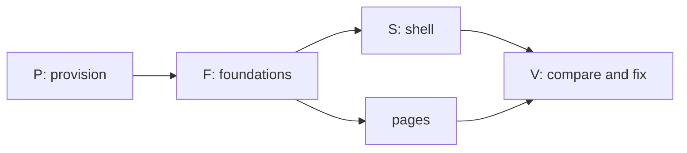

# Prompt: build the Syrius desktop redesign from the mockups

Open a session in this folder, the root of the Syrius repository, and tell
it: `Follow PROMPT-redesign-build.md`. Every path below is relative to this
folder.

This file is the instructions and the record of progress. The coordinator and
its subagents write their progress into the Progress section at the end, so a
session that starts later, or after the context was cleared, reads this file
and carries on from it.

---

## The task

Make the Syrius desktop wallet in this tree look and move the way
`mockups/redesign/` shows: every one of its 47 screens, in both themes, with
the same layout, the same effects and the same transitions. Where a screen
shows a feature the wallet cannot do yet, draw it as the mockup does but do
not let it run: put a seam in the code where the feature will be filled in
later.

You coordinate. Subagents do the microtasks below, up to four at once, each
on one small task with a fresh context. You provision, build, run, commit,
compare and dispatch.

## Assume you have never built Syrius

Nothing about this machine or this tree is taken from memory, an earlier
session, or a file that says it is done. Every tool, version, path and claim
is checked on disk before it is used.

- This file's Progress section is how the work resumes, but it is a record,
  not proof: a row marked `done` names its commit, and the commit is found in
  `git log` before anything is built on it.
- `HANDOFF.md`, when present (it is local, not in git), and its "Redesign
  build (Task 41)" table describe an earlier pass at the same work. Rows marked `done` there are claims. Reuse the code
  they point at where it exists and matches the mockup; otherwise fix it.
- The branch is `redesign`. Look at `git status` and `git log` before the
  first change, and commit nothing you did not read.

## Read first

1. `docs/design/RULES.md`: the owner's interface rules. They bind: motion
   always runs (never follow the OS reduced-motion setting), interface text
   is as short as it can be, no em dashes in it, balances with no trailing
   zeros, diagrams in docs are Mermaid.
2. `AGENTS.md`: the BLoC feature layout, generated files, the pinned and
   patched packages.
3. `mockups/redesign/README.md`: the plan. Its Motion, Shaders, Dollar values
   and "The original animations" tables are the specification for effects.
   "Not drawn" lists screens that follow a drawn pattern; build those to the
   pattern.
4. `mockups/redesign/src/*.html`: each `<section class="scr" id="…">` is one
   screen, with notes under it saying what is at rest, what is one click
   away, what moves, what was dropped. `src/00-head.html` holds the CSS: the
   colours, type, radii and gaps of both themes.
5. `mockups/redesign/shots/NN-<id>-<theme>.png`: each screen at 1280 by 780,
   dark and light. These pictures are what "done" is measured against.
6. `docs/flutter-dev-practices.md` and `docs/research/modern-flutter-stack.md`
   for how motion and shaders are built here; `harness/README.md` for driving
   the wallet; `tools/devnet/lab/README.md` for the chain it sends on.

Some files here (`docs/research/`, `HANDOFF.md`) cite paths in other
repositories or on another machine as their sources. You do not need them,
and you do not go looking for them.

## Hard rules

- **Stay in this folder.** Read and write nothing outside it, except the
  tools you install, what `tools/devnet/lab/lab.sh` fetches into its own
  `.build/`, and Docker's own state. If something seems to need a file from
  elsewhere, stop and ask.
- **Never touch the real wallet.** Real wallets live in `%AppData%\znn`. Run
  the wallet only through `harness/h start`, which moves APPDATA, LOCALAPPDATA,
  TEMP, HOME and USERPROFILE into a profile under `.harness/`, or with those
  variables redirected by hand for `flutter run`. Syrius allows one window per
  desktop: check no `syrius.exe` is running before you start one, and stop
  only what you started.
- **No new dependency.** The packages the mockup's effects need are in
  `pubspec.yaml` already (`animations`, `flutter_animate`, `flutter_shaders`,
  `lottie`). If a task cannot be done without one, it stops and says so.
- `flutter pub get` rewrites `analysis_options.yaml` and `pubspec.lock`;
  restore them before each commit unless the change was meant.
- Elevation (an installer's UAC prompt, enabling Developer Mode) is the
  owner's to grant: list what needs it and ask once, together.
- Keep the tree compiling at every commit. Commit on `redesign` only, new
  commits, never amends, never a push unless the owner asks.
- Writing, in code and docs: say what a thing is and why it is that way, name
  the failure that motivated a constraint, leave out encouragement. Comments
  explain the decision, not the syntax. Reports back are short.

## Seams: a feature that is drawn but not built

Missing means the logic behind the control does not exist in this tree: a
service, a chain call, a file format, a platform API. It does not mean "the
widget is not drawn yet"; drawing is the task.

Task F03 builds the seam kit before any page task starts. Every page task
uses it the same way:

- `lib/seams/seam.dart`: `enum Seam` with one value per missing feature, and
  `SeamGate(seam:, child:)`. The child is drawn exactly as the mockup draws
  it, then held disabled: no tap, no keyboard activation, the cursor stays
  basic, a tooltip of two words ("Not yet"). Its Go to entry and its shortcut
  refuse the same way.
- A missing service is an interface plus an `Unbuilt…` implementation that
  throws `SeamNotBuilt(Seam.x)`. Nothing calls the network or the chain for
  it, and no fake result is shown as real.
- Each seam is listed in `lib/seams/SEAMS.md`: the value, the screens it
  gates, the file to fill in, and the brief in `docs/research/` that describes
  it. A test fails when an enum value has no row there.
- Candidates from the mockup, to be confirmed against the tree by each task:
  Zap send and receive, the wallet picker at unlock, operator modes, the
  GitHub update notice, Windows Hello, WalletConnect approvals in the bell,
  the Sporks group, the Ledger flow. Anything the tree already does is wired,
  not seamed.

## End state

The work is done when all of these hold:

1. On a clean checkout, `docs/environment.md` lists every tool with its
   version and how it was installed, and following it gives a working debug
   and release build of the wallet on Windows.
2. `flutter analyze` reports no error or warning, and `flutter test` passes.
3. For each of the 47 screen ids and each theme, a harness script drives the
   wallet into that state at a 1280 by 780 client area and takes a shot.
   `mockups/redesign/compare/index.html` shows each shot beside its mockup
   shot with a diff, and every pair is marked `match` in the Screens table of
   the Progress section.
   A pair matches when the layout, components, colours, type, spacing, icons
   and animation frames shown agree. Allowed differences: the example figures,
   names and addresses, live data, and font hinting.
4. Every row of the mockup's Motion table and Shaders table plays in the
   running build as specified, checked by eye in the built wallet and, where a
   test can hold it, by a widget test on its duration and curve.
   `harness/h stalls` during a page change, a disclosure and the launch shows
   no frame over 16 ms that the old build did not also have.
5. Every seam is in `SEAMS.md`, and none of them can be set off from the
   interface.

## Order



P runs one task at a time: it installs and builds, and builds collide. F
starts when P is done; S and the page groups start when F03 (seams) and F01
(tokens) are committed, and each page group also needs the shared parts it
names. V runs as pages land, not only at the end.

## How the coordinator works

1. **Start from the Progress section.** Read it whole. A row left at `run`
   by a session that ended is checked against the disk (its files, `git
   status`) and set back to `todo` with a note of what was found.
2. Dispatch up to four `general-purpose` agents, each on one row whose
   dependencies are `done` and whose write paths no running row shares.
   Give each the brief template below, filled in. The agent marks its own
   row as it goes (see "Keeping the Progress section").
3. When a row reports: read the diff, run `flutter analyze --no-pub` on its
   files and its tests, add any strings it reported, commit it, set the row
   to `done` with the commit's short hash, and dispatch the next.
4. After every four rows: full `flutter test`, `harness/h build`, run the
   screen scripts of the screens those rows touched, rebuild the compare
   page, and look at it. Mark each pair looked at in the Screens table. Each
   mismatch becomes a new row (`X01`, `X02`, …) appended to the Rows table,
   naming the screen, the difference and the write paths.
5. Rewrite the "Now" lines of the Progress section after each of steps 3 and
   4, and before anything that can end the session (a long build, a
   restart).
6. Never build or run the harness while an agent is writing.
7. A row that fails twice is split, not retried as it was.

### Keeping the Progress section

Several agents write to this file at once, so every write is small and
exact:

- Only the Edit tool, replacing one whole line that is yours: your row in the
  Rows table, or, for the coordinator, the "Now" lines, the Screens table and
  new `X` rows. Never Write this file, never reformat it, never touch another
  agent's line. If the edit is refused because the file changed, read it
  again and redo the one edit.
- Times are UTC from `date -u +%Y-%m-%dT%H:%MZ`, never an estimate.
- A note is one short line: what is true now, not the history. No `|`, no
  em dashes.
- States: `todo`, `run` (an agent has it), `review` (the agent finished; the
  coordinator has not committed it), `done` (committed, hash in the note),
  `blocked` (the note says on what). In the Screens table: `todo`, `match`,
  or the `X` row that holds the difference.

### Brief template

```
Row <ID>: <what>.
Mockup: mockups/redesign/src/<file>.html, sections <ids>;
shots mockups/redesign/shots/<NN>-<id>-dark.png and -light.png.
Spec rows: <Motion / Shaders / Dollar values rows that apply>.
Write only: <paths>, and your row's line in PROMPT-redesign-build.md.
Read anything in this repository.

Progress: follow "Keeping the Progress section" in PROMPT-redesign-build.md.
Set your row to run when you start, update its note after each step that
lands (drawn, wired, tests passing), and set it to review with a one-line
summary as the last thing before your report. If you stop on a problem,
set it to blocked and say on what.

First check what exists at those paths and whether it already matches the
mockup; change only what does not. Draw what the mockup draws. If the logic
behind a control does not exist in the tree, gate it with SeamGate and add
its row to lib/seams/SEAMS.md; do not build the missing service.

Do not: run flutter build, flutter run, flutter pub get or harness/h; write
to git; add a dependency; kill a process you did not start; bulk-replace
with a script. Use Edit and Write for Dart and ARB files.

Follow docs/design/RULES.md. Read nothing outside this repository.
Colours, gaps and radii from AppTokens.of(context), never literals.
Directional padding. Amounts and addresses in Ltr; balances through
AmountText (no trailing zeros). Motion always runs; nothing on money moves
except ValueFlash. Interface text as short as it can be, no em dashes.
Comments say why. New strings: append to lib/l10n/app_en.arb only, then
flutter gen-l10n (re-read the file if the edit is refused; another agent may
have appended).

Write harness/screens/<id>.txt for each screen you own: the harness lines
that bring the wallet from unlocked Home to that state. Do not run it.

Done when: flutter analyze --no-pub <your files> is clean, and
flutter test --no-pub --timeout 60s <your test dir> passes.
Report in at most 25 lines: files written, tests, seams added, strings
added, what does not yet match the shot and why, what you found. Then stop.
```

## Microtasks

`Needs` names rows that must be committed first. Paths are relative to the
repository; `features/` is `lib/rearchitecture/features/`, `tabs/` is
`lib/widgets/tab_children_widgets/`, `modular/` is
`lib/widgets/modular_widgets/`, `utils/widgets/` is
`lib/rearchitecture/utils/widgets/`.

### P: provision (one at a time; the coordinator or one agent)

| Row | What | Writes | Needs |
| --- | --- | --- | --- |
| P01 | Inventory, read only: Windows version, Git with Git Bash, Visual Studio or Build Tools with the "Desktop development with C++" workload (MSVC, CMake, a Windows SDK), Flutter and Dart, Python 3 with Pillow, Node (the lab's scripts), Chrome or Edge, Docker Desktop, Developer Mode (Flutter's Windows plugins need symlinks). Record what is present, with versions, and what is missing | `docs/environment.md` | |
| P02 | Choose the Flutter version: the newest stable that satisfies `pubspec.yaml`'s Dart constraint and resolves `pubspec.lock`; note where it differs from `FLUTTER_VERSION` in `.github/workflows/` and why | `docs/environment.md` | P01 |
| P03 | Install what P01 found missing (winget where it can; Flutter as a git checkout of the chosen tag). One list of elevation prompts to the owner first | `docs/environment.md` | P02 |
| P04 | `flutter config --enable-windows-desktop`; `flutter doctor -v` clean for Windows desktop. Record any warning left and why it does not matter | `docs/environment.md` | P03 |
| P05 | Dependencies and generated code: `flutter pub get` (then restore the two files it rewrites), `dart run build_runner build --delete-conflicting-outputs` if any `*.g.dart` is stale, `flutter gen-l10n`. Check the `libznn` blobs in `lib/embedded_node/blobs/` load on Windows | generated files only | P04 |
| P06 | Baseline: `flutter analyze`, `flutter test`, `flutter build windows --release` and `--debug`. Record times, test count and every existing warning, so later rows are judged against it | `docs/environment.md` | P05 |
| P07 | Debug loop: `flutter run -d windows` with the profile variables redirected, hot reload and hot restart, DevTools attached, a breakpoint hit. Write the exact recipe | `docs/environment.md` | P06 |
| P08 | Harness: `harness/h build`, `start --fresh`, onboarding, `tour` with no error widget and no SEVERE log | `docs/environment.md` | P06 |
| P09 | Lab devnet: `tools/devnet/lab/lab.sh up` (chain 321; it fetches go-zenon at a pinned commit and builds the image), `status` says producing, the devnet mnemonic from its README imported into the harness profile, `harness/h chain 321`, index 1 selected, one send confirmed | `docs/environment.md` | P08 |
| P10 | Mockup pipeline: `python art.py` and `python build.py shots` in `mockups/redesign/` reproduce `shots/` (diff a few); proves Chrome and Python | none | P04 |

### F: foundations (four at once)

| Row | What | Writes | Needs |
| --- | --- | --- | --- |
| F01 | Tokens: every CSS variable in `src/00-head.html`, both themes (colours, type scale, radii, gaps, shadows, glass), mapped one to one into `AppTokens` and the two `ThemeData`s; a table in the file's doc comment of mockup name to token | `lib/utils/app_theme.dart`, `lib/utils/app_colors.dart`, `test/theme/` | P |
| F02 | Fonts: the families and weights the mockup inlines, bundled and declared. The coordinator edits `pubspec.yaml` from the agent's report | `assets/fonts/`, report for `pubspec.yaml` | P |
| F03 | Seam kit, as specified above, with its test | `lib/seams/`, `test/seams/` | P |
| F04 | Harness additions: `theme dark\|light`, `window` sized by client area in logical pixels at 1280 by 780, and `screens <id>\|all` that runs `harness/screens/<id>.txt` in both themes and saves `.harness/shots/<NN>-<id>-<theme>.png` | `harness/bin/`, `harness/app/`, `harness/README.md` | P08 |
| F05 | Compare page: `tool/redesign_compare.py` pairs `.harness/shots/` with `mockups/redesign/shots/`, writes `mockups/redesign/compare/index.html` (side by side, a diff image, a per-pair score, the screen's notes) | `tool/redesign_compare.py`, `mockups/redesign/compare/` | P10 |
| F06 | Seed data: `harness/seed/` scripts of harness lines that give the lab the states the shots need, done through the wallet itself (a stake, a fuse, a token owned, a swap, a project, a second funded address). Index 1 already owns pillar `dev1` and three fuses. States the lab cannot reach (a sentinel, a fuse old enough to cancel) get a fixture injected through `harness/app/` only, never linked into an ordinary build | `harness/seed/`, `harness/app/fixtures/` | P09 |
| F07 | `Segment` (one sliding thumb, 360 ms `(.65,0,.35,1)`, arrow keys) and `Disclosure` (240 ms slide 8 px, chevron 220 ms, state kept by key) | `utils/widgets/segment.dart`, `disclosure.dart`, their tests | F01 |
| F08 | `PageStrip` (headline figures, 48 px lead slot, main action) and `EmptyNote` (no-data mark at 44 px with "None yet", 16 px on one-line cards) | `utils/widgets/page/`, `test/page_strip/` | F01 |
| F09 | `RowDetail` (a row that opens its details under itself) and the list entrance (40 ms stagger, once) | `utils/widgets/row_detail.dart`, `test/row_detail/` | F01 |
| F10 | Motion kit: `RiseSwitcher` with fade through (320 ms, rise 6 px), `ValueFlash` (one 1.2 s flash; a new row rises 6 px over 320 ms), `Skeleton` sweep (1.4 s, in step across the page) | `utils/widgets/motion/`, `test/motion/` | F01 |
| F11 | Frost: blurred backdrop for dialogs, Go to, the bell panel, menus, the lock and ready cards; one `BackdropGroup` where several share it; dialogs rise 6 px | `lib/widgets/reusable_widgets/modals/`, `test/frost/` | F01 |
| F12 | Primary pill: its look per theme and the 600 ms sheen on hover and once when the action lands | `lib/widgets/reusable_widgets/buttons/`, `test/sheen/` | F01 |
| F13 | Shaders: hero field (Home, lock, Welcome), plasma glow, meter flow; each in a `RepaintBoundary`, one ticker, stopped when its page is hidden or the window loses focus | `lib/rearchitecture/utils/shaders/`, `shaders/`, `test/shaders/` | F01 |
| F14 | Lottie rules in `AppLottie`: play once when the surface appears, hold the last frame, replay on hover; the three loops; nothing below 40 px; `_small` files at 48 px | `lib/widgets/reusable_widgets/app_lottie.dart`, `test/app_lottie/` | F01 |
| F15 | `LaunchFilm`: animated WebP a frame at a time (window file and well file), start frame, hold, replay, skip; the assets from `tool/lottie_reencode.py` if absent | `lib/widgets/reusable_widgets/launch_film.dart`, `assets/images/launch*.webp`, `tool/`, `test/launch_film/` | F01 |
| F16 | Dollar values: price feed (CoinGecko `zenon-2` and `quasar`, once a minute while listened to, last answer kept), `DollarText` (dim, mono, 13 px; four decimals under a dollar; `≈` on sums), the setting key, on | `lib/services/price_feed.dart`, `utils/widgets/dollar_text.dart`, `test/price_feed/` | F01 |
| F17 | Hidden balances: one notifier, `HiddenAmount` dots, the eye on the original Lottie (frames 0 to 30, 200 to 232) | `lib/utils/notifiers/balance_visibility.dart`, `utils/widgets/eye_toggle.dart`, `test/hidden_balances/` | F14 |
| F18 | Toast: rises 300 ms, bar drains over 5 s, hover pauses, self-dismissing | `lib/utils/toast_utils.dart`, its widget, `test/toast/` | F01 |

### S: shell (`10-home.html` shows it on every screen)

| Row | What | Screens | Writes | Needs |
| --- | --- | --- | --- | --- |
| S01 | Rail: 56 px icons, tooltips with shortcuts, chevron to 200 px (200 ms spring, labels fade 150 ms after), state kept across restarts; Home, Transfer, Staking, Nodes, Plasma, Tokens, Swap, Accelerator, then bell, Settings, Lock | all | `lib/widgets/shell/rail.dart`, `test/shell/rail/` | F01, F03 |
| S02 | Status strip: sync, node, chain, peers; sync dot pulse 2.4 s, amber when behind; in-flight block chip; plasma generating with the bolt, elapsed and typical time; update line slot (seam) | all | `lib/widgets/shell/status_strip.dart`, `lib/widgets/shell/strip/`, `test/shell/strip_test.dart` | F03, F14 |
| S03 | Bell panel: dot for unseen, slides 24 px over 240 ms with frost, what needs the user first, runs folded ("Block published × 6") | `home-bell` | `lib/widgets/shell/bell_panel.dart`, `tabs/notifications_tab_child.dart` | F11 |
| S04 | Go to (Ctrl K): pages, actions, addresses, contacts; seamed actions refuse | `home-goto` | `utils/widgets/go_to_palette.dart` | F03, F11 |
| S05 | Shortcuts: Ctrl 1 to 8, Ctrl L, R, H, comma, Esc; page change by fade through | all | `lib/widgets/shell/shortcuts.dart`, `lib/widgets/shell/shell.dart` | S01, F10 |

### Home (`10-home.html`)

| Row | What | Screens | Writes | Needs |
| --- | --- | --- | --- | --- |
| H01 | Hero: balances with dollar values, the eye, Send / Receive / Zap pills, hero field behind; no refresh icons | `home-rest` | `features/home/view/` hero files | F13, F16, F17, F12 |
| H02 | Side cards: To collect on one line with Collect all, Tokens closed (opens in place), Pending only while a block is in flight | `home-rest`, `home-open` | `features/home/view/` side files, `features/pending_transactions/` | F07, F08 |
| H03 | Activity list: rows say what moved, Message on a zap row (seam if Zap is), hidden state hides amounts | `home-rest`, `home-hidden` | `features/latest_transactions/` | F09, F17 |
| H04 | "A zap arrived": 28 sparks over 900 ms, once per hash (gate on the Zap seam if receive is missing) | `home-zap` | `features/home/view/zap_sparks.dart` | F03 |

### Transfer (`20-transfer.html`)

| Row | What | Screens | Writes | Needs |
| --- | --- | --- | --- | --- |
| T01 | One 640 px card, `Segment` Send / Receive / Zap; To receive below only with rows; Receive blocked while a receive runs | all transfer | `features/transfer/`, `tabs/transfer_tab_child.dart` | F07 |
| T02 | Send: recent chips, book icon, dollar line, look-alike and first-time warning, node-behind note | `send-rest`, `send-warn` | `features/send/` | T01, F16 |
| T03 | Receive: address, Show QR, request an amount | `receive`, `receive-qr` | `features/receive/` | T01 |
| T04 | Confirm dialog in the transfer shape (`docs/design/RULES.md` section 8), the block followed to its momentum | `send-confirm` | send dialog files | F11, T02 |
| T05 | Zap tab as drawn; behind its seam if the Zap service is missing | `zap-form` | `features/zap/` | T01, F03 |

### Staking and Nodes (`30-earn.html`)

| Row | What | Screens | Writes | Needs |
| --- | --- | --- | --- | --- |
| E01 | Staking: strip (staked, to collect, week, Stake), list with unlock countdown, New stake as a disclosure, empty state, reward chart behind a button | `staking`, `staking-new`, `staking-empty` | `features/staking/`, `stakes/`, `create_stake/`, `stake_collect/`, `staking_rewards_history/`, `tabs/staking_tab_child.dart` | F07, F08, F09 |
| E02 | Nodes page: `Segment` Pillars / Sentinels, delegation strip; one rail entry replacing the two tabs | `pillars` | new `tabs/nodes_tab_child.dart`, `features/delegation/`, `delegation_stats/` | F07, F08, S01 |
| E03 | Pillars list: five columns, sort chip, search, APR, row detail | `pillars` | `features/pillars/`, `active_pillars/` | E02, F09 |
| E04 | Your pillar panel: pillar Lottie once at 132 px, then 48 px in the strip; revoke asks twice | `pillar-mine` | `features/pillars_by_owner/`, `pillar_parts/` | E02, F14 |
| E05 | Sentinels tab: list, your sentinel leading the strip at 48 px | `sentinels` | `features/sentinels/`, `sentinels_by_owner/`, `active_sentinels/` | E02, F14 |
| E06 | Steppers on a shared axis (300 ms), every step kept mounted | `spawn` | `lib/widgets/reusable_widgets/custom_material_stepper.dart`, step switcher | F01 |
| E07 | Success step: the object full size ("Pillar registered"; the same shape for sentinel and token) | `pillar-done` | stepper success widgets | E06, F14 |

### Plasma and Tokens (`40-plasma-tokens.html`)

| Row | What | Screens | Writes | Needs |
| --- | --- | --- | --- | --- |
| K01 | Plasma: glow in its well, available and fused strip, fused list with checkboxes and "Cancel 2 fuses" | `plasma` | `features/plasma_stats/`, `fused_plasma/`, `cancel_plasma/`, `tabs/plasma_tab_child.dart` | F13, F08, F09 |
| K02 | Fuse form and Other addresses as disclosures | `plasma-fuse` | `features/fuse_plasma/` | K01, F07 |
| K03 | Tokens: one list, Held / Favorites / All, search, balance column, the coin leading the strip | `tokens` | `features/tokens/`, `all_tokens/`, `token_balance/`, `token_favorite/`, `search_token/`, `tabs/tokens_tab_child.dart` | F07, F08, F14 |
| K04 | Token row detail: Mint, Burn, Transfer ownership, Flags in the row | `token-mine` | `features/mint_token/`, `burn_token/`, `transfer_token/` | K03, F09 |
| K05 | Create token stepper | `token-new` | `features/create_token_stepper/`, `create_token/` | E06 |

### Swap and Accelerator (`50-swap-az.html`)

| Row | What | Screens | Writes | Needs |
| --- | --- | --- | --- | --- |
| W01 | Swap: strip, one list (active, completed, to reclaim), row detail with deposit ID | `swap-list` | `modular/p2p_swap_widgets/` list files, `tabs/p2p_swap_tab_child.dart` | F08, F09 |
| W02 | Start and Join dialogs in the transfer shape, dollar line | `swap-start` | `modular/p2p_swap_widgets/modals/` | F11, F16 |
| W03 | Accelerator: fund strip, Voting / Active / Mine / All, vote bar in the row | `az` | `modular/accelerator_widgets/` list files, `tabs/accelerator_tab_child.dart` | F07, F08 |
| W04 | Project page by container transform (300 ms), phases, vote column | `az-project` | `lib/screens/project_details_screen.dart`, project detail files | W03 |

### Settings (`60-settings.html`)

| Row | What | Screens | Writes | Needs |
| --- | --- | --- | --- | --- |
| G01 | Frame: seven sections (Node, Security, Display, Wallet, Apps, Addresses, About), groups closed, no second rail, every Confirm gone | all settings | `tabs/settings_tab_child.dart`, `modular/settings_widgets/settings_parts.dart` | F07 |
| G02 | Node section, Sporks group closed (seam if not wired) | `set-node` | node management and peers files | G01 |
| G03 | Security: applies when chosen, wrong-password limit on at 3, Windows Hello row (seam) | `set-security` | security file | G01, F03 |
| G04 | Display: theme, dollar switch, explorer, rail labels, hide balances | `set-display` | display and general files | G01, F16 |
| G05 | Wallet: modes (seam), wallets on this computer (seam), delete cache keeps labels | `set-wallet` | wallet options and backup files | G01, F03 |
| G06 | Apps: connected sites as one list and one switch | `set-apps` | `modular/wallet_connect_widgets/`, new `apps.dart` | G01 |
| G07 | Addresses: labels and contacts | `set-addresses` | addresses file | G01 |
| G08 | About with the update line (seam), Licences group | `set-about`, `set-licences` | about card, new `licences.dart` | G01, F03 |
| G09 | The unlabelled field under the last licence; 321 raises the Originals card (six tiles that play on hover, three small, replay launch). Nothing stored | `set-originals` | `licences.dart` field, new `originals_card.dart` | G08, F14, F15 |

### Entry (`70-entry.html`)

| Row | What | Screens | Writes | Needs |
| --- | --- | --- | --- | --- |
| N01 | Launch: full window on black, click or key skips to the last frame | `launch` | `lib/screens/splash_screen.dart` | F15 |
| N02 | Lock card: the well playing `LaunchFilm`, wallet name, password, tries left; wrong password shakes the field 4 px twice over 200 ms and replays frames 14 to 56 in the well; Ctrl L replays the same | `lock-screen`, `lock-wrong` | `tabs/lock_tab_child.dart` | F15, F13, F11 |
| N03 | Launch settles into the lock card: one container transform on the stage's rect, 400 ms emphasized decelerate; the lock card under the stage from the first frame | `launch-settle` | `splash_screen.dart`, `lock_tab_child.dart` | N01, N02 |
| N04 | Wallet picker at unlock, drawn; behind its seam if listing wallets is missing | `lock-pick` | lock card picker file | N02, F03 |
| N05 | Welcome: the globe turning on the left half, three rows with the list entrance | `welcome` | `lib/screens/onboarding/access_wallet_screen.dart`, onboarding scaffold | F14, F09 |
| N06 | Import (any file accepted) and the seed quiz of three words, four choices each | `import`, `seed-quiz` | `lib/screens/onboarding/` import and confirm-seed files | N05 |
| N07 | Wallet ready: the map full window behind a frosted card | `wallet-ready` | `lib/screens/onboarding/wallet_success_screen.dart` | F11, F14 |

### V: compare and fix (the coordinator, as pages land)

| Row | What |
| --- | --- |
| V01 | Seed the lab (F06), `harness/h build`, `harness/h screens all`, `python tool/redesign_compare.py`. Mark each pair `match` or open an `X` row for it |
| V02 | Motion pass in the running build: each Motion and Shaders row seen, `harness/h stalls` across a page change, a disclosure and the launch, compared with P06's baseline |
| V03 | Seam pass: every value in `SEAMS.md` tried from its control, its shortcut and Go to; none runs |
| V04 | The minimum window (1200 by 600) and Arabic layout looked at once; defects become `X` rows, not part of the match |
| V05 | A fresh agent, given only the compare page, `mockups/redesign/README.md` (its "Settled by the owner" table above all) and `docs/design/RULES.md`, reviews every pair against the section 9 checklist and the owner's answers; its findings become `X` rows |
| V06 | End state checked item by item and written into the Progress section with the date |

## Progress

Written by the coordinator and its agents as the work goes; see "Keeping
the Progress section" for how. Nothing below has been started.

### Now

- Updated: not yet
- Running: none
- Next: P01
- Last batch check: none

### Rows

| Row | State | Updated (UTC) | Note |
| --- | --- | --- | --- |
| P01 | todo | | |
| P02 | todo | | |
| P03 | todo | | |
| P04 | todo | | |
| P05 | todo | | |
| P06 | todo | | |
| P07 | todo | | |
| P08 | todo | | |
| P09 | todo | | |
| P10 | todo | | |
| F01 | todo | | |
| F02 | todo | | |
| F03 | todo | | |
| F04 | todo | | |
| F05 | todo | | |
| F06 | todo | | |
| F07 | todo | | |
| F08 | todo | | |
| F09 | todo | | |
| F10 | todo | | |
| F11 | todo | | |
| F12 | todo | | |
| F13 | todo | | |
| F14 | todo | | |
| F15 | todo | | |
| F16 | todo | | |
| F17 | todo | | |
| F18 | todo | | |
| S01 | todo | | |
| S02 | todo | | |
| S03 | todo | | |
| S04 | todo | | |
| S05 | todo | | |
| H01 | todo | | |
| H02 | todo | | |
| H03 | todo | | |
| H04 | todo | | |
| T01 | todo | | |
| T02 | todo | | |
| T03 | todo | | |
| T04 | todo | | |
| T05 | todo | | |
| E01 | todo | | |
| E02 | todo | | |
| E03 | todo | | |
| E04 | todo | | |
| E05 | todo | | |
| E06 | todo | | |
| E07 | todo | | |
| K01 | todo | | |
| K02 | todo | | |
| K03 | todo | | |
| K04 | todo | | |
| K05 | todo | | |
| W01 | todo | | |
| W02 | todo | | |
| W03 | todo | | |
| W04 | todo | | |
| G01 | todo | | |
| G02 | todo | | |
| G03 | todo | | |
| G04 | todo | | |
| G05 | todo | | |
| G06 | todo | | |
| G07 | todo | | |
| G08 | todo | | |
| G09 | todo | | |
| N01 | todo | | |
| N02 | todo | | |
| N03 | todo | | |
| N04 | todo | | |
| N05 | todo | | |
| N06 | todo | | |
| N07 | todo | | |
| V01 | todo | | |
| V02 | todo | | |
| V03 | todo | | |
| V04 | todo | | |
| V05 | todo | | |
| V06 | todo | | |

`X` rows from the batch checks are appended here, each naming its screen,
the difference and its write paths in the note.

### Screens

| # | Screen | Dark | Light |
| --- | --- | --- | --- |
| 01 | `home-rest` | todo | todo |
| 02 | `home-open` | todo | todo |
| 03 | `home-hidden` | todo | todo |
| 04 | `home-bell` | todo | todo |
| 05 | `home-goto` | todo | todo |
| 06 | `home-zap` | todo | todo |
| 07 | `send-rest` | todo | todo |
| 08 | `send-warn` | todo | todo |
| 09 | `receive` | todo | todo |
| 10 | `receive-qr` | todo | todo |
| 11 | `zap-form` | todo | todo |
| 12 | `send-confirm` | todo | todo |
| 13 | `staking` | todo | todo |
| 14 | `staking-new` | todo | todo |
| 15 | `staking-empty` | todo | todo |
| 16 | `pillars` | todo | todo |
| 17 | `pillar-mine` | todo | todo |
| 18 | `sentinels` | todo | todo |
| 19 | `spawn` | todo | todo |
| 20 | `pillar-done` | todo | todo |
| 21 | `plasma` | todo | todo |
| 22 | `plasma-fuse` | todo | todo |
| 23 | `tokens` | todo | todo |
| 24 | `token-mine` | todo | todo |
| 25 | `token-new` | todo | todo |
| 26 | `swap-list` | todo | todo |
| 27 | `swap-start` | todo | todo |
| 28 | `az` | todo | todo |
| 29 | `az-project` | todo | todo |
| 30 | `set-node` | todo | todo |
| 31 | `set-security` | todo | todo |
| 32 | `set-display` | todo | todo |
| 33 | `set-wallet` | todo | todo |
| 34 | `set-apps` | todo | todo |
| 35 | `set-addresses` | todo | todo |
| 36 | `set-about` | todo | todo |
| 37 | `set-licences` | todo | todo |
| 38 | `set-originals` | todo | todo |
| 39 | `launch` | todo | todo |
| 40 | `launch-settle` | todo | todo |
| 41 | `lock-screen` | todo | todo |
| 42 | `lock-wrong` | todo | todo |
| 43 | `lock-pick` | todo | todo |
| 44 | `welcome` | todo | todo |
| 45 | `import` | todo | todo |
| 46 | `seed-quiz` | todo | todo |
| 47 | `wallet-ready` | todo | todo |
