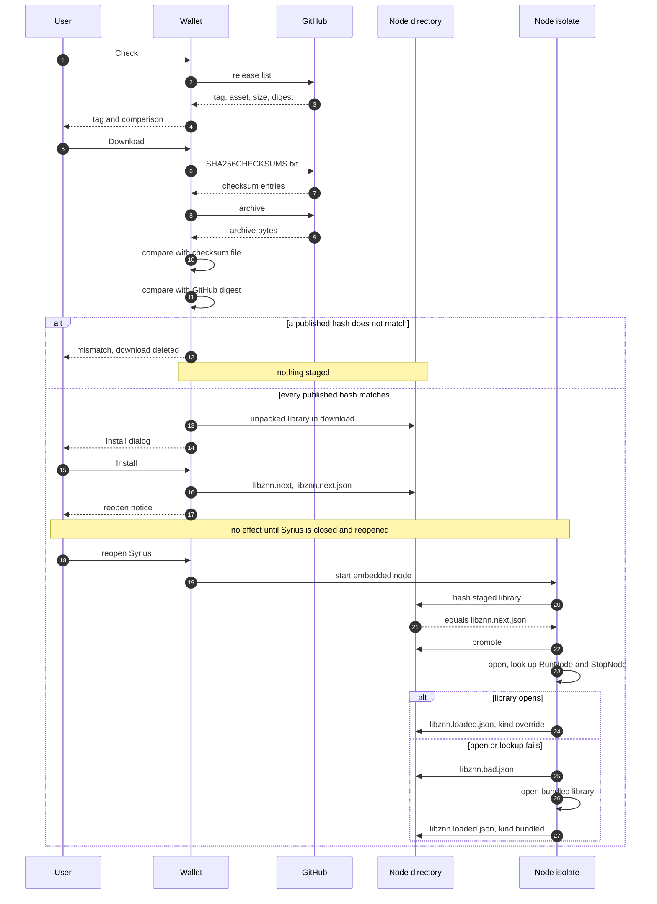
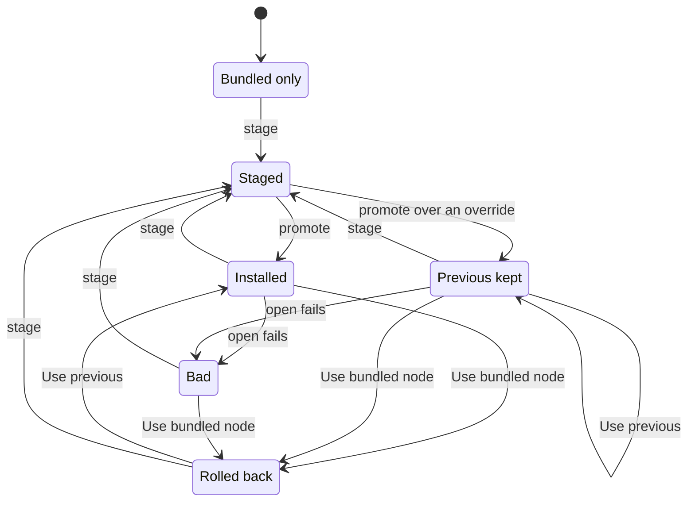

# Embedded node updates

How an installed Syrius loads a newer go-zenon node library (`libznn`) without
a new Syrius release.

Source: `lib/embedded_node/` (loader, updater, archive reader) and
`lib/rearchitecture/features/node_update/` (the Settings panel). Tests:
`test/embedded_node/`, `test/node_update/`.

## What it is

The embedded node is a native library, `libznn.dll`, `libznn.so` or
`libznn.dylib`. Syrius loads it into its own process through FFI and calls two
symbols, `RunNode` and `StopNode`. The library ships beside the executable, so
a newer node used to need a new wallet release.

The bundled copy is refreshed at release time by
`.github/workflows/syrius_lib_updater.yml`. That workflow is started by hand,
downloads the latest release of `zenon-network/go-zenon`, unpacks
`libznn-linux-amd64.tar.gz`, `libznn-darwin-universal.tar.gz` and
`libznn-windows-amd64.zip`, and commits them to `lib/embedded_node/blobs/` when
their hashes differ from what is there. It uses the hashes to detect a change
only. It checks nothing against the release's checksum file.

Now the wallet can also load a library from an override directory in the
user's profile. The profile is writable without an installer or an admin
right. The loader (`NodeLibrary`) prefers a good override and falls back to
the bundled library in the same start when the override is missing, does not
match its manifest, is marked bad or does not open. A bad override never keeps
the wallet from starting.

One constraint shapes all of it: a loaded library cannot be replaced. Windows
locks a loaded DLL against deletion and overwriting, and a Go runtime cannot be
unloaded, because closing the handle under its threads would crash the
process. So an install only stages files. They take effect the next time
Syrius is started and the embedded node is started in it. The loader writes
what it loaded, with the process id, to `libznn.loaded.json`. A later node
isolate in the same process opens that same path again and promotes nothing,
so a library staged mid-session is never renamed into place under a process
that still runs the old one. If that path does not open again, or the record
is gone, the loader throws `NodeLibraryHeldException` and opens nothing: a
second library would put a second Go runtime into the process. The embedded
node then stays down until Syrius is closed and reopened.

A pid alone does not say "this process", because a later run can be given the
same number. `embedded_node.dart` therefore registers a name,
`embeddedNodeLibraryHeld`, in the isolate name server after its first load,
and passes the loader whether the name is there. The name server is shared by
every isolate of a process and empty in a new one.

The override is used by the embedded node only. A wallet connected to a remote
node loads no library at all.

## Trust model

The library runs in the process that holds the wallet's keys. A malicious one
is a total compromise. The design follows from that.

**Nothing installs by itself.** Opening the panel reads the disk and nothing
else. No request leaves the wallet until Check is pressed. Nothing is
downloaded until Download is pressed. Nothing is staged until the Install
dialog is confirmed. There is no background check and no timer.

**Requests go to GitHub only.** HTTPS, the default port, no credentials in the
URL. The release list comes from `api.github.com`. Assets come from
`github.com`, `objects.githubusercontent.com` and
`release-assets.githubusercontent.com`. Redirects are followed by hand, at
most five, and every hop is checked against that list before a request goes to
it. A download is capped at 200 MB, and so is the unpacked library.

**Two checks on a download.** The archive is hashed as it streams in and
compared with two published sha256 values:

1. the entry for the asset in the release's checksum file
   (`SHA256CHECKSUMS.txt`, also recognised as `sha256sums`, `sha256sums.txt`
   or `checksums.txt`), which the publisher uploaded;
2. the `digest` of the asset in GitHub's API, which GitHub computed at upload.

Where both exist they must name the same hash, or nothing is downloaded. A
hash that exists must match the archive, or the download is deleted. One of
the two is enough to go on. Where neither exists the download is refused,
unless the user answers a separate question, "Download without verification?".
A checksum file that the release lists but that cannot be fetched is a
failure, not an absence. Otherwise blocking one request would switch the check
off.

What the checks prove: the archive is the one that release lists, it arrived
whole, and it was not swapped alone. Someone who replaces only the archive
leaves the checksum file behind, and the archive no longer matches it.

What they do not prove: that the release is honest. The checksum file, the
digest and the archive all come from the same release on the same service.
Whoever can publish in the repository, or takes over the account or the
repository, can replace all three together. go-zenon publishes no signature,
so there is nothing outside the release to check against.

**What the user is shown before confirming.** The dialog "Install this node?"
lists:

| Line | Value |
|---|---|
| Repository | `owner/name`, or "None" for a file |
| Release | the tag, or "None" for a file |
| Asset (File for a file) | the archive's or the file's name |
| SHA-256 | the whole sha256 of the library, selectable |
| Checksum file | "Matches the release's checksum file", "Not listed in the release's checksum file", "The release has no checksum file", or "Not checked: a file from this computer" |
| GitHub digest | "Matches GitHub's digest", "GitHub gives no digest for this release", or "Not checked: a file from this computer" |

Then one sentence: "This replaces the node that runs inside the wallet. It
takes effect at the next start." A check line that does not read "Matches" is
drawn in the warning colour. Cancel holds the focus, so Enter and Space back
out. Escape or a click outside is a no, and a no deletes the download.

The sha256 shown is of the unpacked library. The published hashes are of the
archive. The two cannot be compared by eye. The library's hash is what the
manifest records and what `libznn.loaded.json` reports after the next start.

**From file** takes a library, or a `.zip`, `.tar.gz` or `.tgz` holding
exactly one, from the user's disk. Nothing vouches for it. The dialog says so
on both check lines, and the sha256 is all the user has to go on. This is the
path for a self-built node.

**The source repository is a setting** (`node_update_repository` in the
wallet's preferences, default `zenon-network/go-zenon`). It exists so that the
releases of a fork go through the same two checks as upstream's. The
alternative for a fork is From file, which checks nothing. Changing it means
trusting whoever can publish releases in that repository with the wallet's
keys. The panel says under the field: "Libraries from another repository are
not the Zenon project's." The value must be `owner/name`. The hosts cannot be
changed, so it is always a GitHub repository.

**The loader's own hash check is not a defence.** An override is loaded only
when its sha256 equals the one in its manifest. That catches a truncated or
half-written file. Whoever can write the library into the profile can write
the manifest beside it.

## One install



The parties: the user, the wallet's Settings panel (Settings > Node, "Embedded
node"), GitHub (the API and the release assets), the node directory in the
profile, and the isolate the wallet starts the embedded node in.

- **1 to 4.** Check is one API request for the repository's releases. Drafts
  and prereleases are passed over. The panel shows the newest release's tag,
  its date and how it compares: "Up to date", "Update available", "Staged for
  the next start" or "Not compared". The comparison is by tag, and the bundled
  library has no tag, so against the bundled library it reads "Not compared"
  and Download is still offered.
- **5 to 7.** The checksum file is fetched first. If it and GitHub's digest
  name different hashes for the asset, the install stops here and the archive
  is never requested.
- **8 and 9.** The archive streams into the `download` folder of the node
  directory. A download of another length than the release lists is refused.
- **10 to 12.** The two checks. On a mismatch the panel shows the published
  and the downloaded hash, the temporary file is deleted and nothing is
  staged.
- **13.** The one member the archive must hold, such as
  `libznn-windows-amd64.dll`, is unpacked to a temporary file. The archive
  reader never writes to a path taken from the archive. An archive with the
  member missing or twice, or with any path that climbs out, is refused whole.
- **14 and 15.** The dialog described above. Nothing is installed until
  Install is pressed.
- **16.** Staging copies the temporary library to `libznn.next<ext>.part`,
  hashing the copy. The hash must equal the one the user was shown. The file
  is renamed to `libznn.next<ext>` and `libznn.next.json` is written last, so
  the loader never sees a pair that is still being written.
- **17.** The panel says "Close and reopen Syrius to use <tag>." There is no
  restart button.
- **18 and 19.** After the wait in the note. Until Syrius is closed the
  running node keeps the library it loaded. The new process starts the
  embedded node in a fresh isolate, and the loader runs there.
- **20 to 22.** The staged library is hashed against its manifest. On a match
  the current override, if any, is renamed to `libznn.prev.*` and the staged
  pair is renamed into its place. Only renames, so a crash at any step leaves
  whole files. If the hash differs the staged pair is deleted, the reason is
  written to `libznn.next.bad.json`, and the start goes on with what was
  installed before.
- **23.** The override is opened and both symbols are looked up before either
  is kept. On a start with nothing staged, the installed override is hashed
  against `libznn.json` here first. A hash is never trusted across a restart.
  Not drawn: just before the open, the loader writes `libznn.starting.json`
  with the override's sha256 and the pid. See "The start-up guard" below.
- **24.** The record of what this process loaded.
- **25 to 27.** A library that does not open, or lacks a symbol, is marked bad
  by its sha256 and the bundled library is opened in the same call. The next
  start does not try the bad build again. The override file is left in place
  for the user to look at or roll back.

### The start-up guard

A library can open and then take the wallet down. Opening proves two symbols,
nothing more. So the loader counts starts the wallet did not survive.

- Before an override is opened, `libznn.starting.json` records its sha256,
  the pid, the time and `failures`, the count so far.
- `embedded_node.dart` removes the marker when the start was survived. libznn
  gives no sign of health, so the sign is time: the process is still alive 60
  seconds after `RunNode` returned (a timer in the node's isolate), or the
  node was stopped in good order before that (`StopNode` came back).
- At the next process's first load, a marker for the same sha256 whose pid is
  not running, or is this process's own pid, is a start that was not
  survived. The count goes up by one. A marker whose pid is still running is
  another wallet in the middle of its start and counts nothing.
- At two in a row the override is marked bad in `libznn.bad.json`, with
  `"cause": "start"`, exactly as one that does not open is, and the bundled
  library is opened. Two, not one: a single unclean exit is as likely the
  user ending the task as the library.
- Staging the same sha256 again removes the marker and its count, as it
  removes the bad marker.

So a library that kills the wallet at start does it twice, and the third
start runs the bundled one.

## Life of the override



- **Bundled only.** Nothing in the directory. The bundled library loads.
- **Staged.** A `libznn.next` pair waits for the next start. Whatever was
  loaded keeps running, and an older override may still lie beneath it. Which
  promote arrow is taken depends on that.
- **Installed.** `libznn<ext>` and `libznn.json` agree and load at each start.
- **Previous kept.** As Installed, with the override the last promotion
  replaced kept as `libznn.prev.*`. "Use previous" swaps the two, and pressing
  it again swaps them back.
- **Bad.** The override is on disk and `libznn.bad.json` names its sha256. The
  bundled library loads. Staging the same build again clears the marker:
  asking for it again is asking for another try.
- **Rolled back.** "Use bundled node" removed the override and anything
  staged. The bundled library loads at the next start. `libznn.prev.*` and
  `libznn.bad.json` are kept, so "Use previous" still works from here and
  leaves no previous behind.

Not drawn: Bad is also reached from Installed and Previous kept when the
wallet did not survive two starts in a row with the override (the start-up
guard above). The diagram's `open fails` arrow stands for both until it is
redrawn. A staged pair that fails its hash at promotion is deleted and the
state returns to where it was before staging. "Use bundled node" and "Use
previous" also remove a staged pair. Every arrow except `promote` and `open
fails` only changes files. The running node changes at the next start.

## The override directory

`<Syrius data>/node`, where the Syrius data directory is the SDK's
`znnDefaultPaths.cache`, the place of the wallet's Hive boxes and logs:

| Platform | Path |
|---|---|
| Windows | `%AppData%\znn\syrius\node` |
| Linux | `$HOME/.znn/syrius/node` |
| macOS | `$HOME/Library/znn/syrius/node` |

The path comes from the environment alone, which every isolate of the process
shares. The node's isolate finds the directory without being told. It also
means the override belongs to the user's profile, not to one install: every
Syrius that user runs loads it.

`<ext>` is `.dll`, `.so` or `.dylib`.

| File | Written by | Read by | Meaning |
|---|---|---|---|
| `libznn<ext>`, `libznn.json` | the loader at start (promotion), "Use previous" | the loader at every start, the panel | the installed override and its manifest |
| `libznn.next<ext>`, `libznn.next.json` | the panel on Install, or a tester by hand | the loader at start, the panel | a library waiting for the next start |
| `libznn.prev<ext>`, `libznn.prev.json` | the loader at promotion, "Use previous" | "Use previous", the panel | the override the last promotion replaced |
| `libznn.bad.json` | the loader, when an override fails to open or the wallet did not survive two starts in a row with it | the loader at every start, the panel | `sha256`, `cause` (`open` or `start`), `reason` and `at` of the override that failed. It is passed over while its hash is the one named. A file without `cause` is read as `open` |
| `libznn.starting.json` | the loader, before it opens an override | the loader at a process's first load | `sha256`, `pid`, `at` and `failures` of the override being started. Removed 60 seconds into a run, on an orderly stop, when the override is marked bad, and when the same sha256 is staged again. Kept by a roll back |
| `libznn.next.bad.json` | the loader at promotion | the panel | the staged library that was thrown away, and why (`"cause": "mismatch"`). Removed by the next staging, promotion or roll back |
| `libznn.loaded.json` | the loader, after a library opened | the loader (same process id), the panel | what this process loaded: `path`, `kind` (`override` or `bundled`), `pid`, `loadedAt`, `manifest` |
| `libznn.next<ext>.part` | staging | nobody | the copy still being written |
| `libznn.removed<ext>` | "Use bundled node", when the loaded library could not be deleted | deleted by the next start | a loaded override renamed aside. Without its manifest it is never loaded |
| `libznn.swap<ext>`, `libznn.swap.json` | "Use previous" | nobody | exist only while the two pairs are swapped |
| `download/` | Download and From file | Install | the temporary archive and unpacked library. Emptied on Install, on Cancel and on every failure. Leftovers older than an hour are removed by the next download |

A manifest holds `source` (the repository, or `file`), `tag`, `asset`,
`sha256` (of the library, lower-case hex) and `installedAt` (UTC, set when the
library was staged). Only `sha256` is required. A manifest without a usable
one says nothing the loader can check and is treated as unreadable.

Every JSON file is written under a `.tmp` name and renamed over its target.

## Errors the user can see

The panel never shows an exception's own text. Each member of the sealed
`NodeUpdateException` family maps to one sentence.

| Shown | Exception | Meaning | What to do |
|---|---|---|---|
| "GitHub is limiting requests from this computer. Try again after {time}." or "...Try again later." | `NodeUpdateRateLimited` | 403 or 429 with no requests remaining or a `retry-after`. Unauthenticated callers get 60 API requests an hour for each address | Wait until the time shown. Others behind the same address count against the same limit |
| "No connection to GitHub." | `NodeUpdateNetworkError` | No connection, a broken one, a TLS failure or a timeout | Check the connection and press the button again |
| "GitHub has no such repository or file." | `NodeUpdateHttpError` 404 | The repository or the asset does not exist | Check the spelling of the source repository |
| "GitHub answered with error {status}." | `NodeUpdateHttpError` | Any other status that is not 200 | Try again later |
| "GitHub's answer could not be read." | `NodeUpdateMalformedResponse` | The release list was not the JSON GitHub documents, or a redirect led nowhere or looped | Try again. If it stays, the repository is not serving releases the usual way |
| "The download led outside GitHub and was refused." | `NodeUpdateForbiddenUrl` | A URL, first or after a redirect, is not HTTPS to an allowed host. No request was sent to it | Do not work around it. Something is redirecting the download |
| "The file is over 200 MB." | `NodeUpdateTooLarge` | The download, the picked file or the unpacked library is over the cap. The largest archive go-zenon publishes is 13 MB | This is not a node library |
| "The download was incomplete." | `NodeUpdateSizeMismatch` | The download ended with another number of bytes than the release lists | Download again |
| "The download does not match the published checksum and was deleted.", with the Published and Downloaded hashes | `NodeUpdateDigestMismatch` | The archive's sha256 is not the one in the checksum file or in GitHub's digest | Download again once. If it repeats, do not install from that release |
| "The release's checksum file and GitHub's digest disagree. Nothing was downloaded.", with both hashes | `NodeUpdateChecksumConflict` | The release contradicts itself. An asset may have been replaced after the checksum file was written | Do not install. Ask the repository's maintainers |
| "The release's checksum file could not be read." | `NodeUpdateMalformedChecksums` | The file is not `sha256sum` output, lists a name with two hashes, lists nothing, or is over 64 KB | Do not install from that release |
| The dialog "Download without verification?": "Nothing verifies this file. Release {tag} publishes no checksum for it." | `NodeUpdateUnverified` | No checksum file entry and no GitHub digest for the asset. Nothing was downloaded | Cancel, unless the hash can be checked some other way. "Download anyway" still ends in the Install dialog |
| "This is not a libznn library." | `NodeUpdateArchiveError`, `NodeUpdateUnsupportedFile` | The archive is corrupt, uses a feature the reader does not implement, holds no library of the expected name or two, or has an unsafe path. Or the picked file is empty or of another type | Pick this platform's library or a release archive |
| "Release {tag} has no library for this platform." | `NodeUpdateNoAsset` | The release has none of the archive names this platform loads | Use From file with a build for this platform |
| "The file could not be read or written." | `NodeUpdateFileError` | No space, no permission, a file that went away, a temporary library that changed before it was staged, no previous library to restore, or the repository setting could not be saved | Free space or fix the permissions of the node directory, then start over from Download |

Two mapped sentences are not reached by the panel. `NodeUpdateCancelled` maps
to "Cancelled.", but the panel returns to idle on a cancel. `NodeUpdateUnverified`
maps to "The release publishes no checksum for this file.", but the refusal
becomes the question in the table instead.

Lines the panel shows that are not exceptions:

| Shown | Meaning | What to do |
|---|---|---|
| "The installed node failed to load. The bundled one is in use." | `libznn.bad.json` names the installed override. The panel shows this sentence for both causes, so for `"cause": "start"` it is not exact: that library loaded and the wallet did not survive two starts with it | "Use bundled node", or install another build. The cause and the reason are in `libznn.bad.json` |
| "The staged node did not match its checksum and was removed." | `libznn.next.bad.json` exists | Install again |
| "The node folder could not be read." | the directory's status could not be read | Check the permissions of the node directory |
| "No node library found" | no usable override and no bundled library | Reinstall Syrius |
| "Enter a repository as owner/name." | the source repository field does not parse | Correct it. Save stays off until it does |

At start, when neither a usable override nor a bundled library exists, the
embedded node fails with `Library libznn could not be found`.

## By hand, without the panel

For testers. The loader does not care who staged a pair.

1. Close Syrius.
2. Create the node directory if it is not there.
3. Copy the library into it as `libznn.next.dll` (`libznn.next.so`,
   `libznn.next.dylib`).
4. Hash that file: `certutil -hashfile libznn.next.dll SHA256`,
   `sha256sum libznn.next.so` or `shasum -a 256 libznn.next.dylib`.
5. Write `libznn.next.json` beside it, after the library. A library without
   its manifest is left alone as not yet a pair.

   ```json
   {
     "source": "file",
     "tag": null,
     "asset": "libznn-windows-amd64.dll",
     "sha256": "<the 64 hex digits from step 4>",
     "installedAt": "2026-10-13T12:00:00.000Z"
   }
   ```

6. Start Syrius and start the embedded node.
7. Read `libznn.loaded.json`. `"kind": "override"` and the manifest's `sha256`
   mean the staged library is the one running. `"kind": "bundled"` means it
   was refused: `libznn.next.bad.json` says the hash did not match, or
   `libznn.bad.json` says it did not open (`"cause": "open"`) or that the
   wallet did not survive two starts with it (`"cause": "start"`).

The JSON files are the evidence. The loader also logs each decision under the
logger name `EmbeddedNode`, but it runs in the node's isolate, and the log
listener is attached in the main isolate only (`lib/main.dart`).

To go back:

- In the panel, "Use bundled node" or "Use previous", then close and reopen
  Syrius.
- By hand, with Syrius closed: delete `libznn.json`. That is enough, because
  an override without a readable manifest is refused. Delete `libznn<ext>`
  and any `libznn.next.*` as well to leave nothing behind.
- To give a build marked bad another try, delete `libznn.bad.json` and
  `libznn.starting.json`, or stage the same build again.

When the wallet does not survive the start, the start-up guard marks the
override bad at the third start. The by-hand way is the way out sooner:
delete `libznn.json` after the first crash.

## Limits

- **What has been run.** The tests never open a library. The loader tests use
  random bytes and a stand-in for the opener, on real files in a temporary
  directory. The updater tests use a fake GitHub and archives the tests build
  themselves. The real HTTP client is tested against a loopback server only.
  The panel tests use a fake loader, a fake updater and a stub file picker.
  The platform is a parameter in the updater tests, so the macOS and Linux
  asset choices and the `.tar.gz` reader run on whatever host runs the tests,
  but no macOS or Linux library has been loaded. `HANDOFF.md` records, as of
  2026-10-13: the loader checked once with the real Windows DLL in a scratch
  script, not in the app; nothing run against real GitHub; the panel never run
  in the app; Linux and macOS not run.
- **Behaviour under a loaded library is untested.** No test holds a library
  open. Two things rest on the system loader alone. On Windows, a roll back
  renames the locked DLL aside as `libznn.removed.dll`. On every platform, a
  node isolate restarted in the same process reopens the library by its
  recorded path, even after a roll back moved or deleted the file, and expects
  the module already loaded. If that reopen fails, nothing else is opened and
  the embedded node stays down until Syrius is reopened. Whether it fails on
  any platform has not been tried.
- **The start-up guard and the one-library rule are written and not yet
  tested** (2026-10-13). No test covers `libznn.starting.json`, the two-start
  rule, `confirmStarted` or `NodeLibraryHeldException`. One older test in
  `test/embedded_node/node_library_test.dart` ("starts afresh when the
  recorded library does not open") still asserts the behaviour that was
  removed and fails until it is rewritten. Two things the code rests on have
  never been run: that a name registered in the isolate name server outlives
  the port and the isolate that registered it, and the `dart:ffi` question
  whether a pid is running (`OpenProcess` and `WaitForSingleObject` on
  Windows, `kill` with signal 0 elsewhere). If the name did not outlive its
  isolate, the loader would take a restarted node isolate for a new process
  and resolve afresh.
- **The guard counts exits, not causes.** go-zenon answers a node that cannot
  start, such as a port in use or a locked data directory, with `os.Exit`,
  which ends the wallet. With an override loaded that is a start not
  survived, and two of them mark a sound library bad. Staging it again clears
  the mark. A library that kills the wallet later than 60 seconds into a run
  is never counted.
- **The panel does not say which cause.** It shows "failed to load" for a
  library that was marked bad by the guard.
- **The member names inside the archives** (`libznn-<os>-<arch><ext>`) are
  taken from go-zenon's build workflow, not from a downloaded release.
- **No automatic check.** The wallet never asks GitHub unless Check is
  pressed. A user who never opens the panel never learns of a release.
- **No signature.** go-zenon publishes none. The two checks tie an archive to
  its release, not to a key.
- **60 API requests an hour, unauthenticated, for each address.** A Check is
  one request. The wallet sends no token, so users behind a shared address
  share the limit.
- **No restart button.** Quitting goes through the window's close handler,
  which stops the node and exits, and nothing starts the wallet again. The
  panel says to close and reopen.
- **Only the latest release is offered,** prereleases passed over. An older
  release or a prerelease goes through From file, with no checks.
- **Tags are compared for equality only.** An override newer than the latest
  release also reads "Update available".
- **macOS.** The release's checksum file lists `libznn-darwin-amd64.tar.gz`
  and `libznn-darwin-arm64.tar.gz` but not `libznn-darwin-universal.tar.gz`.
  The updater therefore takes the archive of the process's own architecture
  first and the universal one only when that is missing. For the universal
  archive the checksum line reads "Not listed in the release's checksum file",
  and GitHub's digest is the only check. Without a digest the download is
  refused until the user says "Download anyway". The bundled `libznn.dylib` is
  the universal build, so an update on macOS moves to a single-architecture
  one.
- **Windows is always treated as amd64.** There is no arm64 Windows asset.
- **No health check.** Loading proves the library opens and has two symbols.
  It does not prove the node syncs.
- **A reused process id.** The embedded node passes over a
  `libznn.loaded.json` left by an earlier run whose pid the new process was
  given, because the name server says this process has loaded nothing yet.
  The panel still goes by the pid alone: until the node is started it shows
  that earlier run's library as loaded.
