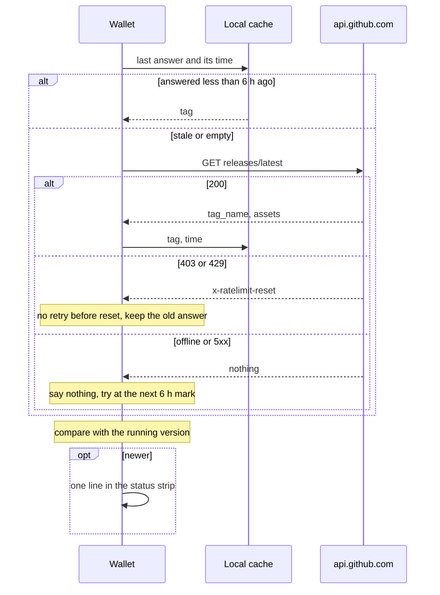

# Update detection from GitHub releases

Wishlist item 4: "Automatic detection of dependency and wallet updates via
GitHub releases (go-zenon, ffi, syrius, etc.), allowing users to update on the
spot." Written 2026-10-13 06:50 UTC. Every GitHub figure below was measured
that morning with unauthenticated `curl` against `api.github.com`.

## Recommendation

1. **Ask GitHub for the newest Syrius release** at start and every six hours
   while the wallet runs, one request, cached. Show a quiet line in the status
   strip when a newer one exists; clicking it opens the About section with the
   version, what changed, and two buttons: open the release page, and download
   and verify.
2. **Download and verify, never run.** "Update on the spot" means one click to
   a downloaded installer whose SHA-256 matches the release's checksum file,
   shown in its folder. The person runs it. Installing in place waits for
   signed builds (see "Later").
3. **go-zenon** is two cases. On the embedded node, `libznn` ships inside
   Syrius (`lib/embedded_node/blobs/`), so a new go-zenon reaches the user as
   a Syrius release and needs no check of its own. On a remote node, show the
   node's version against go-zenon's newest in Settings, as information: the
   node is someone else's to update.
4. **"ffi"** (proof of work `libpow_links`, `argon2_ffi`) lives inside
   `znn_sdk_dart` (`lib/src/pow/blobs/`, `lib/src/argon2/blobs/` in the pub
   cache) and is compiled into the app. It cannot be updated apart from Syrius,
   so it gets no check.
5. Before any of it, fix two release-pipeline defects that would make the
   check wrong (section "Traps in our own pipeline").

## What comparable wallets do

| Wallet | How it learns of a release | What it does then | Source |
|---|---|---|---|
| Electrum | Fetches `https://electrum.org/version`, a version string with signatures; accepts it only if a signature verifies against one of two addresses compiled into the app (`VERSION_ANNOUNCEMENT_SIGNING_KEYS`) | Shows a dialog with a link to the download page. Nothing is downloaded | [update_checker.py](https://raw.githubusercontent.com/spesmilo/electrum/master/electrum/gui/qt/update_checker.py) |
| Electrum ABC | A `releases.json` of version, address and signed message, checked against hard-coded addresses | Informs only: "no automatic updating is performed" | [README](https://bitcoinabc.org/electrum/contrib/update_checker/README.html) |
| Sparrow | An HTTPS version-check file; raises the event only if newer and its signature verifies | A Verify Download dialog checks the manifest signature and the installer's SHA-256 | [commit f22312e](https://code.sparrowwallet.com/sparrowwallet/sparrow/commit/f22312e04f9317cec02099abcf1bb4dfa5468ce4), [download page](https://sparrowwallet.com/download/) |
| Wasabi | Since 2.7.0, notes published by Wasabi's Nostr key, no longer GitHub or DNS | An option downloads the package in the background and then asks before installing; packages are signed | [v2.0.1.4](https://github.com/zkSNACKs/WalletWasabi/releases/v2.0.1.4), [install FAQ](https://docs.wasabiwallet.io/FAQ/FAQ-Installation.html) |
| Monero GUI | DNS TXT records on four MoneroPulse domains, all with DNSSEC | Downloads and checks the SHA-256; the canonical hashes are a GPG-signed list | [commit](https://git.hackliberty.org/Git-Mirrors/monero/commit/7de43154d3995ae9bd024012825e87feec9c7606), [downloads](https://www.getmonero.org/downloads/) |
| Syrius extension | `api.github.com/.../releases/latest`, tag only, cached six hours; the link it shows is a constant, never from the response | Lock-screen line; About's Update writes an unpacked install only after the ZIP matches its published `.sha256` and is this extension at the newer version | `C:\dev\zenon\syrius-extension\src\services\utils\release.js:9-24`, `src\services\update\chromeUpdate.js:18,131-135` |

What they share: the check only tells; anything that installs proves the file
first; the address the user is sent to is the wallet's own, not the
response's. The Bitcoin wallets go further than a checksum and pin a signing
key in the app, because a checksum published beside the file proves only that
the download is intact, not who made it.

## What desktop does today

| | Where |
|---|---|
| An "Update" button that opens `github.com/zenon-network/syrius/releases/latest`. No request, no comparison | `lib/widgets/modular_widgets/help_widgets/update_card.dart:30-37`, `lib/utils/constants.dart:59-61` |
| The running version is a hand-kept constant, `kWalletVersion = '0.2.5'`. It also drives a storage migration at unlock | `lib/utils/constants.dart:31`, `lib/utils/init_utils.dart:72-80,103-106` |
| `pubspec.yaml` has no `version:` line, so `PackageInfo.version` is Flutter's default, not the release | `pubspec.yaml`; `PackageInfo` read at `lib/utils/device_utils.dart:60-66` |
| Git metadata (branch, commit, message, date, origin) arrives as `--dart-define` from `tool/generate_git_metadata.dart`; in CI the branch is the tag name. A local `flutter run` without the define gets empty strings | `tool/generate_git_metadata.dart:14-34`, `lib/utils/metadata.dart:1-7`, `.github/workflows/syrius_builder.yml` "Generate Git metadata" |
| The connected node's version is already read and shown | `generalStats.processInfo.version`, `lib/widgets/modular_widgets/help_widgets/about_card.dart:61-66` |
| `libznn` is refreshed by a manual workflow that downloads go-zenon's latest release and commits the blobs if their hashes differ | `.github/workflows/syrius_lib_updater.yml:17-52` |

## The requests

| Repository | Endpoint | Newest on 2026-10-13 |
|---|---|---|
| `zenon-network/syrius` (the constant today) | `GET /repos/zenon-network/syrius/releases/latest` | `v0.2.4-alphanet`, 2025-05-28; three assets and `SHA256CHECKSUMS.txt`; asset `digest` is null |
| `sol-znn/syrius` (this fork's `origin`) | `GET /repos/sol-znn/syrius/releases/latest` | `v0.0.7-alphanet`, 2023-08-13. The fork has not released since |
| `zenon-network/go-zenon` | `GET /repos/zenon-network/go-zenon/releases/latest` | `v0.0.9-alphanet`, 2026-10-10; every asset carries a `sha256:` digest |

"Latest" is "the most recent non-prerelease, non-draft release, sorted by the
`created_at` attribute", which is the date of the release's commit
([GitHub REST, releases](https://docs.github.com/en/rest/releases/releases)).

**Rate limit.** 60 requests an hour per IP address without a token; past it,
403 or 429 with `x-ratelimit-remaining: 0`, and nothing until
`x-ratelimit-reset` ([rate limits](https://docs.github.com/en/rest/using-the-rest-api/rate-limits-for-the-rest-api)).
A conditional request (`If-None-Match` with the last ETag) that gets 304 is
free only "while correctly authorized with an Authorization header"
([best practices](https://docs.github.com/en/rest/using-the-rest-api/best-practices-for-using-the-rest-api)).
Measured: an unauthenticated 304 raised `x-ratelimit-used` from 14 to 15. So
the wallet cannot poll cheaply; it must cache. Six hours is four requests a
day per repository per running wallet, well inside 60 an hour even behind a
shared address. Never ship a token in the app.

## Comparing versions

Tags in use: `v0.2.4-alphanet`, `v0.2.2-rc.0`, `v0.0.9-alphanet`. Read
`-alphanet` as the network's name, not a pre-release: by semantic versioning
`0.2.4-alphanet` sorts below `0.2.4`, and `alphanet` sorts below `rc.0`, both
wrong here. So:

1. Accept `^v?(\d+)\.(\d+)\.(\d+)(-[0-9A-Za-z.]+)?$`; anything else is
   "unknown", and unknown never shows an update.
2. Drop a trailing `-alphanet`. Treat any other suffix (`-rc.N`) as a
   pre-release, offered only to someone who chose pre-releases.
3. Compare the three numbers with the `version` package already in the app
   (`pubspec.yaml`, used at `lib/utils/init_utils.dart:72`).

The extension's parser accepts exactly `x.y.z` and would call every Syrius tag
unknown (`release.js:27-30`), so it is a model, not something to copy.

**One source for the running version.** Add `version: 0.2.5` to
`pubspec.yaml`, read it with `PackageInfo`, and add a test that
`kWalletVersion` equals it until the constant can go. Have the release
workflow refuse a tag that does not match, as the extension's does
(`C:\dev\zenon\syrius-extension\CHANGELOG.md`, 0.3.0, Repository).

## Where the notice goes

- **Status strip**, right side, before the plasma mark: "Update 0.2.6", muted,
  one line (`_buildStatusStrip`, `lib/widgets/main_app_container.dart:404-443`).
  Present only when there is an update.
- **Lock screen**, under the password field, the same line, as the extension
  does (`dashboard-password.js:180`): the moment a person is about to use the
  wallet is the moment to know (`lib/widgets/tab_children_widgets/lock_tab_child.dart`).
- **About** (Help today, merged into Settings by the plan in `HANDOFF.md`):
  version, release date, the release notes as plain text, Open release page,
  Download and verify, and a switch to turn checking off.
- Not a toast, not a modal, not a notification in the Notifications list: a
  release is not an event the person caused.

## Download and verify

For the platform's asset (`syrius-alphanet-windows-amd64.zip`,
`-macos-universal.dmg`, `-linux-amd64.zip`; names in
`.github/workflows/syrius_builder.yml:196-198`):

1. Download it and `SHA256CHECKSUMS.txt` from the release, into the
   Downloads folder, under the release's own file name.
2. Hash the file; compare with its line in the checksum file, and with the
   asset's `digest` when GitHub provides one. Any mismatch deletes the file
   and says so.
3. Check that the asset belongs to the tag that was offered and that the tag
   is newer than the running version.
4. Reveal the file in its folder. Do not open it.

A checksum from the same release proves the download is whole, not that the
release is honest. Real authenticity needs a signature by a key pinned in the
app (Electrum, Sparrow, Wasabi above), or OS code signing (Authenticode,
Apple notarization). Neither exists for Syrius today.

## What must never happen

- Download and run, or replace the running executable, without the person.
  A wallet that installs code by itself turns a compromised GitHub account
  into every user's keys.
- Send the person to a URL taken from the response. Build the release page
  from a constant and the parsed tag, as the extension does (`release.js:9-11`).
- Render release notes as HTML or Markdown with links. Plain text.
- Retry in a loop after 403 or 429, or poll more often than the cache allows.
- Ship a GitHub token.
- Check while the person turned checking off. Say in Settings what is asked
  and of whom: the request tells GitHub this address runs Syrius.

## Traps in our own pipeline

| Trap | Evidence | Fix |
|---|---|---|
| The release workflow marks any tag containing `-` as a pre-release, so `v0.2.5-alphanet` would be a pre-release, and `releases/latest` never returns pre-releases | `.github/workflows/syrius_builder.yml:209` `prerelease: ${{ contains(env.SYRIUS_VERSION, '-') }}`. Yet the published `v0.2.4-alphanet` is not a pre-release (API, measured), so it was changed by hand or built by another workflow: not established which | Mark only `-rc` tags as pre-releases. Until fixed, the check reads `/releases?per_page=10` and picks the newest non-draft tag that is not `-rc` |
| The checksum file is one line: `hash name hash name …`, because `echo $(sha256sum *)` collapses the newlines | `syrius_builder.yml:202-203`; the bytes of `v0.2.4-alphanet`'s `SHA256CHECKSUMS.txt` (297 bytes, measured). go-zenon's is one pair per line | `sha256sum * > SHA256CHECKSUMS.txt`. The parser takes whitespace-separated pairs, so both shapes read |
| Builds use Flutter 3.44.0 in CI and 3.47.2 here | `syrius_builder.yml:15`; `HANDOFF.md` State | Not an update-check bug, but a release built from this branch should match what was tested |

## Later

In-place install with Sparkle (macOS) and WinSparkle (Windows) through the
`auto_updater` package, already noted as a candidate in
`docs/flutter-dev-practices.md` section 8. Both verify an EdDSA signature on
the update feed, so they need a signing key and signed releases first. Linux
has no equivalent; it keeps Download and verify.

## Plan

`lib/rearchitecture/features/release_check/`: `release_source.dart` (one
`HttpClient` GET, ETag kept, 6 h cache in the shared-prefs box),
`release_version.dart` (parse and compare, pure), `ReleaseCheckCubit`
(unknown, current, update), the strip line and the About panel. Tests: the
parser against every tag shape above, the cache (no request inside 6 h, none
after 403 before reset), the cubit. `dart:io`'s `HttpClient` needs no new
dependency. Size **S** for notice and About, **M** with Download and verify.

## Questions for the owner

1. Which repository is "Syrius": `zenon-network/syrius` (the constant today,
   last release 0.2.4) or `sol-znn/syrius` (this fork, last release 0.0.7 in
   2023)? A fork user pointed at upstream is told nothing until upstream
   passes 0.2.5.
2. Checking on by default, or asked once at first start?
3. Offer pre-releases (`-rc`) behind a switch, or never?
4. Do you want release signing (a minisign or GPG key, or OS code signing)?
   Without it, Download and verify is the furthest "update on the spot" can
   safely go.
