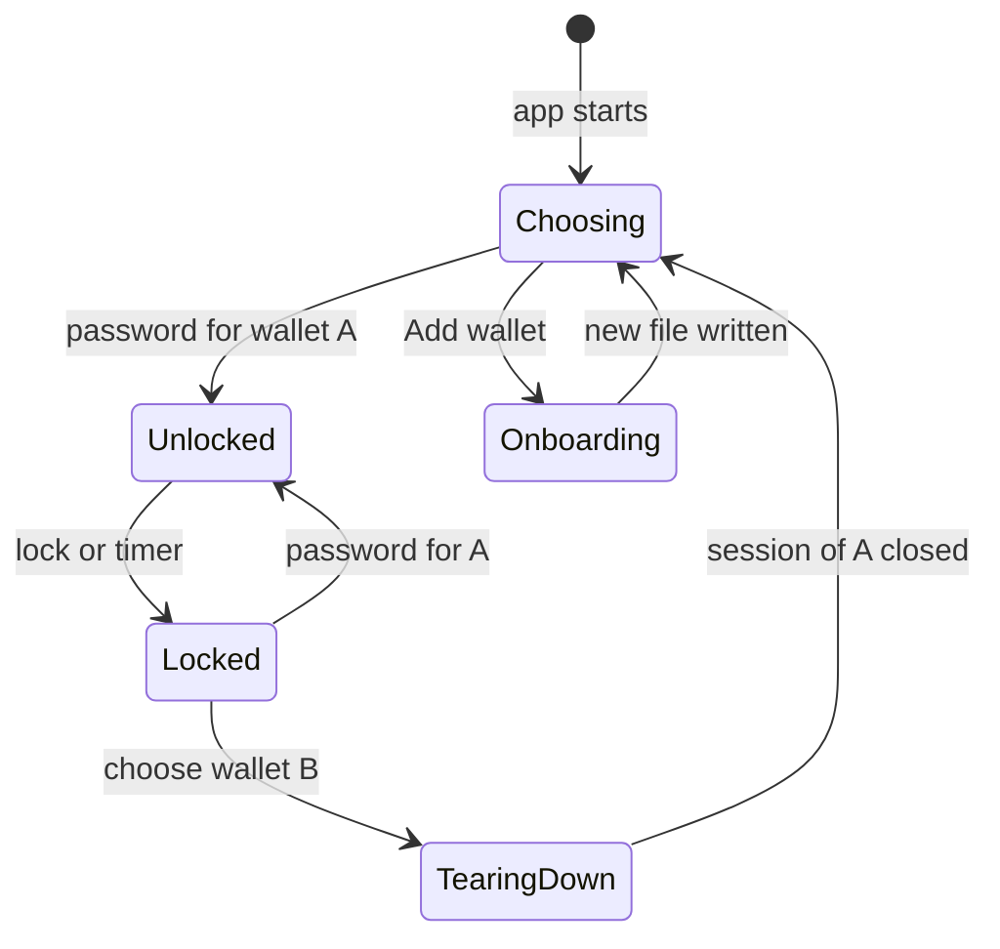

# Wallet selection at login, and user modes by address

Wishlist items 6 and 10. Written 2026-10-13 07:00 UTC against `syrius-sol`
at `70040a24` plus the uncommitted tree; `sdk:` is the pinned `znn_sdk_dart`
(`16bf294b`), `ext:` is `C:\dev\zenon\syrius-extension\` at `863f6bf`. The lock
screen and the shell are being restyled by other agents this round; line
numbers there may have moved a little.

## Recommendation

**Item 6.** Scope the three pieces of per-wallet state that are global today
(the address list, the selected address, the failed-unlock count) by the
wallet's base address, the way the swap store already is; then put a wallet
dropdown on the lock screen that lists the files in the wallet directory and
preselects the last one used. That is the smallest change that is correct.
Switching while a session is open, and "Add wallet" without Reset, come next.

**Item 10.** Three modes, Pillar, Sentinel and Sporks, each **Auto** by
default (on when the selected address owns that infrastructure), with a
per-mode override in Settings: Auto, Always, Never. A mode adds or hides rail
entries and panels; it never removes a page from the tab controller, so
routing, `syrius://` links and the harness keep working.

---

## Item 6: choosing among several wallets

### How wallets are stored today

| What | Where | Source |
|---|---|---|
| Wallet directory | `%AppData%\znn\wallet` on Windows, `~/Library/znn/wallet` on macOS, `~/.znn/wallet` on Linux | `sdk:lib/src/global.dart:25-48` |
| A keystore wallet | One JSON file, named after its first address unless a name is given. Desktop never gives one | `sdk:lib/src/wallet/manager.dart:44-46`; `lib/blocs/key_store_file_bloc.dart:17` |
| A Ledger wallet | One JSON file in the same directory, named after the device's wallet name or base address; it holds the device's wallet name, encrypted | `lib/utils/wallet_file.dart:192-208` |
| Readable without the password | Every file carries plaintext `baseAddress`, `walletType` (`keystore` or `ledger`) and `timestamp` beside the ciphertext | `sdk:lib/src/wallet/manager.dart:29-36`, `sdk:lib/src/wallet/encryptedfile.dart:68-79`, `sdk:lib/src/wallet/constants.dart:2-6` |
| Which wallet the app opens | One path, in Hive box `key_store_box`, slot 0; an older key `entropy_file_path_key` is migrated into it | `lib/utils/wallet_utils.dart:40-62` |
| The harness's `default` profile | `.harness/default/`, with `APPDATA` and the rest pointed into it, so its wallet directory is `.harness/default/AppData/Roaming/znn/wallet`, holding one file, `z1qq9n7fpaqd8lpcljandzmx4xtku9w4ftwyg0mq` | `harness/README.md`, "Profiles"; listed on disk |

Process state that assumes one wallet: `kWalletPath`, `kWalletFile`,
`kDefaultAddressList`, `kSelectedAddress`, `kWalletInitCompleted`
(`lib/utils/global.dart:9-24`).

Disk state that assumes one wallet:

| Store | Per wallet today? | Source |
|---|---|---|
| `addresses_box` (the derived addresses shown) | no | `lib/utils/address_utils.dart:106-122` |
| `default_address` in `shared_prefs_box` (the selected address) | no | `address_utils.dart:96-104`, `lib/rearchitecture/features/home/select_address.dart:18` |
| `num_unlock_failed_attempts` | no | `lib/widgets/tab_children_widgets/lock_tab_child.dart:150-152,206-208` |
| `address_labels_box` | keyed by address, so safe to share | `address_utils.dart:84-94` |
| `htlc_swaps_box_<baseAddress>`, encrypted | **yes** | `lib/services/htlc_swaps_service.dart:22-26` |
| Nodes, theme, auto-lock, notifications | app-wide, and should stay so | `lib/utils/constants.dart:34-54,68-84` |

How a second wallet is reached today: only through Reset, which deletes the
current wallet's file and every cache box before onboarding
(`lib/screens/splash_screen.dart:103-147`). Three failed unlocks take the same
path (`lock_tab_child.dart:154-161`, default limit `constants.dart:167`), so
the wallet file is deleted. Importing a mnemonic whose file already exists
overwrites it, since the name is the base address (`manager.dart:62-63`).

### What a picker needs

| Need | Answer |
|---|---|
| A list | Every file in the wallet directory that parses as a wallet file. `WalletFile.isKeyStoreFile` already does this for keystores without decrypting (`lib/utils/wallet_file.dart:42-70`); widen it to accept `walletType: ledger` |
| A name for each | The user's name if one was given, else the base address shortened (`z1qq9n…0mq`), and a hardware mark for Ledger. Names live in a new small box keyed by base address, so a file renamed on disk keeps its name in the app |
| A default | Slot 0 of `key_store_box` is already "the last wallet opened": preselect it, as the extension does (`ext:src/pages/dashboard/dashboard-password/dashboard-password.js:131-138`) |
| Shown when | Only with two or more wallets, as the extension does (`dashboard-password.js:207`). One wallet keeps today's screen |
| Per-wallet state | The three rows marked "no" above, suffixed with the base address |
| Failed attempts | Counted per wallet. Auto-erase, if kept, deletes only that wallet's file (question 3) |
| Hardware | Unlock connects to the device (`wallet_file.dart:178-190,232-241`); the picker can show a Ledger entry without the device, and the error names it when it is absent |

### The smallest change

1. `WalletDirectory.list()`: files in `znnDefaultWalletDirectory` that parse,
   with `baseAddress`, `walletType`, `timestamp`. Pure, tested with temporary
   files (`test/wallet_file/` has the pattern).
2. Suffix `addresses_box`, `default_address` and `num_unlock_failed_attempts`
   with the base address. Migration on first start: the unsuffixed values
   belong to the wallet in slot 0; rename them once.
3. On the lock screen, a dropdown above the password field when the list has
   two or more entries; choosing one sets `kWalletPath` and slot 0. Offered
   only while `kWalletInitCompleted` is false, that is, before the first
   unlock of this run, so no session has to be torn down.

That is item 6 as worded: a choice when logging in. About two days with tests.

### After it

**Switching with a session open** (Locked to TearingDown) needs what Reset
does minus the deletion: stop the node subscriptions and the auto-receive
pool, close the swap boxes (`htlcSwapsService.openBoxes` opens only once,
`htlc_swaps_service.dart:24`), set `kWalletInitCompleted` false, rerun
`InitUtils.initApp` (`splash_screen.dart:103-116`). A `switchWalletFlow` on
`SplashScreen` beside `resetWalletFlow` is the natural place.

**Add wallet without Reset**: onboarding reached from the lock screen, ending
on the picker instead of replacing the wallet. It must refuse to overwrite an
existing file of a different wallet and say so when the same mnemonic is
imported again.

**Remove a wallet**: Reset becomes "Remove this wallet": delete its file and
its suffixed state, keep the rest.

---

## Item 10: user modes by address

### The owner's words, and my reading

`WISHLIST.md:19-21`: "Different user modes like the Syrius extension's,
depending on which address is selected and what infrastructure it controls,
with toggles to select them regardless."

My reading, stated as a reading: the wallet should show the tools for running
a Pillar, a Sentinel or a spork only to an address that runs one, and stay a
plain wallet for everyone else; because the wallet decides from the selected
address, switching address switches the tools; and Settings keeps a switch per
mode so the person can turn one on without owning anything (to register a
Pillar, for instance) or off despite owning it.

### What the extension does

Three switches in Settings, off by default, global, never automatic
(`ext:src/services/utils/menu.js:28-32`, `ext:src/services/utils/storage.js:219-222`,
`ext:src/pages/settings/settings/settings.js:158-183`). Pillar mode gives three
tab-bar places (Pillar, Rewards, AZ) and moves the displaced tabs to the menu;
Sentinel and Sporks add menu entries (`menu.js:36-47`). Nothing reads the
chain to decide. The address part of the owner's request is new.

### Proposal

| Mode | Auto: on when the selected address | Read with | Adds |
|---|---|---|---|
| (none) | always | | Home, Transfer, Pillars (the list, delegation, delegation rewards and Collect), Staking, Plasma, Tokens, P2P Swap, Accelerator (browse, donate, create), Connected sites, Notifications, Settings, Lock |
| Pillar | owns a pillar, or has QSR deposited towards one | `embedded.pillar.getByOwner`, `getDepositedQsr` (`sdk:lib/src/api/embedded/pillar.dart:17,49`); already app-wide in `PillarsByOwnerBloc` (`lib/widgets/main_app_container.dart:173-175`) | On Pillars, the "Your pillar" panel (`PillarStatsCard`: register, update, revoke, QSR, `lib/widgets/tab_children_widgets/pillars_tab_child.dart:30-35`); on Accelerator, voting (the page already asks for the owned pillar, `lib/widgets/tab_children_widgets/accelerator_tab_child.dart:20-31`); on Home, a pillar panel: produced against expected momentums, weight |
| Sentinel | owns a sentinel, or has QSR deposited towards one | `embedded.sentinel.getByOwner`, `getDepositedQsr` (`sdk:lib/src/api/embedded/sentinel.dart:24,31`); today read only inside its card (`lib/rearchitecture/features/sentinel_stats/view/sentinel_stats_card.dart:30-32`), lift it app-wide | The Sentinels rail entry and its page (`lib/widgets/tab_children_widgets/sentinels_tab_child.dart:21-31`); a sentinel panel on Home |
| Sporks | is a spork administrator of this chain | Not answerable from the node: the extension keeps the genesis spork address per chain and the community window on mainnet (`ext:src/services/spork/spork.js:11-46`). On the lab, chain 321, it is the devnet mnemonic's index 0 (`ext:tools/devnet/lab/README.md`) | A Sporks page, new on desktop (`sdk:lib/src/api/embedded/spork.dart:15-31` has the calls); read-only for anyone with the mode on who is not an administrator |

Overrides, one per mode, in Settings: **Auto** (default), **Always**,
**Never**. Always is how someone with no pillar reaches the register flow.
Never is for someone who owns one and does not want the tools in view.

Effect on the rail: 12 entries for most addresses once WalletConnect and Help
are merged as planned (`HANDOFF.md`, Decisions), against 14 now, which already
forces rows down to 30 px at 1200x600 (`main_app_container.dart:259-265`).

### Where it goes

- `lib/rearchitecture/features/user_modes/`: `UserModesCubit`, state per mode
  `{detected, override}` and `isOn`; listens to the selected address
  (`SelectedAddressNotifier`, set in `select_address.dart:20-23`) and to the
  two ownership reads; the overrides in the shared-prefs box. A bloc test for
  each of the nine detected-by-override combinations.
- The rail (`_buildRail`, `main_app_container.dart:254-338`) and the pages
  read `isOn` with `context.select`, so a mode change rebuilds the rail, not
  the shell.
- `kTabs` and the `TabController` length stay as they are
  (`lib/utils/global.dart:30-48`, `main_app_container.dart:626-640`): a
  hidden page is unlisted, not removed. If the page in view is hidden by an
  address switch, go to Home.
- Detection refreshes on address switch, and after a register or revoke block
  confirms, not on a timer.

Size: **M**, about three days with tests, once the rail work of the reskin
has settled.

## Questions only the owner can answer

Item 6:

1. Does every wallet get a name typed at creation, or is the shortened base
   address enough?
2. Should switching be possible only at start (the smallest change), or also
   from the lock screen with a session open?
3. Auto-erase today deletes the wallet file after three wrong passwords. With
   several wallets: keep it, per wallet, or drop it? It protects little (a
   thief copies the file first) and can destroy a wallet whose phrase was
   never written down.
4. Are hardware wallets listed in the same picker, or kept apart?

Item 10:

5. Is my reading right, in particular that a mode can be forced **off** as
   well as on?
6. Does "controls" include a Pillar's producer or reward address, or only its
   owner? `getByOwner` finds only the owner.
7. Are the overrides one set for the whole app, or remembered per address?
8. Are there more modes than these three: a token issuer (`embedded.token.getByOwner`,
   `sdk:lib/src/api/embedded/token.dart:24`), an Accelerator project owner, a
   bridge guardian or orchestrator?
9. Should Pillar mode take rail places of its own (Pillar, Rewards, AZ) as in
   the extension, or stay as panels inside the existing pages?
