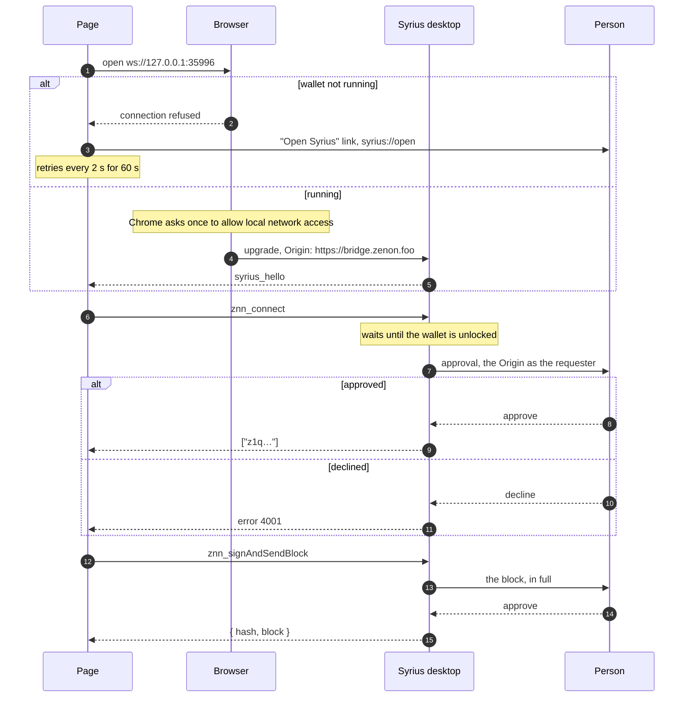

# A web page talking to Syrius desktop

Wishlist item 9, with bridge.zenon.foo as the first client. Written
2026-10-13. Status: channel chosen, desktop side not yet built.

## What comparable wallets do

| Channel | Who uses it | Needs | Why not here, or why |
|---|---|---|---|
| Injected provider | MetaMask, Rabby, the Syrius extension (`window.zenon`) | A browser extension | Already there for the extension. A desktop app cannot inject into a page. |
| Relay with pairing | WalletConnect; Syrius desktop today | A relay server and a project id from Reown | The bridge front end dropped it for exactly those two. On `develop`, `znn_sign` and `znn_send` are not implemented either (`lib/services/web3wallet_service.dart:346`). |
| Loopback server in the app | Trezor Bridge (`127.0.0.1:21325`, origin allowlist), Ledger Live's WebSocket bridge | Nothing outside the machine | Chosen. No relay, no account, works offline, and the page keeps a live two-way connection. |
| Custom URL plus callback | The Syrius Android app (`syrius://request`, `syrius-extension/docs/APP-REQUESTS.md`), Phantom deep links | A registered scheme | Kept as the fallback. Every answer opens a browser tab, so it is poor for a page that makes several requests in a row. |

## The choice

A WebSocket on `127.0.0.1` inside the wallet, speaking the method set the
extension and the Android app already share. `syrius://` stays for two jobs:
starting a wallet that is not running, and carrying a request when a browser
refuses loopback.

Step 1 is the only part the page does differently from the extension. From
step 6 on it is `window.zenon` over another transport, so the page-side
adapter is thin: `zenon-bridge-web/src/wallet/syrius.ts` gains a second
transport and keeps its interface.

## Rules the desktop side enforces

- Binds `127.0.0.1` only. Port 35996, then 45996, then 55996 if taken. The
  page tries the same three.
- The `Origin` header is the requester: it is what the approval shows and
  what consent is stored under. A browser sets it and a page cannot forge it.
  A request with no `Origin`, or one that is not `https://` or a private-host
  `http://`, is refused at the upgrade.
- The `Host` header must be `127.0.0.1:<port>` or `localhost:<port>`, which
  closes DNS rebinding.
- Another program on the same machine can claim any `Origin`. That is true of
  every loopback bridge, and it is why nothing is answered before a connect is
  approved and nothing is signed without the person approving that block.
- Consent is per origin and per address, as in the extension. Reads return
  empty or `null` until connected.
- One pending approval per origin, 16 in all, 30 minutes to answer. The
  extension's numbers.
- A switch in Settings turns the listener off. On by default.

## What the page must do

This is the contract for `zenon-bridge-web`; the full reference will be
`docs/webapp-integration.md` once the server exists and can be tested against.

1. When `window.zenon` is absent, offer "Syrius desktop" and open
   `ws://127.0.0.1:35996` (then 45996, 55996).
2. Speak JSON-RPC 2.0, one JSON text frame per message:
   `{"jsonrpc":"2.0","id":1,"method":"znn_connect"}`.
3. Methods, parameters, results and error codes are those of
   `APP-REQUESTS.md`: `znn_connect`, `znn_accounts`, `znn_chainId`,
   `znn_nodeUrl`, `znn_sendTransaction`, `znn_signAndSendBlock`, `znn_sign`,
   plus `znn_disconnect`.
4. Events arrive as notifications without an `id`: `accountsChanged`,
   `chainChanged`, `nodeChanged`, and `syrius_hello` first.
5. If no port answers, show a link to `syrius://open` and keep retrying.
6. In an iframe, the frame needs `allow="local-network-access"`.

## Not confirmed

- Chrome's Local Network Access prompt is documented for fetch since 142.
  Its extension to WebSockets in 147 comes from vendor support pages, not from
  Chrome's own notes. To be tested against the built server.
- Safari refused `ws://127.0.0.1` from https pages in 2017 (WebKit bug
  171934). Current behaviour is not checked. If it still refuses, Safari users
  get the `syrius://request` fallback.
- Firefox allows the literal `127.0.0.1` but not the name `localhost`, per
  Mozilla bug 1370861. The page should use the literal.

## Sources

1. Chrome for Developers, "Local Network Access", 2025-06-09: https://developer.chrome.com/blog/local-network-access
2. Visualware, Chrome LNA and WebSockets: https://myconnectionserver.visualware.com/support/v11/userguide/chrome-lna-websocket
3. WebKit bug 171934: https://bugs.webkit.org/show_bug.cgi?id=171934
4. Mozilla bug 1370861: https://bugzilla.mozilla.org/show_bug.cgi?id=1370861
5. `syrius-extension/docs/INTEGRATION.md` and `APP-REQUESTS.md`, in this tree.
