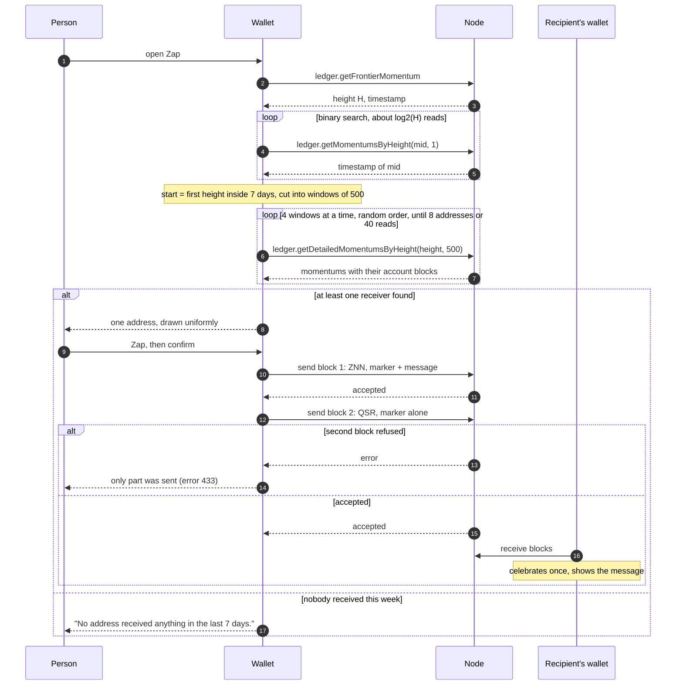

# Zap: what it is, and porting it to desktop

Wishlist item 8. Written 2026-10-13 06:40 UTC. `ext:` is
`C:\dev\zenon\syrius-extension\` at `863f6bf`; `sdk:` is the pinned
`znn_sdk_dart` (maznnwell fork, `16bf294b`, in the pub cache); `go-zenon:` is
`C:\dev\zenon\go-zenon` at `590f43c`.

## Recommendation

Port it as one feature, `lib/rearchitecture/features/zap/`, in two halves that
can ship apart: **reading** (a history row says "Zap" and opens the message, a
new one is celebrated once) and **sending** (the page that finds a recipient
and sends). Reading first: it is the smaller half, and it makes desktop a
correct recipient of zaps the extension already sends.

Nothing is missing from the SDK. No contract, no token and no protocol change
is involved: a zap is two ordinary send blocks with a marker in their data.
Keep the byte format exactly, so the two wallets read each other's zaps.

## What Zap is

The owner's specification, quoted in `ext:HANDOFF-PILLAR.md` item 15
(2026-10-11): an option "to zap a random alien with a default 1 znn / 10 qsr,
with options to customize the amounts and custom message", the message
"embedded in the tx data", a celebration and a popup on receipt, and the
recipient "selected at random from any address that received a transaction in
the last 7 days". The owner was offered other names and kept Zap (same file,
items 19 and 21).

It exists only in the extension. A search of every `*.md` under `C:\dev\zenon`
for the word finds the extension's handoffs and changelog, this repo's
wishlist, and unrelated uses (Lightning zaps in `zenon-evolution`, "zApps" in
the forum corpus under `zenon-docs/corpus/forum`). `zenon-docs` has no page on
it.

### On the chain

| | | Source |
|---|---|---|
| Block | A user send block (type 2) to a user address. One block moves one token, so ZNN and QSR are two blocks | `ext:src/services/zap/zap.js:10-13,187-206` |
| Data, first block | `7a 61 70 01` ("zap", then format version 1), then the message as UTF-8, at most 140 bytes | `zap.js:24-27,60-64` |
| Data, second block | The four marker bytes alone. A reader takes it as "the rest of that zap" | `zap.js:12-13,203` |
| Tokens | `znnZts` and `qsrZts`, defaults 1 and 10; a zero leaves that coin out | `zap.js:29,180-193` |
| Cost | 21,000 plasma for the block plus 68 per data byte, so at most 9,792 extra for a full message | `go-zenon:vm/constants/plasma.go:28-29`, `go-zenon:vm/plasma.go:140-144` |
| Size limit | Block data may be 16 KB; 144 bytes is far inside it | `go-zenon:vm/constants/plasma.go:41-42` |

Test vectors, from `ext:utils/operator-mode-test.js:227-239`: `encode("hi")`
is `7a6170016869`; `encode("")` is `7a617001`; 140 `x` gives 144 bytes and 141
is refused; 46 euro signs fit and 47 do not.

### The message is a stranger's text

Decoding is strict: wrong marker, more than 140 bytes after it, or invalid
UTF-8 means "not a zap" (`zap.js:78-89`). The text is then cut to one line:
breaks and tabs become spaces; control characters, zero-width characters, bidi
overrides and isolates and the byte order mark are dropped (`zap.js:43-55`).
It is rendered as text only, never as a link or markup, with "Written by the
sender, not by Syrius." under it (`ext:src/components/modals/zap-modal.js:10-12,37`).
Desktop must do the same: a `Text` widget, never `SelectableText.rich`, a
link detector or Markdown.

### Who the "alien" is

An account that **published a receive block** in the last seven days, not one
that was merely sent to: a receive proves somebody holds the key
(`zap.js:15-17`). Never a contract (first byte of the address core is 0 for a
user, `go-zenon:common/types/address.go:18-19`, `zap.js:91-93`), never one of
the wallet's own first 16 addresses (`ext:src/pages/settings/zap/zap.js:23,47-48`).



Steps 4 to 7 are `heightSince` and `findAlien` (`zap.js:132-178`). The draw at
step 8 throws away random values past the last whole multiple of n rather than
taking a remainder, so no address is favoured (`zap.js:109-117`). A quiet week
is read to its end before it is called empty (`zap.js:162-165`).

The node chooses what the wallet sees, so a dishonest node can steer the draw.
The extension says so once, in the confirm dialog: "Picked from what your node
reports, so the node can steer it." (`ext:src/pages/settings/zap/zap.js:24-26,97`).

### Receiving

A history row whose send block's data decodes as a zap is labelled "Zap", in
or out (`ext:src/services/hooks/useTransactions.js:122-131`). A confirmed
incoming one with a message, not seen before, throws a burst of sparks and
opens the message once; the row keeps a Message button
(`ext:src/pages/dashboard/dashboard/dashboard.js:92-109,483-484`). "Seen" is a
list of up to 200 hashes per address, and the first look at an address shows
nothing, because its history is not news (`zap.js:208-231`). A sent zap's
modal says "To", a received one "From" (`zap-modal.js:35`).

### State in the extension

Built, unit-tested (8 checks), on the Settings page and in the menu
(`ext:CHANGELOG.md` 0.3.5 and 0.3.6). `ext:HANDOFF-PILLAR.md:80,152,223`
records that **no zap had been sent or seen arriving** as of 2026-10-11,
because on the devnet the harness wallet owned every recently active account.
Whether one has been sent since is not recorded anywhere I could find. The
desktop port should not assume the end-to-end path is proven.

## What desktop needs

| Need | Present | Where |
|---|---|---|
| Frontier momentum | yes | `sdk:lib/src/api/ledger.dart:66` `getFrontierMomentum` |
| One momentum by height | yes | `ledger.dart:84` `getMomentumsByHeight` |
| Momentums with their blocks | yes | `ledger.dart:100` `getDetailedMomentumsByHeight`; `DetailedMomentum.blocks`, `sdk:lib/src/model/nom/detailed_momentum.dart:4-15` |
| Page limit | 1,024 on both sides, so 500 is fine | `sdk:lib/src/client/constants.dart:4`, `go-zenon:rpc/api/utils.go:13-14`, `go-zenon:rpc/api/ledger.go:390-394` |
| A send block with data | yes | `sdk:lib/src/model/nom/account_block_template.dart:85-97` `AccountBlockTemplate.send(to, zts, amount, data)` |
| User or contract address | yes | `Address.core` is public (`sdk:lib/src/model/primitives/address.dart:53`): `core![0] == 0`. `isEmbedded()` (line 95) only matches a fixed list, so do not use it for this |
| Sign, proof of work, publish | yes | `AccountBlockUtils.createAccountBlock`, `lib/utils/account_block_utils.dart:13-84`; it holds the wallet lock and waits a second after each block, so two calls in a row are safe |
| The send block behind a receive | yes, already fetched | `lib/blocs/auto_receive_tx_worker.dart:72-73` reads it for `toAddress`; its `data`, `amount`, `token` and `address` are the zap |
| Own addresses to exclude | partly | `kDefaultAddressList` (`lib/utils/global.dart:24`) holds only the addresses the user has added. Derive the first 16 through `kWalletFile.access` for a keystore wallet; for a Ledger use the list only, since each derivation is a round trip to the device |
| Uniform random draw | yes | `Random.secure().nextInt(n)`: Dart documents `nextInt` as uniform over `[0, n)` for n up to 2^32, which is what `randomBelow` (`zap.js:112-117`) builds by hand in JavaScript. Keep the extension's distribution test (`ext:utils/operator-mode-test.js:376-387`) against the Dart call |
| A history cell that names a zap | no | `lib/rearchitecture/features/latest_transactions/view/latest_transactions_card.dart` and `lib/rearchitecture/utils/widgets/infinite_scroll_table/cells/type_cell.dart` |

Missing from the SDK: nothing.

## Plan

Follow `AGENTS.md`: a feature folder, a cubit, private widgets, a test for the
cubit.

```
lib/rearchitecture/features/zap/
  zap.dart                     exports
  codec/zap_codec.dart         marker, encode, decode, clean        (pure)
  finder/alien_finder.dart     heightSince, findAlien, randomBelow  (pure; RPC passed in)
  cubit/zap_cubit.dart         finding, found, sending, sent, failed
  cubit/zap_seen_cubit.dart    hashes already celebrated, per address
  view/zap_card.dart           ZapCard: provides the cubit; _View, _Finding, _Found, _Empty
  widgets/zap_message_dialog.dart
test/zap/
  zap_codec_test.dart          the extension's vectors, byte for byte
  alien_finder_test.dart       a fake node: window bounds, own addresses excluded, uniform draw
  zap_cubit_test.dart          bloc_test: found, none found, partial send
```

| Step | Work | Size |
|---|---|---|
| 1 | `zap_codec.dart` and its test from `ext:utils/operator-mode-test.js:215-290` | S |
| 2 | Reading: decode in the latest-transactions rows, "Zap" in `TypeCell`, a Message button that opens `zap_message_dialog`. A receive row reads the send block's data from `AccountBlock.pairedAccountBlock` (`sdk:lib/src/model/nom/account_block.dart:46`), which the node fills with the block named by `fromBlockHash` (`go-zenon:rpc/api/ledger_types.go:322-326`) | S |
| 3 | Celebrate once: in `AutoReceiveTxWorker._onSuccess` the send block is in hand; emit an event the shell shows. A Hive box of seen hashes, 200 per address. The motion: one burst, in keeping with "a value that changes flashes once" (`docs/flutter-dev-practices.md` section 5) | S |
| 4 | `alien_finder.dart` and its test | M |
| 5 | `ZapCubit` and `ZapCard`: recipient row with a dice button, ZNN and QSR fields, message with a byte counter (`n/140`), confirm dialog with the node notice | M |
| 6 | Sending: two `createAccountBlock` calls in order; if the second throws after the first landed, say which coin left and which did not | S |
| 7 | Entry point (question 1) | S |

Desktop differences to decide while building:

- **Hardware wallet.** Each block is confirmed on the device
  (`account_block_utils.dart:36-52`), so a zap is two confirmations. Say so
  before the first.
- **Node not synced.** `createAccountBlock` throws `NodeNotSyncedException`
  (`account_block_utils.dart:19-24,82`). The finder should refuse earlier with
  the same reason, or it reads a stale week.
- **Embedded node.** The finder's reads are local and fast there; against a
  public node a week is about 60,480 momentums at 10 s each, 121 windows, of
  which at most 40 are read unless none has a receiver (`zap.js:34-37`).
- **Chain 1 only has strangers.** On a devnet the wallet tends to own every
  active account and the page truthfully finds nobody
  (`ext:HANDOFF-PILLAR.md:223`).

## Proving it on the lab devnet

Chain 321, `ws://127.0.0.1:45998` (`harness/README.md`, "A devnet to send on";
`ext:tools/devnet/lab/README.md`). Syrius is single-instance
(`harness/README.md`, Limits), so sender and recipient run one after the
other, each in its own harness profile.

1. `ext:tools/devnet/lab/lab.sh status` says "producing". Read
   `ledger.getFrontierMomentum` twice, 20 s apart: a stopped chain still
   accepts blocks.
2. **Recipient R**, a fresh mnemonic so it is outside the sender's wallet:
   `harness/h start --instance zapr --fresh`, create a wallet, `node`, `chain
   321`, copy its address, `stop`.
3. **Sender A**, the devnet mnemonic's funded index 1, in the `default`
   profile: send 1 ZNN to R with the lines in `harness/README.md` ("Use").
   `stop`.
4. Start `zapr`, unlock, wait for "Transaction received": R has now published
   a receive block, which is what makes it an alien. It pays with proof of
   work, so allow a minute. `stop`.
5. Start `default`, unlock, open Zap. The finder must show R. If it shows the
   devnet mnemonic's index 0 or another own address, the 16-address exclusion
   is wrong. Zap with the defaults and a message containing a non-ASCII
   character. `harness/h wait` for the success text, `shot`.
6. **Check the chain, not the wallet.** Over the lab's HTTP port:
   `ledger.getAccountBlocksByPage(A, 0, 2)`. Expect two send blocks to R: 1 ZNN
   with data `7a617001` + the message's UTF-8, and 10 QSR with data
   `7a617001`. The node returns data as base64.
7. Start `zapr`, unlock: the burst and the message show once; the row reads
   "Zap" and its Message button reopens the text; lock and unlock, and it does
   not show again.
8. Interoperation: point the extension's harness at R
   (`node utils/dev-harness.js start --instance lab …`, per the lab README)
   and confirm the same two rows read "Zap" there. This is the check that the
   byte format was kept.
9. Put steps 3 to 7 in a `harness/h run` script so it joins the sanity run of
   wishlist item 3.

Evidence for the handoff's item 8: the two block hashes, the momentum they
confirmed in, and the two screenshots.

## Questions for the owner

1. Where does Zap live on desktop: a fourth action on Home beside Send,
   Receive and Swap (`lib/rearchitecture/features/home/view/home_view.dart:225-253`),
   a panel on Transfer, or Settings as in the extension?
2. Same defaults (1 ZNN, 10 QSR, "You got zapped. Have a great day, alien.")
   and the same 140 byte limit?
3. Should the celebration also fire a desktop notification when the window is
   in the tray, or only in the app?
4. The extension's open question (`ext:HANDOFF-PILLAR.md:185`): a zap can draw
   a bridge vault on the public devnet's ZVM. It cannot on mainnet. Leave it?
