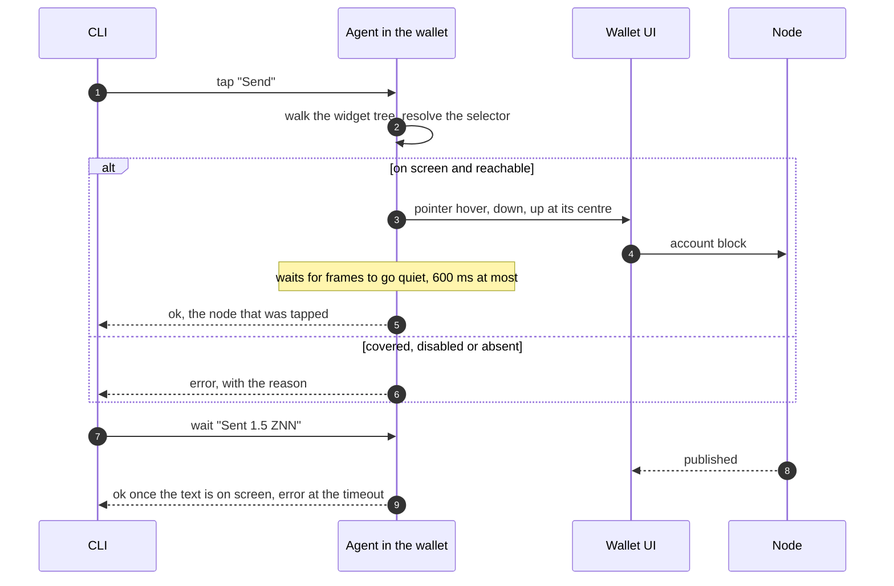

# Syrius harness

Drives the Syrius desktop wallet the way a person does: it reads what is on
screen, clicks, types, scrolls and presses keys, on the real app with its real
window. It exists so that an agent or a script can unlock the wallet, walk
every page and carry out any action, and see what a user would see when one
fails.

It is two parts. The default `harness/app/` entrypoint starts the app
(`lib/main.dart`) with an agent beside it: a loopback HTTP server inside the
Flutter process. `harness/bin/harness.dart` is the command line that builds,
launches and talks to it. An explicit read-only presentation mode instead starts
an independent view before any production wallet owner. The agent is not linked
into an ordinary build.



Step 3 is `GestureBinding.handlePointerEvent`, the call the engine's own mouse
events arrive through, so hit testing, hover states, the auto-lock timer and
gesture arenas behave as they do under a hand. Text goes in through
`EditableTextState.userUpdateTextEditingValue`, the path of the platform's text
input, so input formatters and `onChanged` run. A tap on something a dialog
covers is refused rather than delivered to the dialog.

## Use

All commands are `harness/h <command>` (`harness\h.cmd` from cmd or
PowerShell). Windows only for now.

```sh
harness/h build                 # flutter build windows, entrypoint harness/app/main.dart
harness/h start                 # launch in the profile .harness/default
harness/h import --mnemonic "<24 words>" --password '<password>' --node ws://127.0.0.1:45998 --chain 321
harness/h chain 321             # the chain identifier the wallet signs with
harness/h lab-address           # derive once if needed; select and verify index 1
harness/h stop
```

Import requires an explicit positive `--chain` before entering any private
input. It uses the current keyed importer, accepts one genuine node mismatch
only when its original node and signing facts match that requested chain,
opens the original Ready once, then saves the signing policy through Settings.
Success requires both the SDK signing identifier and its saved effective policy,
plus the original connected and saved node. `state.chainId` is the node's chain;
`state.signingChainId` is the SDK's signing policy. An absent stored signing
preference is reported only as the application's known default when its
original preferences box is already open.

The import, node and signing-policy recipes use a three-minute total budget,
ten-second command limits and finite scroll and observation counts. Ambiguous
or replaced controls, unknown policy, mismatched questions, transport errors
and late acknowledgements stop the recipe without another action. A standalone
`node` command never accepts a chain mismatch. Refusal retains any wallet or
transition already created; it does not reset the profile. Recipe replies and
diagnostics omit private field contents. Native import and signing acceptance
still require execution against the intended isolated profile and node.

`lab-address` requires the exact connected and saved loopback lab endpoint,
node/signing chain 321 and a consistent original wallet selection. It opens
Settings and Addresses through the normal controls, derives one missing member
through Add address, and selects index 1 through its actual choice button.
The original member order, Boxes, transports, wallet and context generations
are retained. Success independently requires the original notifier and saved
preference to agree. Unknown writes retire the driver; no derivation or
selection is retried. Its finite receipt omits member strings and paths.
This prepares P09; it submits no account block and proves no send or seed state.

Later runs find the wallet in the profile and start at the lock screen:

```sh
harness/h start
harness/h unlock '<password>'
harness/h tour                  # every page: screenshot, error widgets, errors logged
```

The page tour explicitly opens Notifications over Home and selects Node for
Settings before capture. WalletConnect selects Apps through Settings. These
choices are repeated on every visit, so a section retained from an earlier
page or theme cannot substitute for the intended capture. Standalone
`goto notifications` still opens the bell over its caller's current page; ordinary
application section retention is unchanged. A missing Home or Node control
fails the original tour operation without retry or relabelling an image.

The loop for anything else is `tree`, act, `tree`:

```sh
harness/h goto transfer
harness/h tree
harness/h type --key send_recipient_field "" z1qq9n7fpaqd8lpcljandzmx4xtku9w4ftwyg0mq
harness/h type --key send_amount_field "" 1.5
harness/h tap Send
harness/h tap Yes
harness/h wait "Sent 1.5 ZNN" --timeout 60
```

`harness/h run <file>` runs such lines from a file and stops at the first that
fails.

## Read-only presentation

The same harness binary has a separate component preview mode. It is selected
before `app.main`, so it does not open a wallet, preferences, a node, WalletConnect,
an embedded process or a signing owner. Its theme is memory-only. A visible
fixture banner remains on screen, all component input is disabled and every
callback refuses. Quiz words are visibly synthetic and do not form wallet
material. This mode does not establish an original initialization, restoration,
chain effect, renderer frame pin or visual match.

After native provisioning and a harness build, use an unused explicit instance:

```text
harness/h start --instance presentation-01 --presentation welcome
harness/h presentation import --instance presentation-01
harness/h theme light --instance presentation-01
harness/h state --instance presentation-01
harness/h stop --instance presentation-01
```

Supported components are `welcome`, `import`, `seed-quiz`, `lock-screen`,
`lock-wrong` and `wallet-picker`. The last is a picker component, rather than
the complete `lock-pick` screen. Ready, cold launch, transition frames and
full-shell fixtures retain their original prerequisites. Existing profiles and
`--fresh` are refused for presentation; inherited presentation flags are removed
from ordinary launches. A running instance must report the exact requested host
mode and component before reuse.

Only anonymous state, theme, window, tree, assertion, wait, logs, stalls,
component selection and quit commands are admitted. Input, clipboard, seed,
publication and both `shot` and `screens` refuse. No presentation output can be
written as a numbered wallet capture or a match. Theme responses require the
attached theme after frame settlement; observed source loss permanently retires
the host. The first attached host Element stays the owner, so an unseen remount
under the same key and controller also refuses. Presentation assertions inspect
only that owner's visible content through its unchanged read-only input barrier;
covered or hidden targets refuse and no assertion qualifies capture evidence.

Quit acknowledges one queued close attempt. After its original delay, admission
rechecks the captured host and scene before invoking native close once. Its exact
Future and terminal error stay retained; subsequent requests inspect that same
attempt and do not retry it. State exposes the anonymous close phase, without
raw errors. A completed close Future does not establish process exit.

Source and finite offline coverage are separate from native execution,
which is recorded in [the environment record](../docs/environment.md).

`capture_protocol.dart` separately retains an immutable plan, original operation
Futures, actual frame observations and positive restoration receipts. Its default
native adapter is unavailable. Source loss or uncertain restoration holds that
original scope permanently; recreating a protocol is not a recovery procedure.
Injected contract tests and presentation commands do not enable the pending
entry or full-shell capture recipes.

## The tree

`tree` prints one line per thing a person could read or use, in reading order:

```
[25]  field    value="" hint="Recipient Address" key="send_recipient_field"  SendPopulated>EditableText @344,275
[30]  button   "Send" key="send_submit_button"  OutlinedButton @378,399
[14]  button   tab="generation" tip="Plasma generation idle" icons=["MaterialCommunityIcons:f140b"]  TabBar>InkWell @977,49
```

The number is a ref, good until the screen changes. The kinds are `text`,
`field`, `button`, `toggle`, `dropdown`, `slider` and `error` (a widget that
failed to build). Only what is on screen and in reach is listed: a page under a
dialog is left out, and so is a list row scrolled out of view, because Flutter
has not built it. `reveal <selector>` scrolls until it appears. `--json` gives
the same as data, with rectangles and the widget path.

## Selectors

| Form | Selects |
|---|---|
| `30` or `#30` | the ref from the last tree |
| `@378,399` | a point, in logical pixels |
| `Send` | text: the label, tooltip, hint, tab name or icon; an exact match wins over a prefix, a prefix over a substring |
| `--key send_submit_button` | a widget's `ValueKey` |
| `--tab settings` | a main tab by name, icon tabs included |
| `--type OutlinedButton` | a widget type, the node's own or one above it |
| `--kind field` | narrows any of the above |
| `--nth 2` | the third match, when several tie |
| `--exact` | text must equal, not contain |

`tap` prefers a button over a field over text when the words alone do not
decide. `type` looks at fields only.

## Commands

| Command | Does |
|---|---|
| `build [--mode release\|profile\|debug]` | builds, and copies the result to `.harness/app/<mode>` |
| `start [--instance <name>] [--fresh] [--port <n>]` | launches in that profile; `--fresh` deletes the profile first |
| `start --instance <unused-name> --presentation <surface>` | starts a separate read-only component host before wallet startup; existing profiles and `--fresh` refuse |
| `presentation <surface>` | changes only an existing presentation host's component; ordinary wallet hosts refuse |
| `stop`, `status`, `state` | `state` is the route, tab, node, chain, address and lock state |
| `tree [--kind <k>] [--json]` | what is on screen |
| `tap <sel> [--double] [--right] [--long] [--force]` | a click; `--force` skips the reach check |
| `hover <sel>` | moves the mouse there, for tooltips |
| `type [<sel>] <text> [--append] [--submit]` | clicks the field and replaces its text; with no selector, the focused field |
| `key <chord>` | `enter`, `escape`, `tab`, `shift+tab`, `ctrl+a`, arrows, and the rest of the list in `agent.dart` |
| `scroll [<sel>] <dy>` | a wheel scroll at the selector, or at the centre |
| `drag <sel> <dx,dy>` | press, move, release |
| `drop <sel> <file>` | a file dragged in from the desktop and released there |
| `wait <sel> [--gone] [--timeout <s>]` | until it is on screen, or gone |
| `assert <sel>` | immediately verifies an exact, reachable selector and refuses any visible error widget |
| `reveal <sel>` | scrolls down until it is on screen |
| `shot [--out <file>]` | the Flutter client as a PNG at one output pixel per logical pixel |
| `theme dark\|light` | changes the existing app theme notifier and saved Display preference, then verifies the rendered brightness |
| `logs [--levels SEVERE,WARNING] [--since <seq>]` | the app's log records and Flutter errors |
| `stalls [--reset] [--min <ms>] [--brief]` | each time the UI isolate ran nothing for over 24 ms (`loop`) and each frame whose build or raster took over 16 ms, and the longest; `--reset` empties the list after printing, `--brief` prints one line |
| `clipboard [<text>]` | reads or sets the clipboard |
| `window [show\|minimize\|maximize\|restore] [--width <w> --height <h>]` | sizes the Flutter client in logical pixels; reports requested and observed client dimensions, physical pixels, DPR and outer window geometry |
| `goto <tab>`, `lock`, `unlock <password>` | the main tabs and the lock screen |
| `import`, `node <ws url>`, `chain <id>` | onboarding, node selection, client chain identifier |
| `lab-address` | original UI derivation and persisted index-1 selection on the isolated chain-321 lab |
| `seed <id>`, `seed fixture <kind>` | guarded isolated lab recipes and read-only fixtures; see [seed preparation](seed/README.md) for required profile, origins and checkpoint evidence |
| `lab-send --ws ws://127.0.0.1:45998 --http http://127.0.0.1:45997` | one fixed original index-1 to owned index-0 UI send in an explicit isolated profile; no custom amount, recipient or retry |
| `tour [--dir <dir>]` | every page in turn |
| `screens <id>\|all [--dir .harness/<fresh-directory>]` | runs each catalog screen script in dark and light, verifies state and 1280 by 780 client dimensions, then saves actual app captures |
| `run <file>` | a script of the above |

UI commands take `--tree` to print the tree after them. Commands can select
their isolated profile with `--instance`.

Unlock first makes a read-only `wait` request with `ready: true` and a
five-second timeout for the existing password field. This requires one
enabled, reachable field; ordinary presence waits retain their meaning.
The driver then makes one original write and one submit, retaining both
input guards and the twenty-second post-submit wait. A readiness refusal
exports only `UNLOCK_FIELD_READY_REFUSED`; it does not retry a password or
profile, format private replies or diagnose an older refusal.

## Redesign captures

F04 supplies the capture source and adapter tests. Native Windows P08 execution
remains pending. No capture, visual match or native window behavior is
established by those tests. Page owners supply the scripts; the runner does
not create missing pages, seed data or substitute mockup images.

`harness/bin/screen_capture.dart` catalogs the 47 mockup IDs in their numbered
order. `screens <id>` reads `harness/screens/<id>.txt`; `screens all` preflights
all 47 scripts before changing the app. Both themes run the script separately,
starting from unlocked Home with the rail collapsed. A missing script, unmet prerequisite, locked
profile or unreachable Home stops the run. Launch, lock and onboarding shots
still need explicit reversible preparation from F06 and the entry tasks.
The runner does not guess passwords, restart the wallet or inject fixtures.

A page script uses UI commands and ends with a stable positive assertion:

```text
# prerequisite: unlocked-home
goto transfer
tap Receive
assert --key receive_screen_marker
```

The key in this example is a placeholder for the page owner's actual marker.
`assert` accepts the text, key, type, kind, tab and nth selectors; text is exact.
Refs, coordinates, `--gone` and `--force` cannot establish a capture state.
The screenshot command repeats the final assertion at capture and after PNG
encoding. A visible error widget, covered marker, changed theme or changed
view metrics refuses that frame.

Available script commands are `goto`, `tap`, `hover`, `type`, `key`, `scroll`,
`drag`, `wait`, `reveal`, `lock` and `assert`. Lifecycle, nested scripts, drops,
theme, window, screenshot and instance overrides are refused. To retain an
entry script without claiming readiness, declare its prerequisite:

```text
# prerequisite: pending F06/N01 reversible launch preparation
assert --key launch_screen_marker
```

Any prerequisite other than `unlocked-home` is a preflight refusal. Comments
and blank lines are allowed; quotes group words, with no shell expansion.

For sizing, the agent measures the Flutter View's physical size divided by
its device pixel ratio. Native `setSize` can include borders and a title bar,
so the agent corrects its request by the observed client delta, up to five
times. It returns both requested and observed geometry and fails if they do
not agree. The root render layer already contains the physical DPI transform;
capture cancels it to produce a complete 1280 by 780 image at logical scale 1.
Both agent metadata and PNG header dimensions must agree before saving.

The default output is `.harness/shots/NN-id-theme.png`, where `NN` comes from
the catalog. Existing targets and links are refused. For another run, choose
a new directory beneath `.harness/` and point the comparison tool at it:

```sh
harness/h screens all --dir .harness/capture-02
python tool/redesign_compare.py --actual-dir .harness/capture-02
```

An explicit `--dir` must not exist. Absolute paths, traversal, links and
Windows device aliases are refused. Captures use exclusive file creation;
the directory must remain under this run's sole ownership because Dart's
subsequent path-based write does not protect against concurrent hostile path
replacement. Interrupted or failed output stays in place for inspection.
There is no cleanup or overwrite command.

On success or failure, the runner attempts to restore the original theme
mode, preference, original rail expansion, outer window position and size,
and minimized/maximized
mode. An unset theme preference retains its default meaning. Restoration
failures are reported alongside the original failure, and earlier captures
are retained. It does not restore page state or unlock a profile a script
locked. Authentication, the isolated profile and the single owned process
remain required for every command.

## Profiles

The SDK keeps wallets in `%AppData%\znn`, where this machine's real wallets
are. `start` therefore launches the wallet with `APPDATA`, `LOCALAPPDATA`,
`TEMP`, `HOME` and `USERPROFILE` pointed into `.harness/<instance>/`, and the
harness binary refuses to start (exit code 64) when they are not: run by hand,
it would open the real wallets with a remote control attached. For the same
reason the agent listens on 127.0.0.1 only and wants the token `start` wrote to
`.harness/<instance>/instance.json`.

`app.main()` registers the running executable as the handler of `syrius://`
links. The harness entrypoint puts the previous handler back once the app is
up.

## Limits

- One wallet per desktop. The Windows runner looks for a window titled
  `s y r i u s` and exits if there is one, so `start` refuses while any
  `syrius.exe` runs, and two instances cannot run side by side. `--instance`
  chooses the profile, not a second window.
- Native dialogs are out of reach: the file pickers behind "Click to browse",
  export and "Save QR" belong to the OS, not to Flutter. A dropped file is in
  reach through `drop`, which starts where the drop plugin hands over to Dart.
- A hardware wallet needs the device.
- The clipboard is the machine's: a copy button in the wallet replaces
  whatever was on it.
- A minimised window draws no frames. Commands still run, each waiting out a
  250 ms frame timeout; `window show` first.
- A wrong `unlock` costs one of the wallet's attempts, and the wallet erases
  itself at zero. It is the harness profile's wallet that goes.
- An icon without a tooltip is listed by font and code point
  (`MaterialIcons:e402`).
- The pinned Flutter still routes focused shortcuts through its deprecated
  key-message bridge. The harness retains that bridge alongside hardware key
  state updates; removing it would lose shortcuts, traversal and text editing.
- `build` leaves the harness binary in `build/windows/x64/runner/` under the
  name `syrius.exe` until the next ordinary build. It will not start outside a
  profile, but do not package it.

## A devnet to send on

`tools/devnet/lab` is a go-zenon devnet on `ws://127.0.0.1:45998`, chain 321
(`tools/devnet/lab/lab.sh up`; its README has the mnemonic). The devnet mnemonic's index 1 is funded:
import it, `chain 321`, then `lab-address` to add and select the second address
through Settings. A confirmed UI send remains a separate prerequisite. Do not
activate a spork there as a test.

## Focused hosted harness checks

The manual Public Contribution Qualification workflow has a default-off
`harness_tests_only` input. Select it with the other execution lanes disabled
to run the isolated controller suite, locked dependency restoration, selected
analysis and the exact source-bound harness gate on a fresh Windows runner. It uses one
pinned Flutter SDK and does not build a native wallet or allocate lab nodes.
Before SDK allocation, it also observes the unchanged original in-memory asset
byte controls through a bounded command wrapper. Only runtime version, actual
exit/completeness, output digests and fixed failure labels are public; raw
output remains private. Missing tools or failed controls stop before the SDK.

Startup observation can include `opening`, `first-frame-pending`,
`frame-visible`, `last-frame`, `ended`, `frames-suspended` or `ticker-muted`.
These labels read the current registered original film and controller; held,
closed or unmounted owners expose none. `ended` records the controller's
existing completion bit, including its existing error path. It does not prove
wallet initialization. A refusal retains only the latest valid label; asset
names, frame payloads, exception text and private input are never projected.

### Fixed P09 send qualification

`lab-send` requires an explicitly selected isolated instance with the public
chain-321 lab fixture unlocked, actual index 1 selected and exact original
loopback transports. The default profile is refused. The authenticated serial
command uses normal Transfer inputs and the actual one-ZNN confirmation,
retaining the original form sender, worker lease, review request and Accept
Element/center. It checks the same admission at pointer down/up and observes
only that original request and its exact positive chain confirmation.

Unknown original outcomes remain held across restart and also block F06. No
retry or custom transfer terms are accepted. The ordinary app has no harness
command. This command does not create an F06 checkpoint or qualify visuals.
Its source and new UI regressions need hosted qualification before native
original-send acceptance can be claimed.

Original-send failures expose only validated source-defined phase/reason
labels. Native CI rejects unknown or extra diagnostic fields and never emits
raw HTTP/SDK errors, paths, addresses or hashes. A failure diagnostic is not a
send receipt or original actor-closure proof. Earlier null-code failures keep
their original unknown scope.


## Native inspection startup

The harness entrypoint recognizes `SYRIUS_CI_READONLY_INSPECTION=true` only
on Windows GitHub Actions with presentation absent. Other supplied values
refuse before native startup. The original agent reserves before `app.main`
and reports only pending `ping` until the initialized process/registered SDK
and original preference service/open Hive box have been sealed and attached.
Publication admission pauses before the original automatic-receive preference
write. Each later command checks the retained SDK scope before and after its
original handler. Financial commands are unavailable in this mode.

The receipt covers `readonly_native_sdk_admission`. Inspection can change
local UI preferences inside its owned profile; the receipt does not prove
wallet, client, socket, image or chain acceptance. Those owners need separate
checks after wallet opening. Ordinary `harness/h start` strips inherited
inspection flags and refuses to reuse an inspection host as an ordinary
wallet. The mode is not an ordinary launcher option. A separately admitted
fresh CI controller and actual native qualification remain pending; the
original mandatory-send tour, seed recipes and F06 are unchanged.

`WalletRecipe.inspection` drives `readonly-entry` through the original keyed
onboarding and Settings callbacks. It requires explicit owned loopback
chain-321 input and validates the actual PID and current SDK receipt on every
reply. Ordinary `wallet-recipe`, financial commands and copied-profile paths
remain unavailable in inspection.

After opening and selecting index one, `readonly-wallet-bind` captures the
actual file, stores, selected membership, SDK/API/WebSocket objects, native
window and Flutter root/navigator/view. A fresh original native frame must
complete. Subsequent commands check that same scope before/after their awaits;
lost owners, duplicate binding and uncertain binding cannot be restored into
success. Its finite `readonly_native_wallet_admission` receipt contains no
private identity or path and supplies no screenshot or chain-effect proof.
Fresh engine tests and actual native controller/runtime qualification remain
required. The full visual, motion, seam, minimum-window and Arabic pass stays
open.

Source229's first hosted analysis retains one undefined-identifier error and
four style infos; Dart is skipped. The follow-up preserves actual SDK ledger
identity/client checks while removing the invalid redundant local name, and
adds equivalent braces/callback types. Exact 615/617 selections and every
assertion remain; fresh engine/zero-findings and native qualification are
required. No earlier failed or uncertain outcome is changed.


### Retained native-agent request analysis failure (2026-10-30T21:20Z)

Source225 8e029cfe3437 / [41129467499](https://github.com/edgepillar/syrius/actions/runs/41129467499) passes 868 Python controls with three existing skips and both assets/fourteen phases. Its complete original analysis exits three with 29 errors, one info, zero warnings and no overflow; Dart is skipped. The first sixteen finite locations repeat INVALID_IMPLEMENTATION_OVERRIDE at request-fixture line 74. The unexported info location remains NOT_ESTABLISHED.

Source226 uses the [HttpRequest Stream<Uint8List> contract](https://api.dart.dev/dart-io/HttpRequest-class.html) for the same owned UTF-8/JSON request and authenticated original handler. Every Dart case/assertion and exact 588/590 selection remains. Analyzer location samples are deduplicated under the same sixteen-location cap; all diagnostic occurrences still count and the zero-findings gate is retained. A new controller regression covers repeated errors, a later info and the finite cap. Fresh 869-Python/404-memory and hosted engine/analysis qualification are required. Actual native startup, separate controller admission and wallet/client/socket/UI acceptance remain pending. Original failures and financial UNKNOWNs are preserved; Native104 is not admitted.


### Equivalent native-agent fixture cascade (2026-10-30T21:29Z)

Source226 f0d7b1f4650f / [41130761869](https://github.com/edgepillar/syrius/actions/runs/41130761869) passes 869 Python/three existing skips and both assets/fourteen phases. All 29 request-stream type errors are resolved. Complete analysis exits zero with zero errors/warnings and one CASCADE_INVOCATIONS info at fixture line 199; the strict gate fails and Dart is skipped. Source225 original 29-error/one-info failure and unexported original info remain preserved.

Source227 expresses only the same presentation-fixture construction and immediate usePresentation call as one cascade. All arguments, ordering, existing assertions, Uint8List body bytes, runtime source, analysis/sample bounds and exact 869-Python/588/590-Dart registrations remain. Fresh 404-case memory controls and hosted analysis/engine qualification are required. Actual native controller and wallet/client/socket/UI acceptance remain pending; old financial UNKNOWNs and every broader acceptance gate remain.


### Explicit programmatic native inspection launch (2026-10-31T05:57Z)

Source227 2b7caf9b9bbd / [41131744481](https://github.com/edgepillar/syrius/actions/runs/41131744481) qualifies 869 Python/three existing skips, all 588 ordinary Dart cases without failures/errors/skips, assets/fourteen phases, zero selected findings and 404 memory controls. Six mode and fifteen original-agent/owned in-memory HTTP cases execute. Its 590-case startup variant and actual native SDK/whole-wallet acceptance remain separate. Source225/226 original failures and skipped Dart are preserved.

A separate CI controller may now call cli.start with readonlyNative: true. This is a programmatic option, absent from the ordinary command line. Windows GitHub Actions, a new ci-inspect identifier and an unused profile are required before access; fresh deletion and presentation are refused. Inspection skips existing-instance reuse and profile deletion, strips inherited mode values and requires the actual spawned PID/readiness plus exact current SDK admission receipt. Ordinary startup retains its defaults and mode boundary. Seven new regression cases prepare exact 595/597 ordinary/startup selections; Python/memory registrations remain 869/404 and fresh hosted analysis/engine qualification is required. Actual native controller admission and wallet/client/socket/UI owners after opening remain pending. Original financial UNKNOWNs, all 94 visual matches and every broader acceptance gate remain.


### Fresh readonly Windows wallet inspection (2026-10-31T07:33Z)

Source230 `1e4161819226` / [focused run 41178101993](https://github.com/edgepillar/syrius/actions/runs/41178101993) qualifies 869 Python controls with three existing skips, all 615 ordinary Dart cases without failures/errors/skips, assets/fourteen phases, zero selected findings and 404 memory controls. All twenty opened-wallet/entry cases execute. Source229 original one-error/four-info analysis refusal and skipped Dart remain retained. Actual native wallet execution and the 617-case startup variant are separate.

Source231 adds a retained-process inspection session, `harness/bin/ci_wallet_inspection.dart` and `tool/ci/windows_wallet_inspection.py`. The explicit `windows_wallet_inspection` input defaults to false, requires the corrected native owned chain-321 lab with diagnostics and refuses the financial tour flag. The entry is job-owned before START. The original spawned app PID, endpoint and current SDK receipt are bound before the parent revalidates five nodes and releases the committed public lab fixture plus a fresh private password through stdin. Original UI import/address selection establishes once-only opened-wallet admission; later original replies retain process, mode, SDK and wallet scope. Ordinary defaults and financial/copied/reopen flows remain.

The original twelve-page tour runs in both themes. Actual English/ltr state is observed before and after each tour. Finite stall observations do not establish a motion baseline. Normal app/entry exits, complete bounded output, unchanged source, lab revalidation and known auxiliary cleanup gate success. The closed public manifest admits only fixed fields. Successful complete runs may export exactly 24 verified 1280x780 PNG references; failed runs retain a finite manifest without pixels. Capped reads preserve original plain-file identity, size and digest. Profiles, tokens, passwords, keys and raw diagnostics are excluded.

Twenty new Dart cases prepare exact 635/637 selections; seventeen Python cases prepare 886 registrations and 421 selected memory controls. Original memory catalog-order and fixture-loader failures are retained without dropping assertions. Fresh complete-source controls and hosted analysis/engine qualification are required before native admission. No native run or local binary transfer occurs here. Independent artifact inspection, minimum-window/Arabic, motion/shaders, nineteen preparations, ninety missing catalog outputs, all 94 visual matches and P03/P09/F06/V01-V06 remain open. Financial UNKNOWNs remain. Main progress stays 71/80.


### Portable inspection artifact fixture (2026-10-31T07:39Z)

Source231 `eba967120d71` / [focused run 41181365639](https://github.com/edgepillar/syrius/actions/runs/41181365639) retains one failed finite-manifest selection fixture within 886 Python cases, zero errors and three existing skips. Assets, SDK allocation, analysis and Dart are skipped. The original failure is preserved; its inner failure text is unexported. Source review and deterministic pure Windows/Posix paths expose a host-separator expectation mismatch: the artifact selector emits portable forward-slash references, while the failed fixture expected the host-specific Path string.

Source232 changes only that expected path to the exact portable manifest reference and adds pure Windows/Posix assertions within the same case. The original manifest-only, one-read and no-PNG checks remain. All application, native controller, export, SDK, financial, workflow, Dart and asset bytes are unchanged. Exact 886-Python/635/637-Dart selections and all 421 memory controls remain. Fresh complete-source memory and hosted confirmation are required. This does not establish actual native wallet, artifact, motion or visual acceptance. The ledger stays 71/80 with zero accepted matches; all earlier failures, financial UNKNOWNs and nine main open gates remain.


### Equivalent inspection line wrapping (2026-10-31T07:46Z)

Source232 `3a66cd7c3e2b` / [focused run 41181630374](https://github.com/edgepillar/syrius/actions/runs/41181630374) passes all 886 Python cases with three existing skips, both asset commands/fourteen phases and 421 memory controls. The portable manifest-only artifact case, including pure Windows/Posix expectations, now passes. Source231 original fixture failure remains. Complete 319-byte analysis exits zero with zero errors/warnings, two long-line infos and no overflow. The strict zero-info gate correctly fails; Dart execution is skipped.

Source233 wraps only the same native-entry signing-policy condition and the same synthetic wallet receipt fields. Non-whitespace tokens, original operations, every test/assertion, all owner/input/close/artifact/privacy guards, bounds and exact 635/637 selections remain. No lint suppression, numeric-policy change, SDK query, clock, profile, financial action or runtime retry is added. Fresh 421-memory, hosted engine and zero-findings qualification are required. Actual native controller/runtime, full-root/DLL/chain, motion/shader, minimum/Arabic, nineteen preparations, ninety missing outputs and 94 matches remain open. Financial UNKNOWNs and all nine main gates remain; main progress stays 71/80.


### Independent readonly inspection reader (2026-10-31T08:11Z)

Source233 `e95d99990dfa` / [original Windows run 41182125486](https://github.com/edgepillar/syrius/actions/runs/41182125486) completes successfully. All 886 Python cases/three existing skips, 635 ordinary Dart cases without failures/errors/skips, assets/fourteen phases, zero selected analysis findings and 421 memory controls pass. Both original entry refusals are complete and unforced before build; the gate, SDK and inspection startup checks exit normally with open stdin and empty owned jobs. Its 637-case startup-asset variant remains unexecuted. Source231 original fixture failure and Source232 original two-info analysis refusal/skipped Dart remain retained.

The same producer reports 24 captured/visited states across the original twelve-page tour in both themes, actual SDK/opened-wallet receipts, index-one selection, two lab revalidations and normal complete app/entry zero exits. Known VCTIP termination is labelled separately from the unforced required actors. This is a producer observation; independent parent/artifact qualification, actual image viewing, catalog admission and visual matching remain pending. The earlier 90-missing catalog inventory is not silently replaced by these differently named page files.

Source234 adds `tool/ci/inspect_wallet_inspection.py` and explicit default-empty retained-run/head inputs, bringing dispatch inputs to 24. The Linux reader allocates no SDK, wallet, node or profile and repeats no producer. It binds attempt-one workflow/job/preflight/runtime metadata, the original source tree and 22 producer-file blobs, the owned native lab manifest, the child manifest digest and exactly the successful 24 PNG references. Every image size, SHA-256 and 1280x780 PNG structure is checked in bounded memory; duplicate child-manifest fields, private wallet fields and foreign/alias/archive members are refused. Both metadata snapshots must agree. Original five-node normal closure, app/entry exits, complete output, current scoped receipts and English locale gate positive inspection. Known auxiliary termination remains explicit. Failed or unavailable child archives preserve failure/UNKNOWN without inferred coverage. Financial/copied/restored scopes remain separate. Existing lab readers retain their ordinary default mode.

Twenty new synthetic cases prepare 906 Python registrations and 441 selected memory controls. The first memory attempts preserve eight legacy-phase fixture errors and eight native-versus-Docker-count refusals. The fixture now uses the real readonly phase, while actual native ownership is counted through its five ordered original exit receipts, without Docker-only counters. Every assertion and existing bound remains. No new Dart case, application, SDK policy, native controller, original financial/send/seed/reopen path, asset or clock changes. Fresh complete-source controls and hosted independent inspection are required. No local archive is downloaded. New page-family local transport needs its concrete storage admission; the earlier four-entry-family allowance is not reused. P03/P09/F06/V01-V06, minimum/Arabic, motion/shader, nineteen literal preparations and all 94 visual matches remain open. Main progress stays 71/80.


### Reader discovery independent of the global test package (2026-10-31T08:26Z)

Source234 `e52ad2b2aa3c` / [reader run 41184048304](https://github.com/edgepillar/syrius/actions/runs/41184048304) fails its test step before archive inspection. Its actual hosted case count and exact inner cause remain NOT_ESTABLISHED; raw logs are not consumed. The original Source233 successful native producer and both retained archives are unchanged and are not replayed. Source234 complete candidate passes 441 local memory controls with all 906 Python methods registered; those local results are not substituted for the failed hosted step.

Source review identifies a portability issue: the checkout has namespace test directories, while package-qualified test.ci imports may resolve through a foreign regular test package. A bounded synthetic package reproduces both legacy load failures. This predicts a cause; it does not reconstruct the original unexported exception. Source235 discovers the exact test files and uses direct fixture module names. All 66 retained-lab and 20 new archive cases/bodies remain. Three additional runner regressions cover fresh imports under a foreign regular package, finite failure projection and private import-origin exclusion. The hosted gate increases from 86 to 89 cases; short suites, load errors, failures, errors, skips and unexpected outcomes fail. Test output remains in memory with a digest and finite known case labels; no raw exception, stack, origin or private search path is printed. A fixed package category is an observation, not an original-cause claim.

Expected complete registrations/selected memory become 909/444. The reader, original parent/PNG/source/job requirements, data limits, application/Dart/SDK/native/financial/seed/reopen/asset bytes and 635/637 Dart selections remain. The discovery regression restores temporary module bindings and runs no SDK, native actor, network or scratch. Fresh complete-source controls and a new reader-only hosted run are required. This is not a native retry or local binary transfer. Source234 failure, all earlier FAILURE/UNKNOWN outcomes, P03/P09/F06/V01-V06, all 94 matches and nineteen preparations remain open. Main progress stays 71/80.


### Independently verified readonly native page artifacts (2026-10-31T08:40Z)

Source233 `e95d99990dfa` / [original Windows producer 41182125486](https://github.com/edgepillar/syrius/actions/runs/41182125486) is independently qualified by Source235 `7a154cef4200` / [reader run 41185011461](https://github.com/edgepillar/syrius/actions/runs/41185011461). The reader passes all 89 retained-lab/archive/discovery cases without failures, errors, skips, load errors or unexpected outcomes. The complete Source235 candidate also passes 444 selected local memory controls with 909 Python methods registered; the hosted reader does not claim execution of all 909. Source233 supplies the actual 886 Python/three existing skips, 635 ordinary Dart, assets/fourteen phases and zero selected findings. Its 637-case startup-asset selection remains unexecuted.

The independent reader verifies both original archives, the source tree and 22 producer-file blobs, original attempt-one job/preflight/runtime binding, repeated metadata, parent/child manifest cross-binding and every one of 24 PNG hashes and 1280x780 structures. The root archive is 29748 bytes with SHA-256 `30f3b4cd92b140cd4620aa3ad593f116f516e8af89bbaad57b1a89ddb79b3865`; the wallet archive is 2162347 bytes with SHA-256 `4adb795ee28995446ddedd270efc6dea442090b89cc570097e64bfc03c8115a1`. All nineteen original checks, two lab revalidations, both English/LTR theme tours and current SDK/opened-wallet scoped receipts pass. Index one is generated, persisted and selected. Original app/entry and all five original nodes exit normally, completely and zero without forced termination. The known VCTIP auxiliary helper is terminated after required actors complete; its distinct receipt remains explicit. Registered SDK/WebSocket/API identity continuity is not physical TCP-epoch proof.

No SDK, Windows, wallet or node producer is repeated for this inspection. Actual image viewing, 47-state catalog mapping and accepted visual matches remain pending; differently named page files do not silently replace the earlier 90-missing catalog inventory. Local review of this new page-image family has a concrete plan: the verified 2162347-byte archive, a 12 MiB task limit, 4 MiB extraction cap and 2 MiB analysis-output cap, with the production 10 GiB floor and existing policy unchanged. Its narrow storage recognition remains pending, separately from the previous four-entry-family allowance. No local binary transfer is claimed.

Source234 failed reader preflight remains failure with exact inner cause NOT_ESTABLISHED. The successful namespace observation is not a reconstruction of that exception. Source231 fixture refusal, Source232 analysis refusal, all earlier FAILURE/UNKNOWN evidence, Native101/Native103 outcomes and Native104 non-admission remain. Main progress is still 71/80 (88.75 percent by rows), with P03/P09/F06/V01-V06, minimum-window/Arabic visual review, motion/shader/frame-time, seams, nineteen literal state preparations and all 94 visual matches open. This documentation update changes no product, reader, controller, workflow, asset or financial/send/seed/reopen bytes and requires no duplicate SDK/native CI allocation.


### Native page review and reference surface corrections (2026-10-31T09:21Z)

All 24 original English page images from Source233 `e95d99990dfa` / [Windows 41182125486](https://github.com/edgepillar/syrius/actions/runs/41182125486), independently verified by Source235 / [reader 41185011461](https://github.com/edgepillar/syrius/actions/runs/41185011461), have now been viewed. One bounded 2162347-byte transfer completes with original zero exit and full output. Every retained PNG and manifest binding agrees. The exact owned task closes SUCCESS; the original archive and reports remain, and only its registered reproducible extraction is removed. An older entry object's ownership HOLD, an initial shared-link admission refusal and the unestablished long-stdin delivery remain separate original evidence. A short canonical review completes in the same admitted task, without another transfer. Page-family authority now covers archives under 4 MiB, with 12 MiB task, 4 MiB extraction and 2 MiB analysis-output caps and the unchanged production 10 GiB free-space floor. No historical object is rebound or adopted.

The actual pages reveal common gutter differences and a Transfer field/card surface mismatch. Generic Notifications is over Accelerator, while dark Settings shows Addresses and light Settings retains Apps. These are page observations rather than explicit 47-state catalog outputs. Figures in the mockups remain illustrative; original numeric, SDK, publication, financial, copied-wallet and seed outcomes are not replaced by visual fixtures. No complete pair is accepted, and the earlier ninety-missing catalog inventory is not silently reduced.

Source237 applies the reference main-column insets 4/4/16/14 to the page/status column rather than the outside of the rail. The extra rail gap becomes zero and the page/status gap becomes twelve. Rail widths, original caption geometry, entry insets, mounted owner retention, focus/pointer guards and clocks remain. Four new actual-component layout cases cover both directions and scrolling/non-scrolling pages with literal reference rectangles after a 32-pixel caption. The older caption-origin discrepancy remains an observation, without an invented root cause or capture adjustment.

Transfer removes its full-page HeroField and replaces only the main raised/frosted surface with the ordinary opaque eight-radius card. The 640-pixel form, original live forms and state retention, callbacks, dialog frost/tokens, backend bindings and numeric/publication policy remain. The existing dark/light layout cases now inspect actual rendered field, outside-edge and corner pixels, with explicit image disposal and no image file output. All fifteen existing Transfer cases and seven shell cases join the unchanged earlier engine selections, making exact ordinary/startup gates 657/659. All 909 Python methods remain registered, with 444 selected memory controls expected. Analysis adds the five changed Dart paths; the strict zero-findings rule, every prior selected path, source binding, output cap and deadline remain. Fresh complete-source memory, hosted analysis/engine and actual native captures are required. This record does not qualify the candidate UI.

The main ledger remains 71/80, or 88.75 percent by rows. P03/P09/F06/V01-V06, motion/shader/frame-time, all native seams, minimum-window/Arabic review, nineteen literal preparations and all 94 visual matches remain open. The 659-case startup-asset variant is still separate. Native101/Native103 stay UNKNOWN and Native104 is not admitted. No local SDK/native execution, original financial replay or new source freeze is introduced.


### Equivalent pixel-helper expressions and preserved PR history (2026-10-31T09:43Z)

Source237 `c6769ca5104d` / [Windows run 41189079339](https://github.com/edgepillar/syrius/actions/runs/41189079339) passes all 909 Python cases with three existing skips, both asset commands/fourteen phases and 444 memory controls. Complete 451-byte analysis exits zero with zero errors/warnings, two infos and no overflow. The finite diagnostics are UNNECESSARY_IMPORT at line 2 column 8 and AVOID_REDUNDANT_ARGUMENT_VALUES at line 321 column 43, both source other. The strict zero-info controller correctly fails and all Dart, lab checkout/build and native wallet stages are skipped. The original run remains failure and no new candidate image is inferred.

Source inspection identifies the redundant dart:typed_data import and explicit rawRgba default in the new real-paint helper. Source238 removes only those expressions. The original API still returns the same raw RGBA format by default; every assertion, actual image operation/disposal, test count, UI surface/layout change, SDK/numeric/publication guard, output cap and deadline remains. Python/memory registrations remain 909/444 and the exact ordinary/startup engine selections remain 657/659. Fresh complete-source controls and hosted zero-findings/engine/native qualification are required; no suppression or selected-path removal is added.

The entire previous public PR body, revision 183, is preserved verbatim in [the validation history](../docs/review/redesign-validation-history.md), with its original source pin, SHA-256, all 74 prior links and every original failure/UNKNOWN limitation. The Source237 refusal is appended separately. This permits a concise current PR summary while retaining source-bound public evidence. It publishes no private paths, records, credentials, wallet files or diagnostic payloads. All 94 visual matches and nineteen preparations remain open, main progress stays 71/80, Native101/Native103 stay UNKNOWN and Native104 is not admitted.


### Complete engine pass with a stale exact-count refusal (2026-10-31T09:57Z)

Source238 `688a2ad9b25d` / [Windows run 41190130606](https://github.com/edgepillar/syrius/actions/runs/41190130606) has zero selected analysis findings and a complete, normal, unforced Dart command: 659 passing nonhidden terminal events, zero failures/errors/skips, 191.859 seconds and 334537 output bytes without overflow. All 909 Python cases with three existing skips, assets/fourteen phases and 444 local memory controls pass. Both original entry refusals and all three real startup checks pass; stdin stays open through normal zero exits and each owned job is empty. The strict controller still expects 657 ordinary terminal passes, so its TESTS_FAILED refusal skips lab checkout/build and native wallet inspection. The original run remains failed.

Source239 aligns the exact ordinary count with the observed complete 659 and projects 661 for the separate two-case startup-asset file. This changes one count expression and the corresponding existing Python fixtures, adding near/stale rejected counts. All selected paths, 22 explicit newly selected widget cases, every Dart assertion/product byte, the event counter, strict zero-skip/error rules, source/refusal/startup checks, output caps and deadlines remain unchanged. The original aggregate output did not export a per-file breakdown of two additional terminal events; their detailed source is not invented. No engine test is removed or suppressed. The 661-case startup variant remains unexecuted. Fresh current-source controls and a native image run are required.

The exact prior PR body and all 74 historical links remain preserved in the validation history, with the Source238 count refusal appended separately. No catalog match is accepted. Main progress stays 71/80, nineteen literal preparations and all 94 matches remain open, Native101's original send and Native103's copied Token confirmation/effect remain UNKNOWN, and Native104 is not admitted.


## Explicit readonly page capture contexts (2026-10-31T10:55Z)

Source239 `509724d138d9` / [Windows run 41190980225](https://github.com/edgepillar/syrius/actions/runs/41190980225)
passes 909 Python cases with three existing skips, all 659 ordinary Dart
terminal passes without failures/errors/skips, zero selected analysis findings
and both asset commands/fourteen phases. All original entry refusals and three
startup checks pass. [Reader 41191984658](https://github.com/edgepillar/syrius/actions/runs/41191984658)
passes all 89 controls and independently verifies the original source tree,
22 producer files, root/wallet manifests and 24 original 1280x780 PNGs.
Required app/entry/five-node exits are normal, complete and unforced zero;
the known VCTIP auxiliary termination stays explicit. All 24 images are viewed.
The first extraction task remains CLOSED FAILURE after a metadata-lock refusal.
A separately closed successful review reuses the verified archive with no
second transport, command or CI execution. Only its registered reproducible
extraction is removed. Reports, the archive, policy and prior HOLD remain.

The survey confirms the intended horizontal shell insets and ordinary Transfer
surface, while mixed 32-pixel caption origins remain NOT_ESTABLISHED. Original
Pillars/Sentinels references use the existing underlined heading tabs. Home
balance spacing and light Plasma's dark backing remain review work. Actual
blank forms and fresh lab data do not establish literal prepared catalog states.
No image is renamed, accepted as a match or used to infer financial effects.

Source240 prepares two synthetic repeated-visit cases across wallet and
readonly-native modes. Notifications explicitly navigates to Home before the
original bell operation; Settings explicitly waits for and selects Node. Apps,
all other pages, existing context/failure guards and standalone navigation are
retained. Exact ordinary/startup gates become 661/663; Python/memory totals
remain 909/444. Hosted analysis, engine and new native capture qualification
are pending. Product UI, caption/capture geometry, fonts, assets, SDK/numeric
policy, original financial/send/seed/reopen paths, clocks and limits do not
change. Main progress stays 71/80 with zero accepted matches, nineteen
unqualified preparations and ninety still-recorded missing catalog outputs.
P03/P09/F06/V01-V06, minimum/Arabic, seams and motion/shader/frame-time remain
open. Native101/Native103 remain UNKNOWN and Native104 is not admitted.


## Natural Home grouping and complete existing regression selection (2026-10-31T11:26Z)

Source240 `cd75998a9847` / [Windows run 41194887854](https://github.com/edgepillar/syrius/actions/runs/41194887854) passes 909 Python cases with three existing skips, all 661 ordinary Dart terminal passes without failures/errors/skips, zero selected findings, both asset commands/fourteen phases and 444 memory controls. All original entry refusals and three startup gates pass. [Independent reader 41195993859](https://github.com/edgepillar/syrius/actions/runs/41195993859) passes 89 controls and verifies 22 producer files, original manifests, 24 original 1280x780 PNGs and complete normal unforced required app/entry/five-node zero exits. Known VCTIP auxiliary termination remains separate. The 663-case startup-asset selection remains unexecuted.

All 24 images are viewed. Notifications is over Home and Settings selects Node in both themes; Apps remains distinct. This sample has expected caption-relative page origins, while the earlier Source239 mixed-origin cause remains NOT_ESTABLISHED. Node frames retain a visible bundled-SHA tooltip. Home still places Plasma near x678. The one 1648460-byte archive is retained once and its owned task is CLOSED SUCCESS with registered reproducible scratch removed. The separate local controller exits one after closure because its report reader expects the wrong cleanup collection key. Read-only reconciliation verifies the original complete transport, actual task success and cleanup; that post-close reader failure is preserved. No transport, image extraction, CI or original operation is repeated. Policy, the production free-space floor and the prior ownership HOLD remain.

Source241 keeps the Home balance group at its natural width within the safe remainder and places unused width before the transfer actions. The reference's 36-pixel gap, 220-pixel Plasma width and 24-pixel end inset are checked in both themes/directions at 1200 and 1280 widths. Existing numeric/hidden-money, original callbacks, price-feed ownership, generation clocks and scaled/narrow stack behavior remain. The complete existing Home test file is newly selected; two existing theme cases gain those geometry checks without removing any earlier assertion. No new Python or Dart registration is added. The 32 existing Home registrations and strict 693/695 ordinary/startup totals are source projections pending actual hosted confirmation; Python/memory totals remain 909/444. All earlier selections, strict zero-skip/error rules, source/refusal/startup guards, caps and deadlines remain.

The mockup README expressly retains the large Plasma heatmap effect. Its static white-bolt illustration does not authorize replacing that effect; light-theme backing remains review work. Product palettes, shaders, assets, dependencies, caption/capture geometry, SDK/numeric policy and original financial/send/seed/reopen paths remain unchanged. Fresh candidate controls, zero selected findings, exact engine counts and native image review are required. Main progress stays 71/80 with zero accepted matches, nineteen unqualified literal preparations and ninety still-recorded missing catalog outputs. P03/P09/F06/V01-V06 and all 94 matches remain open. Prior failures, Native101/Native103 UNKNOWN and Native104 non-admission remain.
