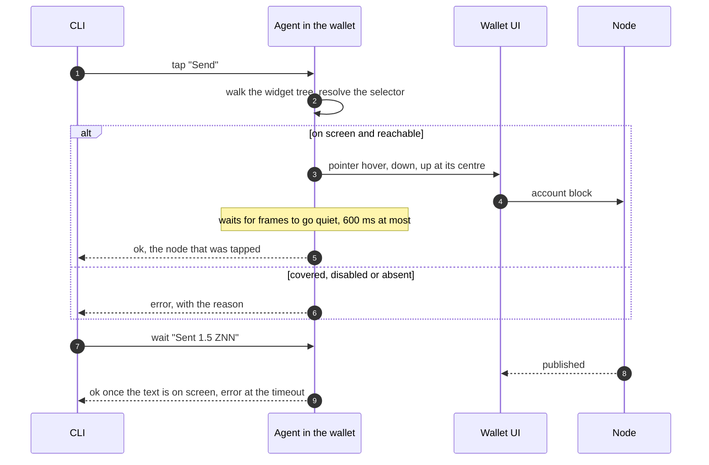

# Syrius harness

Drives the Syrius desktop wallet the way a person does: it reads what is on
screen, clicks, types, scrolls and presses keys, on the real app with its real
window. It exists so that an agent or a script can unlock the wallet, walk
every page and carry out any action, and see what a user would see when one
fails.

It is two parts. `harness/app/` is an entrypoint that starts the unchanged app
(`lib/main.dart`) with an agent beside it: a loopback HTTP server inside the
Flutter process. `harness/bin/harness.dart` is the command line that builds,
launches and talks to it. Nothing under `lib/` is changed, and the agent is
not linked into an ordinary build.



Step 3 is `GestureBinding.handlePointerEvent`, the call the engine's own mouse
events arrive through, so hit testing, hover states, the auto-lock timer and
gesture arenas behave as they do under a hand. Text goes in through
`EditableTextState.userUpdateTextEditingValue`, the path of the platform's text
input, so input formatters and `onChanged` run. A tap on something a dialog
covers is refused rather than delivered to the dialog.

## Use

All commands are `harness/h <command>` (`harness\h.cmd` from cmd or
PowerShell). Windows only for now.

```sh
harness/h build                 # flutter build windows, entrypoint harness/app/main.dart
harness/h start                 # launch in the profile .harness/default
harness/h import --mnemonic "<24 words>" --password '<password>' --node ws://127.0.0.1:45998
harness/h chain 321             # the chain identifier the wallet signs with
harness/h stop
```

Later runs find the wallet in the profile and start at the lock screen:

```sh
harness/h start
harness/h unlock '<password>'
harness/h tour                  # every page: screenshot, error widgets, errors logged
```

The loop for anything else is `tree`, act, `tree`:

```sh
harness/h goto transfer
harness/h tree
harness/h type --key send_recipient_field "" z1qq9n7fpaqd8lpcljandzmx4xtku9w4ftwyg0mq
harness/h type --key send_amount_field "" 1.5
harness/h tap Send
harness/h tap Yes
harness/h wait "Sent 1.5 ZNN" --timeout 60
```

`harness/h run <file>` runs such lines from a file and stops at the first that
fails.

## The tree

`tree` prints one line per thing a person could read or use, in reading order:

```
[25]  field    value="" hint="Recipient Address" key="send_recipient_field"  SendPopulated>EditableText @344,275
[30]  button   "Send" key="send_submit_button"  OutlinedButton @378,399
[14]  button   tab="generation" tip="Plasma generation idle" icons=["MaterialCommunityIcons:f140b"]  TabBar>InkWell @977,49
```

The number is a ref, good until the screen changes. The kinds are `text`,
`field`, `button`, `toggle`, `dropdown`, `slider` and `error` (a widget that
failed to build). Only what is on screen and in reach is listed: a page under a
dialog is left out, and so is a list row scrolled out of view, because Flutter
has not built it. `reveal <selector>` scrolls until it appears. `--json` gives
the same as data, with rectangles and the widget path.

## Selectors

| Form | Selects |
|---|---|
| `30` or `#30` | the ref from the last tree |
| `@378,399` | a point, in logical pixels |
| `Send` | text: the label, tooltip, hint, tab name or icon; an exact match wins over a prefix, a prefix over a substring |
| `--key send_submit_button` | a widget's `ValueKey` |
| `--tab settings` | a main tab by name, icon tabs included |
| `--type OutlinedButton` | a widget type, the node's own or one above it |
| `--kind field` | narrows any of the above |
| `--nth 2` | the third match, when several tie |
| `--exact` | text must equal, not contain |

`tap` prefers a button over a field over text when the words alone do not
decide. `type` looks at fields only.

## Commands

| Command | Does |
|---|---|
| `build [--mode release\|profile\|debug]` | builds, and copies the result to `.harness/app/<mode>` |
| `start [--instance <name>] [--fresh] [--port <n>]` | launches in that profile; `--fresh` deletes the profile first |
| `stop`, `status`, `state` | `state` is the route, tab, node, chain, address and lock state |
| `tree [--kind <k>] [--json]` | what is on screen |
| `tap <sel> [--double] [--right] [--long] [--force]` | a click; `--force` skips the reach check |
| `hover <sel>` | moves the mouse there, for tooltips |
| `type [<sel>] <text> [--append] [--submit]` | clicks the field and replaces its text; with no selector, the focused field |
| `key <chord>` | `enter`, `escape`, `tab`, `shift+tab`, `ctrl+a`, arrows, and the rest of the list in `agent.dart` |
| `scroll [<sel>] <dy>` | a wheel scroll at the selector, or at the centre |
| `drag <sel> <dx,dy>` | press, move, release |
| `drop <sel> <file>` | a file dragged in from the desktop and released there |
| `wait <sel> [--gone] [--timeout <s>]` | until it is on screen, or gone |
| `reveal <sel>` | scrolls down until it is on screen |
| `shot [--out <file>]` | a PNG of the window's contents |
| `logs [--levels SEVERE,WARNING] [--since <seq>]` | the app's log records and Flutter errors |
| `stalls [--reset] [--min <ms>] [--brief]` | each time the UI isolate ran nothing for over 24 ms (`loop`) and each frame whose build or raster took over 16 ms, and the longest; `--reset` empties the list after printing, `--brief` prints one line |
| `clipboard [<text>]` | reads or sets the clipboard |
| `window [show\|minimize\|maximize\|restore] [--width <w> --height <h>]` | the OS window |
| `goto <tab>`, `lock`, `unlock <password>` | the main tabs and the lock screen |
| `import`, `node <ws url>`, `chain <id>` | onboarding, node selection, client chain identifier |
| `tour [--dir <dir>]` | every page in turn |
| `run <file>` | a script of the above |

Any command takes `--tree` to print the tree after it, and `--instance`.

## Profiles

The SDK keeps wallets in `%AppData%\znn`, where this machine's real wallets
are. `start` therefore launches the wallet with `APPDATA`, `LOCALAPPDATA`,
`TEMP`, `HOME` and `USERPROFILE` pointed into `.harness/<instance>/`, and the
harness binary refuses to start (exit code 64) when they are not: run by hand,
it would open the real wallets with a remote control attached. For the same
reason the agent listens on 127.0.0.1 only and wants the token `start` wrote to
`.harness/<instance>/instance.json`.

`app.main()` registers the running executable as the handler of `syrius://`
links. The harness entrypoint puts the previous handler back once the app is
up.

## Limits

- One wallet per desktop. The Windows runner looks for a window titled
  `s y r i u s` and exits if there is one, so `start` refuses while any
  `syrius.exe` runs, and two instances cannot run side by side. `--instance`
  chooses the profile, not a second window.
- Native dialogs are out of reach: the file pickers behind "Click to browse",
  export and "Save QR" belong to the OS, not to Flutter. A dropped file is in
  reach through `drop`, which starts where the drop plugin hands over to Dart.
- A hardware wallet needs the device.
- The clipboard is the machine's: a copy button in the wallet replaces
  whatever was on it.
- A minimised window draws no frames. Commands still run, each waiting out a
  250 ms frame timeout; `window show` first.
- A wrong `unlock` costs one of the wallet's attempts, and the wallet erases
  itself at zero. It is the harness profile's wallet that goes.
- An icon without a tooltip is listed by font and code point
  (`MaterialIcons:e402`).
- `build` leaves the harness binary in `build/windows/x64/runner/` under the
  name `syrius.exe` until the next ordinary build. It will not start outside a
  profile, but do not package it.

## A devnet to send on

`tools/devnet/lab` is a go-zenon devnet on `ws://127.0.0.1:45998`, chain 321
(`tools/devnet/lab/lab.sh up`; its README has the mnemonic). The devnet mnemonic's index 1 is funded:
import it, `chain 321`, add a second address in Settings and select it. Do not
activate a spork there as a test.
