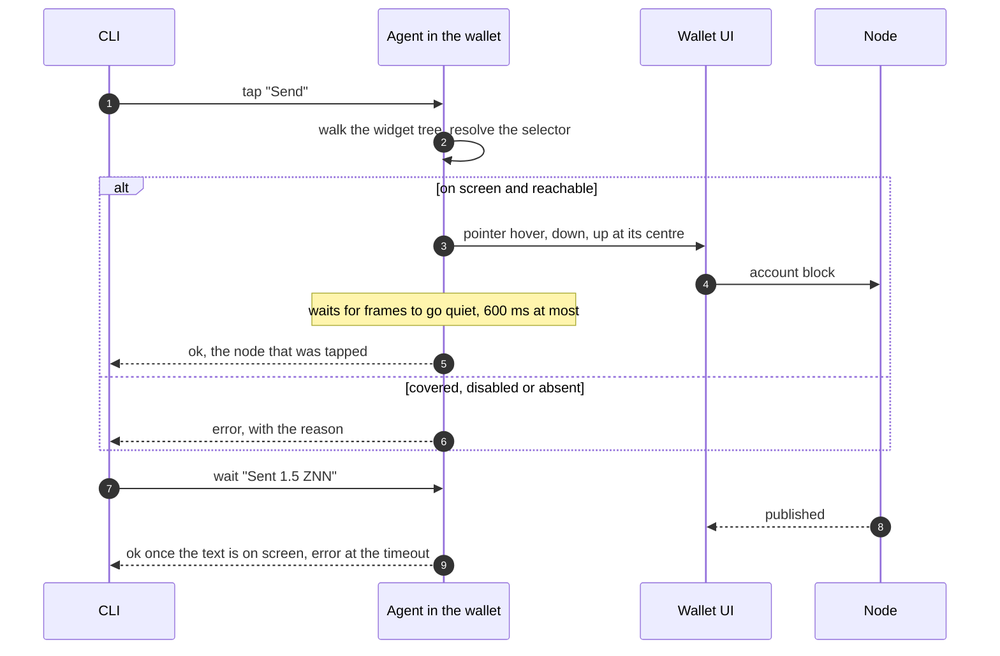

# Syrius harness

Drives the Syrius desktop wallet the way a person does: it reads what is on
screen, clicks, types, scrolls and presses keys, on the real app with its real
window. It exists so that an agent or a script can unlock the wallet, walk
every page and carry out any action, and see what a user would see when one
fails.

It is two parts. The default `harness/app/` entrypoint starts the app
(`lib/main.dart`) with an agent beside it: a loopback HTTP server inside the
Flutter process. `harness/bin/harness.dart` is the command line that builds,
launches and talks to it. An explicit read-only presentation mode instead starts
an independent view before any production wallet owner. The agent is not linked
into an ordinary build.



Step 3 is `GestureBinding.handlePointerEvent`, the call the engine's own mouse
events arrive through, so hit testing, hover states, the auto-lock timer and
gesture arenas behave as they do under a hand. Text goes in through
`EditableTextState.userUpdateTextEditingValue`, the path of the platform's text
input, so input formatters and `onChanged` run. A tap on something a dialog
covers is refused rather than delivered to the dialog.

## Use

All commands are `harness/h <command>` (`harness\h.cmd` from cmd or
PowerShell). Windows only for now.

```sh
harness/h build                 # flutter build windows, entrypoint harness/app/main.dart
harness/h start                 # launch in the profile .harness/default
harness/h import --mnemonic "<24 words>" --password '<password>' --node ws://127.0.0.1:45998 --chain 321
harness/h chain 321             # the chain identifier the wallet signs with
harness/h lab-address           # derive once if needed; select and verify index 1
harness/h stop
```

Import requires an explicit positive `--chain` before entering any private
input. It uses the current keyed importer, accepts one genuine node mismatch
only when its original node and signing facts match that requested chain,
opens the original Ready once, then saves the signing policy through Settings.
Success requires both the SDK signing identifier and its saved effective policy,
plus the original connected and saved node. `state.chainId` is the node's chain;
`state.signingChainId` is the SDK's signing policy. An absent stored signing
preference is reported only as the application's known default when its
original preferences box is already open.

The import, node and signing-policy recipes use a three-minute total budget,
ten-second command limits and finite scroll and observation counts. Ambiguous
or replaced controls, unknown policy, mismatched questions, transport errors
and late acknowledgements stop the recipe without another action. A standalone
`node` command never accepts a chain mismatch. Refusal retains any wallet or
transition already created; it does not reset the profile. Recipe replies and
diagnostics omit private field contents. Native import and signing acceptance
still require execution against the intended isolated profile and node.

`lab-address` requires the exact connected and saved loopback lab endpoint,
node/signing chain 321 and a consistent original wallet selection. It opens
Settings and Addresses through the normal controls, derives one missing member
through Add address, and selects index 1 through its actual choice button.
The original member order, Boxes, transports, wallet and context generations
are retained. Success independently requires the original notifier and saved
preference to agree. Unknown writes retire the driver; no derivation or
selection is retried. Its finite receipt omits member strings and paths.
This prepares P09; it submits no account block and proves no send or seed state.

Later runs find the wallet in the profile and start at the lock screen:

```sh
harness/h start
harness/h unlock '<password>'
harness/h tour                  # every page: screenshot, error widgets, errors logged
```

The loop for anything else is `tree`, act, `tree`:

```sh
harness/h goto transfer
harness/h tree
harness/h type --key send_recipient_field "" z1qq9n7fpaqd8lpcljandzmx4xtku9w4ftwyg0mq
harness/h type --key send_amount_field "" 1.5
harness/h tap Send
harness/h tap Yes
harness/h wait "Sent 1.5 ZNN" --timeout 60
```

`harness/h run <file>` runs such lines from a file and stops at the first that
fails.

## Read-only presentation

The same harness binary has a separate component preview mode. It is selected
before `app.main`, so it does not open a wallet, preferences, a node, WalletConnect,
an embedded process or a signing owner. Its theme is memory-only. A visible
fixture banner remains on screen, all component input is disabled and every
callback refuses. Quiz words are visibly synthetic and do not form wallet
material. This mode does not establish an original initialization, restoration,
chain effect, renderer frame pin or visual match.

After native provisioning and a harness build, use an unused explicit instance:

```text
harness/h start --instance presentation-01 --presentation welcome
harness/h presentation import --instance presentation-01
harness/h theme light --instance presentation-01
harness/h state --instance presentation-01
harness/h stop --instance presentation-01
```

Supported components are `welcome`, `import`, `seed-quiz`, `lock-screen`,
`lock-wrong` and `wallet-picker`. The last is a picker component, rather than
the complete `lock-pick` screen. Ready, cold launch, transition frames and
full-shell fixtures retain their original prerequisites. Existing profiles and
`--fresh` are refused for presentation; inherited presentation flags are removed
from ordinary launches. A running instance must report the exact requested host
mode and component before reuse.

Only anonymous state, theme, window, tree, assertion, wait, logs, stalls,
component selection and quit commands are admitted. Input, clipboard, seed,
publication and both `shot` and `screens` refuse. No presentation output can be
written as a numbered wallet capture or a match. Theme responses require the
attached theme after frame settlement; observed source loss permanently retires
the host. The first attached host Element stays the owner, so an unseen remount
under the same key and controller also refuses. Presentation assertions inspect
only that owner's visible content through its unchanged read-only input barrier;
covered or hidden targets refuse and no assertion qualifies capture evidence.

Quit acknowledges one queued close attempt. After its original delay, admission
rechecks the captured host and scene before invoking native close once. Its exact
Future and terminal error stay retained; subsequent requests inspect that same
attempt and do not retry it. State exposes the anonymous close phase, without
raw errors. A completed close Future does not establish process exit.

Source and finite offline coverage are separate from native execution,
which is recorded in [the environment record](../docs/environment.md).

`capture_protocol.dart` separately retains an immutable plan, original operation
Futures, actual frame observations and positive restoration receipts. Its default
native adapter is unavailable. Source loss or uncertain restoration holds that
original scope permanently; recreating a protocol is not a recovery procedure.
Injected contract tests and presentation commands do not enable the pending
entry or full-shell capture recipes.

## The tree

`tree` prints one line per thing a person could read or use, in reading order:

```
[25]  field    value="" hint="Recipient Address" key="send_recipient_field"  SendPopulated>EditableText @344,275
[30]  button   "Send" key="send_submit_button"  OutlinedButton @378,399
[14]  button   tab="generation" tip="Plasma generation idle" icons=["MaterialCommunityIcons:f140b"]  TabBar>InkWell @977,49
```

The number is a ref, good until the screen changes. The kinds are `text`,
`field`, `button`, `toggle`, `dropdown`, `slider` and `error` (a widget that
failed to build). Only what is on screen and in reach is listed: a page under a
dialog is left out, and so is a list row scrolled out of view, because Flutter
has not built it. `reveal <selector>` scrolls until it appears. `--json` gives
the same as data, with rectangles and the widget path.

## Selectors

| Form | Selects |
|---|---|
| `30` or `#30` | the ref from the last tree |
| `@378,399` | a point, in logical pixels |
| `Send` | text: the label, tooltip, hint, tab name or icon; an exact match wins over a prefix, a prefix over a substring |
| `--key send_submit_button` | a widget's `ValueKey` |
| `--tab settings` | a main tab by name, icon tabs included |
| `--type OutlinedButton` | a widget type, the node's own or one above it |
| `--kind field` | narrows any of the above |
| `--nth 2` | the third match, when several tie |
| `--exact` | text must equal, not contain |

`tap` prefers a button over a field over text when the words alone do not
decide. `type` looks at fields only.

## Commands

| Command | Does |
|---|---|
| `build [--mode release\|profile\|debug]` | builds, and copies the result to `.harness/app/<mode>` |
| `start [--instance <name>] [--fresh] [--port <n>]` | launches in that profile; `--fresh` deletes the profile first |
| `start --instance <unused-name> --presentation <surface>` | starts a separate read-only component host before wallet startup; existing profiles and `--fresh` refuse |
| `presentation <surface>` | changes only an existing presentation host's component; ordinary wallet hosts refuse |
| `stop`, `status`, `state` | `state` is the route, tab, node, chain, address and lock state |
| `tree [--kind <k>] [--json]` | what is on screen |
| `tap <sel> [--double] [--right] [--long] [--force]` | a click; `--force` skips the reach check |
| `hover <sel>` | moves the mouse there, for tooltips |
| `type [<sel>] <text> [--append] [--submit]` | clicks the field and replaces its text; with no selector, the focused field |
| `key <chord>` | `enter`, `escape`, `tab`, `shift+tab`, `ctrl+a`, arrows, and the rest of the list in `agent.dart` |
| `scroll [<sel>] <dy>` | a wheel scroll at the selector, or at the centre |
| `drag <sel> <dx,dy>` | press, move, release |
| `drop <sel> <file>` | a file dragged in from the desktop and released there |
| `wait <sel> [--gone] [--timeout <s>]` | until it is on screen, or gone |
| `assert <sel>` | immediately verifies an exact, reachable selector and refuses any visible error widget |
| `reveal <sel>` | scrolls down until it is on screen |
| `shot [--out <file>]` | the Flutter client as a PNG at one output pixel per logical pixel |
| `theme dark\|light` | changes the existing app theme notifier and saved Display preference, then verifies the rendered brightness |
| `logs [--levels SEVERE,WARNING] [--since <seq>]` | the app's log records and Flutter errors |
| `stalls [--reset] [--min <ms>] [--brief]` | each time the UI isolate ran nothing for over 24 ms (`loop`) and each frame whose build or raster took over 16 ms, and the longest; `--reset` empties the list after printing, `--brief` prints one line |
| `clipboard [<text>]` | reads or sets the clipboard |
| `window [show\|minimize\|maximize\|restore] [--width <w> --height <h>]` | sizes the Flutter client in logical pixels; reports requested and observed client dimensions, physical pixels, DPR and outer window geometry |
| `goto <tab>`, `lock`, `unlock <password>` | the main tabs and the lock screen |
| `import`, `node <ws url>`, `chain <id>` | onboarding, node selection, client chain identifier |
| `lab-address` | original UI derivation and persisted index-1 selection on the isolated chain-321 lab |
| `seed <id>`, `seed fixture <kind>` | guarded isolated lab recipes and read-only fixtures; see [seed preparation](seed/README.md) for required profile, origins and checkpoint evidence |
| `lab-send --ws ws://127.0.0.1:45998 --http http://127.0.0.1:45997` | one fixed original index-1 to owned index-0 UI send in an explicit isolated profile; no custom amount, recipient or retry |
| `tour [--dir <dir>]` | every page in turn |
| `screens <id>\|all [--dir .harness/<fresh-directory>]` | runs each catalog screen script in dark and light, verifies state and 1280 by 780 client dimensions, then saves actual app captures |
| `run <file>` | a script of the above |

UI commands take `--tree` to print the tree after them. Commands can select
their isolated profile with `--instance`.

Unlock first makes a read-only `wait` request with `ready: true` and a
five-second timeout for the existing password field. This requires one
enabled, reachable field; ordinary presence waits retain their meaning.
The driver then makes one original write and one submit, retaining both
input guards and the twenty-second post-submit wait. A readiness refusal
exports only `UNLOCK_FIELD_READY_REFUSED`; it does not retry a password or
profile, format private replies or diagnose an older refusal.

## Redesign captures

F04 supplies the capture source and adapter tests. Native Windows P08 execution
remains pending. No capture, visual match or native window behavior is
established by those tests. Page owners supply the scripts; the runner does
not create missing pages, seed data or substitute mockup images.

`harness/bin/screen_capture.dart` catalogs the 47 mockup IDs in their numbered
order. `screens <id>` reads `harness/screens/<id>.txt`; `screens all` preflights
all 47 scripts before changing the app. Both themes run the script separately,
starting from unlocked Home with the rail collapsed. A missing script, unmet prerequisite, locked
profile or unreachable Home stops the run. Launch, lock and onboarding shots
still need explicit reversible preparation from F06 and the entry tasks.
The runner does not guess passwords, restart the wallet or inject fixtures.

A page script uses UI commands and ends with a stable positive assertion:

```text
# prerequisite: unlocked-home
goto transfer
tap Receive
assert --key receive_screen_marker
```

The key in this example is a placeholder for the page owner's actual marker.
`assert` accepts the text, key, type, kind, tab and nth selectors; text is exact.
Refs, coordinates, `--gone` and `--force` cannot establish a capture state.
The screenshot command repeats the final assertion at capture and after PNG
encoding. A visible error widget, covered marker, changed theme or changed
view metrics refuses that frame.

Available script commands are `goto`, `tap`, `hover`, `type`, `key`, `scroll`,
`drag`, `wait`, `reveal`, `lock` and `assert`. Lifecycle, nested scripts, drops,
theme, window, screenshot and instance overrides are refused. To retain an
entry script without claiming readiness, declare its prerequisite:

```text
# prerequisite: pending F06/N01 reversible launch preparation
assert --key launch_screen_marker
```

Any prerequisite other than `unlocked-home` is a preflight refusal. Comments
and blank lines are allowed; quotes group words, with no shell expansion.

For sizing, the agent measures the Flutter View's physical size divided by
its device pixel ratio. Native `setSize` can include borders and a title bar,
so the agent corrects its request by the observed client delta, up to five
times. It returns both requested and observed geometry and fails if they do
not agree. The root render layer already contains the physical DPI transform;
capture cancels it to produce a complete 1280 by 780 image at logical scale 1.
Both agent metadata and PNG header dimensions must agree before saving.

The default output is `.harness/shots/NN-id-theme.png`, where `NN` comes from
the catalog. Existing targets and links are refused. For another run, choose
a new directory beneath `.harness/` and point the comparison tool at it:

```sh
harness/h screens all --dir .harness/capture-02
python tool/redesign_compare.py --actual-dir .harness/capture-02
```

An explicit `--dir` must not exist. Absolute paths, traversal, links and
Windows device aliases are refused. Captures use exclusive file creation;
the directory must remain under this run's sole ownership because Dart's
subsequent path-based write does not protect against concurrent hostile path
replacement. Interrupted or failed output stays in place for inspection.
There is no cleanup or overwrite command.

On success or failure, the runner attempts to restore the original theme
mode, preference, original rail expansion, outer window position and size,
and minimized/maximized
mode. An unset theme preference retains its default meaning. Restoration
failures are reported alongside the original failure, and earlier captures
are retained. It does not restore page state or unlock a profile a script
locked. Authentication, the isolated profile and the single owned process
remain required for every command.

## Profiles

The SDK keeps wallets in `%AppData%\znn`, where this machine's real wallets
are. `start` therefore launches the wallet with `APPDATA`, `LOCALAPPDATA`,
`TEMP`, `HOME` and `USERPROFILE` pointed into `.harness/<instance>/`, and the
harness binary refuses to start (exit code 64) when they are not: run by hand,
it would open the real wallets with a remote control attached. For the same
reason the agent listens on 127.0.0.1 only and wants the token `start` wrote to
`.harness/<instance>/instance.json`.

`app.main()` registers the running executable as the handler of `syrius://`
links. The harness entrypoint puts the previous handler back once the app is
up.

## Limits

- One wallet per desktop. The Windows runner looks for a window titled
  `s y r i u s` and exits if there is one, so `start` refuses while any
  `syrius.exe` runs, and two instances cannot run side by side. `--instance`
  chooses the profile, not a second window.
- Native dialogs are out of reach: the file pickers behind "Click to browse",
  export and "Save QR" belong to the OS, not to Flutter. A dropped file is in
  reach through `drop`, which starts where the drop plugin hands over to Dart.
- A hardware wallet needs the device.
- The clipboard is the machine's: a copy button in the wallet replaces
  whatever was on it.
- A minimised window draws no frames. Commands still run, each waiting out a
  250 ms frame timeout; `window show` first.
- A wrong `unlock` costs one of the wallet's attempts, and the wallet erases
  itself at zero. It is the harness profile's wallet that goes.
- An icon without a tooltip is listed by font and code point
  (`MaterialIcons:e402`).
- The pinned Flutter still routes focused shortcuts through its deprecated
  key-message bridge. The harness retains that bridge alongside hardware key
  state updates; removing it would lose shortcuts, traversal and text editing.
- `build` leaves the harness binary in `build/windows/x64/runner/` under the
  name `syrius.exe` until the next ordinary build. It will not start outside a
  profile, but do not package it.

## A devnet to send on

`tools/devnet/lab` is a go-zenon devnet on `ws://127.0.0.1:45998`, chain 321
(`tools/devnet/lab/lab.sh up`; its README has the mnemonic). The devnet mnemonic's index 1 is funded:
import it, `chain 321`, then `lab-address` to add and select the second address
through Settings. A confirmed UI send remains a separate prerequisite. Do not
activate a spork there as a test.

## Focused hosted harness checks

The manual Public Contribution Qualification workflow has a default-off
`harness_tests_only` input. Select it with the other execution lanes disabled
to run the isolated controller suite, locked dependency restoration, selected
analysis and the exact source-bound harness gate on a fresh Windows runner. It uses one
pinned Flutter SDK and does not build a native wallet or allocate lab nodes.
Before SDK allocation, it also observes the unchanged original in-memory asset
byte controls through a bounded command wrapper. Only runtime version, actual
exit/completeness, output digests and fixed failure labels are public; raw
output remains private. Missing tools or failed controls stop before the SDK.

Startup observation can include `opening`, `first-frame-pending`,
`frame-visible`, `last-frame`, `ended`, `frames-suspended` or `ticker-muted`.
These labels read the current registered original film and controller; held,
closed or unmounted owners expose none. `ended` records the controller's
existing completion bit, including its existing error path. It does not prove
wallet initialization. A refusal retains only the latest valid label; asset
names, frame payloads, exception text and private input are never projected.

### Fixed P09 send qualification

`lab-send` requires an explicitly selected isolated instance with the public
chain-321 lab fixture unlocked, actual index 1 selected and exact original
loopback transports. The default profile is refused. The authenticated serial
command uses normal Transfer inputs and the actual one-ZNN confirmation,
retaining the original form sender, worker lease, review request and Accept
Element/center. It checks the same admission at pointer down/up and observes
only that original request and its exact positive chain confirmation.

Unknown original outcomes remain held across restart and also block F06. No
retry or custom transfer terms are accepted. The ordinary app has no harness
command. This command does not create an F06 checkpoint or qualify visuals.
Its source and new UI regressions need hosted qualification before native
original-send acceptance can be claimed.

Original-send failures expose only validated source-defined phase/reason
labels. Native CI rejects unknown or extra diagnostic fields and never emits
raw HTTP/SDK errors, paths, addresses or hashes. A failure diagnostic is not a
send receipt or original actor-closure proof. Earlier null-code failures keep
their original unknown scope.


## Native inspection startup

The harness entrypoint recognizes `SYRIUS_CI_READONLY_INSPECTION=true` only
on Windows GitHub Actions with presentation absent. Other supplied values
refuse before native startup. The original agent reserves before `app.main`
and reports only pending `ping` until the initialized process/registered SDK
and original preference service/open Hive box have been sealed and attached.
Publication admission pauses before the original automatic-receive preference
write. Each later command checks the retained SDK scope before and after its
original handler. Financial commands are unavailable in this mode.

The receipt covers `readonly_native_sdk_admission`. Inspection can change
local UI preferences inside its owned profile; the receipt does not prove
wallet, client, socket, image or chain acceptance. Those owners need separate
checks after wallet opening. Ordinary `harness/h start` strips inherited
inspection flags and refuses to reuse an inspection host as an ordinary
wallet. The mode is not an ordinary launcher option. A separately admitted
fresh CI controller and actual native qualification remain pending; the
original mandatory-send tour, seed recipes and F06 are unchanged.


### Retained native-agent request analysis failure (2026-10-30T21:20Z)

Source225 8e029cfe3437 / [41129467499](https://github.com/edgepillar/syrius/actions/runs/41129467499) passes 868 Python controls with three existing skips and both assets/fourteen phases. Its complete original analysis exits three with 29 errors, one info, zero warnings and no overflow; Dart is skipped. The first sixteen finite locations repeat INVALID_IMPLEMENTATION_OVERRIDE at request-fixture line 74. The unexported info location remains NOT_ESTABLISHED.

Source226 uses the [HttpRequest Stream<Uint8List> contract](https://api.dart.dev/dart-io/HttpRequest-class.html) for the same owned UTF-8/JSON request and authenticated original handler. Every Dart case/assertion and exact 588/590 selection remains. Analyzer location samples are deduplicated under the same sixteen-location cap; all diagnostic occurrences still count and the zero-findings gate is retained. A new controller regression covers repeated errors, a later info and the finite cap. Fresh 869-Python/404-memory and hosted engine/analysis qualification are required. Actual native startup, separate controller admission and wallet/client/socket/UI acceptance remain pending. Original failures and financial UNKNOWNs are preserved; Native104 is not admitted.


### Equivalent native-agent fixture cascade (2026-10-30T21:29Z)

Source226 f0d7b1f4650f / [41130761869](https://github.com/edgepillar/syrius/actions/runs/41130761869) passes 869 Python/three existing skips and both assets/fourteen phases. All 29 request-stream type errors are resolved. Complete analysis exits zero with zero errors/warnings and one CASCADE_INVOCATIONS info at fixture line 199; the strict gate fails and Dart is skipped. Source225 original 29-error/one-info failure and unexported original info remain preserved.

Source227 expresses only the same presentation-fixture construction and immediate usePresentation call as one cascade. All arguments, ordering, existing assertions, Uint8List body bytes, runtime source, analysis/sample bounds and exact 869-Python/588/590-Dart registrations remain. Fresh 404-case memory controls and hosted analysis/engine qualification are required. Actual native controller and wallet/client/socket/UI acceptance remain pending; old financial UNKNOWNs and every broader acceptance gate remain.
